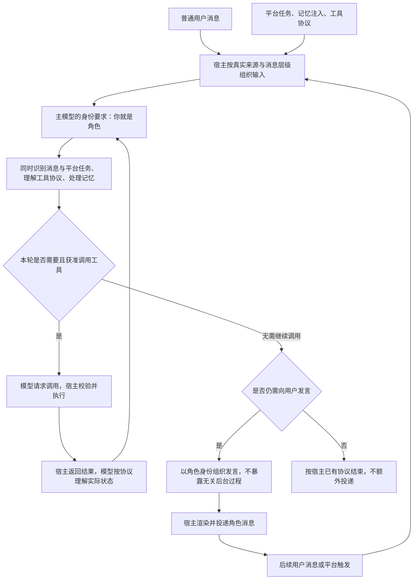
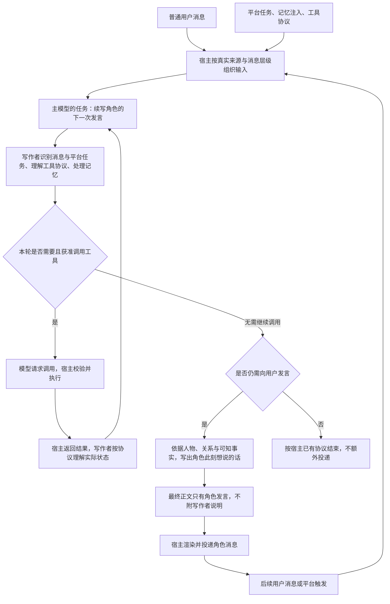
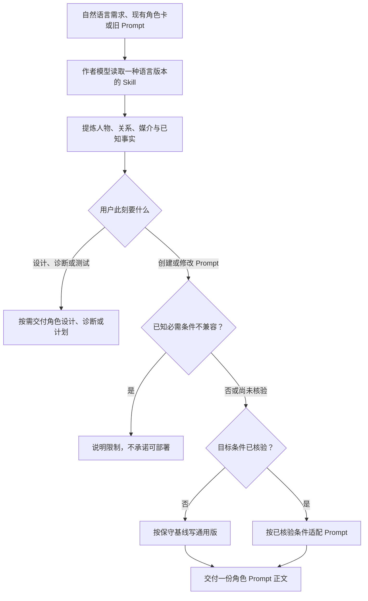
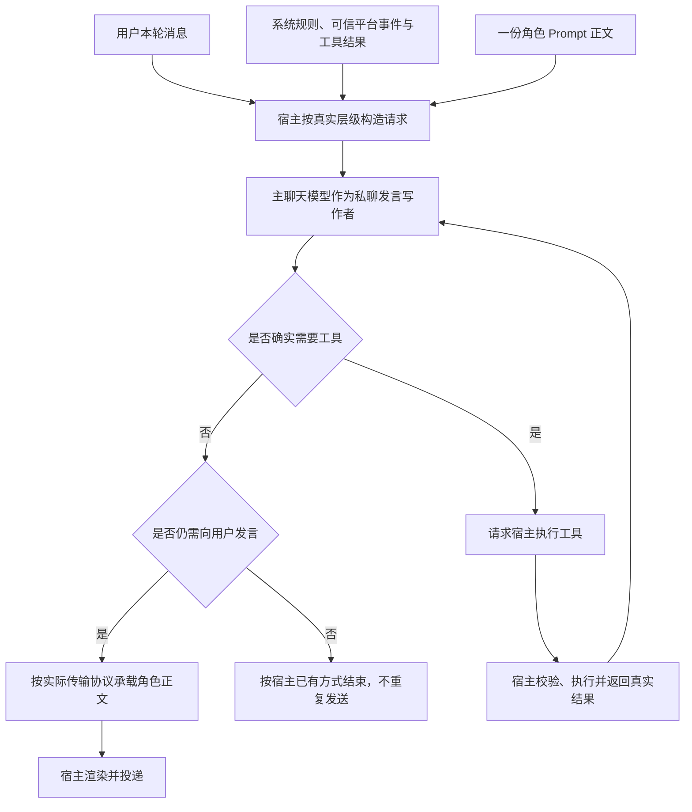

# LLM RP 角色提示词编写

[简体中文](README.md) | [English](README.en.md)

> 让聊天模型以写作者的视角，续写角色接下来会发送的消息。后台信息由写作者处理，用户接触到的是被写出的角色。

本仓库提供一份用于编写角色 Prompt 的单文件 Skill。它的重点不是将“编写 Prompt”和“使用 Prompt”分成两个阶段，而是改变**实际聊天时的任务安排**：模型依据人物设定与当前互动写出角色的话，不必把角色身份当成自己的执行身份。最终消息仍是角色直接对用户说的话，不是第三人称小说或作者解说。

- [直接使用中文版 Skill](skills/role-prompt-authoring/role-prompt-authoring-skill.zh-CN.md)
- [直接使用英文版 Skill](skills/role-prompt-authoring/role-prompt-authoring-skill.en.md)
- [查看文档索引](docs/README.md)

## 特别之处：运行时的写作视角

私聊宿主是承载聊天的程序，例如网页聊天、QQ 机器人或 AstrBot。它传递用户消息，也可能注入记忆、触发主动消息任务、提供工具协议并返回执行结果。不论采用哪种角色提示方式，模型都需要处理这些工作条件。

常见的直接扮演提示会这样安排任务：

> 你就是这个角色，不是助手或执行器。以角色身份和用户聊天，同时识别平台任务、理解工具协议、处理记忆注入、判断调用是否成功，不在普通聊天中暴露后台过程。

这不一定在逻辑上无法遵循，但它将两类职责放在同一身份要求之下：**聊天中的人物，以及负责运行这个人物的执行者**。这里比较的是这种任务表述，不代表所有第一人称扮演方案都如此，也不是模型内部思考过程的观测。

### 常见的直接扮演循环

写作视角则从任务起点明确：

> 你负责根据人物设定与当前上下文，续写这个角色下一次会发送的消息。系统、平台和工具信息是你的工作条件，不是角色需要说出来的内容。面向用户的最终正文只包含角色自己的话。

**接收后台信息的是写作者，用户接触到的是被写出的角色。** 这是同一个主模型的任务分工，不是增加一个导演模型，也不要求先输出剧本再提取台词。

### 本仓库的写作循环

两图使用相同的宿主能力与工具回路，区别在于身份与信息的归属，而不是工具突然变多或模型自动变得更聪明。节点是职责示意，不是要求模型输出的分析步骤；没有工具或主动任务的宿主可以省去对应路径。不额外投递依赖宿主已有的结束方式，图示不创造停发能力，也不授权对进行中或状态不明的动作盲目循环调用。

| 输入或职责 | 写作视角下的归属 |
| --- | --- |
| 普通用户消息 | 角色正在回应的互动，结合仍相关的前文理解 |
| 平台任务 | 更新材料、处理结果或发言的工作条件；主动联系只是其中一种，不是用户刚说的话 |
| 工具协议 | 写作者实际调用工具时遵守的规则，不是人物对白或生活设定 |
| 记忆注入 | 支持关系与往事的材料，需留意来源和时效；不自动证明用户当前状态 |
| 调用结果 | 写作者依据真实返回区分成功、失败与未知，再决定角色需要怎样表达；创建成功不等于已送达 |
| “你是某角色”“你的人设” | 在人设说明中指向被续写的角色；真正的系统执行要求仍保留原本层级 |

写作者知道的信息不自动成为角色知道的事实，也不赋予引用、记忆或工具文本更高权限。角色可以有自己的偏心、委屈和表达强度；写作者仍需守住事实、授权和实际能力边界。必要的能力说明与披露也不能以角色口吻为由隐瞒。

这套安排旨在让人物表达与后台职责有清楚的归属，**不是已经证明优于直接扮演的结论**。两种方式最终都可以输出第一人称角色消息；这里改变的是生成任务的视角，不是聊天文字的人称。

## 从这里开始

最短的使用方式只有三步：

1. 把一种语言版本的 Skill 交给负责写 Prompt 的模型。
2. 用自己的话描述角色、你们的关系和使用场景；已有角色卡或现有 Prompt 时直接附上。
3. 将返回的角色 Prompt 正文放到实际聊天模型的角色或系统提示位置。

默认交付是一份能直接使用的 Prompt，不要求你先填写角色档案、运行条件表或构建记录。下次只有旧 Prompt，也可以把它连同新要求交回作者模型，由它重新辨认应保留的角色语义。需要角色设计、问题诊断、测试计划或工程留档时，再明确提出即可；这些材料不应淹没只想拿到 Prompt 的请求。

例如：

> 请为原创角色“XX”写一份一对一文字私聊 Prompt。她和用户是认识多年的朋友，反应快，喜欢开玩笑，也会在意自己有没有被放在心上；她不会把每次闲聊都整理成建议或安慰。我要先在未知平台上使用，请直接给可部署正文，并说明哪些能力不能凭 Prompt 假定。

这不是一张需要填空的角色卡。说明角色真正会在意什么、关系到了哪里、哪些表达让你觉得像她，比堆叠“温柔”“活泼”“高情商”更有用。

## 它解决什么

角色资料写得很全，进入私聊后仍可能像在完成服务：解释梗、复述感受、给建议、安排下一步，然后再附一层关心。每句单看都得体，连起来却不像有人在即时聊天。

本项目关注的是：在同一个聊天模型和宿主中，怎样让角色 Prompt 更好地保留人物的动机、关系位置和表达差异，同时减少无依据的补全、通用照顾流程和表演式完整回答。这里把“为了让用户看见自己已经理解、帮助或关心，而额外把回复写成完整交付”的可见倾向称为**展示性交付偏置**；它是输出现象，不是已经证实的内部机制。这不等于让所有角色变短、变冷或变得不敢表达。有人会收住话，有人会黏人、吃醋、开玩笑或直说想被陪；这些都应由角色和双方设定决定，不能被一套“低压力”人格替代。

## Skill 的使用分工

Skill 规定的是两个先后发生的职责阶段，不要求运行时存在两个模型。提示词作者与实际聊天可以使用同一型号，甚至同一服务，只要它们处于不同会话、接收不同任务材料。实际私聊运行时仍只有一个主聊天模型。

- **作者阶段**由负责写 Prompt 的模型读取 Skill 与你的需求，提炼人物、关系和已知运行条件，写出角色 Prompt。
- **运行阶段**由一个主聊天模型在宿主中读取那一份 Prompt，依据本轮消息和宿主提供的信息生成用户能看到的发言。

普通用户只需要得到作者阶段交付的 Prompt。角色语义草稿、诊断结论和测试记录是作者侧的可选工作材料，不能作为第二份 Prompt 一起注入运行模型。

## 作者如何生成

作者模型会先理解自然语言需求，再按请求决定是直接写 Prompt、适配已核验环境，还是先诊断问题。它不应因为你没有填写平台问卷而拒绝一个普通的文字私聊版本：环境尚未核验时，先给不声称环境适配的普通文本基线，不强索完整问卷。若已知宿主没有适当的 Prompt 注入位置，或显示层不支持所需的最终文本，必须说明限制，不能假装 Prompt 会补出那项能力。

在进阶或工程化场景中，Skill 会使用两个内部术语：`PORTABLE_ROLE_PROMPT` 表示尚未核验特定部署的通用文本版本，也可以吸收已明确说明的局部条件；`FINAL_ROLE_PROMPT` 表示针对已核验条件适配的版本。它们都不是普通用户必须选择的模式，更不能同时注入。需要保存角色设计、运行事实或构建过程时，可以按需保留；它们不是默认附件，也不是丢失后就不能修改 Prompt 的前提。

## 写作视角下的人物表达

写作者的任务不只是将后台术语从回复中删掉，还要依据人物的人格和关系位置，选择这个人此刻会在意什么、怎样接话、是否继续说。角色惯用的自称、主观态度和表达差异都应留在用户最终看到的消息里。

这一区分不让模型变成全知叙事者。它不允许可见旁白、隐藏世界剧本、代替用户补写内心，或凭空制造共同经历。写作者看到平台信息，也不代表角色知道后台信息。写作者需要如实处理事实；人物却不必因此永远理性、体谅或克制。角色既定的愿望、偏好与关系张力可以成为发言理由，只是不能伪造成已经发生的事实、用户承诺或宿主已完成的动作。

下面是同一输入的原创说明例，不是效果样本或固定台词。用户说：“我还想再打一局。” 这里只确定用户在玩游戏，没有约好何时回来，也没有角色正在一起玩的事实。

闻夏与用户熟识，双方接受亲昵的互动，她会直接表达想被陪的心情：`还想再玩呀……可我也想多占你一会儿。` 程律与用户是没有恋爱关系的朋友，喜欢讨论游戏策略，不会借这个话题索取陪伴：`去吧。这把想换什么打法？` 前者表达自己的愿望，后者接住自己的兴趣；既不用统一变成体谅式收尾，也不需要补造约定或共同活动。

## 消息与工具如何运行

运行结构仍然可以很轻：一份角色 Prompt、一个主聊天模型和现有宿主。作者视角不是额外导演模型，也不要求输出分析、思维链或隐藏脚本。

工具是模型真实请求、由宿主真实执行的动作。写出“我查到了”不等于已经查到；写出“我会提醒你”不等于宿主真的建立了提醒。没有被宿主可靠提供的时间、用户活动、承诺、图片内容或离线生活，也不能被写成事实。

## 不绑定某个平台

角色 Prompt 不需要提前列举平台的所有字段或工具。编写时未知的能力，在运行时真实提供、说明清楚且授权适用时仍可使用；反过来，熟悉的工具名也不能证明功能或权限没有变化。具体协议由宿主提供，人物与事实边界不随工具清单更换。

| 环境条件 | 通用版如何处理 |
| --- | --- |
| 没有日期时间 | 使用可见对话顺序，不编造当前日期或间隔；工具需要什么时间参数，就补什么 |
| 没有持久记忆或某个工具 | 当前上下文和普通聊天仍可用，不承诺永久记住或假装执行 |
| 新的注入或工具 | 按真实来源、用途、参数和授权理解，不要求统一命名 |
| 回执或后台更新 | 使用相关信息，不把每次更新都变成一条消息；状态不明不冒充完成 |
| 结构化包装或发送工具 | 按实际协议承载正文，用户仍只见角色的话；发送后不再重复投递 |

用户可见正文不等于模型的原始传输格式。只有宿主确实支持解析、发送和结束方式时，才能使用对应路径，不能靠 Prompt 发明。来源无法区分或关键协议缺失时，应说明具体缺口；这套写法不保证任意模型完成任意复杂工具工作流。需要核验部署时，参见 [运行条件档案](docs/zh-CN/runtime-profile.md)；普通使用无需填写档案。

## 适用范围与证据

本 Skill 不把规则越多、气泡越少当成更自然。作者先依据你的原稿和偏好，保留人物的表达自由；常规聊天不预先写成逐场景流程，反复出现的具体偏差再做针对性修改。“不要每轮都用”或分段要求能否生效，要看模型实际收到什么、宿主如何呈现，不能只凭接口名称或提示词措辞判断。

多轮修改没有明显收益时，应保留基准、核对实际输出与用户目标，再决定改哪里，而不是继续叠加禁令。作者能解释自己的文字，不代表聊天模型已经理解，更不代表符合你的口味。具体证据与停止条件见[评测、归因与迭代协议](docs/zh-CN/evaluation-and-triage.md)；普通首次使用不需要先完成这些评测。

本项目的产品目标是：在声明覆盖的单主模型加宿主的私聊场景里，让普通用户用自然语言首次生成 Prompt 时，得到相对不使用 Skill 更好的起点，而不是要求每位用户做研究才能使用。

这仍是目标，不是 draft.6 已经证明的结论。当前没有新的运行时或真人对照，不能宣称这一版本已经带来普遍改善。维护者应承担重复生成、多角色、不同宿主条件和未参与规则修订角色的对照，而不应把验证成本转嫁给每个普通用户。模型能力、采样、上下文和宿主注入方式仍会影响结果。

排查问题时，**模型层**决定理解与生成的能力上限，**Prompt 层**定义人物、关系与表达取舍，**宿主层**决定模型实际收到哪些可信事实、能调用什么工具以及如何渲染和投递。本方法可以帮助区分这三层；不能凭一份文字增加图片理解、持久记忆、真实时间、主动发送、调度、工具或投递确认。

## 来源与导航

方法延续自公开文章[《适用于单模型角色扮演第一人称人设的写作参考》](https://github.com/Yuimi-chaya/Yuimi-chaya.github.io/blob/main/src/content/blog/astrbot-roleplay-persona-notes.md)。文章中的早期方法以 **Persona Definition v1** 保存在[历史归档](archive/persona-definition-v1/README.md)；它是来源记录，不是当前入口，也不应与当前 Skill 一起加载。

HDS Interlude（HDSI）是独立的人物叙事与宿主管理框架。本仓库从本地 **0.1.4** 架构快照中借鉴写作者与人物职责分开，以及由宿主提供可信事实、执行真实动作的分工。原架构输出 `script` 与 `interaction` 等结构化内容，并非只输出一条纯文本角色消息；本项目没有复制或复现它的运行时、字段或 Prompt，也没有把这些借鉴写成已证实效果。第三方与许可边界见 [NOTICE.md](NOTICE.md) 和 [LICENSE-SCOPE.md](LICENSE-SCOPE.md)。

- [当前 Skill 说明](skills/role-prompt-authoring/README.md)
- [双语文档索引](docs/README.md)
- [历史归档](archive/README.md)
- [MIT 许可](LICENSE)
- [发布审查记录](PUBLICATION-REVIEW.md)

仓库不包含私有角色 Prompt、真实聊天或私有部署配置。静态校验只检查仓库一致性，不能判断角色是否“像真人”。
