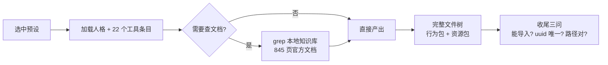

<div align="center">


# 筑界工坊 · 网易MC开发

**DSH Agent 预设 · 网易《我的世界》中国版模组开发专用**

[](LICENSE)
[](https://github.com/deepseek-ai)
[](https://github.com/ZJTM-Studio/dshgo-CNminecraft-add-on-Development/releases)
[](#)
[](https://github.com/ZJTM-Studio/dshgo-CNminecraft-add-on-Development/actions/workflows/validate.yml)

[快速开始](#-快速开始) ·
[使用示例](#-使用示例) ·
[能力](#-能力) ·
[知识库](#-知识库) ·
[结构](#-结构) ·
[常见问题](#-常见问题) ·
[文档](docs/)

</div>

---

## ✨ 这是什么

一个 **DSH Agent 预设包**（bundle），安装后在预设选择器里多出一个专用 Agent。选中它开的会话会加载一套为网易 MC 模组开发定制的能力：

> 直接产出可导入 MCStudio 的完整模组包，**不空谈思路**

| 维度 | 普通会话 | 选中本预设 |
|---|---|---|
| 知识来源 | 模型记忆，容易编 API | 先 grep 本地官方文档库，查不到就直说 |
| 输出形态 | 给思路、给片段 | 给完整文件树 + 每个文件的完整内容 |
| 版本取向 | 可能混入国际版 `@minecraft/server` | 只写网易 ModSDK / Python 脚本 |
| 包结构 | 可能漏 uuid、路径大小写错 | 行为包+资源包成对、uuid 唯一、路径严格对齐 |

<div align="center">



</div>

---

## 🚀 快速开始

### 1. 安装预设

```bash
git clone https://github.com/ZJTM-Studio/dshgo-CNminecraft-add-on-Development.git
cd dshgo-CNminecraft-add-on-Development

dsh plugin --profile web add file:$PWD
```

### 2. 装知识库（强烈建议）

预设会去 `$DSH_HOME/knowledge/mc-netease/` 检索官方文档。没有这个目录时，它会退化成普通助手。

```bash
# 下载（压缩后 1.6 MB，解压后 8.2 MB / 845 页）
curl -L -o mc-netease.tar.gz \
  https://github.com/ZJTM-Studio/dshgo-CNminecraft-add-on-Development/releases/download/v0.2.0-kb/mc-netease.tar.gz

# 解压到知识库目录
mkdir -p $DSH_HOME/knowledge
tar xzf mc-netease.tar.gz -C $DSH_HOME/knowledge/
```

### 3. 重启并选用

重启 DSH，在预设选择器里选 **「筑界工坊 · 网易MC开发」**。

---

## 💬 使用示例


```
你：做一个自定义方块，右键放光

筑界工坊：
  → 检索 api/jiekou/fangkuai/ 下的方块接口
  → 检索 mcguide/20-wanfakaifa/ 下的预设开发

  behavior_pack/
  ├── manifest.json
  ├── netease_blocks/
  │   └── glow_block.json          ← 方块定义
  └── netease_scripts/
      └── modMain.py               ← 右键逻辑

  [给出每个文件的完整内容]

  收尾三问：
  ✓ 能导入 MCStudio 吗 —— 行为包+资源包已配对
  ✓ uuid 全唯一吗 —— 已生成 3 个不重复 uuid
  ✓ 路径大小写对吗 —— 与 netease_blocks 定义一致
```

关键在于它**先查文档再动手**，查不到就说「文档里没有」，不会编一个不存在的 API 给你。

---

## 🎯 能力

- **完整模组包产出**：行为包 + 资源包成对生成，`manifest.json` 的 uuid 全唯一，目录路径大小写与磁盘严格一致（网易黑紫块最高频原因）
- **网易版专精**：只写 ModSDK / Apollo / Python 脚本，禁用国际版 API 与目录布局
- **文档优先**：回答前先检索 845 页官方文档，查不到明说「文档里没有」，不编造 API
- **收尾自检**：每次交付前强制三问 —— 能导入吗 / uuid 唯一吗 / 路径大小写对吗

---

## 📚 知识库

| 路径 | 内容 | 页数 |
|---|---|---|
| `api/jiekou/` | ModAPI 接口（方块 实体 世界 玩家 物品 物理 UI 特效…） | 105 |
| `api/meijuzhi/` | 枚举值 | 75 |
| `api/shijian/` | 事件 | 13 |
| `api/PresetAPI/` | 预设架构 API | 39 |
| `api/Apollo/` | Apollo 联机 SDK | 13 |
| `api/ShaderSDK/` | 着色器 SDK | 8 |
| `api/gengxinxinxi/` | 版本更新日志（2.x → 3.10） | 29 |
| `mcguide/` | 开发指南（玩法开发 177 / 手机网游 94 / 电脑网游 65 / 美术 28 …） | 532 |
| `guide/` | PC Java 服务器开发（认证 反作弊 跨服 经济 公会 性能） | 23 |
| **合计** | | **845** |

> **来源变更**：网易已把文档站整体迁移到 `mc.163.com/newdev/docs/`（VitePress）。
> 旧站 `mc.163.com/dev/mcmanual/mc-dev/` **已下线（404）**，本知识库为迁移后的版本。
> 当前文档版本：**3.10 / BE 1.21.130**

---

## 🧱 结构

```
dshgo-CNminecraft-add-on-Development/
├── package.json              # dsh.bundle.patch 指向 patch/agent.patch.yml
├── patch/
│   └── agent.patch.yml       # 预设定义：persona + 22 个工具条目
├── assets/
│   ├── banner.svg            # README 横幅
│   ├── logo.jpg              # 工作室图标
│   └── logo-full.jpg         # 工作室横版标识
├── LICENSE                   # MIT
├── scripts/
│   └── validate.mjs          # 预设结构校验
├── .github/
│   ├── workflows/validate.yml
│   └── ISSUE_TEMPLATE/
├── docs/
│   ├── install.md            # 安装详解与排错
│   ├── architecture.md       # 架构说明
│   └── faq.md                # 详细 FAQ
├── CHANGELOG.md
├── CONTRIBUTING.md
├── SECURITY.md
├── CODE_OF_CONDUCT.md
└── README.md
```

<details>
<summary>预设里包含哪些工具条目</summary>

| 分类 | 条目 |
|---|---|
| 文件 | `tool-fs`、`tool-fs-search` |
| 执行 | `tool-bash`（Windows 自动切 `tool-pwsh`） |
| 网络 | `tool-web` |
| 技能 | `skill-filesystem`、`tool-skill` |
| 规划 | `planning`、`compaction`、`delegation` |
| 交互 | `tool-ask-user`、`tool-todo`、`present` |
| 任务 | `tool-jobs`、`tool-schedule`、`command-goal`、`tool-goal` |

</details>

---

## ❓ 常见问题

<details>
<summary><b>装完选择器里显示「不可用」怎么办？</b></summary>

两种「不可用」要分清：

- **整页**「标准模式不可用」= roster 整体读取失败
- **该预设单独标「不可用」** = 它自己的 plugins 有条目加载不了

最常见原因是预设 YAML 顶层 `name:` 被改成了中文显示名（必须永远是包名 `@deepseek-ai/dsh-agent-preset`，中文名只能放 `config.name`）。

</details>

<details>
<summary><b>它跟国际版（Bedrock / Java）通用吗？</b></summary>

不通用，也不打算通用。本预设只写网易中国版的 ModSDK / Apollo 脚本，禁用了国际版 `@minecraft/server` 与目录布局。

</details>

<details>
<summary><b>知识库多大？必须装吗？</b></summary>

压缩 2.6 MB，解压 14 MB。不装也能用，但会失去「先查文档再回答」的能力，退化成普通助手。

</details>

更多问题见 **[docs/faq.md](docs/faq.md)**。

---

## 🤝 参与贡献

欢迎提 Issue 和 PR。改之前先看：

- **[贡献指南](CONTRIBUTING.md)** —— 三条硬规矩（顶层 name 不能改、pwsh 要带平台禁用、人格与能力分开）
- **[架构说明](docs/architecture.md)** —— 预设怎么工作、22 个工具条目怎么分组
- **[安装详解](docs/install.md)** —— 含排错
- **[安全策略](SECURITY.md)** · **[行为准则](CODE_OF_CONDUCT.md)**
- **[详细 FAQ](docs/faq.md)**

---

## 📄 更新日志

见 [CHANGELOG.md](CHANGELOG.md)

## 📄 License

[MIT](LICENSE)

<div align="center">


<br/><br/>

<sub><b>筑界同盟工作室</b> · Architects' Alliance</sub><br/>

</div>
