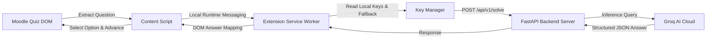

<div align="center">
  
  <h1>QuizPilot AI — Smart AI Assistant for Moodle LMS</h1>
  <p>
    <strong>Specifically Built & Optimized for the Moodle LMS Platform</strong><br>
    <em>Fast, Local-First, Autonomous AI Inference for Moodle Quizzes with Real-Time Multi-Key Fallback and Zero-Server Secret Storage.</em>
  </p>
</div>

---

## 👨‍💻 Creator & Copyright Notice

### **Author & Developer:**
**Zahid Hamdule**  
*Creator & Lead Engineer of QuizPilot AI*

### ⚠️ **Proprietary & Copyright Protection Notice**
```
Copyright (c) 2026 Zahid Hamdule. All Rights Reserved.
```
> **IMPORTANT:**  
> **QuizPilot AI** is the copyrighted intellectual property of **Zahid Hamdule**.  
> - **No one is permitted** to redistribute, re-publish, fork-and-rename, rebrand, sub-license, commercialize, or claim ownership/authorship of this software, in whole or in part, under another individual's or organization's name without explicit, written permission from **Zahid Hamdule**.  
> - Unauthorized distribution, plagiarism, or attribution removal is strictly prohibited.

---

## 📖 What is QuizPilot AI? (In Simple Words)

**QuizPilot AI** is a lightweight, high-speed pair-programming-style browser extension and backend engineered specifically to assist students and educators while taking quizzes on **Moodle LMS**.

### How it works:
1. **Reads Moodle Questions Automatically**: When you open a Moodle quiz attempt, QuizPilot AI safely extracts the question text, question type (Multiple Choice, True/False, Single Choice), and all available options.
2. **Consults Groq AI**: It passes the question through a high-speed inference pipeline powered by Groq's ultra-fast LLM models (such as `llama-3.3-70b-versatile` or `gpt-oss-120b`).
3. **Selects Answers in Real Time**: It selects the optimal answer directly on the Moodle quiz DOM and provides confidence scores alongside clear reasoning.
4. **Autonomous or Assisted Navigation**: In **Auto Mode**, it automatically answers and advances to the next question. In **Assist Mode**, it selects the option and waits for your confirmation to proceed.
5. **Safety Guaranteed**: It automatically detects when you reach the final Attempt Summary / Review page and stops, ensuring it never submits the final quiz automatically.

---

## 🌟 Key Features

- 🎯 **Tailored for Moodle LMS**: Native DOM selectors and adapters built specifically for Moodle 3.x, 4.x, and custom institutional LMS themes.
- ⚡ **Ultra-Fast AI Engine**: Powered by FastAPI and Groq API for sub-second inference latency.
- 🛡️ **Zero-Server Key Storage (Privacy First)**: Your Groq API keys remain strictly on your local browser machine (`chrome.storage.local` with obfuscation). Keys are never stored in any database or backend log.
- 🔄 **Multi-Key Circular Fallback**: Configure multiple Groq API keys. If one key hits a rate limit (429) or quota threshold, QuizPilot immediately falls back to the next key with zero interruptions.
- 📊 **In-Page Floating Dashboard (Shadow DOM)**: A sleek, glassmorphic HUD that floats on your Moodle quiz page showing real-time question progress, answer rationale, confidence ratings, and quick controls.
- 🛑 **Complete Execution Control**: Includes an instant **■ Stop** button, dynamic question retry button, and toggle between **Auto Mode** and **Assist Mode**.

---

## 🛠️ Architecture Overview



---

## 📋 Step-by-Step Setup & User Guide

### Step 1: Clone the Repository
```bash
git clone https://github.com/Zahid-Ham/QuizPilot_AI.git
cd QuizPilot_AI
```

---

### Step 2: Set Up the FastAPI Backend Server

1. Navigate to the `backend` folder:
   ```bash
   cd backend
   ```
2. Create and activate a Python virtual environment:
   ```bash
   # Windows (PowerShell)
   python -m venv .venv
   .\.venv\Scripts\Activate.ps1

   # Linux / macOS
   python3 -m venv .venv
   source .venv/bin/activate
   ```
3. Install the dependencies:
   ```bash
   pip install -r requirements.txt
   ```
4. Start the backend server:
   ```bash
   uvicorn app.main:app --host 127.0.0.1 --port 8000 --reload
   ```
5. Confirm the server is running by opening `http://127.0.0.1:8000/health` in your browser. You should receive:
   ```json
   {
     "status": "healthy",
     "groq_configured": false
   }
   ```

---

### Step 3: Load the Extension into Google Chrome

1. Open Google Chrome and go to `chrome://extensions`.
2. Enable **Developer mode** using the toggle in the top-right corner.
3. Click the **Load unpacked** button.
4. Select the `extension` directory inside the `QuizPilot AI` repository:
   ```text
   QuizPilot_AI/extension
   ```
5. The **QuizPilot AI** extension icon will now appear in your browser extensions bar. Pin it for easy access.

---

### Step 4: Configure Your Groq API Keys

1. Click on the **QuizPilot AI** extension icon in your Chrome toolbar.
2. If it is your first time opening the extension, the Onboarding setup will appear automatically. (You can also open **Settings** anytime).
3. Paste one or more Groq API keys (obtained free from [console.groq.com](https://console.groq.com/keys)).
4. Click **Save & Continue**.
5. The backend status will display **Connected (Green)**.

---

### Step 5: Using QuizPilot AI on Moodle Quizzes

1. Open your authorized **Moodle Quiz Attempt page** (or test on the local mock harness at `http://127.0.0.1:8000/mock-moodle/`).
2. Click the **QuizPilot AI** extension popup icon.
3. Choose your mode:
   - **Auto Mode (ON)**: The assistant will detect questions, answer them, and advance pages automatically.
   - **Assist Mode (OFF)**: The assistant will select the optimal option and allow you to review before clicking next.
4. Click **Start Quiz Assistant**.
5. The floating in-page HUD dashboard will appear on the bottom-right corner of the quiz, displaying live progress and answer explanations!
6. Click **■ Stop** anytime to immediately pause or cancel assistance.

---

## 🧪 Running Automated Tests

QuizPilot AI includes comprehensive unit and end-to-end integration tests:

```bash
# Run Python backend tests
python -m pytest backend/tests -v

# Run JavaScript Extension & KeyManager tests
node tests/test_key_manager.js
node tests/test_extension.js
node tests/test_phase4_e2e.js
```

---

## 🔒 Security & Privacy Policy

- **No Remote Telemetry**: QuizPilot AI communicates exclusively with your designated local backend (`127.0.0.1:8000`) and the official Groq API endpoint.
- **Client-Side Storage**: Groq API keys are stored solely in Chrome's encrypted local storage (`chrome.storage.local`).
- **Review Page Safety**: Autonomous submission on Moodle attempt summary pages is strictly blocked by design to prevent accidental early quiz submissions.

---

## 📜 License & Attribution

```text
Proprietary Software — Created by Zahid Hamdule.
All rights reserved. Unauthorized copying, distribution, or rebranding is strictly prohibited.
```
