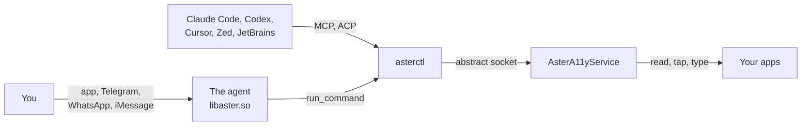

<div align="center">


# Droid

**Your phone. Any agent.**

An agent that uses your Android phone the way you do. Run it on any model,
free and local ones included, drive the phone from any agent over MCP and ACP,
and talk to it in the app, on Telegram, or on WhatsApp and iMessage through Photon.

[](https://github.com/Zfinix/droid/releases/latest)
[](https://www.android.com/)
[](https://github.com/Zfinix/droid)

**[Website](https://droid.withaster.dev)** · [Get the app](https://droid.withaster.dev/download) · [Setup](docs/SETUP.md) · [Report a bug](https://github.com/Zfinix/droid/issues)


</div>

---

Droid (`dev.aster.probe`) gives an AI agent your phone's screen. An accessibility service lets it read, tap, swipe and type, in your apps, with your accounts.

- **Any model.** Free models with no account and no key, Ollama or LM Studio on your own computer, or a key for one of [40 providers](docs/PROVIDERS.md), such as OpenRouter, Gemini and NVIDIA.
- **Any agent.** Claude Code, Codex, Cursor and any other MCP client use the phone's screen as a tool. Zed and JetBrains talk to the agent on the phone over ACP.
- **Chat where you are.** In the Droid app, on Telegram, or on WhatsApp and iMessage through [Photon](https://photon.codes).

## Requirements

- An Android phone on Android 8 or later, with a 64-bit ARM chip (`arm64-v8a`), as most phones from recent years have. There is no iPhone version.
- Droid is experimental. It uses Accessibility to see and tap the screen, and notification access only if you turn on alerts.

## Install

1. On the phone, open [droid.withaster.dev/download](https://droid.withaster.dev/download). It downloads `droid.apk`, the latest release.
2. Open the file to install it. Android asks once to allow installs from your browser: allow it. If Play Protect warns about an unknown app, tap **More details**, then **Install anyway**.
3. Open Droid. It asks three things: a model (**Try it free** needs no account and no key), where to talk to it (the chat in the app unless you pick Telegram, WhatsApp or iMessage), and **Screen** access. Then say what you want done:

```txt
Open settings and turn on Do Not Disturb.
```

**Screen switch greyed out?** Android 13 and later hold back Accessibility for apps installed outside a store. Tap the greyed switch once, then open **Settings > Apps > Droid**, tap the three-dot menu, choose **Allow restricted settings**, and turn Screen on again.

The free models run on a trial service that keeps logs, so keep them away from banking, health and other private screens. Use your own computer's model or a key for those. More help, and the other chat apps, in [SETUP](docs/SETUP.md).

## Connect a computer

Claude Code, Codex, Cursor and other agents can drive the phone over MCP, and Zed and JetBrains can talk to its agent over ACP. Over USB, Wi-Fi or Tailscale it is free and works today.

You need Node 20 or later, and for USB, adb and USB debugging:

- adb on macOS: `brew install android-platform-tools`. Windows: `winget install Google.PlatformTools`. Debian or Ubuntu: `sudo apt install adb`.
- USB debugging: on the phone, tap **Build number** seven times under **Settings > About phone**, then turn on **USB debugging** under **Developer options**.

1. In Droid, open **Connect a computer** and turn on **Agents (MCP)**, **Editors (ACP)**, or both.
2. Plug the phone in, allow USB debugging when it asks, and run:

   ```sh
   npx -y @withaster/droid pair --adb
   npx -y @withaster/droid setup claude    # or codex, cursor, zed, jetbrains, vscode, all
   ```

3. Restart the client, then check that the phone answers:

   ```sh
   npx -y @withaster/droid status
   ```

`pair --adb` reads the keys from Droid over USB when the app can share them. If it asks for them instead, tap **Copy MCP key** in Droid, get it to the computer (a message to yourself works), and paste it.

On Wi-Fi, turn on **Over Wi-Fi** under Connect a computer and run `npx -y @withaster/droid pair --lan <phone address>` with the address Droid shows. Over Tailscale, set Other agents' and Editors' address in settings to the phone's Tailscale address and pair with that. More in the [CLI README](cli/README.md).

**Aster Relay is coming soon.** It will reach the phone from anywhere with one code, with no ports, adb or Tailscale. Until it opens, use USB, Wi-Fi or Tailscale. A relay you host yourself works now: see [Self-hosting](docs/RELAY.md#self-hosting).

## What it can do

### Your apps. A new way to use them.

The agent reads the screen, taps, swipes, and types. Just say what you want to do:

```txt
Open settings and turn on Do Not Disturb.
```

### It remembers, and it learns

Save a fact with `/remember`, teach it a routine with `/learn`, and browse the collection with `/skills`. Installed skills show up as `/commands` too.

```txt
/remember I prefer a quiet phone after 10 pm
Saved to memory. Prefers a quiet phone after 10 pm.

/learn
New skill: quiet-mode
Opens Settings, turns on Do Not Disturb, and lowers ring volume.
```

### It comes back on its own

The agent schedules its own wake-ups, ends the turn, and returns when the timer fires. Rider checks, chunked recordings, anything that needs a later look. Manage them from the chat with `/checkins` and `/cron`.

### Watch it work. Take over whenever.

Use `/mirror` to open your phone's live screen in a browser, over your LAN or Tailscale. Tap, type, and control it yourself.

### Your choice of model

Start on free models with no key, connect a cloud provider, or use a model server on your own computer, and change the model and reasoning effort from chat. 40 providers with key pages in [docs/PROVIDERS.md](docs/PROVIDERS.md); a local server needs no key.

<div align="center">

<table>
  <tr>
    <td></td>
    <td></td>
  </tr>
</table>

</div>

### Bring your own agent

The phone is not tied to the agent on it. Claude Code, Codex, Cursor, or any tool that speaks MCP can read and use the screen too, and Zed and JetBrains can chat with the phone's agent over ACP. Pair once and let `setup` write each client's config, as in [Connect a computer](#connect-a-computer). Your agent gets the same eyes and hands.

You can also swap the agent that runs on the phone for your own command. Details in [docs/USING.md](docs/USING.md#any-harness).

### The little things, thought through

- **Pick up a conversation**: list past sessions, resume your work, or start fresh
- **Stop or try again**: cancel a running turn, retry the last message, see the queue
- **See what happened**: agent status, tool activity, and transcripts in the app
- **Choose who can ask**: on Telegram, WhatsApp or iMessage, set Allowed people; the agent ignores everyone else

<div align="center">


</div>

### It gets better at your phone

After a run it scores its own rounds, keeps the shortest path, and saves it as a skill. The next time is faster. The History screen keeps the receipts: sessions, turns, tool calls, tokens.

<div align="center">

<table>
  <tr>
    <td></td>
    <td></td>
  </tr>
</table>

</div>

## Documentation

| doc | what is in it |
| --- | --- |
| [SETUP](docs/SETUP.md) | onboarding, Telegram, WhatsApp and iMessage, configuration, troubleshooting |
| [PROVIDERS](docs/PROVIDERS.md) | all 40 providers with key pages and env variables |
| [USING](docs/USING.md) | chat commands, the control protocol, action receipts, the screen mirror, other agents over MCP |
| [CLI](cli/README.md) | `@withaster/droid`: pairing a computer, `setup` for each client, the stdio MCP and ACP bridges |
| [RELAY](docs/RELAY.md) | the relay protocol, for Aster Relay (coming soon) or one you host |
| [ARCHITECTURE](docs/ARCHITECTURE.md) | how it works, with a diagram |
| [BUILDING](docs/BUILDING.md) | build from source, releases, CI, permissions, repository layout |
| [PRIVACY](PRIVACY.md) | what leaves the phone, and where keys are kept |
| [SECURITY](SECURITY.md) | how to report a vulnerability |
| [LICENSE](LICENSE) | Apache-2.0 |

Found a bug? [Open an issue](https://github.com/Zfinix/droid/issues). Related: [cloud/](cloud/README.md) runs an Aster agent on Telegram in a container, with no phone.

## The short version of how it works

A foreground service runs the agent as a child process, with a bridge to Telegram or Photon when one is chosen. The agent calls the control client, `asterctl`, which talks to `AsterA11yService` over an abstract Unix socket; the service reads accessibility trees, dispatches gestures and captures screenshots. Other agents reach the same service through `asterctl mcp`, and editors reach the agent through `asterctl acp`. Full detail in [docs/ARCHITECTURE.md](docs/ARCHITECTURE.md).


