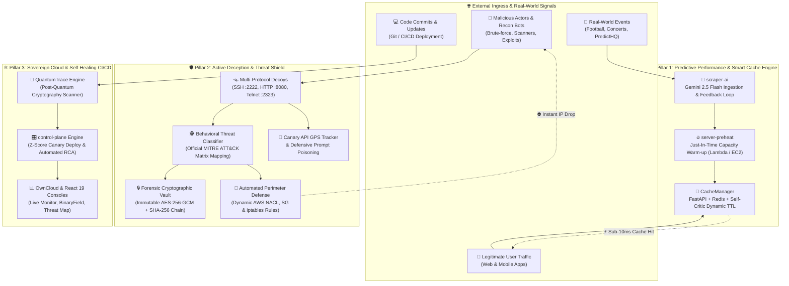

# 🛡️ Babuja Cloud Secure Systems (BCSS)
### *Next-Gen Autonomous Cloud Defense, Predictive Scaling & Quantum-Safe Infrastructure*

[](https://www.docker.com/)
[](https://www.python.org/)
[](https://fastapi.tiangolo.com/)
[](https://redis.io/)
[](https://deepmind.google/technologies/gemini/)
[](https://react.dev/)
[](https://attack.mitre.org/)
[](https://european-union.europa.eu/)

---

## 🎯 Executive Summary

**Babuja Cloud Secure Systems (BCSS)** is an enterprise-grade unified cloud resilience platform designed to tackle two of the most critical vulnerabilities of digital businesses: **uncontrolled cloud and paid API costs triggered by reactive traffic spikes**, and **severe vulnerability to advanced cyberattacks with prolonged intruder dwell-time**.

| Módulo | Área / Desafio | Descrição |
| :--- | :--- | :--- |
| **[`scraper-ai`](./scraper-ai)** | **Previsão de Tráfego & IA** | Ingestão de eventos reais (Futebol, Ticketmaster, PredictHQ, Manual, Feriados) com inferência semântica via **Google Gemini 2.5 Flash** e loop fechado de retroalimentação. |
| **[`server-preheat`](./server-preheat)** | **Dimensionamento Cloud** | Motor desacoplado de pré-aquecimento de capacidade cloud (Provisioned Concurrency AWS Lambda / Instâncias) e disparo de sondas sintéticas paralelas (JIT, DB pools e runtime). |
| **[`CacheManager`](./CacheManager)** | **Eficiência de Rede & Latência** | Serviço de cache preditivo inteligente com FastAPI e Redis, cálculo dinâmico de score multi-fator de prioridade e motor de auditoria contínua (*Self-Critic*). |
| **[`cloud_honeypot_ai`](./cloud_honeypot_ai)** | **Segurança & Eficiência Cloud + IA** | **"A Armadilha para Hackers" (Honeypot)** com análise comportamental por IA (MITRE ATT&CK), defesa perimetral automatizada (AWS NACL / SG / iptables), cofre forense criptográfico imutável (AES-256-GCM + blockchain SHA-256) e **Active Deception** (GPS Lógico de chaves API roubadas, Prompt Injection Defensivo e Beacons de Telemetria). |
| **[`bridge`](./bridge)** | **Orquestração & Benchmarking** | Ferramenta de avaliação arquitetural (`benchmark_comparison.py`) e orquestrador de relay bidirecional (`orchestrator.py`). |
| **[`QuantumTrace`](./QuantumTrace)** | **Criptografia & Postura Cloud** | QuantumTrace: Auditoria estática e dinâmica de ativos criptográficos (KMS, TLS, CBOM CycloneDX 1.6), prontidão pós-quântica (PQC) e dashboard React/Vite. |
| **[`control-plane`](./control-plane) + [`frontend`](./frontend)** | **OwnCloud — Cloud europeia** | Cloud que corre apps em contentores Docker, com consola web, editor de código com análise de segurança, Smart CI/CD, canary com rollback automático, migração desde AWS e extensão VS Code (ver secção OwnCloud abaixo). |

---

## 💥 The Problem vs. The Solution

### 1. The Real-World Challenge (The Problem)

1. **Uncontrolled Cloud Costs & Reactive Throttling:**
   - Conventional cloud auto-scaling mechanisms (e.g., AWS CloudWatch, Kubernetes HPA) react *retrospectively* after CPU/traffic spikes occur. By the time servers scale up, users face **800ms–2000ms latency degradation**, harsh cold-starts, or service outages during major traffic surges (live sports, concerts, flash sales).
2. **Static Cache Inefficiency (*Cache Miss Storms*):**
   - Engineering teams apply static Time-To-Live (TTL) policies across heterogeneous endpoints. When events change in real-time, caches serve stale information. Conversely, setting TTLs too low floods downstream databases and billable external APIs (PredictHQ, Football-Data).
3. **Silent Intrusions & Critical Dwell-Time:**
   - The global average intruder dwell-time before breach detection exceeds **45 to 200 days** (IBM Security Cost of a Data Breach Report). Traditional firewalls and IDSs inundate SecOps teams with false positives while failing to detect stolen cloud keys and internal reconnaissance.
4. **The Post-Quantum Threat (*Harvest-Now, Decrypt-Later*):**
   - Adversaries are actively capturing encrypted network traffic protected by classical RSA and ECC to decrypt once quantum computers reach scale. Most CI/CD workflows possess zero visibility into their post-quantum cryptographic posture.
5. **Fragile Deployments in Production:**
   - Software updates frequently trigger regressions without automated canary rollback or immediate root-cause diagnosis.

---

### 2. The Solution: Babuja Cloud Secure Systems (BCSS)

BCSS acts as an interconnected, closed-loop neural plane operating across **three complementary pillars**:



```
====================================================================================================
                                 BCSS DATA & CONTROL PLANE WORKFLOW
====================================================================================================
   [ INGRESS SIGNALS ]                 [ BCSS INTELLIGENCE CORE ]                   [ OUTCOME ]
----------------------------------------------------------------------------------------------------
  Real-World Events       ───►  [ scraper-ai (Gemini 2.5 Flash) ]
  (Matches, Concerts)                    │
                                         ▼
                                [ server-preheat (JIT) ]        ───► Zero Cold-Starts (<120ms Latency)
                                         │
                                         ▼
  User Web Traffic        ───►  [ CacheManager (Redis + Critic) ]   ───► 90%+ Cache Hit-Rate ($ Saved)
----------------------------------------------------------------------------------------------------
  Adversary / Scanners    ───►  [ Decoys (SSH:2222, HTTP:8080) ]
                                         │
                                         ▼
                                [ Canary GPS & MITRE Analyzer ] ───► Auto-Firewall Drop (Zero Dwell-Time)
                                         │
                                         ▼
                                [ Immutable AES-256 Vault ]     ───► Legally Admissible Audit Trail
----------------------------------------------------------------------------------------------------
  Code Deploys (CI/CD)    ───►  [ QuantumTrace (PQC Scanner) ]  ───► Quantum Vulnerability Gate
                                         │
                                         ▼
                                [ Canary Z-Score & RCA Engine ] ───► Instant Automated Rollback on Bug
                                         │
                                         ▼
                                [ OwnCloud & React Console ]    ───► Unified Real-Time Observability
====================================================================================================
```

#### ⚡ Pillar 1: Predictive Performance & Cost Reduction
- **`scraper-ai`**: Ingests real-world data across sports, concert ticket sales, and localized events. Employs **Google Gemini 2.5 Flash** with feedback calibration to predict incoming surge windows hours before they occur.
- **`server-preheat`**: Calculates required cloud capacity (AWS Lambda Provisioned Concurrency, EC2/container instances) and fires synthetic warm-up probes 15–30 minutes ahead of peak demand.
- **`CacheManager`**: High-throughput FastAPI + Redis service that recalculates cache TTLs dynamically based on real-time event volatility. The integrated **Self-Critic Engine** continuously audits prediction drifts to optimize cache hit rates.

#### 🛡️ Pillar 2: Active Deception & Forensic Defense
- **`cloud_honeypot_ai`**: Multi-protocol deception shield exposing low/medium-interaction traps: Fake SSH on port `2222`, Fake Web Decoy exposing lures like `/.env` on port `8080`, and Telnet on `2323`.
- **Canary API GPS Tracking**: Plants synthetic credentials with logical GPS beacons; when an attacker uses an exfiltrated token outside the honeypot, the system immediately traces the geographic source and auto-generates perimeter blocking rules (AWS NACLs / Security Groups / iptables).
- **Defensive Prompt Poisoning**: Injects deceptive context that breaks and misdirects automated offensive LLMs and scanning tools.
- **Forensic Cryptographic Vault**: Encrypts and writes every attacker terminal keystroke and network interaction into an append-only blockchain ledger secured with **AES-256-GCM** and SHA-256 hash chains.

#### ⚛️ Pillar 3: Sovereign Cloud Infrastructure & Automated CI/CD
- **`QuantumTrace`**: Post-quantum static cryptographic scanner for Python, Go, and Java codebases, classifying algorithms by quantum risk tier (`critical`, `medium`, `resilient`).
- **`control-plane` & `frontend`**: European sovereign app platform with **Statistical Canary Deployments** (automated rollback via two-proportion Z-score tests), **Automated Root-Cause Analysis (RCA)** mapping error traces directly to diff commits, and **Markovian Synthetic Load-Testing**.

---

## 💰 ROI & Measurable Business Impact

| Savings Vector | Without BCSS | With BCSS | Monthly Savings Estimate |
| :--- | :--- | :--- | :--- |
| **Paid Third-Party API Calls** | 500,000 daily requests hitting external rate-limited APIs | 88%–94% hit-rate via predictive dynamic TTL caching | **\$1,500 – \$8,000 / mo** |
| **Breach Prevention & Dwell-Time** | 45+ days undetected access; avg. breach cost >\$150,000 | Immediate decoy alert & auto-isolation in seconds | **\$10,000 – \$16,000 / mo** *(amortized)* |
| **Latency & Cart Abandonment** | 900ms–1500ms latency spikes during burst traffic | <120ms p95 latency via proactive JIT pre-heating | **\$5,000 – \$15,000 / mo** |
| **Incident Response & SRE Labor** | 4–8 engineering hours diagnosing bad production deploys | Automated AI Root-Cause Analysis (RCA) with instant fix hints | **\$2,000 – \$4,000 / mo** |
| **TOTAL ESTIMATED VALUE** | — | — | **\$18,500 – \$43,000 / mo** |

---

## 🏗️ Architecture & Port Mapping

When running the containerized stack, the following endpoints are published:

| Service | Port | Description | Access URL |
| :--- | :--- | :--- | :--- |
| **BCSS OwnCloud Console** | `8088` | Main developer portal, Monaco code editor, metrics | [http://localhost:8088](http://localhost:8088) |
| **Honeypot AI Dashboard** | `8888` | Real-time threat visualizer, MITRE matrix, attack replay | [http://localhost:8888](http://localhost:8888) |
| **CacheManager API** | `8001` | OpenAPI / Swagger interactive documentation | [http://localhost:8001/docs](http://localhost:8001/docs) |
| **Distributed Redis Cache** | `6379` | In-memory key-value cache cluster | `redis-cli -p 6379` |
| **Decoy Web Trap (HTTP)** | `8080` | Lure endpoints for credential-harvesting bots (`/.env`) | `curl http://localhost:8080/.env` |
| **Decoy SSH Shell** | `2222` | Decoy SSH terminal backed by in-memory virtual filesystem | `ssh -p 2222 root@localhost` |
| **Decoy Telnet Service** | `2323` | Legacy TCP interactive lure | `nc localhost 2323` |
| **QuantumTrace Posture Web** | `5173` | Cryptographic posture and PQC readiness dashboard | [http://localhost:5173](http://localhost:5173) |

---

## 🐳 Quickstart Guide: Running with Docker

All BCSS components are orchestrated using multi-stage Docker Compose v2.

### 📋 Prerequisites
- **Docker Engine** (v24.0+) and **Docker Compose v2** (`docker compose`)
- Linux / WSL2: Ensure the active user is in the `docker` group.

---

### Step 1: Environment Variables Configuration

Copy the sample environment file:
```bash
cp scraper-ai/.env.example scraper-ai/.env
```
*(Optional: Add your API keys for Gemini, Football-Data, or PredictHQ in `scraper-ai/.env`. If omitted, BCSS seamlessly transitions to its built-in heuristic fallback engine without breaking!)*

---

### Step 2: Fix Docker Socket Permissions (Linux / WSL2)

If running in Linux or WSL2 and encountering socket permission errors (`permission denied while trying to connect to the Docker daemon socket`):
```bash
bash fix_docker_perms.sh
```
*This utility grants socket permissions and adds your user to the docker group.*

---

### Step 3: Launch the Full Stack

Start the core stack (Redis + CacheManager + Cloud Honeypot + OwnCloud Console + QuantumTrace):

```bash
docker compose up -d --build
```

*(If your user profile requires elevated rights: `sudo docker compose up -d --build`)*

#### Want to include the optional Posture React Frontend (:5173)?
```bash
docker compose --profile frontend up -d --build
```

---

### Step 4: Verify Deployment Health

1. **Check Container Status:**
   ```bash
   docker compose ps
   ```
   *Verify that all services (`hackathon-redis`, `hackathon-cache-service`, `hackathon-cloud-honeypot`, `control-plane`, `web`, `quantumtrace`) show state `Up`.*

2. **Stream Service Logs:**
   ```bash
   # Follow CacheManager logs
   docker compose logs -f cache-service

   # Follow Honeypot logs
   docker compose logs -f cloud-honeypot

   # View latest logs across all containers
   docker compose logs --tail=50
   ```

3. **Run the Diagnostic Health Checker:**
   ```bash
   bash check_docker.sh
   ```

---

### Step 5: Graceful Shutdown
```bash
docker compose down
```
*(To wipe volume state and reset databases: `docker compose down -v`)*

---

## 🧪 Local CLI Testing (Without Docker)

You can also run and evaluate individual engines locally in bare-metal mode:

### 1. End-to-End Pipeline Execution
Executes traffic scraping, AI prediction, server capacity pre-heating, and cache synchronization in under 1 second:
```bash
python3 run_pipeline.py
```

### 2. Interactive Honeypot Defense Simulation
Simulates automated bot attacks, canary key exfiltration, and auto-generated firewall rules:
```bash
python3 -m cloud_honeypot_ai.run_honeypot demo
```

151 attacks against the running stack (`test_attacks.py`, `test_users.py`), using temporary accounts it creates and
removes: cross-user access to every app route, privilege escalation, role mass assignment, token scope and
cross-user abuse, revoked/expired/forged tokens, disabled accounts, password changes, username enumeration (answers
and timing), cookie tossing, session fixation, unauthenticated access, forged cookies, session replay after sign-out, CSRF
from other origins and from hosted apps, DNS rebinding, open redirects, SQL / command / Dockerfile / environment
injection, path traversal (encoded, absolute, Windows, NUL byte), zip slip, zip bombs, oversized bodies, YAML bombs,
analyzer DoS, secret disclosure, security headers, dotfiles, exposed internal ports, hosted-app network isolation and
sign-in brute force. The last test locks this machine out of *new* sign-ins for 5 minutes (restart the control plane to reset).

Known limits: the control plane has full access to Docker through its socket, so every user can run code on this
machine inside resource-limited containers (that is what a cloud does — keep sign-up off unless you trust who can
reach the console); hosted apps are served over plain HTTP; they can still reach the internet and services on the host
bound to `0.0.0.0`; and for a public deployment, serve the console and the apps on separate domains with HTTPS.

### Layout

| Path | What |
| --- | --- |
| `control-plane/` | FastAPI + Docker SDK. `app/main.py` (API and pipeline), `security.py` (auth, CSRF, headers), `code_review.py` (security analyzer), `runtime.py` (build/run), `quantum.py` (QuantumTrace client), `migration.py` + `aws_sources.py` (AWS migration), `store.py` (SQLite) |
| `control-plane/app/router/` | Per-app router (traffic split, metrics, edge cache, prefetch) and the load generator |
| `control-plane/app/{pipeline,canary,rca,database,loadtest}.py` | Smart CI, canary analysis, root-cause analysis, database tuning, load tests |
| `scripts/` | End-to-end checks: `test-ai-features.py`, `test-vscode.py` |
| `security-tests/` | Attack suite run against the live stack |
| `vscode-extension/` | OwnCloud Security extension for VS Code |
| `QuantumTrace/` | QuantumTrace scanner (teammate's code), run as its own service |
| `frontend/` | Website and console (Vite, React, TypeScript, Tailwind) |
| `examples/apps/` | Sample apps: `legacy-payments` (RSA, gets blocked by the gate), `secure-notes` (AES-256), `hello-node`, `landing-static` |

### API

| Method | Path | |
| --- | --- | --- |
| `POST` | `/api/apps` | multipart: `name`, `enforce_gate`, `files[]`, optional `env` (JSON; defaults to the variables in the app's AWS config) |
| `POST` | `/api/migrations/analyze` | multipart `files[]` → migration report, nothing deployed |
| `GET` | `/api/apps`, `/api/apps/{id}` | status, URL, scan summary |
| `POST` | `/api/apps/{id}/stop` · `/start` · `/redeploy` | lifecycle |
| `DELETE` | `/api/apps/{id}` | removes container, image and files |
| `GET` | `/api/apps/{id}/logs` · `/stats` · `/scan` | logs, CPU/memory, full QuantumTrace result |
| `GET` | `/api/events?app_id=` | shared event feed |
| `GET` | `/api/apps/{id}/files` · `/file?path=` | Source tree and file contents (editor) |
| `PUT` | `/api/apps/{id}/file?path=` | Save a file: `{"content": "…"}` |
| `GET` | `/api/apps/{id}/analysis` | Security + QuantumTrace findings for every file |
| `POST` | `/api/apps/{id}/analysis/file` | Findings for an unsaved buffer: `{"path", "content"}` |
| `POST` | `/api/auth/login` · `/logout`, `GET /api/auth/me` | Session (all other routes need it) |
| `POST` | `/api/auth/signup`, `GET /api/auth/config` | Self-service account (when enabled) |
| `POST` | `/api/auth/password` | Change password: `{"current_password", "new_password"}` |
| `GET` `POST` `DELETE` | `/api/tokens` | Personal access tokens (browser session only) |
| `GET` `POST` `PATCH` `DELETE` | `/api/users` | Accounts (admins, browser session only) |
| `POST` | `/api/analysis/file` | Findings for any file `{"path", "content"}` (used by the VS Code extension) |
| `GET` | `/api/apps/{id}/archive` | Every text file of an app in one response |
| `GET` | `/api/apps/{id}/deployments` · `POST …/rollback` | Pipeline + canary history; roll back one version |
| `GET` | `/api/apps/{id}/traffic` | Per-version requests/errors/latency, edge cache per region, learned navigation |
| `GET` | `/api/apps/{id}/incidents` | Root-cause reports |
| `GET` `POST` | `/api/apps/{id}/database` · `POST …/database/optimize` | Managed PostgreSQL and its optimiser |
| `GET` | `/api/apps/{id}/loadtest/model` · `…/loadtest/k6` | Learned traffic model; k6 script |
| `GET` `POST` | `/api/apps/{id}/loadtests` | Run and list generated load tests (`{"max_users"}`) |
| `GET` | `/api/system` | Docker and QuantumTrace reachability |
| `GET` | `/api/health` | `{"status": "ok"}` only |

Browser requests other than `GET` need the header `X-OwnCloud-CSRF: 1`. Tools authenticate with
`Authorization: Bearer oc_…` instead (no CSRF header needed).

### Developing without Compose

### 4. Architecture Benchmark & Code Matrix
```bash
# QuantumTrace on :8001
docker build -t owncloud/quantumtrace QuantumTrace && docker run -d -p 127.0.0.1:8001:8000 owncloud/quantumtrace

---

## 📁 Repository Structure

```text
hackaton-project/
├── docker-compose.yml              # Root multi-service Docker Compose v2 specification
├── run_pipeline.py                 # 5-step end-to-end data & AI orchestration pipeline
├── fix_docker_perms.sh             # Docker socket permission configuration script
├── check_docker.sh                 # Fast health check and listening port diagnostic
│
├── scraper-ai/                     # 🧠 Traffic forecasting engine & Gemini 2.5 Flash
│   ├── main.py                     # Closed-loop collection pipeline and data synchronizer
│   ├── gemini_analyzer.py          # Semantic LLM analyzer with heuristic fallback
│   └── ManualEvents.json           # Calibrated real-world event catalyst dataset
│
├── server-preheat/                 # ⚡ JIT cloud server preheating & scaling engine
│   └── preheat_engine.py           # Concurrency model, instance sizing, and probe dispatch
│
├── CacheManager/                   # 🚀 Intelligent predictive cache (FastAPI + Redis)
│   ├── main.py                     # ASGI application server and watcher loop
│   ├── api/routes.py               # REST API endpoints (/cache, /metrics, /health, /plan)
│   └── services/self_critic.py     # Continuous self-critic TTL calibration engine
│
├── cloud_honeypot_ai/              # 🛡️ Deception shield, MITRE ATT&CK & Forensic Vault
│   ├── run_honeypot.py             # CLI entrypoint (start, demo, test)
│   ├── ai/mitre_attack.py          # Official MITRE ATT&CK technique mapper
│   ├── ai/threat_analyzer.py       # Behavioral anomaly analyzer & report generator
│   ├── core/                       # In-memory virtual decoys: SSH (2222), HTTP (8080), TCP (2323)
│   ├── crypto/vault.py             # Immutable forensic vault with AES-256-GCM + SHA-256
│   ├── deception/                  # Logical GPS canary tracking & defensive prompt poison
│   └── web/app.py                  # Live threat visualizer and attacker terminal replay (:8888)
│
├── control-plane/                  # ☁️ OwnCloud orchestrator (Canary, RCA, Load Testing)
│   ├── app/canary.py               # Two-proportion Z-score statistical canary rollback
│   ├── app/rca.py                  # Automated Root-Cause Analysis correlating logs to diffs
│   ├── app/loadtest.py             # Markov-chain synthetic load test generator
│   └── app/quantum.py              # Client adapter for the QuantumTrace engine
│
├── quantumtrace/                   # ⚛️ Post-quantum cryptographic auditor and posture dashboard
│   ├── core/assessment.py          # Static source scanner (Python, Java, Go) for PQC readiness
│   └── web/                        # React 18 + Tailwind posture dashboard
│
├── frontend/                       # 🎨 Modern European web console (React 19 + Vite)
│   ├── src/components/BinaryField.tsx # Interactive cursor-reveal binary canvas
│   └── src/sections/MadeInEurope.tsx  # Scroll-driven orbital EU star ring animation
│
└── bridge/                         # 🌉 Relay tools and comparative benchmarks
    └── benchmark_comparison.py     # Live multi-service capability matrix generator
```

---

## 🔒 Security & European Digital Sovereignty

- **Zero-Key Resilient Architecture:** Designed from the ground up to operate seamlessly with zero mandatory third-party API keys, relying on deterministic heuristic fallbacks when external connections are unavailable.
- **Container Hardening:** All microservices run with least-privilege configurations (`cap_drop: [ALL]`, `no-new-privileges:true`, and read-only root filesystems where applicable).
- **Data Sovereignty:** Forensic ledgers, user navigation Markov models, and cache states remain strictly contained within your sovereign infrastructure.

---

## 👥 Babuja Cloud Secure Systems (BCSS) Team
*Developed for Hackathon 2026.*
- Afonso Sopa
- Diogo Osório
- Diogo Pinto
- Francisco Pereira
- Manuel André
