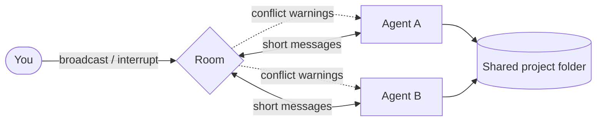

<div align="center">

# Twinbraid

**Put two coding agents on the same project and watch them work together.**<br>
Claude Code, Codex, local models (Ollama, LM Studio, llama.cpp), Gemini CLI, Aider, or any OpenAI-compatible API. Any two, side by side.

[](https://github.com/aaryanbindage/twinbraid/actions/workflows/ci.yml)
[](https://github.com/aaryanbindage/twinbraid/releases/latest)
[](LICENSE)


[**Download**](https://github.com/aaryanbindage/twinbraid/releases/latest) · [Try the demo](#try-it-in-60-seconds) · [How it works](#how-the-agents-talk) · [Pick your agents](#pick-any-two-agents)


</div>

---

You start a feature in Claude, hand it to Codex, and Codex rewrites half of it because it never saw the reasoning. Twinbraid removes that handoff. Both agents work **in the same folder, at the same time**, and talk to each other directly. You watch the whole conversation and can step in whenever you like.

- **See both agents at once.** What each is thinking, what it is editing (`Editing src/parser.js (+300)`), tokens used, lines added and removed, and every tool call. No more staring at a pulsing logo.
- **They talk, not you.** A handoff is a two-line message ("I own `parser.js`, it's done; please build the renderer and tests"), never a pasted code dump.
- **You stay in control.** Interrupt one agent, redirect it, or broadcast a message to both. A cap on agent-to-agent messages stops them chatting forever on your tokens.
- **Mix anything.** Claude with a local Qwen, Codex with Gemini, two Claudes with different models. If it can run in a terminal or speak an OpenAI-style API, it can be an agent.

## Install

Download from the [latest release](https://github.com/aaryanbindage/twinbraid/releases/latest):

| Platform | Download |
|---|---|
| Windows | `Twinbraid-Setup-x.y.z.exe` (installer) or `Twinbraid-x.y.z-win-portable.zip` |
| macOS, Apple Silicon | `Twinbraid-x.y.z-mac-arm64.dmg` |
| macOS, Intel | `Twinbraid-x.y.z-mac-x64.dmg` |

Or with a package manager:

```bash
# macOS (Homebrew)
brew trust --cask aaryanbindage/twinbraid/twinbraid   # newer Homebrew requires trusting third-party casks
brew install --cask aaryanbindage/twinbraid/twinbraid

# Windows (Scoop)
scoop bucket add twinbraid https://github.com/aaryanbindage/scoop-twinbraid
scoop install twinbraid
```

> **macOS note:** the app is not signed or notarized yet, so the first launch needs right-click → **Open**, or `xattr -dr com.apple.quarantine /Applications/Twinbraid.app`. Windows may show a SmartScreen prompt for the same reason (More info → Run anyway).

Twinbraid drives the agent tools you already have, so install and sign in to whichever you want to use:

| Agent | Setup |
|---|---|
| Claude Code | <https://claude.com/claude-code> |
| Codex | `npm i -g @openai/codex`, then `codex login` |
| Local models | [Ollama](https://ollama.com) (`ollama pull qwen2.5-coder`), LM Studio, or llama.cpp, with the server running |

## Try it in 60 seconds

No accounts, no models, no cost. These run two scripted agents through the real engine:

```bash
git clone https://github.com/aaryanbindage/twinbraid && cd twinbraid
npm install
npm run demo        # two scripted agents
npm run demo:sim    # a simulated Codex and a simulated local model through the real adapters
```

Then run it for real: `npm start`, choose two agents, pick a project folder, describe the task.

## Pick any two agents

| Kind | What it is |
|---|---|
| `claude` | Claude Code CLI |
| `codex` | OpenAI Codex CLI |
| `ollama`, `lmstudio`, `llamacpp`, `openai-compat` | Local or self-hosted models via an OpenAI-compatible `/v1` API |
| `openai`, `openrouter` | Cloud APIs (key from `$OPENAI_API_KEY` / `$OPENROUTER_API_KEY` or typed per run, never saved) |
| `gemini`, `aider`, `opencode`, `cli` | Plain-text CLIs, or any command that reads a prompt on stdin |
| `codex-sim`, `local-sim` | Built-in simulators for testing without accounts |

**Local models get a real agent loop.** A chat endpoint can't edit files, so for Ollama, LM Studio and the like Twinbraid runs its own tool loop (Read, Write, Edit, LS, Glob, Grep, Bash) over streaming `/chat/completions`, with reasoning shown in the thinking panel and token usage tracked. The model must support **tool calling** (for example `qwen2.5-coder`, `llama3.1`, `mistral-nemo`; for llama.cpp start `llama-server` with `--jinja`). Small models often stumble, so Twinbraid recovers tool calls printed as text, nudges a model that announces work without doing it, and ignores a "done" from an agent that has read or run nothing.

## What you see

| | |
|---|---|
| **Per-agent panel** | Pulsing avatar while active, a live "Now" line, the thinking stream, an activity feed with ✓/✕ per tool call |
| **Stats** | Tokens (in / out / cache / reasoning), cost, **lines added and removed**, files touched, tool calls, turns, active time |
| **Shared chat** | Every agent-to-agent message, your messages, interrupts, file conflicts, "needs you" questions |
| **Controls** | Message *Both* or either agent; **⚡ Interrupt now**; per-agent Interrupt / Resume; Stop all |

Lines changed are measured by diffing the filesystem after each tool call, so the numbers are identical whatever the agent used to edit.

## How the agents talk



Each agent runs as a headless process or API session, one turn at a time, resuming the same session so it remembers what it did. The final message of a turn goes to the peer's inbox; if the peer is mid-turn it is delivered when that turn ends. The protocol every agent is given:

- Your final message is always forwarded to the peer. Keep it short and say which files you touched.
- `[[silent]]` means nothing to say, `[[done]]` means the task is complete (the session ends when both agree), `[[ask-user]]` means a human decision is needed.
- The lead sends a plan that splits work **by file**; the other agent orients read-only on its first turn.

Safety rails: a cap on agent-to-agent messages without you (default 14), conflict warnings when both touch a file, and a router that a stray tag can't deadlock.

## Permissions

| Preset | Claude | Codex | Local models |
|---|---|---|---|
| **Workspace** (default) | edits auto-approved, shell allowed | `workspace-write` sandbox | writes confined to the project; shell allowed (not sandboxed) |
| **Careful** | edits only, no shell | read-only | read-only |
| **Full auto** | `bypassPermissions` | no sandbox | no path restriction. Throwaway folders only |

Headless agents can't answer permission prompts, so these presets decide up front what is allowed.

## From the terminal

```bash
node src/cli.js --a claude --b ollama:qwen2.5-coder --cwd path/to/project --task "add a /health endpoint with tests"
# while running:  text = broadcast   @agent text = one agent   !agent text = interrupt + send   /stop
```

## FAQ

**Is this a new agent?** No. It orchestrates agents you already have. Twinbraid itself calls no model except the local-model and API agents you choose.

**Does it send my code anywhere?** Only where each agent already would. Claude Code talks to Anthropic, Codex to OpenAI, a local model stays on your machine. Twinbraid keeps session logs locally in `~/.twinbraid/sessions/`.

**Why two agents instead of one?** A strong model can plan and review while a cheaper or local one does the bulk of the edits, or two different models can cross-check each other. You decide the split.

**Do I need paid accounts?** No. The simulators run everything without them, and a local model plus any other agent works for free.

## Status and limits

Twinbraid is young. What has and hasn't been proven:

| | Verified |
|---|---|
| Claude Code, live | Two-agent collaboration, session resume, interrupt and redirect, usage and line stats |
| Ollama, live | `qwen2.5-coder` 7B paired with Claude Haiku finished a small module with passing tests. Small models are weak partners, see [above](#pick-any-two-agents) |
| Codex | **Simulator only.** The adapter speaks the documented `codex exec --json` protocol and has not yet met a signed-in Codex |
| LM Studio, llama.cpp | Simulated server only |
| Gemini CLI, Aider, OpenCode | Presets written from their docs, not run against the real tools. Plain-text CLIs report no tokens or tool calls; lines changed are inferred from the filesystem |
| macOS | Tests and a smoke launch pass on a macOS CI runner; not yet hands-on tested. Unsigned build |

Claude's thinking text is often summarized or hidden by the model; the panel then shows a live thinking-token estimate. Cost is shown for Claude (API-equivalent) only.

If you try Codex, LM Studio or a Mac build, an [issue](https://github.com/aaryanbindage/twinbraid/issues) saying what happened is the most useful thing you can send.

## Development

```
src/core/        room.js (router, inboxes, stats), protocol.js, workspace.js (line diffing), registry.js, factory.js
src/core/agents/ claude.js, codex.js, openai.js + tools.js (local models), cli.js, mock.js, base.js
src/sim/         fake-codex.js, fake-openai-server.js, fake-cli.js
src/main/        Electron main + preload
src/renderer/    the UI (plain HTML/CSS/JS, no build step)
src/cli.js       headless runner
```

```bash
npm test             # 27 tests, including mixed pairs through the full Room
npm run dist:win     # or dist:mac
```

Adding another agent means one adapter: subclass `Agent`, implement `buildCommand()` and `handleLine()` (or override `runTurn()` for an API agent), emit the normalized events (`thinking`, `tool`, `usage`, ...), and register it in `registry.js`. The simulators (`fake-codex.js`, `fake-openai-server.js`, `fake-cli.js`) make it easy to test without accounts; run the fake OpenAI server standalone with `node src/sim/fake-openai-server.js --port 11500`.

Releases are built by GitHub Actions: pushing a `v*` tag builds the Windows and macOS installers and publishes them.

## License

[MIT](LICENSE) © Aaryan Bindage
