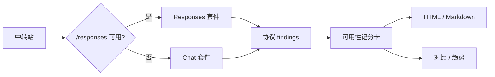

<p align="center">
  <a href="https://abcabc354.github.io/zhongzhuancha-relay-audit/demo/">
    
  </a>
</p>

<h1 align="center">中转查 · relay-audit</h1>

<p align="center">给 OpenAI 兼容中转做一次“能不能用、协议面是否像官方”的体检。</p>

<p align="center">简体中文 ｜ <a href="README.en.md">English</a></p>

<p align="center">
  <a href="https://abcabc354.github.io/zhongzhuancha-relay-audit/demo/"></a>
  <a href="https://github.com/abcabc354/zhongzhuancha-relay-audit/releases/latest"></a>
</p>

<p align="center">
  <a href="https://www.python.org/"></a>
  <a href="https://pypi.org/project/zhongzhuancha-relay-audit/"></a>
  <a href="docs/checks.md"></a>
  <a href="#"></a>
  <a href="LICENSE"></a>
  <a href="https://github.com/abcabc354/zhongzhuancha-relay-audit/actions/workflows/ci.yml"></a>
</p>

<p align="center">
  
  
</p>

<p align="center"><em>左：真实命令输出的逐字动画；右：报告预览。主分、协议附录和检查明细分开呈现。</em></p>

## 关于

**中转查**（[zhongzhuancha.com](https://zhongzhuancha.com/)）是一个 AI 中转站导航与评测站。
这个仓库是它的 **clean audit-only** 工具：只回答“能不能用、协议面是否像官方”，不认证型号身份。

- 先探 `/responses`，不支持就自动回退 Chat-only；
- 主分只看稳定性、对话、能力、目录；
- 协议契约、错误码和包装放在附录，作为证据，不直接扣主分；
- 不放 API key、证据或真实报告；完整 legacy `relay_check` 不在这里。

如果这个项目对你有帮助，欢迎点一个 Star :star:。

## 它能回答什么

| 回答 | 不回答 |
|---|---|
| Responses / Chat 面是否可用 | 底层权重是不是某个具体型号 |
| 流式、工具、结构化、视觉是否正常 | 同门型号替换（例如 6-sol 冒充 6.1-sol） |
| 同一请求用量是否稳定 | 服务商是否“官方” |
| 目录里的型号是否真的能调 | 充值/退款/服务承诺 |
| 协议参数是否生效、错误码是否像官方 | — |

## 快速开始

```sh
python3.11 -m venv .venv
. .venv/bin/activate
pip install zhongzhuancha-relay-audit

zzc-audit --base-url https://relay.example/v1 \
  --api-key-file config/relay-a.local.env \
  --out _evidence/report --enable-remote
```

也可以从源码安装：

```sh
pip install -e .
```

> 兼容：旧的 `relay-audit` / `relay-audit-compare` / `relay-audit-trend` / `relay-inspect` 仍保留；新项目请使用 `zzc-*`。

## 工作流



## 文档

- [场景库](docs/scenarios/index.md)
- [第一次审计](docs/walkthrough.md)
- [检查项参考](docs/checks.md)
- [评分口径](docs/scoring.md)
- [架构](docs/architecture.md)
- [FAQ](docs/faq.md)
- [示例](docs/examples.md)
- [Roadmap](ROADMAP.md)
- [PyPI 发布](docs/publishing.md)
- [Live demo](https://abcabc354.github.io/zhongzhuancha-relay-audit/demo/)

## 参与

欢迎 issue、PR 和真实脱敏样例。

- [Contributing](.github/CONTRIBUTING.md)
- [Security Policy](.github/SECURITY.md)
- [Code of Conduct](.github/CODE_OF_CONDUCT.md)

<p align="center">
  <a href="https://github.com/abcabc354/zhongzhuancha-relay-audit/graphs/contributors">
    
  </a>
</p>

## 边界

- 低分不等于型号假，高分也不等于型号真；
- 同门型号替换无法排除；
- 自报、persona、instructions 只能当线索，不能当身份证据。

## License

MIT
