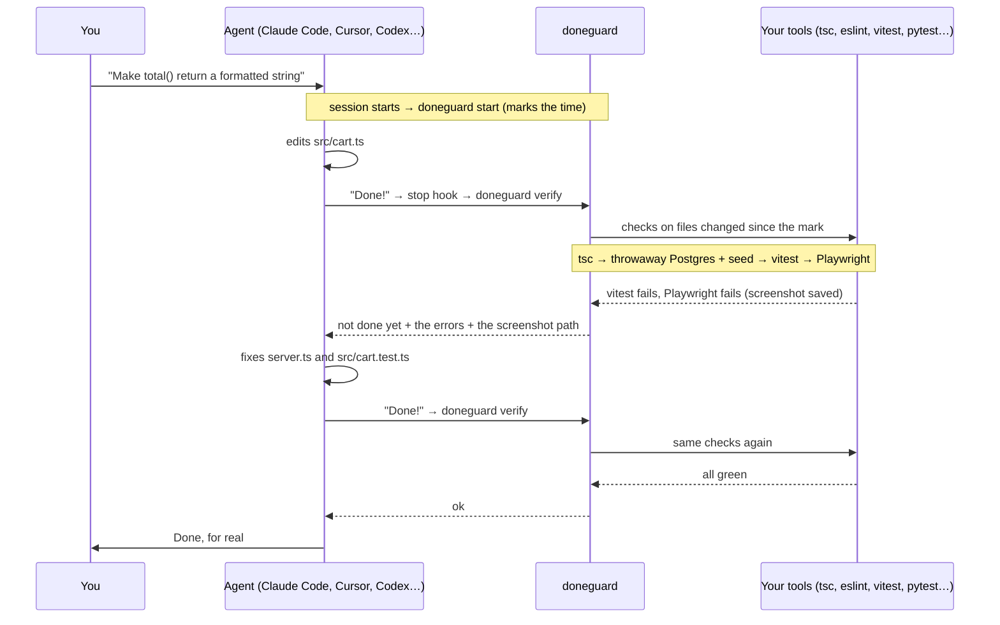

<div align="center">

# doneguard

**Your AI coding agent can't say "done" until the checks pass.**

[](https://pypi.org/project/doneguard/)


<sub>A real Claude Code session. The agent can only read and edit files, so it can't run anything itself. When it tries to stop, doneguard starts a throwaway Postgres, seeds it, runs the unit tests and the Playwright tests, and sends back both failures.</sub>

</div>

Agents love to finish with *"Done! ✅"* while the types are broken and the tests are red. You find out ten minutes later.

doneguard is a **stop hook**. When the agent tries to finish, doneguard runs your type checker, linter and *related* tests on the files changed in the session. If anything fails, the errors go straight back to the agent and it keeps working until they pass.

- **Tests that need a database?** doneguard starts a throwaway Postgres, MySQL, Redis or MongoDB in Docker, migrates and seeds it, points `DATABASE_URL` at it, runs the tests and removes it. Your real database stays out of it.
- **Playwright or Cypress in the project?** It runs the end-to-end tests in a real browser and keeps a screenshot and a video of every test in `.doneguard/evidence/`. When one fails, the agent gets the error, the failure screenshot and a snapshot of the page.
- **Agent skipped the test instead of fixing it?** A `test.skip`, an `@ts-ignore`, an `as any`, a hardcoded API key or a deleted test file added in the session is sent back too: [no shortcuts](#no-shortcuts).
- **Broke a file it never opened?** New type errors anywhere in the project count, while the old ones never block anyone.

- [Works with your agent](#works-with-your-agent)
- [How it works](#how-it-works)
- [Install](#install) · [Update](#update)
- [Add it to an existing project](#add-it-to-an-existing-project) · [Start from zero](#start-a-new-project-from-zero)
- [Tests that need a database](#tests-that-need-a-database) · [End-to-end tests with evidence](#end-to-end-tests-with-evidence) · [No shortcuts](#no-shortcuts)
- [Without hooks: CI, git hooks, any agent](#without-hooks-ci-git-hooks-any-agent)
- [Stats](#stats) · [Show it](#show-it) · [Day to day](#day-to-day) · [Teams](#teams)
- [Stacks](#what-init-detects) · [Configuration](#configuration) · [Commands](#commands) · [FAQ](#faq)

## Works with your agent

Not using Claude Code? doneguard speaks each agent's own hook format. `doneguard init` hooks into the agents it finds, or name them: `doneguard init cursor codex`.

| Agent | How doneguard keeps it working | Status |
|---|---|---|
| **Claude Code** | `Stop` hook → `decision: block` | ✅ tested end to end |
| **Cursor** (IDE and CLI) | `stop` hook → `followup_message` | 🧪 |
| **OpenAI Codex CLI** | `Stop` hook → `decision: block` | ✅ tested end to end ([GIF](#codex-and-copilot)) |
| **GitHub Copilot CLI** | `agentStop` hook → `decision: block` | ✅ tested end to end ([GIF](#codex-and-copilot)) |
| **GitHub Copilot** in VS Code | the same `agentStop` hook | 🧪 |
| **Gemini CLI** | `AfterAgent` hook → `decision: block` | 🧪 |
| **Google Antigravity** | `Stop` hook → `decision: continue` | 🧪 |
| **Devin Local** (successor of Windsurf Cascade) | `Stop` hook → `decision: block` | 🧪 |
| **Kiro CLI** | `Stop` hook → `decision: block` | 🧪 |
| **Aider** | `lint-cmd` → Aider's own fix loop | 🧪 |
| **OpenCode** | plugin on `session.idle` → new prompt | ⚗️ experimental |
| **Cline, Windsurf Cascade, anything else** | a rule: *"run `doneguard check` before saying done"* | manual |

✅ a real session, recorded: Claude Code at the top, Codex and Copilot below. 🧪 built from the agent's official hook docs and tested against its documented payloads. ⚗️ experimental. Using one of them? Tell how it went, worked or not, in an [agent report](https://github.com/abranchesia/doneguard/issues/new?template=agent-report.yml): that's what turns 🧪 into ✅.

<a id="codex-and-copilot"></a>
<details>
<summary><b>Codex and Copilot</b>: the same task, the same block, the same fix</summary>


Codex runs a project's hooks once you approve them (`/hooks` in Codex), and Copilot once you trust the folder. The recordings do that for the one run ([codex.tape](https://github.com/abranchesia/doneguard/blob/main/demo/codex.tape), [copilot.tape](https://github.com/abranchesia/doneguard/blob/main/demo/copilot.tape)).

</details>

Cursor, Copilot and Devin also run the hooks in `.claude/`. When Claude Code is hooked too, `init` doesn't add theirs, so nothing runs twice.

## How it works



1. **`doneguard init`** looks at your project, writes the checks to `.doneguard.conf` and registers two hooks in your agent's config.
2. **Session starts:** the agent runs `doneguard start`, which notes the time.
3. **The agent says it's done:** before letting it stop, the agent runs `doneguard verify`.
4. **verify** lists the files modified since the mark (respecting `.gitignore`), runs only the checks whose globs match them, and only the tests related to them. If a database is needed, it starts one in Docker first and removes it at the end. End-to-end runs leave their evidence in `.doneguard/evidence/`. Whole-project checks like `tsc` count errors in the changed files plus any error that wasn't there at the mark (doneguard notes those in the background when the session starts), so a broken caller in another file is caught and old errors aren't.
5. **Something fails:** the errors go back to the agent in its own format and it keeps working. **Everything passes:** the agent stops and the mark moves forward.
6. **Safety valve:** after 3 failed attempts in a row, doneguard lets the agent stop and tells you, so it never loops forever.

## Install

From [PyPI](https://pypi.org/project/doneguard/):

```bash
uv tool install doneguard   # or: pipx install doneguard
doneguard init --global
```

That's all, for every project, from then on.
- **What `init --global` does:** it hooks doneguard into your agents' user config, for example `~/.claude/settings.json`. The first time an agent opens a git repo, doneguard writes that repo's `.doneguard.conf`, keeps it out of git (`.git/info/exclude`), and checks every stop.
- **What's on in that file:** the quick checks (types, lint, tests that need no database, [no shortcuts](#no-shortcuts)). [Test databases](#tests-that-need-a-database) and [e2e tests](#end-to-end-tests-with-evidence) are there too, commented out: remove their `#` to turn them on.
- **For a team:** `doneguard init` in a project writes a `.doneguard.conf` to commit instead, as in [Add it to an existing project](#add-it-to-an-existing-project).
- **Where it's hooked:**
  - Claude Code (Cursor and Devin run its hooks too), Codex, Gemini CLI, Copilot, Antigravity and Kiro CLI V3.
  - Codex asks you to approve the hooks once with `/hooks`.
  - A project hooked on its own keeps its hooks, and the global ones step aside there.

- **Try it without installing:** `uvx doneguard init`, then `uvx doneguard check`. The agent hooks call `doneguard` by name, so for them it has to be installed and on your `PATH`.
- **Shell can't find `doneguard`?** Run `uv tool update-shell` (or `pipx ensurepath`) and open a new terminal.
- **A check isn't running?** `doneguard doctor` lists what each check needs (tools, Docker, browsers, hooks) and what's missing.
- **New version out?** See [Update](#update).

Requirements: Python 3.9+ (only to run doneguard itself), macOS or Linux, and the tools your checks call (`tsc`, `ruff`, `cargo`…) installed in the project. git is optional; with it, change detection respects `.gitignore`. Docker is optional, for [test databases](#tests-that-need-a-database). Playwright browsers are optional, for [end-to-end tests](#end-to-end-tests-with-evidence).

## Update

doneguard never updates itself and never checks for updates on its own. Nothing runs in your agent's hooks that you didn't install.

**Is there a new version?**

```bash
uv tool list --outdated     # doneguard v0.3.0 [latest: 0.4.0]
doneguard doctor            # ↑ doneguard 0.4.0 is out: uv tool upgrade doneguard…
doneguard --version         # the version you have
```

`doctor` asks pypi.org only when you run it. To get an email for each new version: on GitHub, **Watch → Custom → Releases**. What changed: [Releases](https://github.com/abranchesia/doneguard/releases) and [CHANGELOG.md](https://github.com/abranchesia/doneguard/blob/main/CHANGELOG.md).

**Update:**

```bash
uv tool upgrade doneguard   # or: pipx upgrade doneguard
doneguard init --update     # in each project: adds the checks the new version brings
```

- **The hooks pick it up on their own.** They call `doneguard` by name, so the agent's next stop already runs the new version. There's no need to restart the agent or run `init` again for the hooks.
- **`init --update` only adds lines.** It puts each new check where it works and never changes yours. Commit `.doneguard.conf` so your team gets them too, and each teammate runs `uv tool upgrade doneguard`.
- **In CI**, `pipx install doneguard` or `uvx doneguard` installs the latest version on every run.

## Add it to an existing project


```bash
cd your-project
doneguard init              # detects the stack and your agents, writes .doneguard.conf, adds the hooks
doneguard check src/app.ts  # optional: dry-run the checks on any file
```

Then restart your agent so it loads the hooks, and:

1. **Read `.doneguard.conf`.** One line per check, plain text. Delete what you don't want, add what's missing ([format](#configuration)).
2. **Commit `.doneguard.conf`.** Your team and your CI share the same checks.
3. **Work as usual.** Old errors elsewhere in the repo don't matter: doneguard only looks at files changed in the session.

Using an agent that `init` didn't find (or several)? Name them: `doneguard init codex gemini`, or `doneguard init all`.

Already have a `.doneguard.conf`? `init` never rewrites it, but it lists what it detects now and the file doesn't have yet. `doneguard init --update` adds those lines, each where it works: `cheats` on top, a database right above the tests that need it. Your lines and comments stay as they are.

## Start a new project from zero

In an empty folder there's nothing to detect yet. Run `init` once to install the hooks, scaffold the project, then run `init` again: it fills in the checks as soon as it finds a stack.


```bash
mkdir my-app && cd my-app
doneguard init              # hooks installed, 0 checks for now
npm init -y && npm i -D typescript vitest && npx tsc --init
doneguard init              # now detects tsc + vitest
```

Letting the agent scaffold the project? Tell it: *"once the project is set up, run `doneguard init`"*. The config is read on every stop, so the checks kick in right away.

## Tests that need a database

Integration tests usually need a database with the schema and some data in it. When `init` sees that your project talks to one, it adds a line for it right above the tests, at the end of the file:

```text
*.ts,*.tsx            | @package.json | filter                      | npx --no -- tsc --noEmit --pretty false -p .
*                     | .             | postgres=postgres:17-alpine | npm run db:migrate && npm run db:seed
*.js,*.jsx,*.ts,*.tsx | @package.json | files                       | npx --no -- vitest related --run --passWithNoTests
```

Right before the first check below it runs, doneguard:

1. **starts a throwaway database** in Docker, on a free port of `127.0.0.1`. Same image as your `docker-compose.yml` when there is one (pgvector and PostGIS included), so the version and extensions match.
2. **points your project at it.** For every check below, doneguard overrides `DATABASE_URL`, every variable holding a URL of the same kind in your `.env` files or your shell (`DIRECT_URL`, `POSTGRES_PRISMA_URL`…), and every URL variable your ORM config reads (Prisma's `env("…")`, `process.env.…` in `drizzle.config` and `knexfile`). For Postgres it also sets `PGHOST`, `PGPORT`, `PGUSER`, `PGPASSWORD` and `PGDATABASE`. dotenv, Prisma, Next.js, Vite and pydantic all let a real environment variable win over `.env`.
3. **migrates and seeds it** with the command on the line, with `NODE_ENV=test`. A broken migration or seed is reported to the agent as the cause, and the tests after it are not run, so it isn't buried under fifty "relation does not exist" errors. If the command can't run at all, the tests below are skipped rather than run on an empty database.
4. **runs the checks below it**, then **removes the container**. If the run is killed, the container still removes itself after 15 minutes.

If no check below it runs (only a README changed, or no related tests), no database starts. With the image cached, Postgres is ready in about a second.

| Detected by | Database | Environment |
|---|---|---|
| `pg`, `postgres`, `psycopg`, `asyncpg`, gem `pg`, Prisma `provider = "postgresql"`, or a `postgres`/`postgis`/`pgvector` image in compose | `postgres` | `DATABASE_URL`, `PG*` |
| `mysql2`, `mysqlclient`, `pymysql`, Prisma `provider = "mysql"` | `mysql` | `DATABASE_URL` |
| `redis`, `ioredis`, `bullmq` | `redis` | `REDIS_URL` |
| `mongodb`, `mongoose`, `pymongo`, `motor`, `mongoid` | `mongo` | `MONGODB_URI`, `MONGO_URL` |

The migrate and seed command `init` writes:

| Project | Command |
|---|---|
| Prisma | `prisma migrate deploy` (or `prisma db push` without migrations), then your `db:seed`/`seed` script or `prisma db seed` |
| Drizzle | `drizzle-kit push`, then your seed script |
| Knex | `knex migrate:latest`, then your seed script |
| Other Node projects | your `db:migrate`/`migrate` and `db:seed`/`seed` scripts |
| Alembic (when `env.py` reads the environment) | `alembic upgrade head` |
| Rails | `RAILS_ENV=test bin/rails db:prepare` |
| Django, Redis, MongoDB | `-` (nothing: Django's test runner builds its own test database) |

`init` only writes a migrate and seed command when it can see the connection comes from a variable it redirects: the ORM config reads a URL variable, or, for plain npm scripts, your `.env` files hold a database URL. Otherwise it writes `-` and tells you to fill it in. A config that builds the connection from `DB_HOST`, `DB_USER`… can't be redirected that way, so doneguard never runs a migration through it on its own.

**Docker not running?** The database and the checks below it are skipped, never failed, and doneguard says so (Claude Code shows it after the turn). `init` puts these lines last, so your linters and the stacks that don't need a database still run. Your tests don't need a database after all? Delete the line.

## End-to-end tests with evidence


With `@playwright/test` and a `playwright.config.*` that starts the app (`webServer`), `init` adds an `e2e` line. When the agent changes a page, a component or a stylesheet, doneguard runs the suite in a real browser and keeps everything in your project:

```text
.doneguard/
├── .gitignore                       # "*": evidence stays out of git unless you delete this
└── evidence/
    └── 2026-10-30_12-08-37/
        ├── report/                  # npx playwright show-report .doneguard/evidence/2026-10-30_12-08-37/report
        └── results/
            └── cart-two-mugs-cost-20-00/
                ├── test-failed-1.png    # what the page looked like when it failed
                ├── error-context.md     # the page as text, for the agent
                ├── video.webm
                └── trace.zip            # npx playwright show-trace …
```

- **Every test gets a screenshot and a video**, passing or not; failures also get a trace. Your own Playwright config is used as is: doneguard wraps it for the run (a temporary `.doneguard.playwright.config.*` next to yours) only to add the evidence and the output folder.
- **When a test fails, the agent gets** the error, the paths of the failure screenshot and the page snapshot, and opens them like any other file. Claude Code reads screenshots.
- **Which server the tests hit:** without a test database, `CI` is unset, like a run in your terminal, so a `webServer` with `reuseExistingServer: !process.env.CI` reuses the dev server you already have running. With a test database, `CI` stays set, so Playwright starts its own server pointed at it; if your dev server holds the port, the check is skipped and doneguard tells you, instead of clicking through your dev database.
- **The last 10 runs are kept.** Older ones are deleted.
- **No browsers installed?** The check is skipped until you run `npx playwright install chromium`.
- **Timeout:** 7 minutes, then the check is skipped.


<sub>`test-failed-1.png` from the run above: two mugs in the cart, total $10.00. The agent sees this.</sub>

Any other runner works too: put `{evidence}` in the command and doneguard replaces it with that run's folder. pytest-playwright gets one automatically when there is a `tests/e2e` or `e2e` folder. Cypress needs your app running, so `init` suggests a line instead of writing it:

```text
*.py,*.html,*.css,*.js | . | e2e | pytest -q --tb=short tests/e2e --screenshot on --video on --tracing retain-on-failure --output {evidence}
*.tsx,*.css            | . | e2e | npx --no -- start-server-and-test dev http://localhost:3000 'cypress run --config screenshotsFolder={evidence}/screenshots,videosFolder={evidence}/videos,video=true'
```

## No shortcuts

An agent that can't get a test to pass will sometimes make the check pass instead, and one that needs an API key will sometimes paste it straight into the code. `init` adds a `cheats` line that sends back what was **added in the session**:

| Group | Catches |
|---|---|
| `skips` | `test.skip`, `.only`, `xit`, `@pytest.mark.skip`/`xfail`, `t.Skip()`, `#[ignore]`, `@Disabled`, `markTestSkipped`… in test files |
| `silencers` | `@ts-ignore`, `@ts-expect-error`, `eslint-disable`, `biome-ignore`, `# type: ignore`, `# noqa`, `//nolint`, `#[allow(…)]`, `@SuppressWarnings`, `rubocop:disable`… |
| `any` | `as any`, `: any` in TypeScript |
| `secrets` | AWS, Anthropic, OpenAI, Stripe, GitHub, Slack and Google keys, and private keys, in files git would commit (your gitignored `.env` isn't checked). Shown cut short, never whole |
| `deleted-tests` | test files deleted in the session |

```text
[.] cheats: changes that hide failures or leak secrets
src/cart.test.ts:7  test.skip  skips or focuses a test: that hides the failure instead of fixing it
```

- **Only what the agent added.** doneguard compares against a git snapshot taken when the session starts (`git stash create`, which touches nothing), so the skips and ignores already in your code don't count.
- **Each one is flagged once.** If the agent keeps it, it has to say why in its final answer, and doneguard lets it stop and tells you (Claude Code shows it).
- **`doneguard check`** lists them without failing: they're aimed at agents, not at the `eslint-disable` you wrote on purpose.
- Some of them are fine in your project? Drop the group from the line: `* | . | cheats | skips,deleted-tests`.

## Without hooks: CI, git hooks, any agent

`doneguard check` runs the same checks on your git changes (or on the files you pass, or with `--base <ref>` on everything the branch changed), one progress line per check, and exits 1 on failure. No agent needed. The GIF in [End-to-end tests](#end-to-end-tests-with-evidence) shows it.

**GitHub Actions**, on everything the pull request changed, with the result in the run's summary:

```yaml
on: pull_request
jobs:
  doneguard:
    runs-on: ubuntu-latest
    steps:
      - uses: actions/checkout@v7
        with:
          fetch-depth: 0
      - run: npm ci                  # install your project's tools
      - run: npx playwright install --with-deps chromium   # if you have e2e tests
      - run: pipx install doneguard
      - run: doneguard report --base origin/${{ github.base_ref }} >> $GITHUB_STEP_SUMMARY
```

GitHub's Ubuntu runners have Docker, so the test databases work there too.

**Git pre-commit hook:**

```bash
printf '#!/bin/sh\nexec doneguard check $(git diff --cached --name-only)\n' > .git/hooks/pre-commit
chmod +x .git/hooks/pre-commit
```

**Agents without a stop hook** (Cline, Windsurf Cascade…): add to `AGENTS.md` or the agent's rules: *"Before saying you're done, run `doneguard check` and fix everything it reports."*

## Stats

doneguard keeps a tiny local log of every checked stop. Ask it how many times it caught your agent:

```text
$ doneguard stats
doneguard stats since 2026-10-30
  stops checked        2 in 1 session(s)
  "done" blocked       1
  fixed by the agent   1 of 1 (100%)
  most failing         vitest (1)
  agents               claude (2)

Caught 1 broken "done" claim(s); the agents fixed 100% on their own.
```

That's the real output of the session in the GIF at the top: one stop blocked by Playwright and vitest, fixed on the next try. The log lives in `~/.local/state/doneguard/log.jsonl` (or `$XDG_STATE_HOME`) and stores only times, agent names, results and tool names: no code, no paths. Delete it to start over.

## Show it

**Every turn, in Claude Code.** When everything passes, doneguard says what it checked, so you see it working and not only when it blocks:


**In a pull request.** `doneguard report` runs the same checks and writes the result as markdown:

```bash
doneguard report --base origin/main | gh pr comment --body-file -       # a PR comment
doneguard report --base origin/${{ github.base_ref }} >> $GITHUB_STEP_SUMMARY   # the summary of a GitHub Actions run
```

```markdown
### ✅ Checked by doneguard

| Check | Result | Time |
|---|---|---|
| cheats | ✓ passed | 0.0 s |
| tsc | ✓ passed | 0.6 s |
| postgres | ✓ passed | 0.9 s |
| postgres setup | ✓ passed | 0.3 s |
| vitest | ✓ passed | 0.7 s |
| playwright | ✓ passed | 1.0 s |
```

When something fails, the report says what, and exits 1.

**In your README.** [](https://github.com/abranchesia/doneguard)

```markdown
[](https://github.com/abranchesia/doneguard)
```

## Day to day

- **You don't run anything.** The hooks fire on their own when a session starts and every time the agent tries to stop. In Claude Code, a line under the agent's answer says what passed: `doneguard: ✓ cheats · tsc · vitest (3.1 s)`.
- **When a check fails**, the agent gets the errors and keeps going. You see it fixing things instead of saying "done".
- **If it still fails after 3 tries**, the agent stops (Claude Code shows `doneguard: checks still failing after 3 fix attempts`).
- **After an e2e run**, the screenshots and videos are in `.doneguard/evidence/`, newest last. Open the report with `npx playwright show-report .doneguard/evidence/<run>/report`.
- **Pause a check** by commenting its line with `#` in `.doneguard.conf`. It takes effect on the next stop.
- **Check by hand** at any time: `doneguard check`.

## Teams

Commit `.doneguard.conf`. Each developer installs doneguard and runs `doneguard init`, which keeps the existing config and adds their hooks. After an upgrade, one person runs `doneguard init --update` and commits the result.

`.doneguard/` ignores itself, so evidence never lands in a commit by accident. To keep evidence in the repo (for review, or as a CI artifact), delete `.doneguard/.gitignore`.

Hook files that live in the repo (`.cursor/hooks.json`, `.codex/hooks.json`, `.gemini/settings.json`, `.github/hooks/doneguard.json`…) run for everyone who opens the project with that agent. Commit them only if everyone has doneguard installed: without it, their agent reports a failed hook on every stop. Claude Code's hooks go to `.claude/settings.local.json`, which is personal.

## What `init` detects

| Stack | Detected by | Check |
|---|---|---|
| TypeScript | `tsconfig.json` | `tsc --noEmit`, errors in changed files only |
| ESLint / Biome | `eslint` or `@biomejs/biome` in `package.json` | `eslint --quiet` / `biome lint` on changed files |
| Vitest / Jest | `vitest` or `jest` in `package.json` | `vitest related` / `jest --findRelatedTests` |
| Playwright | `playwright.config.*` with a `webServer` | the e2e suite, with [evidence](#end-to-end-tests-with-evidence) (Cypress: a suggested line) |
| Python | `pyproject.toml`, `setup.py`, `requirements.txt` | `ruff` (syntax errors, undefined names), `pytest` on related tests, pytest-playwright e2e |
| Ruby | `Gemfile` | `rubocop` (errors only), `bin/rails test` or `rspec` on related tests |
| Go | `go.mod` | `go vet` (findings in changed files), `go test` on the packages with related tests |
| Rust | `Cargo.toml` | `cargo check`, errors in changed files only |
| Java / Kotlin | `pom.xml`, `build.gradle*` + `gradlew` | `mvn compile` / `./gradlew classes`, errors in changed files only |
| C# | `*.sln`, `*.csproj` | `dotnet build`, errors in changed files only |
| PHP | `composer.json` | `php -l` on changed files, Pest or PHPUnit on related tests |
| Deno | `deno.json` | `deno check`, `deno test` on related tests |
| Swift | `Package.swift` | `swift build`, errors in changed files only |
| Databases | dependencies, Prisma schema, `docker-compose.yml` | a [throwaway Postgres, MySQL, Redis or MongoDB](#tests-that-need-a-database) |

It looks at the root and one folder down, so monorepos work: JS checks run once per package (`@package.json`). For Python it uses `uv run` or `.venv/bin/` when it finds them. Anything else is one line of [configuration](#configuration) away.

## Configuration

`.doneguard.conf` lives at the root of the project. One check per line, `#` for comments:

```text
# <globs>       | <dir>         | <mode>   | <command>
*.ts,*.tsx      | @package.json | filter   | npx --no -- tsc --noEmit --pretty false -p .
*.py            | .             | files    | .venv/bin/ruff check --select E9,F63,F7,F82 --output-format concise
*               | .             | postgres | .venv/bin/alembic upgrade head
*               | .             | redis    | -
*.py            | .             | tests    | .venv/bin/pytest -x -q --tb=short {tests}
*.go            | .             | tests    | go test {test_dirs}
*.tsx,*.css     | web           | e2e      | npx --no -- playwright test
*.sql           | .             | command  | ./scripts/check-migrations.sh
```

| Field | Meaning |
|---|---|
| `globs` | Comma-separated, matched against the path relative to the root. `*` also crosses folders. |
| `dir` | Where the command runs, relative to the root. `@<file>` means the nearest folder holding `<file>`, so `@package.json` runs once per package in a monorepo. |
| `mode` | How the result is judged, see below. |
| `command` | Any shell command. Pipes are fine. |

| Mode | Runs | Fails when |
|---|---|---|
| `files` | `command <changed files>` | exit code is not 0 |
| `filter` | `command` as is | an output line cites a changed file, or (in an agent session) an error appears that wasn't there when the session started. Perfect for whole-project tools like `tsc` |
| `tests` | `command` with `{tests}` replaced by the related tests (`test_x.py`, `x_test.go`, `x.test.ts`, `x.spec.ts`, `XTest.php`…), or `{test_dirs}` by their folders (`./cart`) | exit code is not 0; skipped when there are no related tests |
| `command` | `command` as is | exit code is not 0 |
| `cheats` | nothing: looks at the lines added since the session started; `command` lists the [groups](#no-shortcuts) (`-` for all) | one of them shows up; each is flagged once, and `doneguard check` only lists them |
| `e2e` | `command` with `{evidence}` replaced by a new folder in `.doneguard/evidence/`; `playwright test` gets screenshots, videos and traces there on its own | exit code is not 0; the failure screenshots are listed for the agent |
| `postgres`, `mysql`, `redis`, `mongo` | a throwaway database in Docker (`postgres=<image>` picks the image), before the first check below it that runs; then `command` (`-` for none) with `DATABASE_URL` and friends pointing at it | the command's exit code is not 0; the checks below it are then skipped |

A tool that isn't installed, Docker that isn't running, missing browsers, or a check that takes longer than 150 s (7 minutes for `e2e`) is skipped, never failed.

## Commands

| Command | What it does |
|---|---|
| `doneguard init [--update] [agents…]` | Detect the stack, write `.doneguard.conf` (if it has no checks yet; otherwise list what's new, and with `--update` add it) and add the hooks to the agents found here, or to the ones you name (`all` for every one). Safe to run again. |
| `doneguard init --global [agents…]` | Hook into your agents for every project, in their user config. Each git repo then gets a `.doneguard.conf`, kept out of git, on its first session: quick checks on, databases and e2e commented out. Safe to run again. |
| `doneguard check [--base REF] [files…]` | Run the checks on the given files, on your git changes, or on everything changed since the branch left `REF`, with a progress line per check. Exit 1 on failure. |
| `doneguard report [--base REF] [files…]` | The same checks, written as markdown for a pull request comment or a CI summary. Exit 1 on failure. |
| `doneguard doctor` | What the checks here need (tools, Docker, Playwright browsers, hooks) and what's missing. Exit 1 if a check would be skipped. |
| `doneguard stats` | How many "done" claims were blocked, and how many the agents fixed. |
| `doneguard --version` | The installed version. |
| `doneguard start` | Hook: mark the start of a session (reads the event JSON on stdin). |
| `doneguard verify` | Hook: check the files changed since the mark and answer in the agent's format. |

## FAQ

**Do I need Claude Code?** No. See [Works with your agent](#works-with-your-agent). Without any agent, `doneguard check` works in CI and git hooks.

**Why not write my own stop hook that runs lint and tsc?** The usual hand-written one has three gaps. It lets the second stop through (`stop_hook_active`), so the agent's fix is never checked. It fails on errors that were already in the project, so a legacy repo never passes. And it only sees files changed through the edit tool, so it misses `sed`, codegen and scripts. doneguard checks again after every fix (up to 3 tries), counts only new errors, compares modification times, and also runs the related tests, a throwaway database and the e2e suite, in each agent's own hook format.

**Does it slow the agent down?** It runs once, when the agent tries to stop, and only the checks that match the changed files. Usually a few seconds.

**Can it touch my real database?** The migrate and seed command only runs after the throwaway database is up, with `DATABASE_URL`, the `PG*` variables, every same-kind URL from your `.env` files and shell, and the URL variables your ORM config reads all pointing at it. If Docker can't start it, the command doesn't run at all. `init` only writes the command when it can see the connection goes through one of those variables, and e2e tests never reuse your dev server while a test database is up. What doneguard can't redirect is a connection hardcoded in your code: read the database line before you commit it.

**Docker is off on my laptop half the time.** Then the database line and the checks below it are skipped, with a note, and everything above it still runs (`init` puts them last). Start Docker Desktop, OrbStack or Colima and the next stop runs them again.

**Isn't a database per stop slow?** About a second with the image cached, plus your migrations and seed. It only starts when a check below it actually runs, and it uses `fsync=off` because the data is thrown away anyway.

**My e2e suite takes 10 minutes.** Then it doesn't fit in a stop hook: give the `e2e` line narrower globs (only the pages that matter), point it at a smoke subset (`npx --no -- playwright test e2e/smoke`), or keep the full suite in CI with `doneguard check`.

**My project already has lint errors.** `filter` checks (tsc, cargo, go vet, mvn, swift) only count errors in changed files and errors that are new since the session started. `files` checks lint whole files, so the default ruff rules are fatal errors only: syntax errors and undefined names.

**The agent changed a function and broke a file it didn't touch. Will doneguard see it?** Yes. Related tests follow imports (`vitest related`, `jest --findRelatedTests`). And when a session starts, doneguard notes in the background the errors `tsc`, `cargo`, `go vet`… already report. When the agent stops, any error that wasn't on that list counts, in any file. Old errors never block anyone.

**What if I edit files while the agent works?** Your changes count too: doneguard checks every file modified since the agent last finished, whoever changed it.

**Does it catch edits the agent makes through shell commands?** Yes. It compares modification times, so `sed`, codegen and scripts count, not just the edit tool.

**Does it send my code anywhere?** No. It runs your own tools on your machine. No telemetry. The only network requests: Docker may pull a database image the first time, and `doneguard doctor`, when you run it, asks pypi.org for the latest version number. It's one file: [`doneguard.py`](https://github.com/abranchesia/doneguard/blob/main/doneguard.py).

**How do I uninstall?** Remove the `doneguard` entries from your agent's hook config, delete `.doneguard.conf`, then `uv tool uninstall doneguard` (or `pipx uninstall doneguard`).

**Windows?** macOS and Linux for now: commands run through `sh`.

## Contributing

Small on purpose: one file, standard library only. New stack detections, agent adapters and reports from agents marked 🧪 are welcome: see [CONTRIBUTING.md](https://github.com/abranchesia/doneguard/blob/main/CONTRIBUTING.md). What changed in each version: [CHANGELOG.md](https://github.com/abranchesia/doneguard/blob/main/CHANGELOG.md) and [Releases](https://github.com/abranchesia/doneguard/releases). Found a bug? [Open one](https://github.com/abranchesia/doneguard/issues/new?template=bug.yml) with your `doneguard --version`.

```bash
uvx pytest            # run the tests
vhs demo/check.tape   # re-record a GIF (needs vhs, npm and Docker; claude.tape also needs Claude Code)
```

Releasing: bump `version` in `pyproject.toml`, commit, then `git tag vX.Y.Z && git push origin vX.Y.Z`. The [release workflow](https://github.com/abranchesia/doneguard/blob/main/.github/workflows/release.yml) runs the tests and publishes to PyPI.

## License

[MIT](https://github.com/abranchesia/doneguard/blob/main/LICENSE)
