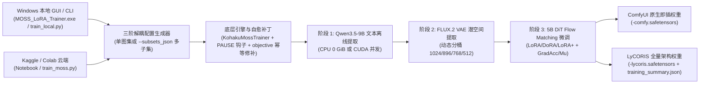

# OpenMOSS MOSS-Image Dual-Track LoRA Training Pipeline

[](https://github.com/abysschaos/kaggle-moss-lora-pipeline/releases/latest)
[](./LICENSE)
[](https://huggingface.co/KBlueLeaf/MOSS-Image-heal)
[](https://github.com/KohakuBlueleaf/KohakuMossTrainer)
[](#快速开始-quickstart)

> 一套面向 **OpenMOSS MOSS-Image (5B Single-Stream DiT)** 的双轨 LoRA / DoRA / LoHa / LoKr 自动化训练与工程调度方案，基于 [KohakuBlueleaf/KohakuMossTrainer](https://github.com/KohakuBlueleaf/KohakuMossTrainer) 构建，全面兼顾 **Windows 消费级显卡（6GB~16GB VRAM）零黑框图形化极速炼丹** 与 **Kaggle / Colab 云端免费 GPU 自动化流水线**。

---

## 目录 (Table of Contents)

- [项目定位与核心特性](#项目定位与核心特性)
- [系统架构与双轨数据流](#系统架构与双轨数据流)
- [双轨硬件与效率对比](#双轨硬件与效率对比)
- [快速开始 (Quickstart)](#快速开始-quickstart)
- [详细使用指南](#详细使用指南)
- [配置项与环境变量](#配置项与环境变量)
- [ComfyUI 官方原生推理规范](#comfyui-官方原生推理规范)
- [项目目录结构](#项目目录结构)
- [核心技术文档体系](#核心技术文档体系)
- [更新计划 (Roadmap)](#更新计划-roadmap)
- [常见问题与排错指引](#常见问题与排错指引)
- [开发与贡献指南](#开发与贡献指南)
- [致谢与开源许可证](#致谢与开源许可证)

---

## 项目定位与核心特性

在消费级显卡（如 8GB VRAM 的 RTX 4060 / 4070 Laptop）或免费云端容器（Tesla T4 16GB）上微调 50 亿参数的 MOSS-Image 单流 DiT 与 9B Qwen3.5 文本编码器，容易遭遇联合加载显存溢出（>22 GB）、PyTorch 动态库脱节、Windows Triton 中文路径解码失败以及半精度残差尖峰溢出。本项目在不修改原生权重格式的前提下，将环境治理、三阶解耦调度、多子集配比与视觉化监控打包为开箱即用的双轨工程系统。

- **全谱系底模与显存弹性档位**：本地与云端双轨同步支持 `MOSS-Image-Base`、`MOSS-Image-heal` 与 `MOSS-Image-SFT` 三大变体自动探测，提供 `auto / 6g / 8g / 12g / 16g` 五档精准校准显存配置（`MAX_TOKENS = 4352 / 6144 / 8192`）与 `1024 / 896 / 768 / 512` 动态分桶分辨率；支持 `--base_precision`（含 RTX 40 系+ `fp8_compute` + `FP8_DGRAD="16bit"` 守卫）与非 Heal 底模 `FP16_FIX="online"` 防溢出保护。
- **三阶时序解耦与零重复消费下载**：支持全盘宽域扫描并零拷贝复用现有 ComfyUI 模型库，按需路由 Qwen3.5-9B 至主机内存执行 CPU 离线文本特征提取（当主机内存 ≥22GB 或 GPU ≥15GB 时智能优先选用全精度 BF16 文本编码器），随后由 GPU 提取 FLUX.2 VAE 潜向量并释放，最终在仅载入 5B DiT 与轻量适配器的状态下完成高精度微调。
- **原生零黑框 Windows 桌面控制台与 5-Tab 分区看板 (`v1.8.0`)**：内建开源可审计 C# 启动器 [MossTrainerLauncher.cs](launcher/MossTrainerLauncher.cs)，1 秒无第三方依赖编译为原生 `MOSS_LoRA_Trainer.exe`；采用 `core/` + `ui/` 解耦架构与深色 `5-Tab` 选项卡工作区，支持在 Tab 1 顶部一键切换 **【目标算力】**（`💻 本机显卡 / ☁️ Kaggle 双卡 T4 / ⚡ Kaggle 单卡 T4`）并按双卡 `MAX_TOKENS=9216×2卡` 并发吞吐智能校准 8 套预设的 `GradAcc`、$\sqrt{B}$ 学习率、短步数 `EMA` 与存盘间隔（内置预估图数算步与推送前防过曝拦截）；右侧常驻纯原生 `tk.Canvas` 实时 Loss / EMA 折线图与 4 枚 KPI 卡片，内置 **【🩺 一键体检图集】**、**8 套实战预设模板**以及离线手册直读器。
- **零代码 Kaggle 云端四模图集直拉与成果回传 (`v1.8.0`)**：直接在本地 GUI 的【☁️ 云端遥控】选项卡完成 `kaggle.json` 凭据隔离保存，支持四大图集投递通道——**🔗 6 站临时外链自动中转直拉 (`url`)**（自动打包为 `_direct.zip` 并轮询上传至 `temp.sh / x0.at / filebin.net / transfer.whalebone.io / ul.sto.care / tmpfiles.org` 生成多镜像 `|` 容灾链，云端容器自动处理 POST/Cookie/签名穿透，**完全不创建/挂载 Kaggle Dataset**）、**🤗 HF 私有仓库 (`hf`)**（支持勾选自动新建 `Private` 数据集并直传本地图片或直接拉取已有仓库，享 100GB 免费私有空间）、**☁️ Cloudflare R2 私有对象存储 (`r2`)**（零依赖 AWS SigV4 预签名直传私有桶并自动签发 7 天有效 `GET` 直链，享 10GB 免费与 $0 出站流量，Secret 密钥仅存 `~/.kaggle/r2_credentials.json`），以及 **📦 Kaggle 私有 Dataset (`local`)**；内建 **超时自动存盘守护（默认 540 分钟触发优雅存盘并打包退出）**、**30 秒自动轮询**、**右侧拉取云端日志**、**🛑 停监控与网页 Stop 引导**、**🗑️ 强删云端任务**、一键回传同步 ComfyUI/Loss 曲线，以及**零 API 手动上传导出包**。
- **全场景断点续炼与中途暂停存盘**：支持 `fresh / resume / init_from` 三大训练模式、双轨同步解析 `safetensors` 头部自动对齐已有架构（含 LoKr 因子与 `TRAIN_NORMS`）、训练中途随时点击【暂停并存盘】安全退出并保留权重，以及每 10 秒后台增量同步导出产物到专属目录与 ComfyUI `models/loras/`。
- **高阶适配器防过拟合、多优化器与自适应调度体系**：双轨开放 LoKr 全参数（`--lokr_factor / --lokr_full_matrix / --lokr_decompose_both`）、`--train_norms`、三层 `DROPOUT`（含 DoRA `input_dropout` 强置 0 防护）、`AdamW / AdamW8bit Kernel / Muon` 优化器与 GPU 安全显存档位自动重映射、`Cosine / Constant` 调度、可配 `Warmup` 与 `EMA` 平滑、多种时间步分布（`moss / uniform / logit_normal`）、`--text_drop / --flip / --seed / --save_format`，以及默认折叠的 GUI 进阶抽屉兼顾小白零门槛与高阶精细微调。

---

## 系统架构与双轨数据流



---

## 双轨硬件与效率对比

| 评估维度 | 模式 A：云端 Kaggle / Colab 自动化 | 模式 B：Windows 本地消费级显卡极速模式 |
| :--- | :--- | :--- |
| **目标硬件** | **Kaggle GPU T4 x2 (16GB × 2)** / T4 x1 / Colab L4 / A100 | RTX 4070 / 4060 / 3060 / 2060 (6GB ~ 16GB VRAM) |
| **计算精度** | 物理架构检测 `sm>=80`（T4 自动 FP16 + 防溢出，L4/A100 用 BF16） | 原生硬件级 BF16（Turing 显卡自动平滑回退 FP16） |
| **显存档位与分辨率** | 支持 `auto / 6g / 8g / 12g / 16g`、`1024 / 896 / 768 / 512` 与 **Dual-T4 DDP** | GUI / CLI 自由切换显存档位、`896` 甜点分辨率与底模计算精度 |
| **底模变体支持** | `heal` / `base` / `sft` 全谱系，Dual-T4 DDP 自动优选 `int8`+`ckpt-resident` | 自动探测并直连现有本地 `Base` / `Heal` / `SFT` 文件 |
| **单步实测参考速度** | **Dual-T4 DDP: ~30.2 秒/step (并发 4×1024 图，约 7.5 秒/图)**；单卡 ~42s | ~7 - 9 秒 / step (RTX 40 系列, 提速约 4.5 倍) |
| **模型资产依赖** | 从 HuggingFace 按所选变体与量化规格高速拉取 | 优先零拷贝复用本机 ComfyUI 模型库，无需重复下载 |
| **标准入口** | [notebooks/kaggle_moss_lora_training.ipynb](notebooks/kaggle_moss_lora_training.ipynb) 或桌面 GUI【☁️ 云端遥控】/ `.\scripts\push_to_kaggle.ps1` | `MOSS_LoRA_Trainer.exe`（由 [build_exe.bat](build_exe.bat) 1 秒编译）或 [launch_ui.vbs](launch_ui.vbs) |

---

## 快速开始 (Quickstart)

> **路径避坑铁律**：Windows 本地运行请务必将仓库解压或克隆至**纯英文且无空格**的磁盘路径（如 `D:\kaggle_moss_lora_pipeline\`），避免 PyTorch C++ 算子或 Triton 解码发生路径异常。
> **第一次炼丹不知道按钮是干嘛的？** 直接点击阅读 **[📖 小白傻瓜式使用指南 (含全部按钮与参数大白话字典)](docs/beginner_guide.md)**，30 秒看懂从体检图集到出图避坑！

### 方式一：Windows 本地极速上手（3 步零黑框启动）

#### 1. 获取项目代码与发行工具
- **推荐下载压缩包**：前往 [GitHub Releases 最新稳定版 (v1.8.0)](https://github.com/abysschaos/kaggle-moss-lora-pipeline/releases/latest) 获取源代码包与预编译的 `MOSS_LoRA_Trainer.exe`（可对照同页 `SHA256SUMS.txt` 校验），或直接下载 [主分支 ZIP](https://github.com/abysschaos/kaggle-moss-lora-pipeline/archive/refs/heads/main.zip)。
- **Git 命令行克隆**：
  ```bash
  git clone https://github.com/abysschaos/kaggle-moss-lora-pipeline.git
  cd kaggle-moss-lora-pipeline
  ```

#### 2. 环境就绪与原生启动器构建
- **若本机已安装 ComfyUI 便携版 / 独立 CUDA Python**：无需新建环境，启动器会自动全盘探测并直接复用现有 PyTorch 环境。
- **若为全新纯净 Windows 系统**：双击根目录 [install_windows.bat](install_windows.bat)（或运行 `.\scripts\install.ps1`），脚本将自动构建隔离 `venv`、安装 CUDA 12.4 PyTorch、补齐 `requirements-local.txt` 并生成 `models/` 与 `KohakuMossTrainer/` 存放说明。
- **编译本地 `.exe` 启动器（1 秒透明编译，无需 PyInstaller）**：双击根目录 [build_exe.bat](build_exe.bat)（或运行 `.\scripts\build_exe.ps1 -CreateDesktopShortcut`），系统会调用 Windows 自带的 `.NET Framework 4.x csc.exe` 从源码生成 `MOSS_LoRA_Trainer.exe`。

#### 3. 选择适合你的启动入口

| 启动入口 | 类型 | 核心定位与适用场景 | 是否弹黑框 |
| :--- | :--- | :--- | :--- |
| **`MOSS_LoRA_Trainer.exe`** | 原生 WinExe 启动器 | **日常桌面首选**：1 秒由源码透明编译，带多分辨率图标、可固定 Windows 任务栏、内置高速 PyTorch 直达通道 | 否（全链路静默） |
| [launch_ui.vbs](launch_ui.vbs) | Windows Script Host | **免编译备选**：未执行 `build_exe.bat` 时直接双击使用，后台静默拉起 `silent_launcher.pyw` 与 GUI | 否 |
| [launch_ui.bat](launch_ui.bat) | 批处理兼容入口 | 用于双击习惯或快捷脚本中转，自动转交 `launch_ui.vbs` 后立即关闭窗口 | 极短闪关 / 否 |
| [scripts/run_local.ps1](scripts/run_local.ps1) | 交互式 PowerShell CLI | **终端/无人值守调试**：快速检测显卡与默认图集后直接敲回车或输入 `custom` 跑 CLI | 是（终端模式） |

打开图形控制台后，界面按任务划分为左侧 **5 大选项卡**与右侧**实时监控看板**：在【📂 数据与续炼】选择图集并点一次【🩺 一键体检图集】（或启用多子集配平），在【🚀 快速训练】顶部一键套用 8 套实战模板（`艺术画风 / 单人角色 / 多人物配比 / 多画风配比 / 概念与动作 / LoKr 高还原画风 / 小图集防过拟合角色 / Muon 画风加速`）并点击【📐 一键对齐推荐步数】，随后点击【🚀 启动本地极速训练】即可在右侧实时观察 Loss / EMA 曲线，训练完成后权重自动归档到 `output/<lora_name>/` 并可同步至 `ComfyUI/models/loras/`。

---

### 方式二：Kaggle 云端免费部署（无需本地高性能显卡）

#### 首选方式：本地桌面端【☁️ 云端遥控】零代码四模图集直拉流水线（v1.8.0 升级）

不写一行代码、也不用打开繁琐的终端和网页上传表单，在 `MOSS_LoRA_Trainer.exe` 中切到 **`☁️ 云端遥控`** 选项卡（快捷键 `Ctrl+4`）四步即可全自动完成云端炼丹与成品回收：
1. **接入凭证**：点击【📥 导入 kaggle.json】（或填入 Kaggle 用户名与 API Key 后点保存），密钥仅写入本机 `~/.kaggle/kaggle.json`，随后可点【🔍 检测连通性】验证权限。
2. **选目标算力、超时存盘与图集来源（四选一）**：先在 Tab 1 顶部把【目标算力】切到 `☁️ Kaggle 双卡 T4`（软件会自动按双卡 4 图/步把预设 `GradAcc` 归 1、校准学习率与推荐步数，并按步数细化存盘与短步 EMA），再到 Tab 4 选定 `🔥 双卡 T4 DDP (推荐)` / `⚡ 单卡默认 GPU`、底模分支及**自动存盘时限(分)**（默认 `540` 分钟）；在 **【训练图集来源】** 按需选择：
   - **🔗 临时外链 (6站免配)**：无需任何第三方账号，自动打包上传 `temp.sh / x0.at / filebin.net / transfer.whalebone.io / ul.sto.care / tmpfiles.org` 生成多镜像容灾直链，云端容器开机直接 `curl` 拉入 `/tmp/`（`dataset_sources=[]`），免 Kaggle 数据集审核；
   - **🤗 HF 私有仓库**：支持勾选“开炼前自动上传本地图集至 HF 私有仓”或“仅直拉已有仓库”，长期复用最省心（100GB 免费私有空间）；
   - **☁️ R2 私有存储**：填入 Cloudflare R2 Account ID / Bucket / API 密钥并安全存至 `~/.kaggle/r2_credentials.json`，自动上传压缩包并签发 7 天 AWS4 预签名直链供 Kaggle 私有拉取；
   - **📦 Kaggle 私有集**：直接将图集上传为 Kaggle Private Dataset 并挂载。
3. **一键开炼（带防过曝检查）**：点击绿色主按钮一键启动（推送双卡前若检测到高曝光隐患会弹出自动重算/强推确认窗），也可点击【📦 导出免 API 手动上传包】生成对应模式下的预填 `.ipynb` 与操作指南。
4. **日志监控、停机控制与一键拉回**：开启【⏱️ 自动轮询 (30s)】或点【📜 拉取云端日志】在右侧查看输出；若需中止，可点【🛑 停监控 & 去网页点 Stop】或经高危二次确认后执行【🗑️ 强删云端任务】；待云端变成 `COMPLETE` 后点【3️⃣ 一键拉回成品权重】，软件自动下载解压到 `output/<lora_name>/`、同步至 `ComfyUI/models/loras/`，并在右侧画出云端收敛 `Loss / EMA` 曲线！

#### 备选方式：纯网页端 Notebook 运行
1. 将本地图片与同名 `.txt` 自然语言标注打包为 ZIP（或使用桌面端导出的免 API 上传包），在 Kaggle 创建私有 Dataset（**+ Create -> New Dataset**）。
2. 新建 Notebook，开启 **GPU T4 x2**（或 `T4 x1`）与 **Internet on**，挂载私有数据集。
3. 导入仓库中的 [notebooks/kaggle_moss_lora_training.ipynb](notebooks/kaggle_moss_lora_training.ipynb)（或免 API 导出包里的预填 `.ipynb`），核对顶部的 `LORA_NAME`、`TRIGGER_WORD`、`ALGO`、`USE_DORA`、`SUBSETS_JSON` 后点击 **Run All**，完工后下载 `{LORA_NAME}_lora_results.zip`。完整图文说明见 [docs/kaggle_deployment_guide.md](docs/kaggle_deployment_guide.md)。

---

## 详细使用指南

### 1. 本地 CLI 标准调用示例 ([train_local.py](train_local.py))

```powershell
# 查看当前版本
python train_local.py --version

# 常规单人角色 + DoRA + 梯度累积 + 精细细节 Mu=0.35 + 896 甜点分辨率训练
python train_local.py `
    --data_dir "./dataset/my_char" `
    --lora_name "my_char_dora_v1" `
    --trigger_word "my_char" `
    --repeats 6 `
    --epochs 4 `
    --steps 400 `
    --rank 32 `
    --alpha 32.0 `
    --algo lora `
    --dora `
    --target_preset attn-mlp `
    --loraplus_ratio 2.0 `
    --grad_acc 2 `
    --timestep_mu 0.35 `
    --vram_preset 16g `
    --resolution 896 `
    --base_precision auto `
    --tune off `
    --overlong drop_tokens `
    --precision bf16 `
    --text_device cpu `
    --copy_to_comfy_loras
```

### 2. 多子集配比调用示例（多人物 / 多画风 / 概念均衡）

准备一个 JSON 配置文件（或直接传入 JSON 数组字符串），指定各子集名称、独立目录、专属触发词与独立重复倍率：

```json
[
  {"name": "char_alice", "path": "D:/datasets/alice", "trigger": "alice_char", "repeats": 6, "enabled": true},
  {"name": "char_bob",   "path": "D:/datasets/bob",   "trigger": "bob_char",   "repeats": 12, "enabled": true}
]
```

```powershell
python train_local.py `
    --subsets_json "./subsets.json" `
    --lora_name "duo_alice_bob" `
    --steps 800 `
    --rank 48 `
    --alpha 48.0 `
    --algo lora `
    --dora `
    --target_preset attn-mlp+text-refiner `
    --loraplus_ratio 2.0 `
    --copy_to_comfy_loras
```

> 本地 54 个 CLI 开关与云端 60 个 CLI / 环境变量参数全表，请参阅 [docs/parameter_configuration_reference.md](docs/parameter_configuration_reference.md)。

### 3. 断点续炼与已有 LoRA 继续微调

- **继续中断任务 (`resume`)**：`--train_mode resume --resume_from latest`（或指向具体 `step_XXXXXXXX` 目录），程序会自动顺延剩余步数。
- **基于已完成权重二次强化 (`init_from`)**：`--train_mode init_from --init_from "./output/my_lora/my_lora-comfy.safetensors"`，系统自动嗅探权重文件中的 `LoRA / LoHa / LoKr`、`DoRA`、`Rank / Alpha` 与 `PRESET` 对齐初始化。

---

## 配置项与环境变量

本仓库提供完整脱敏的环境变量模板 [.env.example](.env.example)，包含本地路径指针与云端全量环境开关。以下列出高频关键环境变量：

| 变量名 | 默认值 | 适用脚本 | 核心作用说明 |
| :--- | :--- | :--- | :--- |
| `COMFYUI_PYTHON` | 自动探测 | `MossTrainerLauncher` / `silent_launcher` / `run_local.ps1` | 显式指定本地 ComfyUI `python.exe` 绝对路径 |
| `COMFYUI_PATH` / `COMFYUI_MODELS` | 自动探测 | `train_local.py` | 指定本机 ComfyUI 根目录或 `models/` 路径，优先级高于全盘扫描 |
| `HF_TOKEN` | 空 | 云端 `train_moss.py` | 加速拉取 HuggingFace 权重并降低限流概率 |
| `MODEL_VARIANT` | `heal` | `train_moss.py` | 指定云端底层权重分支：`heal` / `base` / `sft` |
| `VRAM_PRESET` | `auto` | `train_moss.py` | 云端显存档位：`auto` / `6g` / `8g` / `12g` / `16g` |
| `ALGO` / `LOKR_FACTOR` / `USE_DORA` | `lora` / `8` / `false` | `train_moss.py` | 控制低秩算法、LoKr 矩阵因子及 DoRA 开关 |
| `TARGET_PRESET` / `LORAPLUS_RATIO` / `TRAIN_NORMS` | `attn-mlp` / `1.0` / `false` | `train_moss.py` | Transformer 注入层预设、LoRA+ 倍率与归一化层微调 |
| `RANK_DROPOUT` / `MODULE_DROPOUT` / `EMA` | `0.0` / `0.0` / `0.0` | `train_moss.py` | 三层防过拟合 Dropout（DoRA 下锁定 `INPUT_DROPOUT=0`）与 EMA 平均 |
| `OPTIMIZER` / `LR_SCHEDULER` / `WARMUP_STEPS` | `adamw` / `cosine` / `-1` | `train_moss.py` | 优化器（`adamw`/`adamw8bit_kernel`/`muon`，非 AdamW 自动映射 GPU 档案）与学习率曲线 |
| `GRAD_ACC` / `TIMESTEP` / `TIMESTEP_MU` | `1` / `moss` / `-1.09` | `train_moss.py` | 梯度累积步数与采样分布（`moss` 下 `-1.09` 画风 / `0.35` 角色） |
| `BASE_PRECISION` / `TUNE` / `OVERLONG` | `auto` / `off` / `drop_tokens` | `train_moss.py` | 底模计算精度（含 `sm89+` 守卫）、Triton 调优与超长截断保护 |
| `TEXT_DROP` / `FLIP` / `SEED` / `SAVE_FORMAT` | `0.05` / `false` / `0` / `both` | `train_moss.py` | 空提示词丢弃、水平镜像（不对称服饰慎开）、种子与权重导出格式 |
| `GPUS` / `PARALLEL_MODE` / `MAX_TOKENS` | `auto` / `auto` / `0` | `train_moss.py` | 多卡控制（`T4 x2` 自动启用 DDP + `ckpt-resident` + `9216` Token 打包） |
| `SUBSETS_JSON` | 空 | `train_moss.py` | 多子集配比 JSON 数组或文件路径 |
| `HF_DATASET_REPO` / `HF_DATASET_SUBDIR` / `HF_DATASET_REVISION` | 空 / 空 / `main` | `train_moss.py` | 从 Hugging Face Dataset 仓库免本地上传直拉训练图集，支持指定仓内子目录与分支 |
| `MAX_RUN_MINUTES` | `540` | `train_moss.py` | 云端最大运行时长守护（分钟），到点自动触发优雅存盘与压缩打包防 12h 硬超时丢失；`0` 为关闭 |

---

## ComfyUI 官方原生推理规范

将导出的 `<lora_name>-comfy.safetensors` 放置于 `ComfyUI/models/loras/` 目录下，使用标准 `Load LoRA` 节点加载（对于 DoRA / LoHa / LoKr 权重同样可由现代 ComfyUI 与 `LycorisLoader` 加载；训练器内部已强制锁定 `SAVE_FUSED_QKV = False` 保持紧凑键名）：

| 推理参数 | 官方推荐值 | 错误设定风险 |
| :--- | :--- | :--- |
| **LoRA Strength Model** | `0.6 ~ 0.8` | 过高易牺牲提示词泛化能力 |
| **CFG Guidance** | `3.0 ~ 3.5` | 严禁设为 `7.0+`，否则画面瞬间过饱和发黑 |
| **Sampler / Scheduler** | **Flow-matching Euler** + **Shift = 5.0** | 使用 Karras / DPM++ 易导致轨迹偏移或局部糊化 |
| **Steps** | `>= 50` 步 | 步数过低无法完成连续速度场积分 |
| **Negative Prompt** | **留空 (Empty)** | 填入传统负面套话会破坏无分类器引导动力学分布 |
| **Trigger Example** | 自然语言前导，如 `A digital anime illustration of ..., in the style of <trigger>` | 遵循 MOSS-Image 自然语言散文风格分布 |

更多 ComfyUI 节点与原理细节，请参阅 [docs/comfyui_inference_guide.md](docs/comfyui_inference_guide.md)。

---

## 项目目录结构

```text
kaggle_moss_lora_pipeline/
├── VERSION                                    # 单一版本信源 (1.8.0)
├── LICENSE                                    # Apache License 2.0 开源协议
├── CHANGELOG.md                               # Keep a Changelog 1.1.0 演进记录
├── README.md                                  # 项目主文档与全双轨操作指南
├── CONTRIBUTING.md                            # 研发规范、提交约定与自检清单
├── SECURITY.md                                # 安全策略与敏感文件隔离说明
├── .env.example                               # 本地与云端全量环境变量脱敏模板
├── .gitignore                                 # 严格过滤权重、个人配置、kaggle.json、缓存与构建产物
├── kernel-metadata.json                       # Kaggle CLI 推送元数据配置
├── requirements.txt                           # 云端辅助工具依赖清单
├── requirements-local.txt                     # 本地 Windows 辅助训练依赖清单
├── install_windows.bat                        # Windows 本地一键创建 venv 与 CUDA 依赖部署
├── build_exe.bat                              # 1 秒本地编译 MOSS_LoRA_Trainer.exe 批处理入口
├── launch_ui.vbs                              # 免编译 Windows 零黑框原生桌面启动器
├── launch_ui.bat                              # Windows 启动兼容入口 (转交 launch_ui.vbs 后秒关)
├── gui_local.py                               # 桌面控制台轻量兼容入口 (向下兼容 exe / vbs / bat)
├── core/                                      # GUI 无界面业务逻辑内核包
│   ├── __init__.py
│   ├── config_store.py                        # 配置持久化、ComfyUI 宽域探测与曝光步数计算
│   ├── kaggle_bridge.py                       # 零依赖 Kaggle/6站外链/HF私有仓/Cloudflare R2 桥接引擎
│   ├── presets.py                             # 8 套声明式场景预设与默认高阶参数字典
│   └── trainer_runner.py                      # 参数校验、54 参数 CLI 构建、优雅暂停与进程树强杀
├── ui/                                        # 5-Tab 桌面表现层组件包
│   ├── __init__.py
│   ├── theme.py                               # Catppuccin Mocha 暗色主题与 TNotebook/Treeview 样式
│   ├── widgets.py                             # 自适应折叠 ScrollableFrame、选择器与只读阅读弹窗
│   ├── monitor_panel.py                       # 右侧常驻 KPI 卡片、Loss/EMA 画布与终端控制台
│   ├── tab_train.py                           # Tab 1: 🚀 快速训练（8 预设 + 核心/高阶参数）
│   ├── tab_dataset.py                         # Tab 2: 📂 数据与续炼（单/多子集配平 + 体检 + Resume）
│   ├── tab_models.py                          # Tab 3: 📦 底模与框架（三核心底模探测 + 引擎同步）
│   ├── tab_cloud.py                           # Tab 4: ☁️ 云端遥控（Kaggle API 四步无代码工作台与导出包）
│   ├── tab_help.py                            # Tab 5: 📖 指南与工具（离线文档阅读器与一键体检）
│   └── app.py                                 # 主窗口编排控制器 (ModernLocalTrainerGUI)
├── train_local.py                             # Windows 消费级显卡本地训练执行引擎与图集体检器
├── train_moss.py                              # Kaggle / Colab 云端自动化训练执行引擎
├── tests/                                     # 自动化单元测试套件 (`unittest`)
│   └── test_external_url_flow.py              # 6站外链/R2 SigV4预签名/HF上传/403抑制单元测试
├── .github/
│   ├── ISSUE_TEMPLATE/
│   │   ├── bug_report.yml                     # 结构化 Bug 反馈表单
│   │   └── feature_request.yml                # 结构化功能建议表单
│   └── PULL_REQUEST_TEMPLATE.md               # PR 提交与自检核对清单
├── assets/
│   └── moss_trainer.ico                       # 16px~256px 6 档超采样应用图标
├── launcher/
│   └── MossTrainerLauncher.cs                 # 开源可审计 Windows C# WinExe 启动器源码
├── notebooks/
│   └── kaggle_moss_lora_training.ipynb        # Kaggle 纯网页端开箱即用 Notebook 模板
├── scripts/
│   ├── build_exe.ps1                          # 调用 .NET csc.exe 编译启动器 (支持 -EmitChecksum)
│   ├── generate_icon.py                       # 超采样应用图标生成工具
│   ├── silent_launcher.pyw                    # 零黑框全盘环境探测与 GUI 拉起脚本
│   ├── install.ps1                            # PowerShell 版环境自动安装脚本
│   ├── run_local.ps1                          # PowerShell 交互式 CLI 启动脚本
│   ├── detect_env.py                          # ComfyUI Python 环境轻量探测器
│   ├── push_to_kaggle.ps1                     # 一键推送任务至 Kaggle 云端后台
│   ├── pull_weights.ps1                       # 一键拉回 Kaggle 云端产出权重
│   └── sync_github_release.ps1                # GitHub 仓库元数据与 Releases/资产同步脚本
└── docs/
    ├── beginner_guide.md                      # 零基础小白傻瓜式指南 (30秒上手 + 全界面大白话字典)
    ├── local_installation_guide.md            # Windows 本地安装、底模下载与零拷贝复用指南
    ├── local_deployment_guide.md              # 消费级显卡 8GB 显存解耦与 BF16 原理白皮书
    ├── kaggle_deployment_guide.md             # Kaggle 纯网页端与 CLI 自动化操作手册
    ├── parameter_configuration_reference.md   # 本地 54 项与云端 53 项参数速查与 JSON 范例
    ├── hyperparameter_tuning_guide.md         # 画风/人物/多子集/LoKr/Dropout/Muon 与时间步调优指南
    ├── dit_flow_matching_guide.md             # 5B DiT 连续流匹配、Logit-Normal Mu 与 Token Packing 模型
    ├── comfyui_inference_guide.md             # ComfyUI 原生节点配置与 SLG 推理规范
    ├── troubleshooting_matrix.md              # 25 个迭代沉淀的排错矩阵与底层根因实录
    └── github_release_workflow_template.yml   # GitHub Actions 自动编译与 Release 工作流参考模板
```

---

## 核心技术文档体系

1. **[小白傻瓜式使用指南（零基础首选）](docs/beginner_guide.md)**：30 秒上手三步走、8 大预设挑选指南、全界面所有原有与新增按钮的大白话百科全书，以及常见翻车对症速查表。
2. [Windows 本地部署与环境安装完全手册](docs/local_installation_guide.md)：硬件门槛、一键虚拟环境部署、底模存放路径与现有 ComfyUI 资产零拷贝复用。
3. [消费级显卡显存控制与 BF16 深度指南](docs/local_deployment_guide.md)：详解三阶时序解耦、CPU 文本路由、显存挡位（`6g/8g/12g/16g`）与多分辨率权衡。
4. [Kaggle 云端部署与自定义训练完全手册](docs/kaggle_deployment_guide.md)：纯网页三步挂载、全参数内联脚本与 CLI 无头投递拉取流程。
5. [全量参数调节位置与 CLI / 环境变量速查手册](docs/parameter_configuration_reference.md)：精准对照 `train_local.py` 与 `train_moss.py` 全量开关、多子集 JSON 格式与默认配置文件生成位置。
6. [超参数调优与高阶适配器实战指南](docs/hyperparameter_tuning_guide.md)：涵盖画风 vs 人物差异、多子集配平、LoKr 全参、三层 Dropout、Muon/8-bit Kernel、EMA、多时间步采样与生物特征剪枝（Token Pruning）。
7. [5B DiT 与 Flow Matching 训练工程理论](docs/dit_flow_matching_guide.md)：连续流速度场微调、`4352 / 6144 / 8192` Token Packing 真实吞吐公式、`TIMESTEP_MU` 分布与 `int8` vs `fp8_compute` 量化机制。
8. [ComfyUI 官方原生推理规范与避坑指南](docs/comfyui_inference_guide.md)：CFG 3.0~3.5、Shift 5.0、SLG 跳层 22 与 `lora_unet_` 键名映射解析。
9. [全流程排障实录与错误矩阵](docs/troubleshooting_matrix.md)：涵盖 TorchVision C++ 算子脱节、PyTorch 2.11 `empty_host_cache` 兼容、Flow Matching 假性收敛等真实故障诊断与修复方案。
10. [完整版本变更日志](CHANGELOG.md)：严格遵循 Keep a Changelog 1.1.0 规范记录各版本演进与 Git 对比链接。

---

## 更新计划 (Roadmap)

以下规划项已列入项目迭代路线图（当前稳定版本为 `v1.8.0`）：

### 1. v1.5.x 训练体验增强候选
- **训练期定时样图预览 (`SAMPLE_EVERY` / `SAMPLE_PROMPTS`)**：配套显存安全守卫，在训练中途定期生成验证图以便直观评估收敛质量。
- **扩展冷门适配器算法**：按需引入 `tlora` 与 `oft` 等专用微调结构。
- **可选 `tags` 词表打标模式**：在坚持自然语言（`nl`）优先的前提下，为习惯 Danbooru 标签库的用户补充可选 `tags` 模板及 `shuffle` / `keep_first` 控制。

### 2. 云端平台远程控制演进（v1.8.0+）
- **✅ 已在 `v1.6.0 ~ v1.7.2` 交付 — Kaggle 无头一键控台、HF 直拉、双卡 T4 目标算力自适应校准与上传加固**：支持 `core/kaggle_bridge.py` + Tab 4 四步控台、30 秒轮询与 Curve 复盘、`--max_run_minutes` 自动存盘守护、Tab 1/Tab 4 目标算力双向联动、$\sqrt{B}$ 缩放与过曝安全网、纯 ASCII 短名 `sample_XXXX` 打包与 403 预检误报修复。
- **✅ 已在 `v1.8.0` 交付 — 四模多源图集直拉引擎**：全面打通 **6 站临时外链容灾中转 (`temp.sh / x0.at / filebin.net / transfer.whalebone.io / ul.sto.care / tmpfiles.org`)**、**Hugging Face 私有数据集一键建库上传与直拉**，以及 **Cloudflare R2 零依赖 AWS SigV4 私有对象存储直传与 7 天预签名直拉**，全部外链/仓库模式均将 Kaggle `dataset_sources` 置空免除数据集创建阻塞。
- **后续候选 — 通用 SSH / SFTP 远端 GPU 控制台**：基于 `paramiko` 直连任意 Linux 云卡主机（AutoDL / RunPod / Vast.ai / 腾讯云 HAI），增量传图并实时流式回传 `metrics.jsonl`。

---

## 常见问题与排错指引

- **Windows 报错 `UnicodeDecodeError` 或 Triton 缓存失败**：确保项目根目录、数据集路径与输出路径均不含中文与空格；引擎默认已自动强制绑定 `C:/tmp/moss_pipeline` 作为安全临时与 Triton 缓存根目录。
- **训练初期 Loss 迅速下降但出图几乎看不出 LoRA 效果**：MOSS-Image (5B DiT) 具备极强原生先验，且引擎按显存档位动态 Token Packing（1024 下约 1 图/包，896 下 `16g` 约 2 图/包，768 下约 2~3 图/包）；角色五官等微细特征建议适当提升 `Alpha = Rank`、设 `TIMESTEP_MU = 0.35` 并保证足够优化步数。
- **显存只有 6GB 或 8GB 却加载全精度底模 OOM**：确认 GUI 或 CLI 设为 `--vram_preset 6g`（或 `auto`）、`--base_precision auto` 与 `--text_device cpu`，优先使用 `int8` 量化 DiT 与 `896` 或 `768` 分辨率。
- **手动放置 `KohakuMossTrainer` 无法识别**：请确认源码直接位于根目录 `KohakuMossTrainer/` 下，即 `KohakuMossTrainer/pyproject.toml` 位于第一层，切忌保留 ZIP 解压出来的双层 `KohakuMossTrainer-main/` 套娃目录；点击 GUI 中的【🩹 检查并注入补丁】即可自动完成自愈修复。

---

## 开发与贡献指南

欢迎提交 Issue 与 Pull Request 改进本工程！提交代码或文档前请阅读 [CONTRIBUTING.md](CONTRIBUTING.md) 与 [SECURITY.md](SECURITY.md)，遵守 Conventional Commits、PowerShell 5.1 兼容性与隐私零泄露规范，并通过全部本地语法与启动器编译校验。

---

## 致谢与开源许可证

- **上游核心架构**：
  - [OpenMOSS-Team/MOSS-Image](https://github.com/OpenMOSS-Team/MOSS-Image) — 官方开源 5B Single-Stream DiT 视觉生成大模型与官方 `USERGUIDE.md` 推理基准（Apache-2.0）。
  - [KBlueLeaf/MOSS-Image-heal](https://huggingface.co/KBlueLeaf/MOSS-Image-heal) — 修复版 MOSS-Image 权重，大幅降低深层残差尖峰溢出现象。
  - [KohakuBlueleaf/KohakuMossTrainer](https://github.com/KohakuBlueleaf/KohakuMossTrainer) — 底层高性能训练引擎（遵循 Kohaku License 1.0；本管线通过运行时独立拉取调用，不在本仓库源码中混包分发其源代码）。
- **本项目授权协议**：
  本仓库自研脚本、UI 控制台、启动器及工程文档体系基于 [Apache License 2.0](./LICENSE) 开源发布。
