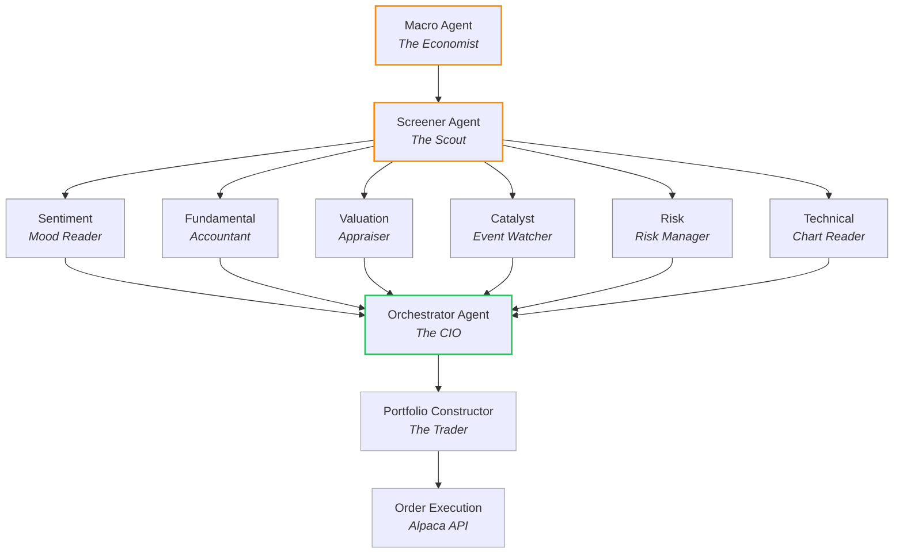

# 1rok


`1rok` is a standalone harness for running portfolio-construction agents across OpenAI, Anthropic, Gemini, xAI, DeepSeek, GLM, and OpenRouter against the same financial tool surface. Agents query Alpaca, Yahoo Finance, FRED, and Tavily through an inline, in-process tool registry defined in this repo.

Live leaderboard tracking how each model's portfolio performs in paper trading on Alpaca (started 2026-01-20): **[investingbench.vercel.app](https://investingbench.vercel.app/)**.

> [!NOTE]
> `run` produces an artifact. `execute` places orders. They are always separate commands. `run` never touches a broker; `execute --live` is the only path to real order placement.

## Features

- **Inline tool registry** — `listTools` / `callTool` over local handlers; one registry per pipeline run.
- **Eight tool groups** — market, stock, research, technicals, options, earnings, portfolio, Tavily web search.
- **Seven LLM providers** — OpenAI (GPT-5.2/5.4/5.5), Anthropic (Claude Opus 4.7 / Sonnet 4.6 / Haiku 4.5), Gemini, xAI, DeepSeek, GLM, OpenRouter — behind a single tool-calling loop.
- **Specialist agents** — orchestrator, screener, fundamental, valuation, technical, sentiment, catalyst, macro, risk, constructor.
- **Two-stage pipeline** — `run` emits a portfolio-construction JSON artifact; `execute` reads it and places orders via Alpaca (paper by default).
- **Provider-agnostic schemas** — Zod definitions converted to each provider's tool-call format with shared retry/loop logic.

## Agent Pipeline

Four stages, ten agents, one weekly run. Macro reads regime; Screener surfaces 25–30 candidates; six analysts score in parallel; Orchestrator composites; Constructor sizes trades; Alpaca executes (paper by default).



Composite scoring weights: fundamental 20%, valuation 20%, risk 15% (inverted), technical 15%, catalyst 15%, sentiment 10%, macro gate 5%. Constructor caps at 8 positions, ≥85% invested, ≤40% per name.

## Architecture

```
CLI (run | execute)
   │
   ▼
Provider ── TradingPipeline ── InlineToolRegistry (per run)
                │                       │
                ▼                       ▼
        Specialist agents ───── Tool handlers
                                        │
                                        ▼
                              src/data/services
                                        │
                                        ▼
                Alpaca · Yahoo Finance · FRED · Tavily
```

1. Runner builds provider + `TradingPipeline` from model id.
2. Pipeline instantiates one `InlineToolRegistry` per run.
3. Agents execute through provider's tool-calling loop.
4. Tool handlers call typed services in `src/data`.
5. Services hit external APIs.

## Layout

| Path | Role |
|---|---|
| `src/data` | Provider clients, domain services, types |
| `src/tools` | Inline tool definitions + registry (`listTools` / `callTool`) |
| `src/harness/agents` | Specialist agents (orchestrator, constructor, …) |
| `src/harness/providers` | Provider adapters + tool-loop |
| `src/harness/pipeline` | Run orchestration |
| `src/cli/1rok.ts` | CLI entrypoint (`run`, `execute`, `help`) |

## Requirements

- [Bun](https://bun.sh) `>= 1.1.0` — supported on macOS (x64/arm64), Linux (x64/arm64, glibc or musl), and Windows (x64/arm64).
- API keys for the providers you intend to exercise (see [Environment](#environment))

## Quick Start

macOS / Linux (bash/zsh):

```bash
bun install
cp .env.example .env   # fill in keys you actually need
bun run typecheck
```

Windows (PowerShell):

```powershell
bun install
Copy-Item .env.example .env   # fill in keys you actually need
bun run typecheck
```

Windows (cmd.exe):

```cmd
bun install
copy .env.example .env
bun run typecheck
```

Run a portfolio-construction pipeline:

```bash
bun run 1rok -- run --model gpt-5.2-medium
```

Execute the resulting orders file (paper by default). Path separators differ per OS:

```bash
# macOS / Linux
bun run 1rok -- execute ./results/openai/gpt-5.2-medium/portfolio-construction-2026-04-16T07-00-00.json
```

```powershell
# Windows PowerShell
bun run 1rok -- execute .\results\openai\gpt-5.2-medium\portfolio-construction-2026-04-16T07-00-00.json
```

> [!WARNING]
> `--live` places real orders. Without it, execution targets `paper-api.alpaca.markets`.

```bash
bun run 1rok -- execute ./results/<...>.json --live
bun run 1rok -- execute ./results/<...>.json --live --force
```

Install the CLI globally on your shell:

```bash
bun link
1rok run --model gpt-5.2-medium
1rok execute ./results/<...>.json
```

On Windows, `bun link` creates a `1rok.cmd` shim on `PATH`; the commands above work unchanged from PowerShell or cmd.

## Environment

Copy `.env.example` to `.env`. Nothing is required unless you exercise that integration.

**Data providers**

| Var | Purpose |
|---|---|
| `ALPACA_API_KEY` / `ALPACA_SECRET_KEY` | Bars, quotes, positions, news, order execution |
| `FRED_API_KEY` | Macro indicators, interest rates |
| `TAVILY_API_KEY` | Web search, page extract, site crawl |

Yahoo Finance needs no key.

**LLM providers** — set at least one:

`OPENAI_API_KEY`, `ANTHROPIC_API_KEY`, `GEMINI_API_KEY`, `XAI_API_KEY`, `DEEPSEEK_API_KEY`, `GLM_API_KEY`, `OPENROUTER_API_KEY`

**Anthropic models**

| Model id | Notes |
|---|---|
| `claude-opus-4-7` | Default Anthropic model |
| `claude-opus-4-7-high` | Reasoning effort `high` |
| `claude-opus-4-7-max` | Reasoning effort `max` |
| `claude-sonnet-4-6` | |
| `claude-haiku-4-5` | |

The Anthropic adapter runs through `@anthropic-ai/claude-agent-sdk`, which ships a native `claude` binary as an optional dependency. The provider resolves that binary automatically for macOS (`darwin-arm64`, `darwin-x64`), Linux (`linux-x64`/`arm64`, glibc + musl), and Windows (`win32-x64`, `win32-arm64`). Override the resolved path with `CLAUDE_CODE_EXECUTABLE` if needed (e.g. pointing at an existing `claude` install, or `claude.exe` on Windows).

**Optional**

- `IROK_MODEL` — default model id when `--model` is omitted.
- `ALPACA_API_KEY_<PROVIDER>` / `ALPACA_SECRET_KEY_<PROVIDER>` — per-model paper credentials for `execute`. Falls back to the global `ALPACA_*` keys.
- `CLAUDE_CODE_EXECUTABLE` — absolute path to the `claude` binary the Anthropic provider should use. Only needed if auto-resolution from the SDK's optional deps fails.

## Scripts

```bash
bun run typecheck   # tsc --noEmit
bun run build       # tsc
bun run test        # bun test
bun run 1rok -- ... # CLI passthrough
```

## Tool Groups

`market`, `stock`, `research`, `technicals`, `options`, `earnings`, `portfolio`, `tavily`. Each group registers Zod-typed definitions in `src/tools/definitions/*` and is aggregated through `ALL_TOOLS` in `src/tools/definitions/index.ts`.

## Programmatic Use

```ts
import { createProviderFromModel } from "1rok/harness";
import { TradingPipeline } from "1rok/pipeline";

const provider = createProviderFromModel("gpt-5.2-medium");
const pipeline = new TradingPipeline({ provider });
const result = await pipeline.run();
```

Subpath exports: `1rok/tools`, `1rok/data`, `1rok/harness`, `1rok/providers`, `1rok/agents`, `1rok/pipeline`.
