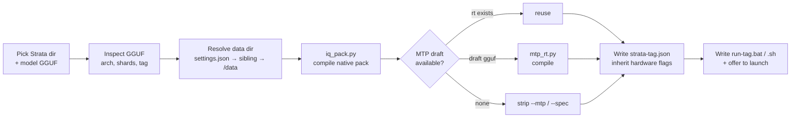

<div align="center">

# Strata Universal Model Importer

### Strata 通用模型一键导入器

**Drop any fine-tuned, abliterated or community GGUF into Strata — one double-click, zero command line.**

把任何第三方微调 / 去限制（Abliterated）/ 社区量化 GGUF，一键接入 Strata 推理引擎。

[![Download][rel-shield]][rel-url]
[![Platform][platform-shield]][platform-url]
[![Python][python-shield]][python-url]
[![Dependencies][deps-shield]][deps-url]
[![License][license-shield]][license-url]
[![Zero CLI][cli-shield]][cli-url]

[English](#english) · [简体中文](#简体中文) · [Download][rel-url] · [Quick start](#-quick-start) · [Troubleshooting](#-troubleshooting)

</div>

```
   pick two folders  →  ⚡  →  pack · MTP · config · run-<model>.bat
   (no CLI, no JSON, nothing leaves your machine)
```

---

## English

### Why this exists

[Strata](https://github.com/Niko1221/Strata) is a great way to run big local models, but the moment you want a
*fine-tuned*, *abliterated*, *refusal-removed* or *differently quantized* GGUF you are suddenly editing JSON by hand:

| Doing it manually | With this importer |
| --- | --- |
| Run `tools/iq_pack.py`, wait, check for a valid `native_experts.txt` | ✔ auto |
| Hunt for `Strata-data`, or edit `%APPDATA%\Strata\settings.json` | ✔ auto-detected |
| Rename shards, wire `--pack` / `--native` / `--ple-gguf` / `--tokenizer` | ✔ rewritten for you |
| Hand-copy hardware flags from an existing `strata-*.json` | ✔ inherited verbatim |
| Decide whether MTP speculative decoding will even load | ✔ detected / compiled / degraded safely |
| Write a `run-*.bat`, remember the port, open the browser | ✔ generated launcher, `--open` included |

Everything stays **100 % local** — no upload, no account, no network call, no telemetry.

### Features

- 🖥️ **Pure GUI, zero CLI** — native folder and file pickers, one button. Nothing to type.
- 🔍 **Crisp on high-DPI screens** — Per-Monitor DPI awareness (V2 → 8.1 → legacy fallback), so fonts are sharp, not blurry.
- 📦 **Isolated native packs** — every model gets its own `<data-dir>/packs/<tag>/` (`index.txt`, `native_experts.txt`, `dense.bin` and a `tokenizer/` dir, all written by Strata's own `tools/iq_pack.py`). The official pack is never touched.
- 🧩 **Shard-aware inspection** — understands `-00001-of-00002` splits, auto-attaches shard 2 as `--ple-gguf`, ignores `mmproj*.gguf`, `*refusal-direction*` and `controlvector` files.
- ⚡ **Adaptive speculative decoding (MTP)** — see the table below.
- 🧠 **Hardware presets inherited** — reuses the engine flags from an existing `strata-*.json`, so your VRAM split, expert cache and KV settings survive the swap.
- 🔁 **Idempotent** — re-running skips repacking unless you pass `--repack` (a CLI flag; the GUI always reuses a
   complete pack). Import as many models as you like; each gets its own pack, config and launcher (give concurrently
   running models different ports).
- 🛡️ **Ships clean** — no hardcoded personal paths anywhere; unzip and run.
- 🪟 **Windows-first** — `.bat` launchers; on Linux/macOS the CLI emits `run-<tag>.sh`.

#### MTP (draft layer) handling

| What you have | What happens |
| --- | --- |
| `Strata-data/mtp/rt` already exists | reused as-is, `--spec` kept |
| Only `mtp-q2_0.gguf` (next to the shards, in `<data-dir>/mtp/`, in a `strata/` subfolder, or picked manually) | compiled on the fly with `tools/mtp_rt.py` |
| Neither | MTP flags are stripped and the model launches **safely without** speculative decoding — no crash, no guessing |

### Requirements

| | |
| --- | --- |
| OS | Windows 10 / 11 (x64). CLI mode also runs on Linux & macOS |
| Python | 3.10+ (`python.org` installer is enough — Tkinter is included) |
| Strata | any install or source checkout containing `tools/iq_pack.py` + `tools/gguf_reader.py` (both ship with Strata; `tools/mtp_rt.py` is also used when a draft GGUF has to be compiled) |
| Model | one GGUF, or a folder of GGUF shards |
| Extra packages | **none** — standard library only |

### 🚀 Quick start

1. Grab the latest zip from [**Releases**][rel-url] (or `git clone`) and extract it. Put this folder **next to** your
   Strata checkout (e.g. `...\Strata\` and `...\Strata-Model-Importer\`) — or anywhere you like, the paths are all picked in the UI.
2. Double-click **`START-IMPORTER.bat`** — or `双击启动图形界面导入器.bat`, they are the same thing with a friendlier name.
3. Fill in three boxes and press **⚡ Start import / 开始一键导入**:

| Field | What to pick |
| --- | --- |
| **Strata directory** | the folder containing `engine\` and `tools\` |
| **Model path** | the model folder, or shard 1 (`...-00001-of-00002.gguf`) |
| **MTP GGUF** *(optional)* | `mtp-q2_0.gguf`, only needed if you have no pre-built `mtp/rt` |

4. Done. The GUI asks whether to launch right now, and leaves you a permanent **`run-<model>.bat`** in your Strata
   folder (plus a convenience copy next to `importer.py`) — double-click it any time to start the model and open the web UI.

```
┌────────────────────────────────────────────────────────────┐
│ Strata Model Importer                                      │
│                                                            │
│ Strata directory  [ <your Strata folder>             ]     │
│ Model path        [ <model folder or shard 1 .gguf>  ]     │
│ MTP GGUF          [ <mtp-q2_0.gguf, optional>        ]     │
│ Model name        [ auto: abliterated-iq3_s          ]     │
│                                                            │
│ [ Import and prepare to run ]                              │
│                                                            │
│ log | shard 2 detected -> wired as --ple-gguf              │
│ log | mmproj / refusal-direction skipped                   │
│ log | MTP draft head compiled once, hardware flags kept    │
│ log | ready -> run-abliterated-iq3_s.bat                   │
└────────────────────────────────────────────────────────────┘
```

<sub>Drawn from the actual code path, not a screen capture: the fields are blank until you fill them in, your paths land
only in your own local Strata config, and nothing is ever uploaded.</sub>

### What gets created

```
Strata-data/
├── packs/<model-tag>/            # isolated native pack for YOUR model
│   ├── index.txt
│   ├── native_experts.txt
│   ├── dense.bin
│   └── tokenizer/                # written by tools/iq_pack.py
└── mtp/rt/                       # compiled draft layer (only if a draft GGUF existed)

Strata/
├── strata-<model-tag>.json       # engine config, hardware flags inherited
└── run-<model-tag>.bat           # double-click to run  →  http://localhost:8080

Strata-Model-Importer/
└── run-<model-tag>.bat           # identical copy, kept next to the tool
```

Nothing is deleted, nothing is overwritten except files that carry your model's own tag. A pack is treated as
already built once `native_experts.txt` and `tokenizer/vocab.json` both exist — pass `--repack` to rebuild anyway.

### ⚙️ How it works



Model names are sanitized into a safe tag, and the example is a real pack:
[`SC117/Qwen3.8-Flash-Next-GSQ-RCO-abliterated-GGUF`][sc117-pack] ships
`Qwen3.8-Flash-Next-GSQ-RCO-abliterated-IQ3_S-00001-of-00002.gguf`, which becomes the tag **`abliterated-iq3_s`** — the
`-00001-of-00002` shard suffix goes, the `Qwen3.8-Flash-Next-GSQ-RCO-` vendor prefix goes (it lives in the editable
`_TAG_VENDOR_PREFIXES` tuple at the top of `importer.py`), everything is lowercased and anything outside `a-z 0-9 _ -`
becomes `_`. Add your own prefixes to that list, or just type a name in the **custom model name** box.

**Two details that look trivial but are the whole point:**

- **The second shard is not renamed.** Strata wants it under `--ple-gguf` (the n-gram per-layer embedding table).
  Guessing that from a filename called `-00002-of-00002.gguf` is exactly the kind of thing you should not have to remember.
- **The MTP draft head has to be compiled.** Strata ships `tools/mtp_rt.py`; the importer calls it once per draft file,
  caches the result under `Strata-data/mtp/rt/`, and reuses it for every later model. If a model genuinely has no draft
  head, `--mtp` and `--spec` are stripped from the launch args instead of leaving a dangling reference.

### 🔧 Command line mode (optional)

Prefer scripts, or want to batch-import a whole library? Run `importer.py` headlessly:

```bat
python importer.py --strata-dir "D:\Strata" --model-path "D:\Models\my-abliterated" --name my_abliterated --context 131072 --port 8081
```

| Flag | Meaning | Default |
| --- | --- | --- |
| `--strata-dir` | Strata root (must contain `tools/iq_pack.py`) | — |
| `--model-path` | GGUF file or folder of shards | — |
| `--name` | model tag / identifier | derived from file name |
| `--context` | `--max-context` | `131072` |
| `--port` | web & API port | `8080` |
| `--data-dir` | override the auto-detected data directory | auto |
| `--mtp-file` | explicit `mtp-q2_0.gguf` | auto-search |
| `--repack` | rebuild the pack even if it already exists | off |

Running `python importer.py` with no arguments starts an interactive prompt that
also uses native folder pickers.

### 🩺 Troubleshooting

| Symptom | Fix |
| --- | --- |
| `Invalid Strata directory (missing tools/iq_pack.py)` | You picked an app-data/install root. Choose the folder that contains `engine\` **and** `tools\`. |
| `No valid model GGUF found` | The folder only holds `mmproj`/control-vector files. Select shard 1 `.gguf` directly with **Select a single file…** |
| Pack step fails | Open the log pane, scroll up for the `iq_pack.py` error. Then retry with `python importer.py ... --repack`. |
| Model starts but is slow | You had no MTP runtime, so speculative decoding is off. Add `mtp-q2_0.gguf` and re-import. |
| `Address already in use` / wrong tab opens | Another model owns the port. Change **Web/API port** and re-import. |
| Blurry text on a 4K panel | Already handled (Per-Monitor DPI V2). If you forced a compatibility DPI override in Windows, turn it off. |
| `Python 3.10+ was not found` | Install Python 3.10+ with *Add to PATH*, or drop the importer next to a Strata `.venv`. |

### ❓ FAQ

<details>
<summary><b>Does it touch my model files?</b></summary>

No. GGUFs are only read. All writes go to `<data-dir>/packs/<tag>/`, `Strata/strata-<tag>.json`,
`Strata/run-<tag>.bat` and a copy of that launcher next to `importer.py`.

</details>

<details>
<summary><b>Can I keep several models side by side?</b></summary>

Yes — that is the point. Each import creates its own pack, config and launcher. Just use a different port for each.

</details>

<details>
<summary><b>After a Strata update, do I need to re-import?</b></summary>

Usually not: the generated config points at your files, and hardware flags were copied from Strata's own config. Re-import with `--repack` if a Strata release changes the pack format.

</details>

<details>
<summary><b>Is anything sent to the cloud?</b></summary>

No. There are no network calls at all — the importer only shells out to the `iq_pack.py` / `mtp_rt.py` tools that are already inside your Strata folder.

</details>

<details>
<summary><b>Where does the data directory come from?</b></summary>

In this order: `data_dir` from `%APPDATA%\Strata\settings.json` → `<Strata>/../Strata-data` → `<Strata>/Strata-data` →
`<Strata>/data`. Wrong folder? Pass `--data-dir` on the CLI (the GUI always uses the auto-detected one).

</details>

<details>
<summary><b>Do I need the Strata desktop app?</b></summary>

No. The launcher talks to `serve/server.py` and opens your browser. Works with a source checkout too.

</details>

---

<a id="简体中文"></a>

## 简体中文

一个**完全免命令行**的图形化工具，把任何**微调版、消融/去安全限制版（Abliterated）、社区量化版 GGUF**一键接入
[Strata](https://github.com/Niko1221/Strata) 本地推理引擎。原来需要手写 `strata-*.json`、逐个配置
`--pack` / `--native` / `--ple-gguf` / `--mtp` 参数的过程，现在只需双击一次。

**全程本地运行，不联网、不上传、零第三方依赖（仅 Python 标准库）。**

### 使用步骤

1. 从 [**Releases**][rel-url] 下载最新 zip 并解压（或直接 `git clone`），双击 **`双击启动图形界面导入器.bat`**（或 `START-IMPORTER.bat`）。
2. 依次点击【浏览文件夹】选择 **Strata 主目录**（含 `engine\` 与 `tools\`）、**模型文件夹或第 1 分卷 GGUF**，
   可选提供 `mtp-q2_0.gguf`。
3. 选择上下文长度与端口，点击 **【⚡ 开始一键导入与适配】**。
4. 完成后询问是否立即启动；同时在 Strata 目录生成 **`run-<模型名>.bat`**（导入器目录下也会保留一份同名副本），以后双击即可启动并自动打开浏览器。

### 核心特性速览

- 🖥️ **纯 GUI**：原生文件选择对话框，零命令行、零手输路径。
- 🔍 **高分屏无损清晰**：Windows Per-Monitor DPI V2 感知，字体不再发虚。
- 📦 **Pack 隔离**：为新模型单独生成 `index.txt`、`native_experts.txt`、`dense.bin` 与 Tokenizer，绝不动官方原版。
- 🧩 **智能识别**：自动跳过 `mmproj`、`refusal-direction`、`controlvector` 等非模型文件；自动识别 `00001-of-00002` 分卷并把第 2 分卷挂为 `--ple-gguf`。
- ⚡ **MTP 投机解码自适应**：已有 `mtp/rt` 直接复用；只有 `mtp-q2_0.gguf` 时自动编译；两者都没有时自动剥离 MTP 参数，**安全降级不闪退**。
- 🧠 **硬件参数继承**：沿用你原有 `strata-*.json` 中的显存分配、专家缓存、KV 量化等调优结果。
- 🔁 **可重复执行**：已生成的 pack 会自动跳过（`--repack` 为命令行参数，可强制重建）；多模型互不干扰。
- 🛡️ **无硬编码路径**：仓库内不含任何个人绝对路径，解压即用。
- 🏷️ **自动 tag 清洗**：去掉分片后缀、厂商前缀与非法字符。例如
  `Qwen3.8-Flash-Next-GSQ-RCO-abliterated-IQ3_S-00001-of-00002` → `abliterated-iq3_s`（厂商前缀列在 `importer.py` 顶部的
  `_TAG_VENDOR_PREFIXES`，可自行增删）。
- 🙏 **示例模型包**：[SC117](https://huggingface.co/SC117) 的 [`Qwen3.8-Flash-Next-GSQ-RCO-abliterated-GGUF`][sc117-pack]
  （Apache-2.0）——本工具就是照这个包的目录布局开发并实测的；上游量化与消融的完整出处见它自己的模型卡。

### 命令行模式

```bat
python importer.py --strata-dir "D:\Strata" --model-path "D:\Models\我的模型" --name my_model --context 131072 --port 8081 --repack
```

不带参数直接运行 `python importer.py` 会进入交互式（同样带图形选择框）模式。
完整参数表见上文 [Command line mode](#-command-line-mode-optional)。

### 环境要求

Windows 10 / 11 x64 · Python 3.10+（自带 Tkinter 即可）· 已包含 `tools/iq_pack.py` 与 `tools/gguf_reader.py` 的 Strata 目录（编译 MTP 时还会用到 `tools/mtp_rt.py`）· 无需安装任何第三方库。

---

## Repository layout

```
Strata-Model-Importer/
├── gui.py                      # the tkinter GUI (dark theme, DPI aware)
├── importer.py                 # the engine: inspect → pack → MTP → config → launcher
├── START-IMPORTER.bat          # double-click to open the GUI (English name)
├── 双击启动图形界面导入器.bat   # same launcher, friendly name
├── LICENSE
└── README.md
```

## Contributing

Issues and PRs are welcome — especially reports that include the log pane contents plus your Strata version and
model file name. Please strip personal paths from anything you paste.

## Credits

Built on top of [**Strata**](https://github.com/Niko1221/Strata) by [Niko1221](https://github.com/Niko1221) —
go star [the main repo](https://github.com/Niko1221/Strata) too, that is where the real engineering lives.

The model pack named in the examples — the build this importer was written and tested against — is
[SC117/Qwen3.8-Flash-Next-GSQ-RCO-abliterated-GGUF][sc117-pack] (Apache-2.0); its own model card carries the full
upstream provenance. This importer is an independent community tool, not affiliated with Strata or any model publisher.

## License

MIT — see [LICENSE](LICENSE). Strata itself is MIT as well; the model weights you import have their own licenses,
so check those before publishing outputs.

<div align="center">

**If this saved you an afternoon of JSON wrangling, a ⭐ is the nicest way to say thanks.**

[![Star the repo][star-shield]](https://github.com/adamandama/Strata-Model-Importer)

</div>

<!-- links -->
[rel-shield]: https://img.shields.io/github/v/release/adamandama/Strata-Model-Importer?label=download&color=0ab887
[rel-url]: https://github.com/adamandama/Strata-Model-Importer/releases/latest
[platform-shield]: https://img.shields.io/badge/platform-Windows%2010%2F11-0078d4?logo=windows&logoColor=white
[platform-url]: #requirements
[python-shield]: https://img.shields.io/badge/Python-3.10%2B-blue?logo=python&logoColor=white
[python-url]: #requirements
[deps-shield]: https://img.shields.io/badge/dependencies-stdlib%20only-brightgreen
[deps-url]: #requirements
[cli-shield]: https://img.shields.io/badge/CLI%20required-never-8a2be2
[cli-url]: #-quick-start
[license-shield]: https://img.shields.io/badge/license-MIT-green
[license-url]: LICENSE
[star-shield]: https://img.shields.io/github/stars/adamandama/Strata-Model-Importer?style=social

<!-- the model pack cited in the examples -->
[sc117-pack]: https://huggingface.co/SC117/Qwen3.8-Flash-Next-GSQ-RCO-abliterated-GGUF
