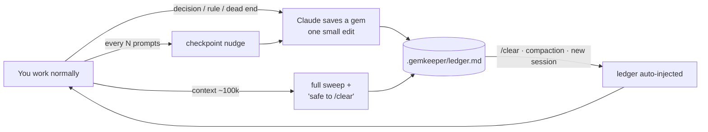

<p align="center">
  
</p>

<h1 align="center">gemkeeper</h1>

<p align="center">
  <b>Never kill a good Claude Code session again.</b><br>
  Claude writes down the 2% of context that matters <i>while it still remembers it</i>,<br>
  so you can <code>/clear</code> a bloated session and keep going at full quality.
</p>

<p align="center">
  <a href="#quick-install">Install</a> ·
  <a href="#how-it-works">How it works</a> ·
  <a href="#benchmark">Benchmark</a> ·
  <a href="examples/ledger.example.md">Example ledger</a> ·
  <a href="#faq">FAQ</a>
</p>

<p align="center">
  <a href="#quick-install"></a>
  <a href="https://skills.sh/adamoelz/gemkeeper/gems"></a>
  <a href="LICENSE"></a>
</p>

<p align="center">
  <a href="#benchmark"></a>
</p>

<p align="center"></p>

## Quick install

In Claude Code:

```
/plugin marketplace add adamoelz/gemkeeper
/plugin install gemkeeper@gemkeeper
/reload-plugins
```

---

## The problem

You finally have a session where Claude *gets it*. It knows the weird test setup, why you
picked SQLite, the three approaches that already failed. Then the context fills up and you have two bad options:

- **Keep going.** Quality drifts as the window bloats. Old instructions fade.
- **`/clear` or let it compact.** `/clear` throws everything away. Compaction keeps a lot, but as a
  ~17k-token summary that only lives inside this one session: tomorrow's session starts from zero.

Handoff skills help, but they run **at the end**, when the context is already at its biggest and the
details are already blurred.

## The fix: a ledger that's written continuously

gemkeeper keeps one short file, `.gemkeeper/ledger.md`, that Claude updates **as things happen**:

| Section | What goes in |
|---|---|
| **Mission** | The goal and what "done" means |
| **Rules** | Hard constraints and your stated preferences, marked `(user)` |
| **Decisions** | What was decided **and why**, so the next session doesn't reverse it |
| **Dead ends** | What was tried and why it failed, so nobody wastes an hour retrying it |
| **Facts** | Env quirks, the exact command that works, the misleading error |
| **Now** | Current state and the single next step |

Every entry has to pass one test: *would a fresh session with only the code and this ledger get this wrong?*
If not, it stays out. That keeps the ledger at around 1–2k tokens instead of turning into another dump.
→ [See a real-looking example](examples/ledger.example.md)

## How it works



- **Skill `gems`.** Teaches Claude what counts as a gem, the format, and four modes: capture, sweep, resume, close.
- **SessionStart hook.** Re-injects the ledger after `/clear`, after auto-compaction, and on a new session.
  After compaction it tells Claude the ledger outranks the compaction summary.
- **UserPromptSubmit hook.** When your message looks like it holds a gem (a rule, a reason, a dead end,
  a gotcha; English and German), a one-line *gem check*. Otherwise a checkpoint every 6 prompts, plus a
  single warning when the context passes ~100k tokens (read from the real API usage in the transcript).
- **PreCompact hook.** Tells the compactor not to waste summary space on what the ledger already holds.

Plain bash. No dependencies, no network, no telemetry.

## Benchmark

<p align="center"></p>

15 facts are planted in a scripted 20-turn Claude Code session, the session is reset in different ways,
and a blind judge scores what the next session still knows ([gemkeeper-bench](https://github.com/adamoelz/gemkeeper-bench), all raw data
and the harness to rerun it):

- **gemkeeper 0.2.1 kept all 15** after a reset into a fresh session, also across two fresh sessions
  (30/30 in 3 of 3 runs), carrying only ~2.6k tokens into the next session.
- **`/compact` is strong too** (29–30/30) but only inside one session and at ~17k tokens.
  A handoff summary lost the *why* and the dead ends (25/30). No memory: 0/30.

<sub>gemkeeper 0.2.1 (`8979dab`), Sonnet via `claude -p`, one synthetic scenario; limitations in the
[results](https://github.com/adamoelz/gemkeeper-bench/blob/main/RESULTS.md).</sub>

## Install

### Recommended: the full plugin (skill + hooks)

This is the version the [benchmark](#benchmark) measured. Only this one loads the ledger automatically
after `/clear`, compaction and in new sessions, and reminds Claude to save gems while you work.
Run the three commands from the [Quick install](#quick-install) in Claude Code
(or simply start a new session instead of `/reload-plugins`).

**Check that everything loaded:** `/hooks` should list three gemkeeper hooks (SessionStart,
UserPromptSubmit, PreCompact), and `/gemkeeper:gems` should autocomplete. If Claude Code mentions two
unset options, there's nothing to do: the defaults apply (checkpoint every 6 prompts, sweep warning at
~100k tokens, see [Configuration](#configuration)).

**Keep it up to date:** plugins from third-party marketplaces don't auto-update by default. Turn it on
once under `/plugin` → Marketplaces → gemkeeper → *Enable auto-update*, or update by hand with
`claude plugin update gemkeeper@gemkeeper`, then `/reload-plugins`.

### Other ways (fewer features)

| | What you get | What's missing |
|---|---|---|
| [Skill-only edition](editions/skill-only) (for the Claude plugin directory) | Skill + `/gemkeeper:resume` command, no code runs on your machine | No automatic loading: run `/gemkeeper:resume` after every `/clear` or new session. No hook reminders, no token-based sweep warning. Not benchmarked yet. |
| Skill only via [skills.sh](https://skills.sh/adamoelz/gemkeeper/gems), any agent with skills (Claude Code, Cursor, Codex, …): `npx skills add https://github.com/adamoelz/gemkeeper --skill gems` | The `gems` skill; without hooks it checks each message for gems itself | No automatic loading: ask your agent to "resume from the ledger" after a reset. No token-based sweep warning. Not benchmarked yet. |
| Manual install of the full version: `git clone` this repo, then `./install.sh --hooks` | Same as the recommended plugin | Updates by hand: `git pull && ./install.sh --hooks` |

Install only **one** of these. The full plugin and the skill-only edition both bring a `gems` skill.

## Usage

Mostly: nothing. Work as usual and Claude captures gems on its own. When you want to reset:

```
/gems          # full sweep → "Safe to /clear"   (as a plugin: /gemkeeper:gems)
/clear         # fresh context, ledger is injected automatically
```

Claude then replies with three lines (mission, where we are, next step) and continues.

| You say | What happens |
|---|---|
| `/gems` or "sweep" | Full pass: capture missed gems, verify against git, rewrite `## Now`, prune |
| "resume" | Restate mission / state / next step from the ledger and check it against git |
| "close the ledger" | Archive it to `.gemkeeper/archive/` and start fresh for the next mission |

## Configuration

Plugin users: `/plugin` → gemkeeper → configure. Manual install: environment variables.

| Option | Env var | Default | |
|---|---|---|---|
| `nudge_every` | `GEMKEEPER_NUDGE_EVERY` | `6` | Checkpoint every N prompts (`0` = off) |
| `warn_tokens` | `GEMKEEPER_WARN_TOKENS` | `100000` | Sweep warning threshold (`0` = off) |
| | `GEMKEEPER_LEDGER` | `.gemkeeper/ledger.md` | Ledger path |
| | `GEMKEEPER_MAX_INJECT_LINES` | `250` | Safety cap on what gets injected |

## How is this different from…

| | Built-in `/compact` | Handoff skills | **gemkeeper** |
|---|---|---|---|
| When context is captured | At compaction | At the end of the session | **Continuously, while details are fresh** |
| Facts kept after a reset ([benchmark](#benchmark)) | 29–30 of 30 | 25 of 30, loses the *why* and dead ends | **30 of 30** |
| Survives `/clear` and new sessions | No | Only if you paste it | **Re-injected automatically** |
| Tokens carried into the next session | ~17k | ~3k | **~2.6k** |
| Manual step needed | No | Yes (copy/paste or command) | **No** |

Works well *alongside* `/compact` and CLAUDE.md: CLAUDE.md is for project-wide truths, the ledger is for the current mission.

## FAQ

**Should I commit `.gemkeeper/`?** Your call. Ignored by default (in `.gitignore`). Commit it if your team should share the context of a mission.

**Does it cost tokens?** Some. Saving gems while you work adds a few model steps. On a reset the next session starts with the ledger, ~1–3k tokens instead of ~17k for a `/compact` summary, so you can reset earlier and more often.

**Parallel sessions in one repo?** gemkeeper uses one ledger per project. Set `GEMKEEPER_LEDGER` per terminal if you run several missions in parallel.

**Windows?** Works in Git Bash, which Claude Code uses on Windows.

## Contributing

Issues and PRs are welcome, especially real-world "the ledger missed X" reports. They make the ledger test sharper.

If gemkeeper saved one of your sessions, a ⭐ helps other people find it.

## License

MIT
