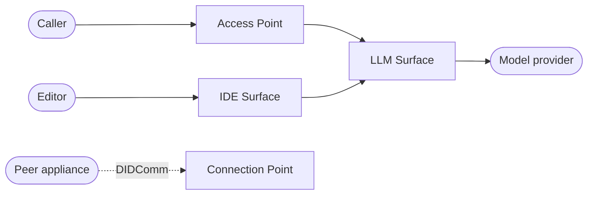

# Affinidi Trust Fabric - Agent Stream

_Govern every model call your agents make._

[](LICENSE) [](Cargo.toml) [](https://docs.affinidi.com/products/affinidi-trust-fabric/agent-stream/) [](https://github.com/affinidi-ai/agent-stream/issues)

Agent Stream sits between agents and the model providers they call. It routes each call
across providers, applies guardrails, policy, and budgets to it inline, and records what
happened, from one configuration layer instead of in every integration.

It understands the model APIs rather than forwarding bytes: it reads OpenAI Chat
Completions, Anthropic Messages, and OpenAI Responses requests, so it can inspect,
transform, meter, cache, and route each one.

Agent Stream is part of the Affinidi Trust Fabric, alongside Agent Gateway, which governs
the traffic to and from agents.

> [!IMPORTANT]
> **Project status:** Agent Stream is under active development. Interfaces and stored
> configuration may change between minor releases. Evaluate its security, privacy,
> availability, and regulatory properties before production use.

## Why use it

- **No changes to your agent code.** Point the caller at a Surface's URL instead of the
  provider's. The request format stays the same, and any client dialect can reach any
  provider.
- **One place for the controls.** Authentication, policy, guardrails, rate limits, and
  budgets live on the Surface instead of being rebuilt in every application.
- **Provider keys stay out of applications.** Operator keys are resolved from the secret
  store at call time and never returned to callers. Where a Surface allows it, a caller can
  bring its own key instead.
- **Spend you can attribute.** Every call is metered. Where a Surface enables attribution,
  it is attributed to a Member and Team, and budgets are checked before a call is sent,
  not after.
- **Resilience without code.** Failover, load balancing, circuit breakers, response caching,
  and canary rollouts are configuration.
- **Sensitive data handled inline.** Prompt Guard masks, pseudonymises, or blocks sensitive
  values on the way in and out, and LLM-based Judge and Jury stages review requests and
  answers.
- **Evidence for an auditor.** When enabled, each interaction produces a signed,
  hash-chained Governance Record that can be verified and exported.

[`docs/CAPABILITIES.md`](docs/CAPABILITIES.md) describes every capability in detail.

## How it works

Say an application calls a model provider directly. It needs its own route to the
provider, holds the provider key, and has nothing between it and the model that can
check, limit, or record the call.

With Agent Stream, the application calls an Access Point on a Surface, and the Surface
calls the provider. The application only needs to reach Agent Stream, and the provider
key never leaves it. On the way, the request is authenticated, checked against policy and
budget, guarded, routed, and recorded; the answer is reviewed before it is returned.


Editors and agents that need a choice of models can use an IDE Surface: one endpoint that
offers a governed model menu, where each model is an LLM Surface with its own controls.


## Moving parts



A **Surface** is the configuration and runtime unit for one governed connection. Its
**Access Point** is where callers reach it. An **LLM Surface** fronts one provider, with its
guardrails, routing, resilience, cost controls, and recording; an **IDE Surface** offers a
menu of LLM Surfaces behind one endpoint. **Variants** change a Surface per request, for
canary rollouts or routing rules, without a second Surface. Each Agent Stream instance is
an appliance with its own DID, and connects to peer appliances through **Connection Points**.

## What it looks like

Everything is configured and watched from a web dashboard served by Agent Stream itself.


Each Surface is built on a canvas by dragging in elements such as Prompt Guard, Expert
Witness, Judge, and Jury. The same Surface can be edited as JSON.


## Quickstart

### Deploy an appliance

Follow the hosted [Agent Stream Quickstart](https://docs.affinidi.com/products/affinidi-trust-fabric/agent-stream/get-started/)
to deploy an appliance, create your first LLM Surface, add guardrails and a budget, and
monitor traffic.

### Run with Docker

The fastest way to see Agent Stream answer a model call needs only Docker with Compose,
`make`, `jq`, and `openssl`, and asks for your password once to trust the development
certificate (macOS) or set directory ownership (Linux). No provider account or API key is
required.

```bash
make config-docker
export AS_BACKUP_ENCRYPTION_KEY=$(cat envs/backup_encryption_key)
export AS_MASTER_KEY=$(cat envs/master_key)
docker compose up
```

`make config-docker` builds the image locally (the first build takes a while) and
generates a configuration under `envs/docker/` with a sample LLM Surface at
`/llm/quickstart`. Compose starts Agent Stream with a mock model server behind that
Surface. In another terminal:

```bash
curl -k https://localhost:8443/llm/quickstart/v1/chat/completions \
  -H 'content-type: application/json' \
  -d '{"model":"mock-small","messages":[{"role":"user","content":"Hello"}]}'
```

The sample Surface has no caller authentication. Compose publishes it on loopback only;
add authentication before exposing the port.

### Build from source

The primary local path uses macOS with Homebrew. Install Git, Rust `1.95.0` or newer,
Node.js with npm, and a WebAuthn-capable browser and authenticator, then run:

```bash
git clone https://github.com/affinidi-ai/agent-stream.git
cd agent-stream
make install-deps
make run-debug
```

Complete passkey registration in the browser window opened by the run script, then check
the local HTTPS backend:

```bash
curl -k https://localhost:8443/api/v1/health
curl -k https://localhost:8443/api/v1/alive
```

[`docs/development/GETTING_STARTED.md`](docs/development/GETTING_STARTED.md) covers both
paths, including Linux setup, expected responses, reset, and troubleshooting. No public
binary or container image is published; both paths build from this source.

## What is in this repository

One Rust binary, `agent-stream`, built from [`src/`](src/), plus a React dashboard served
from the same process and built from [`www/default/`](www/default/). About 280,000 lines
of Rust across 55 top-level modules. No database and no sidecar: state lives in an
in-memory cache backed by JSON files on disk; sensitive records are encrypted at rest unless explicitly opted out.

[`ARCHITECTURE.md`](ARCHITECTURE.md) maps the system to the source tree.

## Documentation

Everything needed to understand and build this repository is in it. The hosted
documentation adds procedures for deploying and operating an appliance. Where the two
differ, repository documentation describes this source revision exactly.

| Goal | Documentation |
| --- | --- |
| Learn what Agent Stream can do | [`docs/CAPABILITIES.md`](docs/CAPABILITIES.md) |
| Understand how the system works and where the code is | [`ARCHITECTURE.md`](ARCHITECTURE.md) |
| Build and run this source locally | [`docs/development/GETTING_STARTED.md`](docs/development/GETTING_STARTED.md) |
| Develop, debug, and test | [`docs/development/DEVELOPMENT.md`](docs/development/DEVELOPMENT.md) |
| Configure an appliance | [`docs/CONFIGURATION_REFERENCE.md`](docs/CONFIGURATION_REFERENCE.md) |
| Look up a term | [`CONTEXT.md`](CONTEXT.md) |
| Inspect revision-specific internals | [`docs/README.md`](docs/README.md) |
| Contribute a change | [`CONTRIBUTING.md`](CONTRIBUTING.md) |
| Deploy and operate a hosted appliance | [Hosted product documentation](https://docs.affinidi.com/products/affinidi-trust-fabric/agent-stream/) |

## API status

| Interface | Status in this source revision |
| --- | --- |
| OpenAI Chat Completions | On by default on every LLM Surface; a Surface can restrict it |
| Anthropic Messages | On by default on every LLM Surface; a Surface can restrict it |
| OpenAI Responses | On by default on every LLM Surface; a Surface can restrict it |
| OpenAI Realtime (voice) | Off by default; enabled per Surface |
| DIDComm v2 | Available for appliance-to-appliance traffic |

[`docs/CLIENT_API_DIALECTS.md`](docs/CLIENT_API_DIALECTS.md) records the exact
limitations and compatibility behaviour of this source revision. Before upgrading, check the
Breaking section of [`CHANGELOG.md`](CHANGELOG.md).

## Before production

The local quickstart is a development environment, not a production deployment recipe.
Before exposing an instance, decide and test:

| Area | Questions to answer |
| --- | --- |
| Network boundary | Which listeners are public, private, or restricted by a front-end proxy? |
| Public origin | Do DID and WebAuthn origins match the externally visible scheme and host? |
| Authentication | Which source-auth method protects each Surface and management workflow? |
| Policy | What is denied by default, and how are policy changes reviewed and audited? |
| Credentials | Where are provider keys and signing keys stored, rotated, and recovered? |
| Spend | Which budgets and usage limits apply, and who is alerted when they are reached? |
| Persistence | How is the storage directory protected, backed up, restored, and tested? |
| Encryption | Is encryption at rest enabled or explicitly opted out, and who controls its key source? |
| Availability | How are Active and Standby instances monitored and transitioned? |
| Egress | Which upstream and integration destinations are permitted by surrounding network controls? |
| Fabric | Which peer appliances and mediators may connect, and which Trust Fabric policy applies to each? |
| Telemetry | Which signals and Governance Records leave the deployment, and how is prompt data handled? |

Use least privilege at every boundary. Agent Stream does not replace network
segmentation, secret management, host hardening, patching, or deployment-specific threat
modelling.

## Built on open standards

Agent Stream uses open standards so that identity and trust work across organisational
and cloud boundaries, not only inside one deployment.

| Area | Standards |
| --- | --- |
| Model APIs | OpenAI Chat Completions, OpenAI Responses, Anthropic Messages |
| Policy | Open Policy Agent Rego, evaluated in-process by Regorus |
| Identity | W3C Decentralized Identifiers, with `did:webvh`, `did:web`, `did:peer`, and `did:key` |
| Credentials | W3C Verifiable Credentials and Verifiable Presentations |
| Messaging | DIDComm v2, including Out Of Band invitations |
| Authentication | OAuth 2.0 and OpenID Connect, JWT, mutual TLS, WebAuthn passkeys, SAML |
| Observability | OpenTelemetry, Prometheus |

The Affinidi technology stack adheres to open standards from the W3C, the Decentralized
Identity Foundation, the Linux Foundation, and the EU Digital Identity (EUDI) programme.
Affinidi has also donated open-source implementations to some of these bodies, among
them [`didwebvh-rs`](https://github.com/decentralized-identity/didwebvh-rs), the did:webvh
library Agent Stream itself uses, now hosted by the Decentralized Identity Foundation.

## Contributing and support

Contributions are welcome. Read [`CONTRIBUTING.md`](CONTRIBUTING.md) for the
discuss-first workflow, required checks, tests, and changelog fragments. Participation is
governed by the [Code of Conduct](CONTRIBUTING.md#code-of-conduct).

For usage questions, use the [Affinidi support form](https://share.hsforms.com/1i-4HKZRXSsmENzXtPdIG4g8oa2v).
For reproducible technical problems or feature requests, search or open a
[GitHub issue](https://github.com/affinidi-ai/agent-stream/issues).

To report a security vulnerability, follow the private disclosure process in
[`SECURITY.md`](SECURITY.md).

## License

Licensed under the Apache License 2.0. See [`LICENSE`](LICENSE).
