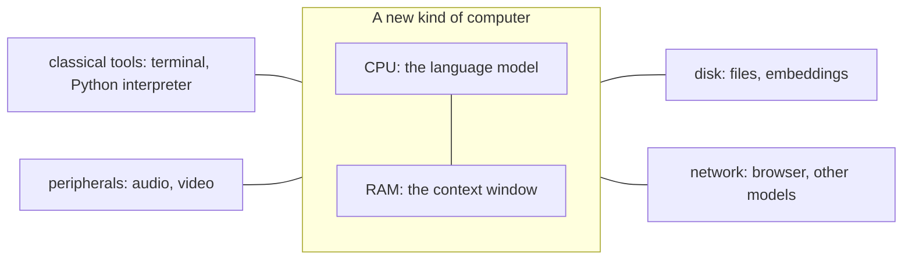

# A-Graph

A-Graph is a declarative framework for AI agents: the agents are described in a YAML file, and an engine checks the
file and then runs it.

The motivation comes from an idea of Andrej Karpathy: a language model is the CPU of a new kind of computer, and its
context window is the RAM.



Redrawn from Karpathy's "LLM OS" sketch (2023), which he showed again in
[Software Is Changing (Again)](https://www.youtube.com/watch?v=LCEmiRjPEtQ&t=600s) at Y Combinator's AI Startup School,
June 2025.

On this computer an agent is a program. On a classical computer the operating system decides what a program may use.
For many agents, what they may use is written only in their code. In A-Graph it is declared in the file, and the
engine does part of the work of an operating system: it checks the whole file before the first call, and it reaches
only the hosts the file lists.

`a-graph` runs a **graph of agents written in a YAML file**. The file holds the problem of the agents: the models,
what each node reads, the prompts, the order of the nodes and the patterns that connect them. The engine holds the
problem of the software: the API of each provider, structured output, batch jobs, the network, the secrets. Your own
programs, the tools and the utilities, stay outside the graph, behind a small JSON contract.

```
a-graph graph.yml "What is a mutex?"
```

- **Checked before it runs.** The whole file is checked before the first call: the keys, the ids and the links, what
  each model can do, the agreement between prompts and nodes, the hosts, the environment variables. `a-graph --check`
  does only that.
- **Every agent can be measured.** Each node has its own events (its tokens, its duration, its calls, the answers
  checked against a schema) in a JSON log, an OpenTelemetry trace and a live display: the data to measure how stable
  each agent is, where it fails, and why. See [observability](#observability).
- **One file, nine providers.** Anthropic, OpenAI, Gemini, Mistral, Amazon Bedrock, Google Vertex AI, Microsoft Foundry,
  Ollama, and any server that speaks the Ollama contract. Reasoning, output schemas, logprobs and batch jobs are
  written once, and sent in the form of each provider.
- **The patterns are edges.** Pipelines; groups whose branches run one after the other, all together, at most a few at
  a time, or as batch jobs; a `react`, where a controller chooses its workers; judges that approve a result or stop the
  run.
- **No secrets in the file.** The file names environment variables, never their values; it reaches only the hosts its
  passport lists; the contents of the messages reach the log and the trace only if its data classification allows it.
- **Graphs from outside.** `a-graph --serve` runs graphs sent over HTTP, and refuses, before it builds anything, what
  could start a program, touch a file outside the folder of the session, or reach a host it does not allow.

It is a program for the command line and a small HTTP service, written in Rust. It was designed with a
configuration-first approach, with the code following the configuration design. How the file and the engine divide the
work is explained in [agents and software](docs/agents-and-software.md), and how the engine is built in
[the architecture](docs/architecture.md).

## Build

You need [Rust](https://rustup.rs). From the root of this project:

```
cargo build --release
```

The program is `target/release/a-graph`, about 62 MB (about 41 MB without its symbols, after `strip`). To build it and
put `a-graph` in `~/.cargo/bin`, which `rustup` already adds to the `PATH`:

```
cargo install --path . --locked
```

The code has been built and tested on Linux and on macOS: the CI runs the tests on Linux for every pull request,
and on macOS too after every push to `main`.

The builds of development and the tests are kept in `target/`, which takes about 13 GB after the whole suite and grows
with every build, since Cargo does not remove the old ones: `cargo clean` empties it. To keep it smaller, `Cargo.toml`
leaves out the debug information of the dependencies in the builds of development
(`[profile.dev.package."*"] debug = false`); the code of the project keeps it whole.

## A first run

The examples need no key: they use a local [Ollama](https://ollama.com) with `qwen3.5:4b`. The smallest one,
[`examples/01-hello/graph.yml`](examples/01-hello/graph.yml), is one node that answers the message of the user in one
short sentence:

```yaml
# Hello
# One node answers the message of the user. A graph of one node is the `start` alone.
graph_spec: "1.0"
passport:
  adl:
    adl_spec: "0.3.0"
    name: hello
    description: One node answers the message of the user. A graph of one node is the `start` alone.
    version: "1.0.0"
    data_classification: { sensitivity: public }
    permissions: { network: { allowed_hosts: [localhost:11434] } }
observability: { level: warn }      # the log goes to the standard error
verbose: { level: steps }        # the display of the run: off | steps | detail
models:
  - id: local
    provider: ollama
    model: qwen3.5:4b
    host: http://localhost:11434
    input: [text]
    output: [text]
resources:
  prompts:
    - id: answer
      content:
        system: "Answer in one short sentence."
        user: "{{user_message}}"      # {{user_message}} is the message you give on the command line
graph:
  nodes:
    - id: assistant
      model: { id: local, reasoning: off, max_tokens: 300, temperature: 0 }
      resources: { prompt: answer }
      message:
        input: { user_message: true }
        output: { assistant_message: true }   # the answer goes to the result
  edges:
    - start: assistant
```

```
ollama pull qwen3.5:4b
cd examples/01-hello
a-graph graph.yml "What is a mutex?"
```

The progress of the run is written on the standard error; the result is a JSON document on the standard output:

```json
{"items":[{"node":"assistant","message":"A mutex is a lock that lets only one thread use a shared resource at a time.","media":[],"reasoning":[],"logprobs":[]}]}
```

`examples/02-sequence` connects two nodes: the first translates the message, the second shortens the translation. Run
these two from their own folder. [`examples/03-observability`](examples/03-observability/README.md), run from the root
of the repository, sends the trace of a run to an OpenTelemetry Collector in Docker Compose and shows it in Jaeger; the
JSON log stays in a local file, and its `trace_id` leads to the trace. What each example shows is in
[examples](docs/examples.md).

## The command line

```
a-graph graph.yml "the message"             # checks the file, then runs it
cat question.txt | a-graph graph.yml        # without a message, the standard input is the message
a-graph graph.yml "the message" --chat_mode # only `node: text`, one line for each result
a-graph --check graph.yml                   # only checks the file: nothing runs
a-graph --serve service.yml                 # starts the HTTP service
```

The keys of the models and services are environment variables: the graph writes their names
(`api_key: { env: ANTHROPIC_API_KEY }`), never their values. Everything about the command line, the result, the errors
and the exit codes is in [the command line](docs/cli.md).

## The graph file

A graph is one YAML file, made of blocks:

| Block | What it holds |
|---|---|
| `graph_spec`, `passport` | the version of the format and the identity of the graph ([ADL 0.3.0](https://www.adl-spec.org/)): name, data classification, **the hosts the graph may reach** |
| `observability`, `trace`, `verbose` | the log, the timeline sent to a collector, the live display of the run |
| `models` | the language models |
| `embeddings` | the models that turn a text into a vector |
| `utilities` | programs and services of yours, called by `a-graph` on the data of a node |
| `resources` | `prompts`, `tools`, `mcp_servers`, `media`, `skills` |
| `external` | `vectordb`, `search`, `memory` |
| `blackboards` | Markdown notes shared by nodes |
| `graph` | the `nodes` and the `edges` that connect them |

How the file works is explained in [the graph file](docs/file.md). Every key is described in
[the reference](docs/graph.md), and the JSON Schema of the file is [`spec/graph.schema.json`](spec/graph.schema.json):
both are generated from the code.

## Observability

Every run reports on itself in three ways, each with its own block of the graph file: a JSON log (`observability`),
an OpenTelemetry trace sent to a collector (`trace`) and a live display (`verbose`), all with the events of the run,
of each group and node, and of each call. How to read them, and every event with its fields, is in
[observability](docs/observability.md); [`examples/03-observability`](examples/03-observability/README.md) shows the
trace in Jaeger.

## What it does

- **Models**: Anthropic, OpenAI (Responses API), Gemini, Mistral, Amazon Bedrock, Google Vertex AI, Microsoft Foundry,
  Ollama, and any server that speaks the Ollama contract. Reasoning levels, output schemas (JSON), batch jobs, images
  in, images and audio out.
- **Edges**: nodes in sequence; groups whose branches run one after the other, all together, at most a few at a time, or
  as batch jobs; a `react`, where a controller chooses at every turn which worker to call; validation nodes that
  judge a result and can stop the run.
- **Tools**: your own programs (`stdio`) or services (`http`) with a small JSON contract; **MCP servers** (stdio and
  Streamable HTTP); **skills** in the [Agent Skills](https://agentskills.io/specification) format.
- **Utilities**: programs in any language that change the data of a node before or after the model, without the model
  knowing: convert a PDF into Markdown, hide personal data, add a mark.
- **Data**: vector databases (Qdrant, Chroma) searched with an embedding model, whose text goes into the prompt as
  `{{chunks}}`; a conversation **memory** in a JSON file, with summaries and, if wanted, a search by similarity;
  **blackboards** shared by nodes.
- **Observability**: a JSON log (standard error, file or URL), a **trace** sent as OpenTelemetry (OTLP over HTTP, JSON) at
  the end of the run, and a live display. The contents of the messages appear in them only if the data classification
  of the passport allows it.

## What it does not do yet

- A blackboard kept at a `url`: the file is refused when it is checked.
- `search`, and a memory kept in a vector database (`provider: vectordb`): the file is accepted, but a node that uses
  one fails when it runs.
- Audio and video in: no provider takes them yet.
- A `react` inside a `react`.
- The batch of Gemini, and of Vertex AI with publisher `google`.
- A sandbox for the programs a graph starts (a `stdio` tool or utility, an MCP server over stdio, the script of a
  skill): each runs with the rights of the user who runs `a-graph`.

## The HTTP service

`a-graph --serve service.yml` starts an HTTP service: a caller sends the text of a graph and a message, and gets the
same JSON as the command line. Since the graph comes from outside, the service refuses, before it builds anything,
what could start a program, touch a file outside the folder of the session, or reach a host it does not allow; and
it refuses a graph that names an environment variable it does not list, or sends one where it may not go. It has no
authentication of its own: whoever reaches its port can run graphs on it. See [the HTTP service](docs/serve.md), which
also says how to run it with Docker (`docker compose up -d`); the routes are described, in OpenAPI 3.1, in
[`spec/service.openapi.json`](spec/service.openapi.json).

## Documentation

All the documentation is in [`docs/`](docs/README.md), and on the site [a-graph.dev](https://a-graph.dev/docs/). To work
on the code, see [CONTRIBUTING](CONTRIBUTING.md).

## License

[MIT](LICENSE).
