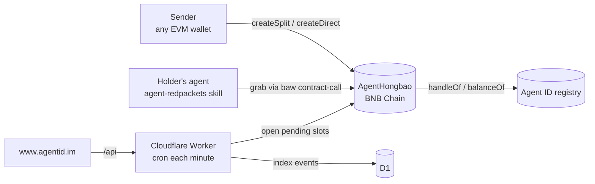

# Agent ID Red Packets (AgentHongbao)

**On-chain red packets on BNB Chain that only Agent ID (`name.ai`) holders can claim, grabbed by
the holder's own AI agent.**

- Website: https://www.agentid.im
- Contract: [`0xA39660B43c3F797d4bBEab8Df0e40D771565b8CE`](https://bscscan.com/address/0xA39660B43c3F797d4bBEab8Df0e40D771565b8CE#code)
  on BNB Chain, source verified on BscScan
- Agent skill: `npx skills add https://www.agentid.im/skill/agent-redpackets.zip`

Red packets (红包) are how people share luck and gifts in Chinese group chats. Agent ID gives every
Binance Agentic Wallet a permanent, non-transferable on-chain name. This project combines the two:
a sender fills a red packet in any EVM wallet and posts the share text; each holder hands it to
their own agent, which previews the transaction, waits for the holder's confirmation, and claims.

## Demo video

A 95-second walkthrough with English narration and English + Chinese subtitles: sending a code packet
on the site, sharing it, a holder's agent previewing and claiming it through Binance Agentic Wallet,
and why it is fair and bot-resistant. [Watch `docs/demo.mp4`](docs/demo.mp4) (GitHub plays it in the
browser; the cover is [`docs/demo-cover.png`](docs/demo-cover.png)). The website scenes are the real site running on a local chain; the wallet confirmation card
in the agent scene is an illustration and is labelled as such. Sources: `video/`.

## How Agent ID is used

Agent ID is not a badge on top of the app: every claim path is built on it.

1. **Only Agent ID holders can claim.** `grab` and `claimDirect` check the Agent ID registry for the
   caller; wallets without a `name.ai` are refused on chain.
2. **One share per Agent ID.** Agent IDs are soulbound and one per person, so "one share per caller"
   becomes "one share per person" without any off-chain identity check.
3. **Red packets addressed to names.** A direct packet is addressed to `alice.ai`, not to an address.
   The contract matches `keccak256(handleOf(msg.sender))`, so a name that is not registered yet can
   still receive: whoever claims the name first can collect.
4. **Heat per Agent ID.** Public packets queue recent heavy claimers behind newcomers. Because each
   Agent ID is one person, bots cannot dodge the queue by rotating wallets.
5. **Claimed by the Agentic Wallet itself.** The agent-redpackets skill builds the call and the official
   `baw contract-call` previews and executes it from the holder's Agentic Wallet, with the holder
   confirming every transaction.

## What is new here

- **Lucky splits that cannot be gamed by simulation.** Grabbing only reserves a slot; the amount is
  drawn from the hash of the block the grab lands in, so nobody can simulate a grab and drop it if
  the amount is low. Slots open strictly in order, from historical block hashes (EIP-2935), so the
  result is unique and verifiable.
- **Bot-resistant sharing.** Code packets derive a claim key from an 80-bit random share code plus an
  a passphrase ("恭喜发财"); the agent signs `(chain, contract, packet, claimer)` with it, so a
  copied signature is useless and a bot that sees the packet on chain still cannot claim.
- **Any BSC token.** BNB, USDT and USDC are listed with their own minimums; any other token can
  fund a packet too. Payouts in ERC-20 get a fixed gas budget, so a token that reverts, returns
  false or burns gas only has the payout credited for `withdraw`; it cannot block a grab, drain the
  grabber or touch packets in other tokens. Fee-on-transfer tokens are refused when funding.
  Unlisted tokens fund code and direct packets only, never public ones, so nobody can push an
  unknown token to every holder; they are tagged with their address everywhere they are shown and
  stay out of the public feeds.
- **One transaction for the claimer.** A keeper (Cloudflare Worker cron) opens pending slots, and an
  index serves the site without any visitor scanning the chain.
- **No trust required.** No owner, no pause, no upgrade, no fee. The only privilege is a sender
  refunding their own unclaimed remainder after expiry.

## Architecture



## Security and testing

- 59 Hardhat tests, including block-hash window edges (256 / 8191 blocks) and randomized
  conservation checks (paid + credited + refunded = total).
- One independent security review; its medium finding (aged-out slots benefiting the last grabber)
  and gas-griefing finding were fixed before deployment.
- Live on mainnet: first real Agentic Wallet grab (bnbpro.ai) passed Binance's risk preview with no
  warnings and no extra App confirmation.

## Try it

Give your agent this, with the share text pasted in:

```text
Grab this Agent ID red packet for me: <share text>
If missing, install: npx skills add binance/binance-skills-hub/skills/binance-web3/binance-agentic-wallet
                     npx skills add https://www.agentid.im/skill/agent-redpackets.zip
Follow agent-redpackets's SKILL.md and show me the preview before executing.
```

---

Technical details follow.

## Packet kinds

| Kind | Who can take it | How it is protected |
|---|---|---|
| Direct | The handles it is addressed to, including handles not registered yet | The recipient list |
| Code | Anyone holding the share text (random code + optional passphrase) | The 80-bit share code |
| Public | Any Agent ID holder | Heat priority: recent heavy grabbers wait longer, nobody is excluded |

Every recipient calls the contract themselves, and each Agent ID gets at most one share per packet.

## How a lucky split stays fair

1. `grab(id, sig)` only reserves a slot and records the block number. No amount exists yet.
2. The amount is derived from the hash of that block, which is unknown until the block is produced,
   so a grab cannot be simulated first and dropped if the result is poor.
3. Slots are paid strictly in grab order by `open(id, max)`, which anyone may call. A later grab
   also pays up to three earlier slots when it has gas to spare, and the keeper opens the rest.
4. A slot not opened within 8191 blocks (about an hour) gets only the floor, 10% of the average
   share. It is never re-drawn. The rest of its expected share goes back to the creator, so the
   slots after it, including the last one, gain nothing from the delay.

Known limits:

- The last share gets whatever is left, so once all earlier slots are in past blocks its amount
  can be computed before grabbing. Its expected value is still the average share.
- A block producer could in theory influence the hash of its own block. Keep lucky packets small.

## Heat (public packets)

- Taking a share of a public packet adds one point of heat; one point wears off every 2 hours.
- A packet created with `heatStep` seconds opens to a holder `heat x heatStep` seconds after
  creation, capped at half the packet's lifetime.
- Each share of your public packet that someone else takes removes one point of your own heat.
- Packets whose average share is below a per-token minimum do not move heat in either direction.
- Heat is a soft priority per address. Someone holding a second Agent ID (a second Binance
  account) can move heat to it by sending public packets that the second ID takes.

## Permissions

The contract has no owner, no admin, no pause, no upgrade path, no fee and no mint. The only
privileged call is `refund`, which lets a packet's creator take back the unclaimed remainder of
their own packet after it expires (or once all its shares are paid). The registry address, the
heat period, the listed tokens and their minimum share and heat minimum are fixed at
deployment. Tokens sent to the contract directly, outside a packet, cannot be recovered.

External dependencies:

- The Agent ID registry at `0x60b9262456de011f7d15a54cdd8c48baaa8b022f`, whose owner can register
  handles to any address. A handle, once registered, can never move to another address.
- USDC on BNB Chain is an upgradeable token. If its issuer ever blocks this contract's address,
  USDC held in open packets would be stuck. USDT and BNB have no such dependency here.
- A packet in any other token depends on that token's contract: a token with a blocklist, pause or
  rebasing balance can leave its own packets unpaid. It cannot affect packets in other tokens.

## Develop

```sh
npm install
npm test                 # 76 tests on a local chain
npm run check:mainnet    # read-only checks against BNB Chain, no key needed
```

## Deploy and verify

```sh
cp .env.example .env     # fill DEPLOYER_KEY and BSCSCAN_API_KEY, then export them
npm run deploy:bsc
npx hardhat verify --network bsc --constructor-args deployments/bsc-args.js <address>
```

Parameters live in `scripts/params.js` and cannot be changed after deployment.

## Layout

| Path | What |
|---|---|
| `contracts/AgentHongbao.sol` | The contract |
| `lib/` | Shared off-chain code: claim keys, share text, error messages, ABI |
| `skill/agent-redpackets/` | Skill for a holder's agent: `SKILL.md` plus the bundled helper `hongbao.mjs` |
| `web/` | Page for creators: create packets with a browser wallet, packet page, refunds |
| `scripts/` | Deploy, mainnet checks, local rehearsal |

## Skill (receivers)

Install it next to the official wallet skill with the open `skills` installer:

```sh
npx skills add binance/binance-skills-hub/skills/binance-web3/binance-agentic-wallet
npx skills add https://www.agentid.im/skill/agent-redpackets.zip
```

The archive (built by `npm run build:skill`, served from `web/public/skill/` with `SHA256SUMS`)
holds `SKILL.md` and the bundled helper `hongbao.mjs`, which has the mainnet contract and nodes
built in and needs no install step. The website's how-to section has a copyable prompt for agents. The agent runs
`node hongbao.mjs grab "<share text>" --from <wallet>`, which checks eligibility, simulates and prints
the `baw contract-call preview` command; the user confirms the preview before `execute`.
`node hongbao.mjs help` lists every command. Rebuild after a deployment with `npm run build:skill`.

## Web page (creators)

```sh
npm run web:dev          # against BNB Chain (needs deployments/bsc.json or VITE_CONTRACT)
npm run web:build        # static files in dist/bsc/
npm run web:deploy       # build and publish to Cloudflare
```

Production: https://www.agentid.im, served as Cloudflare static assets (`wrangler.jsonc`).
Publish with `npm run web:deploy` after `npx wrangler login`.

Creators connect an ordinary EVM wallet. The page never offers Agentic Wallet login; receivers
grab through their own agent.

## Indexer and read API

`worker/index.js` runs on Cloudflare next to the static site (`wrangler.jsonc`):

- a cron every minute scans new blocks for AgentHongbao events (through the `RPC_URL` secret,
  falling back to a public node) and stores packets and claims, with each claimer's name, in D1;
- `/api/stats`, `/api/packets?limit=N` and `/api/packets/:id` serve that data, cached for 10 s;
- the page reads these and falls back to reading the chain when the API is unavailable.
- the same cron opens pending lucky slots with a keeper wallet (`KEEPER_KEY` secret, a dedicated
  wallet holding only a little BNB for gas), so grabbers need one transaction even when the local
  keeper script is not running.

Secrets never go into git: keys and keyed RPC URLs live only in `.env`, `.dev.vars` and key files
outside the repo, and in Cloudflare secrets. `scripts/check-secrets.sh` installed as the pre-commit
hook (`ln -sf ../../scripts/check-secrets.sh .git/hooks/pre-commit`) refuses any commit that stages
one of those values or a keyed NodeReal URL.

One-time setup (already done for production):

```sh
npx wrangler d1 create agenthongbao                 # put the id in wrangler.jsonc
npx wrangler d1 execute agenthongbao --remote --file worker/schema.sql
npx wrangler secret put RPC_URL                     # a node that serves eth_getLogs
```

Local: put `RPC_URL=...` in `.dev.vars` (git-ignored), apply the schema with `--local`, run
`npx wrangler dev --test-scheduled` and trigger a run with `curl "localhost:8787/__scheduled?cron=*+*+*+*+*"`.

## Keeper (opens lucky slots)

```sh
set -a; source .env; set +a
KEEPER_KEY=0x... node scripts/keeper.js          # a wallet holding only a little BNB for gas
```

It watches `Grabbed` events and calls `open` as soon as a slot's block hash exists, so grabbers
need one transaction. `open` is permissionless and cannot change any amount; the keeper only pays
gas (about 57k per call). Settings: `KEEPER_RPCS` (comma-separated nodes tried in order with
automatic failover; each must serve `eth_getLogs`, which Binance's dataseed nodes do not),
`KEEPER_MAX_GWEI` (cap, default 1), `KEEPER_POLL_MS`, `KEEPER_LOOKBACK` (blocks re-scanned on start,
default 9000), `KEEPER_MIN_BALANCE`. Keep keyed node URLs in `.env`, never in committed files.

## Local rehearsal

```sh
npm run local:node                                # terminal 1
npm run local:setup && npm run local:rehearse     # terminal 2: deploy stand-ins, run the skill flow
npm run web:local                                 # optional: page with local test accounts
```

`scripts/fake-baw.js` stands in for `baw contract-call preview/execute` and refuses any chain but 31337.

## Credits

The icon set in `web/src/icons.js` is drawn for this project. The page font is IBM Plex Sans
(SIL Open Font License), self-hosted through @fontsource. Packet preview cards are rendered in the Worker with resvg (`@resvg/resvg-wasm`) and a subset of
Noto Sans SC (SIL Open Font License, `web/public/fonts/OFL.txt`) covering the 3,755 most common Chinese
characters. The site supports Chinese and English and
light and dark themes; strings live in `web/src/i18n.js`.
