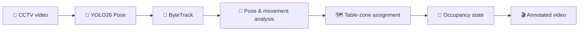

<div align="center">

# 🍽️ TableVision

### Turn existing restaurant CCTV into live table-occupancy insights.
No new hardware. No sensors. Just the cameras you already have.

<br>


<br>

[**Features**](#-features) ·
[**How it works**](#-how-it-works) ·
[**Quick start**](#-quick-start) ·
[**Configuration**](#%EF%B8%8F-configuration) ·
[**Roadmap**](#%EF%B8%8F-roadmap) ·
[**Contributing**](#-contributing)

<br>


</div>

---

## 🧠 Overview

Most restaurants already have CCTV. **TableVision** is a computer vision prototype that analyzes that footage to detect and track people, assign them to tables, and show which tables are **free**, **being checked**, or **taken**.

> [!WARNING]
> **Experimental prototype.** Occupancy and guest counts are estimates and may be inaccurate in some scenes. See [Limitations](#-limitations).

---

## ✨ Features

| | Feature | Details |
|:--:|---|---|
| 🧍 | **Pose detection** | People and body pose via YOLO26 Pose |
| 🔁 | **Multi-object tracking** | Consistent identities across frames with ByteTrack |
| 🗺️ | **Table zones** | Hand-drawn polygons per table, per camera view |
| ⏱️ | **Temporal confirmation** | Confirm and exit timers filter out short-lived false assignments |
| 🧑‍🍳 | **Staff filtering** | Staff filtering plus ignore zones for walkways |
| 🎥 | **Annotated output** | Exports video with table states and estimated guest counts |

---

## 🚦 Table states

| State | Meaning |
|:--|:--|
| 🟢 **Available** | No confirmed seated guests assigned to the table |
| 🟡 **Checking** | Evaluating, or waiting on a confirmation / exit timer |
| 🔴 **Occupied** | One or more guests passed the seating confirmation logic |

---

## ⚙️ How it works



Occupancy is estimated by combining four signals:

- **Proximity** to each table polygon
- **Pose cues** (sitting vs. standing)
- **Movement history** per tracked person
- **Confirmation / exit timers** to avoid flicker

---

## 🚀 Quick start

> [!NOTE]
> **Requirements:** Python 3.10+ · CPU works for basic runs (NVIDIA GPU with CUDA recommended) · OpenCV display support for the zone tool.

**1. Clone and install**

```bash
git clone https://github.com/ahmaddii/TableVision
cd TableVision

python -m venv .venv
source .venv/bin/activate        # Windows: .venv\Scripts\activate

python -m pip install ultralytics opencv-python numpy torch lap
```

Make sure `yolo26s-pose.pt` and your input video are available at the paths set in the scripts.

**2. Draw table zones**

Set your video and output paths in `src/table_zones.py`, then:

```bash
python src/table_zones.py
```

Zones are saved as JSON (default: `outputs/table_zones_1.json`).

> [!IMPORTANT]
> Each camera view needs its own zones. If the camera position or zoom changes, redraw them.

**3. Process a video**

```bash
python src/occupancy.py
```

Open the result in any player, such as VLC. Default output: `outputs/restaurant_occupancy.mp4`.

---

## 🎛️ Configuration

All settings live in `src/occupancy.py`.

| Setting | Purpose | Default |
|:--|:--|:--|
| `MODEL_PATH` | Pose model weights | `yolo26s-pose.pt` |
| `ZONES_PATH` | Table-zone file for your camera | `outputs/table_zones_1.json` |
| `OUTPUT_PATH` | Annotated video output | `outputs/restaurant_occupancy.mp4` |

Confirmation timers, exit timers, and detection thresholds are also configurable in the same file.

---

## 📁 Project structure

<details>
<summary><b>Click to expand</b></summary>

```text
.
├── assets/             # README demo image
├── data/
│   ├── images/         # Demo footage
│   └── videos/         # Test videos
├── outputs/            # Table-zone JSON and generated video
├── src/
│   ├── detector.py     # Person detection
│   ├── occupancy.py    # Occupancy pipeline and configuration
│   ├── table_zones.py  # Table polygon annotation tool
│   ├── tracker.py      # Tracking helpers
│   └── video.py        # Camera/video input experiment
├── yolo26s-pose.pt     # Pose model weights
└── yolo26n.pt          # Detection model weights
```

</details>

---

## ⚠️ Limitations

- 🪑 **Occlusion** by people, tables, and furniture reduces accuracy
- 📷 **Camera angle, lighting, and image quality** affect zone assignment and pose estimates
- 🧑‍🍳 **Staff vs. guests** can be confused; filtering depends on scene and configuration
- 🔢 **Tracking IDs** can change between runs
- ⚡ **Performance** depends on input resolution and hardware
- 🎞️ **Sample or generated footage** is no substitute for testing on real restaurant video

---

## 🗺️ Roadmap

- [ ] Better person-to-table association and seated-person classification
- [ ] Multi-camera support with clearer configuration
- [ ] Evaluation on authorized, representative restaurant footage
- [ ] Real-time camera stream support
- [ ] Dashboard: live availability, utilization, occupancy trends, waiting-time insights

---

## 🔒 Privacy and responsible use

> [!CAUTION]
> Use camera footage only with proper authorization. Follow applicable privacy requirements, limit access to video and derived data, and validate the system carefully before relying on its estimates for operational decisions.

---

## 🤝 Contributing

Contributions are welcome.

1. 🍴 **Fork** the repository
2. 🌿 **Create a branch** for your change
3. 🔀 **Open a pull request** with a clear description

Work in restaurants, hospitality tech, or computer vision? Open an issue and share what would make this useful in the real world.

---

## 👤 Author

**Ahmad** · Computer Vision, Machine Learning, and Software Engineering

If TableVision helps you, consider giving it a ⭐

<div align="center">

**Built with 🧠 computer vision and ☕ coffee**

</div>
