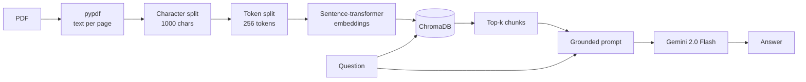

# RAG with Gemini

Retrieval-Augmented Generation over a PDF, end to end, in a single Colab notebook. Point it at a 100-page annual report and ask questions in plain English. Answers come from the document, not from what the model happens to remember.

<a href="https://colab.research.google.com/github/akajammythakkar/rag-with-gemini/blob/main/RAG_with_Gemini.ipynb"></a>


---

## What this is

Most RAG walkthroughs stop at "embed some text, call an LLM." This one runs the whole path on a real document (Alphabet's annual report, 100+ pages) and is explicit about the two decisions that actually move answer quality: **how you chunk** and **what you retrieve**. The model is the easy part.

The notebook is deliberately linear. One step per cell, commented throughout, readable top to bottom in about five minutes.

## Pipeline



## Quick start

1. Open the notebook in Colab using the badge above.
2. Get a free Gemini API key from [Google AI Studio](https://aistudio.google.com/app/apikey).
3. In Colab, open the key icon in the left sidebar and add a secret named `API_KEY` with that value. Enable notebook access.
4. Runtime > Run all.

The Alphabet annual report ships with the repo, so the notebook runs as-is with no uploads.

## Run it locally

```bash
pip install langchain langchain-experimental chromadb pypdf google-generativeai sentence_transformers
```

Replace the Colab `userdata.get('API_KEY')` call with your own secret handling, for example `os.environ["GEMINI_API_KEY"]`, and point the `PdfReader` path at a local file.

## How it works

**1. Extract.** `pypdf` pulls text page by page. Empty pages are dropped rather than embedded as noise.

**2. Chunk twice.** First a `RecursiveCharacterTextSplitter` at 1000 characters, splitting on paragraph breaks before line breaks before sentences, so chunks land on natural boundaries. Then a `SentenceTransformersTokenTextSplitter` at 256 tokens per chunk, because the embedding model has a hard token limit and silently truncates anything longer. Skipping the second pass is the most common reason a RAG demo retrieves the right chunk and still answers badly: half the chunk never made it into the vector.

**3. Embed and index.** Chroma's default sentence-transformers embedding function turns each chunk into a vector, stored in an in-memory collection.

**4. Retrieve.** The question is embedded with the same function and matched against the collection. Top-k chunks come back as the evidence set.

**5. Generate.** Those chunks are pasted into a prompt that instructs Gemini to answer using only the supplied information. That constraint is what keeps the model from filling gaps with plausible-sounding numbers.

## Use your own PDF

Change one line:

```python
reader = PdfReader("/content/your-document.pdf")
```

Rename the Chroma collection to match, and the rest of the notebook runs unchanged. Dense, table-heavy documents usually want a smaller character chunk size; prose can go larger.

## What I would change before production

This is a teaching notebook, not a service. If you are building on it:

- **Persist the index.** The in-memory Chroma client is wiped on every restart, so you re-embed the whole document each run. Use a persistent client or a hosted vector store.
- **Lower the temperature.** The notebook uses 0.9, which is fine for demos and wrong for grounded question answering. Around 0.2 gives noticeably more faithful answers.
- **Add reranking.** Pure vector top-k is a weak retriever. A cross-encoder rerank over the top 20, or hybrid BM25 plus dense, is usually the single largest accuracy win.
- **Return citations.** Carry chunk IDs through to the answer so a reader can verify a claim against a page.
- **Measure it.** Build a small set of question and answer pairs and score retrieval hit rate separately from answer quality. Without that split you cannot tell whether a bad answer is a retrieval bug or a generation bug.

## Repo structure

```
RAG_with_Gemini.ipynb      the full pipeline
alphabet annual report.pdf  sample document, 100+ pages
```

## Related work

- [adk_hiring_agent](https://github.com/akajammythakkar/adk_hiring_agent), multi-agent hiring system on Google ADK
- [a2ui-multiagent-codelab](https://github.com/akajammythakkar/a2ui-multiagent-codelab), multi-agent coding assistant on A2A, AG-UI and A2UI

---

Built by [Jay Thakkar](https://github.com/akajammythakkar), Google Developer Expert in AI and Cloud.
