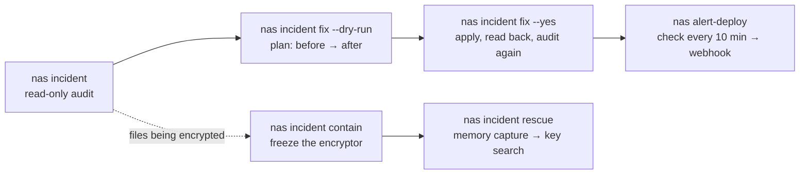

# synology-nas-cli

**Audit a Synology NAS against the C3RB3R / `.L0CK3D` ransomware campaign with one command, fix what it finds with a second, and keep running DSM from the terminal afterwards.**

[English](README.md) · [繁體中文](README.zh-TW.md) · [简体中文](README.zh-CN.md) · [日本語](README.ja.md) · [한국어](README.ko.md) · [Deutsch](README.de.md) · [Español](README.es.md) · [Français](README.fr.md)

[](https://gitlab.com/aa22396584/synology-nas-cli/-/releases) [](LICENSE)

Canonical repository, releases and issues: https://gitlab.com/aa22396584/synology-nas-cli


`nas` is a zero-dependency Python CLI (standard library only, Python 3.8+, so it also runs on DSM itself) and stdio MCP server for the Synology DSM 7 Web API: status, health, logs, packages, volumes, Tailscale, DSM upgrades, scheduled health alerts pushed to a webhook, and an incident audit and remediation tool built during the October 2026 C3RB3R / `.L0CK3D` campaign against internet-exposed Synology NAS boxes (Synology-SA-24:20, SA-26:13, SA-26:14).

Not affiliated with Synology Inc. "Synology", "DSM" and "QuickConnect" are trademarks of Synology Inc.

- [Hand it to your agent](#hand-it-to-your-agent)
- [What it checks and fixes](#what-it-checks-and-fixes)
- [Install](#install)
- [Pick your setup](#pick-your-setup)
- [Configuration](#configuration)
- [Credentials](#credentials)
- [Backends](#backends)
- [Incident quick start](#incident-quick-start)
- [`nas incident fix`](#nas-incident-fix)
- [MCP server and agent skills](#mcp-server-and-agent-skills)
- [Alerts and webhooks](#alerts-and-webhooks)
- [Command reference summary](#command-reference-summary)
- [What changes the NAS](#what-changes-the-nas)
- [Tests](#tests)

## Hand it to your agent

Paste either prompt into Claude Code, Codex, Cursor, Gemini CLI, OpenCode, Grok Bot, or any tool-using AI agent (Grok Bot setup, skills and alert routine: [`docs/GROK-BOT.md`](docs/GROK-BOT.md)):

**English prompt:**

```text
Use https://github.com/akari-sora/synology-nas-cli to audit and fix my Synology NAS at https://192.0.2.10:5001. Follow docs/AGENT-RUNBOOK.md.
```

**繁體中文提示詞：**

```text
使用 https://github.com/akari-sora/synology-nas-cli 檢查並修復我的 Synology NAS（位址：https://192.0.2.10:5001），照著 docs/AGENT-RUNBOOK.md 的步驟執行。
```


### What the agent does, step by step

1. **Install**: Clones the repository (or installs the package) and verifies `./bin/nas --version`.
2. **`nas setup`**: Runs `nas setup --json --no-input ...` to write `~/.config/synology-nas-cli/config.json` (mode `0600`), signs in once to verify credentials, and pins DSM's TLS certificate SHA-256 fingerprint on first use.
3. **`nas doctor`**: Runs `nas doctor --json` to verify configuration, credentials, origin reachability, TLS pin, login, DSM version against SA-26:13, 2-step verification status, administrator capabilities, and clock skew.
4. **`nas incident`**: Runs `nas incident --json` (and optionally `--probe --scan`) for a read-only audit of DSM version, vulnerable packages, firewall, QuickConnect, UPnP router rules, public ports, external and failed sign-ins, AutoBlock, SMB1, built-in `admin`, snapshot schedules, the unsupported-model WORM lock trap, ransom notes, and CVE-2024-10441 exploit attempts.
5. **Plan**: Runs `nas incident fix --dry-run --json --ransom-scan` and shows every planned change (`before -> after`), the exact DSM Web API calls, and the corresponding DSM web UI path.
6. **`nas incident fix --yes`**: Applies the approved plan in order (`snapshot_worm` → `snapshots` → `packages` → `smb_min_protocol` → `quickconnect` → `router_port_forwarding` → `autoblock` → `admin_account` → `firewall`, plus optional `--rotate-password` and `--upgrade`), reads every setting back to verify, and re-runs the audit.
7. **Optional `--deep` and `alert-deploy`**: Runs `nas incident --deep --json` (one read-only root collector via Task Scheduler checking root-only logs, crontabs, `/bin` binaries, accounts, SSH keys, and `/proc`) and `nas alert-deploy --json --test` (10-minute health and security monitoring pushed to a webhook).

### What you provide along the way

1. **NAS address and account (once)**:
   - DSM URL (for example `https://192.0.2.10:5001`, plus a VPN/Tailscale URL if used).
   - An administrator username and where its password comes from (`op://VAULT/ITEM/password`, a password command, or the OS keychain).
   - Your LAN/VPN subnet CIDR(s) to keep allowed in the firewall (for example `192.0.2.0/24`).
   - An optional shared folder path for temporary staging (for example `/docker/.nas-cli-deploy`, used by `--deep` and `alert-deploy`).
2. **A 6-digit 2FA code (once, if 2-step verification is on)**:
   - When `nas setup` exits `3` with `"field": "otp"`, provide the current 6-digit code; `--trust-device` stores DSM's trusted-device token (`0600`) so subsequent commands do not need a code.
3. **Plan confirmation**:
   - Review the dry-run plan before `nas incident fix --yes` runs (and choose whether to include `--rotate-password` or `--upgrade`).

Full agent specification: [`docs/AGENT-RUNBOOK.md`](docs/AGENT-RUNBOOK.md).



## What it checks and fixes

`nas incident` is read-only. Each item prints `PASS`, `WARN`, `FAIL` or `SKIP` with a one-line hint (`--json` outputs structured JSON; schema in [`schemas/incident.schema.json`](schemas/incident.schema.json)). Exit status is `1` when any item is `FAIL`.

| Item | What `nas incident` reports | What `nas incident fix` changes |
|---|---|---|
| `dsm_version` | `FAIL` if the DSM build is older than the SA-26:13 fixed build for its branch, or on a branch with no SA-26:13 fix (DSM 7.1 and older); `PASS` if patched | With `--upgrade`: downloads the newest official `.pat` for the model, runs PreCheck, installs, and reboots |
| `sa_26_14_packages` | Checks installed packages against Synology-SA-26:14 (Calendar, MailStation, PHP 7.3–8.4): `FAIL` if a vulnerable version is running, `WARN` if installed but stopped | Stops running vulnerable packages (`--only packages`) |
| `firewall` | `FAIL` when the firewall is off and the NAS holds a public IP itself (e.g. dials PPPoE), `WARN` when off behind NAT, or `FAIL`/`WARN` when interfaces accept unmatched traffic or rules allow any source (`source_ip: all`) | Enables the firewall, adds allow rules for this computer's `/32` (as DSM logged it) plus IPv4 `allowed_networks` on LAN interfaces, sets every non-`global` interface policy to `drop`, and removes allow-any-source rules (`--only firewall`) |
| `quickconnect` | `FAIL` when QuickConnect or QuickConnect automatic router port forwarding is enabled | Turns off QuickConnect and its UPnP router port forwarding (`--only quickconnect`) |
| `router_port_forwarding` | `FAIL` when DSM has enabled UPnP/NAT-PMP port-forwarding rules on the router | Disables all router port-forwarding rules managed by DSM (`--only router_port_forwarding`) |
| `public_ports` | Only with `--probe`: opens TCP connections from this machine to DSM and file-service ports on the NAS's public IP (`FAIL` if any port answers) | Covered by `firewall`, `quickconnect`, and `router_port_forwarding` |
| `external_signins` | `FAIL` when the connection log contains successful sign-ins from source addresses outside `allowed_networks` | None (investigate unauthorized access; see [`docs/INCIDENT-C3RB3R.md`](docs/INCIDENT-C3RB3R.md)) |
| `failed_signins` | `WARN` when failed sign-ins in the last `--hours` (default `24`) exceed `--failed-threshold` (default `20`) | Mitigated by `firewall` and `autoblock` |
| `autoblock` | `FAIL` when AutoBlock is disabled | Enables AutoBlock (`10` attempts within `5` minutes, permanent block) and allow-lists this computer's IP plus IPv4 `allowed_networks` (and `127.0.0.1` if `incident.autoblock_allow_loopback` is true) (`--only autoblock`) |
| `smb_min_protocol` | `FAIL` when SMB is enabled and allows SMB1 (`smb_min_protocol=0`), `WARN` when SMB is off but minimum protocol is SMB1 | Raises minimum SMB protocol to SMB2 (`smb_min_protocol=1`, `smb_max_protocol=3`) (`--only smb_min_protocol`) |
| `admin_account` | `FAIL` when the built-in `admin` account is enabled (`expired: normal`) | Disables the built-in `admin` account via a temporary root task after checking that another enabled administrator exists and the current session is not `admin` (`--only admin_account`) |
| `snapshot_schedule:<share>` | Per shared folder: `FAIL` if no snapshot schedule exists, the schedule is disabled, or the newest scheduled snapshot is older than `snapshot_max_age_hours` (default `26` h) | Creates a daily snapshot schedule (`03:30` default) and a 14-day retention policy on shares that have no schedule yet; gated on a clean `--ransom-scan` in the same run or `--i-know-snapshots-may-rotate` (`--only snapshots`) |
| `snapshot_worm:<share>` | `FAIL` when the immutable-snapshot (WORM) lock is enabled on a model whose `SYNO.DisasterRecovery.Retention info` lacks `worm` (DSM accepts the API call and scheduled snapshots silently stop) | Turns off the unsupported WORM lock on affected shares so scheduled snapshots resume; gated like `snapshots` (`--only snapshot_worm`) |
| `ransomware_files` | Only with `--scan`: searches shares via File Station for `*.L0CK3D`, `*.LOCK3D`, and `read-me3.txt` (`FAIL` if any match is found) | None (incident response required; see [`docs/INCIDENT-C3RB3R.md`](docs/INCIDENT-C3RB3R.md)) |
| `exploit_attempts` | Scans the DSM connection log for CVE-2024-10441 sign-in injection markers (`PLUGIN_VALUE_END`, `LD_PRELOAD=`, `LD_DEBUG_OUTPUT`) and `incident.ioc_ips` (`WARN` when attempts are seen) | None (check `--deep` to verify whether any attempt succeeded) |
| `exploit_attempts_logs`, `ioc_cron`, `ioc_binaries`, `ioc_users`, `ioc_ssh_keys`, `ioc_processes` | Only with `--deep`: runs one read-only root collector to inspect `/var/log/synoplugin.log*`, `/var/log/synoscgi.log*`, `/var/log/auth.log*`, crontabs (`/etc/cron.d/synot*`), `/bin/libgld`, `/bin/qnetd`, `/bin/l0ck.enc`, `xdy5*`, extra uid-0 or unknown accounts, `authorized_keys`, and `/proc` processes/connections (`FAIL` on known C3RB3R artifacts, `WARN` on unknown entries) | None (incident response required; see [`docs/INCIDENT-C3RB3R.md`](docs/INCIDENT-C3RB3R.md)) |

`SKIP` always states the reason: the item needs a flag (`--probe`, `--scan`), the API returned an error, or the NAS does not use that feature (no Btrfs/Snapshot Replication, no router configured in DSM).

## Install

### From a Git checkout (zero install)

```bash
git clone https://gitlab.com/aa22396584/synology-nas-cli.git synology-nas-cli
cd synology-nas-cli
./bin/nas --help                     # runs directly from the checkout (Python 3.8+ stdlib only)
ln -s "$PWD/bin/nas" ~/bin/nas       # optional: put `nas` on PATH
```

### With `pip` from a GitLab release or local checkout

```bash
pip install https://gitlab.com/aa22396584/synology-nas-cli/-/archive/v1.0.0/synology-nas-cli-v1.0.0.tar.gz
# or from a local checkout:
pip install -e .                     # or: pipx install .
nas --help
```

### On Windows (with `py`)

```powershell
git clone https://gitlab.com/aa22396584/synology-nas-cli.git synology-nas-cli
cd synology-nas-cli
py -3 bin\nas --help
# or install the console script:
py -3 -m pip install -e .
nas --help
```

### Initialize and verify login

Interactive or agent-driven one-step setup:

```bash
nas setup --origin https://192.0.2.10:5001 --user ops --password-source op:op://VAULT/ITEM/password --allowed-network 192.0.2.0/24
nas doctor
```

Or create the config file from the template and edit it by hand:

```bash
nas config init                      # writes ~/.config/synology-nas-cli/config.json (mode 600)
$EDITOR ~/.config/synology-nas-cli/config.json
nas config show                      # effective config, commands masked
nas whoami                           # one login: account, admin flag, DSM version, credential source
```

## Pick your setup

| Setup | Backend | Password from | Notes |
|---|---|---|---|
| macOS with 1Password | `password` | `op://VAULT/ITEM/password` refs; `op` signed in through the 1Password app | Approve `op` in the app the first time. 2FA codes from the same item (`op item get --otp`). |
| macOS without 1Password | `password` | `nas login --save` (Keychain), or `password_command` = `security find-generic-password -s synology-nas -a USER -w` | `nas login` also caches the session so later commands do not sign in again. |
| Linux server, cron, systemd timer | `password` | 1Password service account (`OP_SERVICE_ACCOUNT_TOKEN` or the token file) + `op://` refs, or `password_command` (`secret-tool lookup ...`, `pass show ...`) | No terminal: the prompt is off, so configure a non-interactive source. |
| Windows | `password` | `password_command` with PowerShell (see [Credentials](#credentials)), or `NAS_USER` + `NAS_PASSWORD` | Store the credential with the CredentialManager PowerShell module (`New-StoredCredential`) and read it with `Get-StoredCredential` in `password_command`. |
| On the NAS itself | `local` | none: runs as root through DSM Task Scheduler | `nas alert-deploy` sets this up. Uses DSM's own Python 3.8. |
| CI / headless with a service account | `password` | `OP_SERVICE_ACCOUNT_TOKEN` (CI secret) + `op://` refs | Or `NAS_PASSWORD_COMMAND` reading the CI secret store. `NAS_PASSWORD` also works. |

## Configuration

One JSON file: `$NAS_CONFIG`, else `~/.config/synology-nas-cli/config.json`. Every key is optional. Unknown keys are an error, so typos do not silently fall back to defaults. Keys beginning with `_` are comments. Environment variables override the file; command-line flags override both. `nas config show` prints the result with commands masked.

Example ([`config.example.json`](config.example.json), what `nas config init` writes; the addresses are documentation examples):

```json
{
  "name": "my-nas",
  "origins": ["https://192.0.2.10:5001", "https://my-nas.example-tailnet.ts.net:5001"],
  "lan_ip": "192.0.2.10",
  "snapshot_shares": ["photos", "documents"],
  "credentials": {
    "op_username": "op://VAULT/ITEM/username",
    "op_password": "op://VAULT/ITEM/password"
  },
  "webhook": {"file": "~/.config/synology-nas-cli/webhook.json"},
  "deploy": {"stage_dir": "/SHARE/.nas-cli-deploy"}
}
```

| Key | Default | Meaning |
|---|---|---|
| `name` | `nas` | Label in webhook bodies and the DSM notification prefix (`[name]`). |
| `assume_yes` | `false` | Accept every confirmation (same as `--yes` / `NAS_YES=1`; what that turns on: [What changes the NAS](#what-changes-the-nas)). The MCP server does not read it. |
| `origins` | `[]` | DSM URLs for `--backend password`, tried in order; the first that accepts a TCP connection (3 s) is used. Put the LAN address first, then a VPN/Tailscale one. |
| `chrome_origins` | = `origins` | Which Chrome tab `--backend chrome` may use. |
| `connect_timeout` | `3.0` | Seconds for the TCP reachability check. |
| `tls.verify` | `false` | `true`: check DSM's certificate against the system CAs (a real certificate for the origin's name). `false` (DSM ships a self-signed certificate): trust on first use, see [TLS](#tls). |
| `tls.known_certs_file` | `~/.config/synology-nas-cli/known-certs.json` | SHA-256 of the certificate each origin presented first (mode 600). `nas trust` lists it, `nas trust --reset ORIGIN` forgets one. |
| `lan_ip` / `public_ip` | `""` | Targets for `exposure` and `incident --probe`. `lan_ip` defaults to the host of the first origin. `public_ip` is only needed when the NAS does not dial PPPoE itself (behind a router: the router's WAN address). |
| `allowed_networks` | `[]` | Sign-ins from these are expected (`alert`, `incident`); empty = every non-global address (RFC 1918, 100.64.0.0/10, loopback, link-local, IPv6 ULA). For `incident fix` these IPv4 networks plus this computer's address (as DSM logged it, `/32`) are what the firewall and AutoBlock allow; empty = this computer only. IPv6 entries are not written as firewall rules. Entries wider than a /8 (for example `0.0.0.0/0`), and public ranges wider than a /24 (IPv6: /48), stop `incident fix`'s firewall and AutoBlock changes with the entry named; private ranges of any size and public /24s or single addresses are fine. |
| `snapshot_shares` | `[]` | Shares whose scheduled snapshots `alert` watches. `incident` checks every share when empty. |
| `snapshot_max_age_hours` | `26` | A scheduled snapshot older than this is "stale". |
| `latest_dsm` | `""` | Newest build you expect for this model (e.g. `7.4.1-90080`); empty skips the `dsm_behind` alert. |
| `credentials.*` | see [Credentials](#credentials) | `source`, `op_username`, `op_password`, `op_otp`, `op_token_file`, `username`, `password_command`, `otp_command`, `store`, `store_service`. |
| `session.cache_file` | `~/.cache/synology-nas-cli/session.json` | Where `nas login` caches the DSM session. Nothing is cached unless you run `nas login`. |
| `session.device_token_file` | `~/.config/synology-nas-cli/device-token.json` | Trusted-device token from a 2FA login with `--trust-device`. |
| `session.device_name`, `session.trust_device` | `synology-nas-cli`, `false` | Device name shown in DSM; ask for a device token on every 2FA login. |
| `alert.state_file` | `~/.local/state/synology-nas-cli/baseline.json` | Baseline between `alert` runs. |
| `alert.package_volume` | `""` | Report packages installed outside this volume (e.g. `/volume1`). |
| `alert.recordings` | off | `{"path": "/share/folder", "local_path": "", "folders": ["cam1"], "max_age_min": 10, "note": ""}`: warn when a folder stops receiving files (camera recordings and the like). Empty `folders` = off. |
| `webhook.*` | `""` | Where `alert-deploy` reads `{"url", "header"}`: `op_item` (`op://VAULT/ITEM`: website = URL, field `op_header_field` = header), `file` (JSON file), or `command` (prints that JSON). |
| `deploy.*` | see `nas config show` | `root_dir` (`/volume1/@nas-alert`), `stage_dir` (a folder in a writable share), `task_name`, `install_task_name`, `interval_min` (10), `dsm_webhook_name`, `dsm_webhook_prefix`, `dsm_webhook_template` (`Warning`). |
| `upgrade.lang`, `upgrade.cache_dir` | `enu`, `~/.cache/synology-nas-cli/pat` | PreCheck note language; where `.pat` files are kept. |
| `incident.*` | `14`, `3`, `30`, `10`, `5`, `false` | `snapshot_retain_days` (only set on shares that have no retention policy), `snapshot_hour`, `snapshot_minute` for schedules `incident fix` creates; `autoblock_attempts`, `autoblock_within_mins` it sets; `ioc_ips` (default `46.8.78.122` from public reports and `104.253.175.125`, observed in the wild on 2026-10-28), `ioc_strings` (extra strings) for `exploit_attempts` and `--deep`; `allowed_users` (accounts `--deep` treats as known); `autoblock_allow_loopback`: also allow-list `127.0.0.1` in AutoBlock (Tailscale's DSM package in userspace mode delivers every tailnet connection as `127.0.0.1`, so one blocked tailnet device would block all of them). |

Environment variables: `NAS_CONFIG`, `NAS_BACKEND`, `NAS_YES`, `NAS_NO_INPUT`, `NAS_ORIGINS` (comma-separated; older name `NAS_LAN_ORIGIN`), `NAS_CHROME_ORIGINS` (older `NAS_ORIGIN`), `NAS_OP_ITEM` (`op://VAULT/ITEM`), `NAS_OP_TOKEN_FILE`, `NAS_USER`, `NAS_PASSWORD_COMMAND`, `NAS_PASSWORD`, `NAS_OTP_COMMAND`, `NAS_CREDENTIAL_SOURCE`, `NAS_SESSION_FILE`, `NAS_SID` + `NAS_SYNOTOKEN`, `OP_SERVICE_ACCOUNT_TOKEN`.

## Credentials

The password comes from the first configured source in this chain (`credentials.source` or `NAS_CREDENTIAL_SOURCE` can force one: `op`, `command`, `keychain`, `env`, `prompt`):

1. **1Password** (`op`): `credentials.op_password` = `op://VAULT/ITEM/FIELD` (and `op_username`, or a literal `username`). `op` authenticates with `OP_SERVICE_ACCOUNT_TOKEN`; if that is unset and `credentials.op_token_file` (default `~/.config/op/service-account-token`) exists, its content is used as the token; otherwise `op` uses its own sign-in (1Password app integration or `op signin`). `op` is only run when an `op://` reference is configured. `op read` fails on item names with non-ASCII characters: use the item ID.
2. **Command** (`command`): `NAS_PASSWORD_COMMAND`, else `credentials.password_command`, run with `/bin/sh -c` (`cmd.exe` on Windows); the first line of output is the password. Examples:
   - macOS Keychain: `security find-generic-password -s synology-nas -a USER -w`
   - Linux Secret Service: `secret-tool lookup service synology-nas account USER`
   - pass: `pass show nas/USER`
   - Bitwarden CLI: `bw get password synology-nas` (needs `BW_SESSION` from `bw unlock`)
   - Windows: `powershell -NoProfile -Command "(Get-StoredCredential -Target synology-nas).GetNetworkCredential().Password"` with the CredentialManager module (`Install-Module CredentialManager`). `cmdkey /generic:synology-nas /user:USER /pass` stores a credential but has no way to print the password again.
3. **OS keychain** (`keychain`): the entry `nas login --save` wrote. macOS Keychain through `security` (the password goes through `security -i` on stdin, not the command line) or the Linux Secret Service through `secret-tool` (password on stdin). `credentials.store` = `auto` (default), `keychain`, `secret-tool`, or `""` (off); service name `credentials.store_service`. `nas logout --forget` deletes it.
4. **Environment** (`env`): `NAS_USER` + `NAS_PASSWORD`. The value sits in the process environment (readable by processes of the same user, and by `ps e` on some systems).
5. **Prompt** (`prompt`): `getpass`, only when stdin is a terminal and nothing above is configured.

The username comes from `NAS_USER` / `credentials.username`, else `op_username`, else the keychain entry's account, else a prompt.

**2-step verification.** When DSM answers 403 the login is retried once with a code from `credentials.otp_command` / `NAS_OTP_COMMAND` (e.g. `oathtool --totp -b SECRET`), else `op item get --otp` when the password came from 1Password (add the DSM 2FA secret to the item as a one-time password), else a prompt. `nas login --trust-device` (or `session.trust_device: true`) asks DSM for a trusted-device token and stores it (mode 600); later logins send it and skip the code until DSM forgets the device.

**Sessions.** By default every command signs in and out (each sign-in adds a "signed in successfully" line to DSM's connection log). `nas login` signs in once and caches the SID and SynoToken in `session.cache_file` (mode 600); later commands reuse it, and when DSM rejects it (106 timeout, 107 duplicate login, 119 invalid SID) they sign in again and rewrite the cache. `nas logout` ends and deletes it. `NAS_SID` + `NAS_SYNOTOKEN` reuse a session you already have (for example copied from a browser): nothing signs in or out, and a rejected session is an error.

### TLS

The `password` backend never uses `HTTP(S)_PROXY`, `ALL_PROXY` or the system proxy settings for DSM. With `tls.verify: false` (default) the SHA-256 of the certificate an origin presents on the first connection is stored in `tls.known_certs_file` (mode 600; `nas: trusting the certificate of ... on first use` on stderr) and every later connection must present the same certificate, otherwise the command stops with `the TLS certificate of ORIGIN changed`. After replacing the DSM certificate: `nas trust --reset https://HOST:PORT`. `nas trust` lists the stored fingerprints. With `tls.verify: true` the system CAs decide and nothing is pinned. A notice is printed when the 1Password token file is readable by other users.

**AutoBlock.** DSM blocks an address after 10 failed sign-ins within 5 minutes by default, often permanently. `nas` never retries a failed password. A wrong password in your source costs one attempt per command, so fix the source before running again. Code 407 means the address is already blocked: remove it from Control Panel > Security > Protection > Allow/Block List from another address. See [`docs/TROUBLESHOOTING.md`](docs/TROUBLESHOOTING.md) for recovery paths.

## Backends

| Backend | When | How it signs in | Notes |
|---|---|---|---|
| `password` (default) | From any computer that reaches DSM over HTTPS (LAN, VPN, Tailscale) | The credential chain above | Uses `origins` from the config. |
| `chrome` | macOS only, when you are already signed in to DSM in Google Chrome and do not want to store a password anywhere | Runs same-origin requests inside the DSM tab via AppleScript (Chrome: View > Developer > Allow JavaScript from Apple Events) | `upgrade`, `alert-deploy` and `tailscale` run with `--backend password`. |
| `local` | On the NAS itself as root (DSM Task Scheduler), e.g. what `alert-deploy` installs | None: `/usr/syno/bin/synowebapi --exec` runs the API as the system | Runs on the NAS as root. Tailscale status via the `tailscale` binary. |

## Incident quick start

```bash
nas incident                       # read-only audit
nas incident --probe               # also test the public address from this machine
nas incident --scan                # also search every share for ransom notes (minutes)
nas incident --deep                # also indicators of compromise via one read-only root script (needs deploy.stage_dir)
nas --json incident                # machine-readable

nas incident fix --dry-run         # the plan: every change (current -> new), the API calls, the DSM UI path
nas incident fix                   # same plan, asks before applying
nas incident fix --yes             # apply without asking
nas incident fix --only firewall,smb_min_protocol
nas incident fix --skip admin_account
nas incident fix --ransom-scan --yes          # a clean scan also allows the snapshot fixes
nas incident fix --upgrade --rotate-password --yes   # opt-in extras

nas incident contain                       # list processes that look like an encryptor (signals nothing without --yes / NAS_YES=1)
nas incident contain --yes                 # SIGSTOP them (all threads) so their memory and keys stay intact
nas incident contain --yes --stop-sync     # also stop Cloud Sync, Synology Drive, Hyper Backup, Container Manager
nas incident contain --yes --save-exe /volumeUSB1/usbshare/evidence   # copy each executable (sha256 recorded)
nas incident contain --release             # SIGCONT the frozen PIDs and start the packages --stop-sync stopped

nas incident rescue --yes --capture-dir /usbshare1/rescue                  # freeze, capture memory, recover key candidates
nas incident rescue --yes --capture-dir /usbshare1/rescue --sample /share/a.pdf.L0CK3D   # test each candidate on a copy
nas incident rescue --yes --capture-dir /usbshare1/rescue --decrypt-from /share/docs --decrypt-to /Volumes/USB/out
```

While files are being encrypted, `nas incident contain --yes` is the first command: it freezes the encryptor (`SIGSTOP`, never killed) so the session keys stay in its memory, then prints the next steps.

- Candidates: known names (`libgld`, `qnetd`, `xdy5*`, `incident.ioc_process_names`), executables in `/tmp`, `/var/tmp`, `/dev/shm`, `/volume*/@tmp`, processes with `*.L0CK3D` / `read-me3.txt` files open for writing, and high CPU outside Synology paths (containers excluded). A process whose executable is under a Synology path (`/usr/syno`, `/var/packages`, `/bin`, ...) needs a reason besides the open files; the scan lists it under `skipped` with the `--pid` that adds it. PID 1, kernel threads and the scanning script with its parents are never signalled, also with `--pid`.
- The freeze signals exactly the processes the scan listed: same PID, start time (`/proc/PID/stat` field 22) and executable; a PID reused in between is reported and skipped.
- `--stop-sync`: after the freeze, each of the packages Cloud Sync, Synology Drive, Hyper Backup and Container Manager (or Docker) that is running is stopped with `SYNO.Core.Package.Control stop`. Stopping Container Manager stops every container. The IDs it stopped are recorded in `contain-packages.json` next to the session cache on this computer.
- `--release`: `SIGCONT` to the PIDs recorded on the NAS (`incident.contain_state_file`) and any `--pid`, then `SYNO.Core.Package.Control start` for each recorded package; the record is deleted once every package started. It starts packages, not single containers: a container comes back when its restart policy (auto-restart in Container Manager) starts it with the package.

`nas incident rescue` does the memory capture and key recovery with [soimy/c3rb3r-rescue](https://github.com/soimy/c3rb3r-rescue), fetched at run time at the commit in `incident.rescue_commit`:

1. `contain`: the freeze above (`--no-contain` skips it).
2. `toolkit`: clones the toolkit and checks the commit. `--rescue-dir DIR` uses an existing checkout when `git status --porcelain` is empty and HEAD is that commit (`--force-unpinned-toolkit` for any other).
3. `capture`: as root on the NAS (temporary Task Scheduler task, or directly with `--backend local`), the toolkit's `capture_process_memory.py inspect` and `capture` for each frozen PID into a new case folder under `--capture-dir`. The folder has to be on a USB disk or another volume than the affected data; volumes are compared by mount source in `/proc/self/mountinfo` (every Btrfs shared folder is its own subvolume with its own device number, so device numbers do not tell volumes apart); `--force-same-volume` captures onto the same volume. A `--capture-dir` with a symlink in its path is refused. With `--backend password` the capture tool goes through `deploy.stage_dir` (DSM answers 4803 to a task script that carries it inline) and runs (from stdin) only if its sha256 matches the uploaded file. The case folder is then handed to the signed-in DSM account (`id -u`, `chown`) so File Station can list and download it.
4. `pull`: downloads the capture to the workdir on this computer after checking free space there (the capture's readable bytes plus 256 MiB); with `--backend local` a workdir on the NAS's system partition is refused. `--keep-on-nas` stops after the capture.
5. `venv`: a venv (Python `incident.rescue_min_python`, 3.11, or `--python`) with the toolkit's requirements installed by `pip --require-hashes`: the sha256 of every PyPI file of numpy 2.3.5, cryptography 50.0.2, cffi 2.1.1 and pycparser 3.12 is kept in `nas/rescue.py` for the pinned commit; other pins install without hash checks with `--force-unpinned-toolkit`. Then the toolkit's self-tests.
6. `keys`: `recover_process_key.py` on each capture; candidates are files with mode 400, never printed. A process that is not the reviewed encryptor stops here with `ValueError: Executable does not match the reviewed sample profile`.
7. `sample` (`--sample NAS_FILE [--expected-sha256 HEX]`): copies the file and tries each candidate on the copy.
8. `decrypt` (`--decrypt-from NAS_FOLDER --decrypt-to DIR`): decrypts copies with the verified candidate (`--force-unverified-key`: the first candidate when no `--sample` verified one).

`--force` turns on `--force-same-volume`, `--force-unverified-key` and `--force-unpinned-toolkit` together.

Each step is recorded in `<workdir>/state.json` (`--workdir`, default `~/.local/share/synology-nas-cli/rescue/<time>`); the same command continues where it stopped. What it writes on the NAS:

- the case folder `--capture-dir/case-<time>-<random>/pid-N` (kept; owned by the signed-in account; delete it when the capture is safe elsewhere). The capture tool runs from stdin (the verified bytes); no copy of it is written to the case folder. The chown/chmod walk goes through file descriptors opened with `O_NOFOLLOW` and leaves symlinks alone. In testing on a DSM shared folder, folders created with mode 0700 were listed as 0755 afterwards (files kept 0400); check who can read that shared folder.
- with `--backend password`: the uploaded tool `deploy.stage_dir/nas-rescue-tool-<random>.py` and the result file `deploy.stage_dir/nas-incident-rescue-<token>.json`, both deleted after the run, and the temporary root task `nas-incident-rescue`, deleted after the run.
- the `contain` step: the temporary task `nas-incident-contain` and its result file (deleted), and the freeze's state file `incident.contain_state_file` (`/root/.nas-incident-contain.json`), removed by `nas incident contain --release`.

JSON: [`schemas/incident-rescue.schema.json`](schemas/incident-rescue.schema.json).

If the audit shows `ransomware_files FAIL` or `external_signins FAIL` you are past hardening: follow [`docs/INCIDENT-C3RB3R.md`](docs/INCIDENT-C3RB3R.md) (isolate first, keep evidence, restore from snapshots).

## `nas incident fix`

Runs the audit, prints the plan, asks for confirmation (`--yes`, `NAS_YES=1` or `assume_yes: true` answer yes; without a terminal and without those it exits 3 with `Not applied: add --yes (or NAS_YES=1).`), applies the changes in this order, reads each one back, then runs the audit again and prints before -> after. `--dry-run` prints the plan and the exact calls and sends no write. Exit status 1 when a change fails or the final audit still has a FAIL.

Order: `snapshot_worm` -> `snapshots` -> `packages` -> `smb_min_protocol` -> `quickconnect` -> `router_port_forwarding` -> `autoblock` -> `admin_account` -> `firewall` -> `rotate_password` (opt-in) -> `upgrade` (opt-in, reboots).

| Fix | What changes | DSM web UI (manual way) | Raw call (`nas api ... --allow-write`) |
|---|---|---|---|
| `snapshot_worm` | Immutable-snapshot lock off on shares where the model lacks immutable snapshots (gated like `snapshots`: the share's schedule starts taking snapshots again) | Snapshot Replication > Snapshots > Settings (the option is hidden on unsupported models, so the API is the only way) / Snapshot Replication > 快照 > 設定 | `SYNO.DisasterRecovery.Retention set_worm_lock --version 1 type=Share name=SHARE worm_lock_enable=false worm_lock_day=7` |
| `snapshots` | Create a daily schedule (`incident.snapshot_hour:minute`) on shares that have none, with retention by days (`incident.snapshot_retain_days`, 14) only where the share has no retention policy yet. Existing schedules, enabled or not, and existing retention are left alone. Runs after a clean `--ransom-scan` in the same run, or with `--i-know-snapshots-may-rotate` / `--force`: snapshots that start being taken apply retention, which deletes the oldest snapshots | Snapshot Replication > Snapshots > select the share > Settings > Schedule / Retention Policy (Snapshot Replication > 快照 > 設定 > 排程 / 保留原則) | `SYNO.Core.Share.Snapshot set_schedule --version 1 name=SHARE enable_snapshot_schedule=true 'schedule={...}' task_id=-1` then `SYNO.DisasterRecovery.Retention set --version 1 name=SHARE type=Share policyType=64 retainDay=14 ...` |
| `packages` | Stop running packages named in SA-26:14 (update or uninstall them yourself) | Package Center > Installed > package > Update or Stop (套件中心 > 已安裝) | `SYNO.Core.Package.Control stop --version 1 id=PHP7.4` |
| `smb_min_protocol` | Minimum SMB protocol SMB2 (SMB1-only clients lose access) | Control Panel > File Services > SMB > Advanced Settings (控制台 > 檔案服務 > SMB > 進階設定) | `SYNO.Core.FileServ.SMB set --version 3 smb_min_protocol=1 smb_max_protocol=3` |
| `quickconnect` | QuickConnect off, and its automatic router port forwarding off | Control Panel > External Access > QuickConnect (控制台 > 外部存取 > QuickConnect) | `SYNO.Core.QuickConnect set --version 2 enabled=false`; `SYNO.Core.QuickConnect.Upnp set --version 1 enabled=false` |
| `router_port_forwarding` | Disable (not delete) the router port-forwarding rules DSM manages over UPnP/NAT-PMP | Control Panel > External Access > Router Configuration (控制台 > 外部存取 > 路由器設定); also check the router's own page | `SYNO.Core.PortForwarding.Rules save --version 1 'rules=[...enable:false...]' task_id_suffix=PF`, poll `save_status` |
| `autoblock` | AutoBlock on (10 attempts / 5 min); allow-list this computer's address as DSM logged it, the IPv4 `allowed_networks`, and `127.0.0.1` only with `incident.autoblock_allow_loopback` | Control Panel > Security > Protection > Auto Block; Allow/Block List (控制台 > 安全性 > 保護) | `SYNO.Core.Security.AutoBlock set --version 1 enable=true attempts=10 within_mins=5 enable_expire=false expire_day=0`; `SYNO.Core.Security.AutoBlock.Rules create --version 1 type=allow block_days=0 overwrite=true 'ip=["127.0.0.1"]'` |
| `admin_account` | Disable the built-in `admin`. Checks first whether the CLI is signed in as `admin`, which account a pasted `NAS_SID` session uses (`SYNO.Core.Desktop.Initdata`), and whether another enabled member of `administrators` exists; `--force-admin` (or `--force`) applies it whatever those checks say. `SYNO.Core.User set` answers 105 from a password session, so it runs as root in a temporary Task Scheduler task that is deleted afterwards | Control Panel > User & Group > admin > Edit > Disable this account (控制台 > 使用者與群組) | root task script: `/usr/syno/bin/synowebapi --exec api=SYNO.Core.User method=set version=1 name='"admin"' expired='"now"'` (with `--backend local`: `SYNO.Core.User set --version 1 name=admin expired=now`) |
| `firewall` | Enable the firewall; allow rules (this computer's `/32` as DSM logged it + IPv4 `allowed_networks`) on the LAN interfaces (`global` only when the profile has no LAN interface); every interface except `global` (eth*, pppoe, ppp0, vpn, wlan0, ...) drops unmatched traffic; rules that allow any source are removed | Control Panel > Security > Firewall > Edit Rules (控制台 > 安全性 > 防火牆 > 編輯規則) | `SYNO.Core.Security.Firewall.Profile set --version 1 'profile={...}' profile_applying=false`, then `SYNO.Core.Security.Firewall.Profile.Apply start --version 1 name=default profile_applying=false`, poll `status task_id=...`, `stop` |
| `rotate_password` (`--rotate-password`) | New random 24-character password for the signed-in account. Written to the store first (1Password item via `op item edit` on stdin, keeping the old value in the item history; or the keychain entry, with the old value copied to `<store_service>-previous`), then changed in DSM; if DSM rejects it, the old password goes back into the store; if the DSM call is interrupted the store keeps the new one. Read back and a fresh login verified. Never printed. Writes to 1Password or the keychain entry; for a password from a command, env or prompt, change it in DSM and in that source | Personal > Account > change password (個人 > 帳號) | `SYNO.Core.NormalUser set --version 2 password=... old_password=...` |
| `upgrade` (`--upgrade`) | Download the newest official `.pat`, upload, PreCheck, install; the NAS reboots | Control Panel > Update & Restore > Manual DSM Update (控制台 > 更新與還原) | `nas upgrade --yes` |

**Firewall lockout check.** Before the firewall change the CLI checks, and lists in the plan: HTTP(S) proxies are configured for the origin; the origin is a loopback address (SSH tunnel, local proxy) or a public address; the newest successful sign-in of this account in DSM's connection log shows a loopback, IPv6 or public source; or that logged source differs from the local address this computer uses to reach the NAS (NAT, a proxy, or the sign-in came from another device). When a check does not pass, the change waits for `--force-firewall` (or `--force`), which applies it with the check result in the plan note. The allowed set contains the address DSM logged. After applying, it signs in again over the same origin from scratch; if that fails it prints rescue steps: another computer on the LAN, Synology Assistant / find.synology.com, Tailscale userspace mode (DSM sees `127.0.0.1`, which the firewall did not filter in testing), and the RESET button (mode 1). IPv6 allow-list entries are not written as rules, so IPv6 sources are dropped. `100.64.0.0/10` (Tailscale) is also the range CGNAT ISPs use on the WAN side: on a NAS that dials PPPoE itself, a `global` allow rule for it would admit other subscribers, which is why the rules go on the LAN interfaces.

**A NAS with its own public address** (it dials PPPoE itself, or sits in a DMZ) has no router NAT in front of it: the DSM firewall is then the only layer between every DSM service and the internet. QuickConnect and UPnP port forwarding open DSM to the internet even behind NAT.

## MCP server and agent skills

### MCP server (`nas mcp`)

`nas mcp` runs a Model Context Protocol server over stdio (JSON-RPC 2.0; protocol versions `2025-11-25`, `2025-06-18`, `2025-03-26`, `2024-11-05`) exposing 15 tools: `setup`, `doctor`, `whoami`, `status`, `health`, `net`, `services`, `logs`, `alert`, `incident_audit`, `incident_fix`, `pkg_list`, `volume_list`, `tailscale_status`, and `api_read`.

```bash
claude mcp add synology-nas --scope user -- /path/to/synology-nas-cli/bin/nas mcp
claude mcp add synology-nas --scope user -- /path/to/synology-nas-cli/bin/nas mcp --auto-confirm
```

`incident_fix` applies its plan when a call has `confirm: true`, or has no `confirm` on a server started with `--auto-confirm`; `confirm: false` is always a dry run. `NAS_YES` and `assume_yes` do not change MCP calls. The `setup` tool fills fields the configuration does not have yet and takes `op:`, `keychain` and `env` credential sources; changing a value already in effect (config file, environment such as `NAS_ORIGINS`, or the server's `--lan-origin`) for `origins`, `user`, `password_source`, `otp_source`, `tls`, `allowed_networks`, `stage_dir` or `webhook_file`, and `command:` sources, go through `nas setup` on the command line (the tool answers exit 2 naming the field). Built-in defaults (`tls` `pin`, `otp_source` `op`) do not count as set; public `allowed_networks` entries are added on the command line. Fields such as `user`, `descr`, log `text`, `cmdline` and file names carry text chosen by whoever sends sign-ins to the NAS or runs processes on it.

Full tool list, schemas and configuration for Claude Code, Claude Desktop, Cursor and Codex: [`docs/MCP.md`](docs/MCP.md).

### Agent skills installer

The [`skills/`](skills/) folder contains [`skills/synology-nas/SKILL.md`](skills/synology-nas/SKILL.md) and [`skills/synology-ransomware-response/SKILL.md`](skills/synology-ransomware-response/SKILL.md). Install them into existing skill directories (`~/.claude/skills`, `~/.cursor/skills`, `~/.codex/skills`, `~/.agents/skills`, `~/.grok/skills`, `~/.gemini/skills`, `~/.config/opencode/skills`, `~/.hermes/shared-skills`):

```bash
./skills/install.sh                  # symlink skills into detected agent folders
./skills/install.sh --copy           # copy instead of symlink (--dry-run, --uninstall also available)
```

On Windows PowerShell:

```powershell
.\skills\install.ps1                 # supports --copy, --dry-run, --uninstall
```

## Alerts and webhooks

`nas alert` runs every health and security check once and exits 1 when something is at warning/critical level. Every finding is `{level, code, kind, message}`. With `--push FILE` it POSTs only what changed since the last successful push to `{"url", "header"}` from FILE: new conditions, a reminder every 24 h for warning/critical ones still present, every event, resolved keys, and one heartbeat a day. Codes, the body format and receiver examples are in [`docs/ALERTS.md`](docs/ALERTS.md).

Three ways to run it:

1. **On the NAS, set up for you:** `nas alert-deploy` copies the code into a root-only folder (`deploy.root_dir`), creates a root Task Scheduler task running `nas --backend local alert --push` every 10 minutes, and points DSM's own notification webhook (Control Panel > Notification > Webhooks) at the same URL.
2. **On the NAS, by hand:** the same three pieces done in DSM's UI. Steps in [`docs/ALERTS.md`](docs/ALERTS.md#manual-install-on-the-nas).
3. **From another always-on machine:** cron or launchd running `nas alert --push ...` with the `password` backend. See [`docs/ALERTS.md`](docs/ALERTS.md#from-another-machine-cron--launchd).

Receivers: any HTTPS endpoint that takes a JSON POST with one header (generic JSON receiver), a chat-bot "routine" webhook that starts an agent run per POST (Grok-Bot-style), or no webhook at all: DSM's built-in notifications (email, Synology mobile push through the DS finder / Synology app) cover DSM's own warning/error events. All three are in [`docs/ALERTS.md`](docs/ALERTS.md#receivers).

## Command reference summary

```bash
nas setup --origin URL --user USER --password-source SOURCE   # write the config, sign in once, pin the certificate
nas doctor        # config, credentials, origin, TLS, login, DSM version, 2FA, capabilities, clock
nas whoami        # backend, origin, credential source, session, account, admin flag, DSM version
nas status        # model, DSM version, uptime, SA-26:13 verdict
nas net           # interfaces, PPPoE (public address), firewall, gateway
nas services      # SSH / FTP / SMB / AFP / NFS / rsync / QuickConnect / AutoBlock / DSM ports
nas inventory     # shares, packages (SA-26:14 flags), containers, users (2FA), scheduled tasks
nas health        # disks (SMART, temperature), pools, volumes, UPS, CPU, memory
nas logs --since "2026-10-30 00:00" --top 5   # failed sign-ins by user/IP, external successes
nas ransom-scan   # File Station search for *.L0CK3D, *.LOCK3D, read-me3.txt (one task per pattern)
nas exposure      # TCP probe of LAN and public addresses from this machine
nas incident [--probe] [--scan] [--deep] [--hours 24] [--failed-threshold 20]
nas incident fix [--dry-run] [--yes] [--only LIST] [--skip LIST] [--share S] [--ransom-scan] [--upgrade] [--rotate-password]
nas upgrade --dry-run | nas upgrade | nas upgrade --yes | nas upgrade --wait-only
nas pkg list | start ID | stop ID | install ID [--volume /volume1] | uninstall ID [--remove-data] | default-volume [/volumeN]
nas volume list | volume atime volume_1 noatime
nas tailscale status | tailscale login-url [--force]
nas alert [--no-update] [--push webhook.json]
nas alert-deploy [--test] [--interval 10] [--webhook-item op://VAULT/ITEM] [--no-dsm-webhook]
nas login [--save] [--trust-device] [--no-cache] | nas logout [--forget]
nas config init [--force] | nas config show
nas trust | nas trust --reset https://HOST:PORT                # TLS certificates trusted on first use
nas api SYNO.Core.System info --version 1                     # any DSM API; writes need --allow-write
nas --json <command>                                          # JSON output for everything
nas --no-input <command>                                      # prompts answer with exit 3 (also NAS_NO_INPUT=1; automatic without a terminal)
nas --yes <command>                                           # accept every confirmation (also NAS_YES=1, config assume_yes; see "What changes the NAS")
nas --force incident fix --yes                                # apply changes whose checks do not pass (--force-firewall, --force-admin, snapshot rotation, reinstall)
nas mcp [--auto-confirm]                                      # MCP server on stdio (docs/MCP.md)
```

### Documentation index

- [`docs/AGENT-RUNBOOK.md`](docs/AGENT-RUNBOOK.md) — Step-by-step sequence for AI agents (`setup` → `doctor` → `incident` → `incident fix` → `--deep` → `alert-deploy`).
- [`docs/INCIDENT-C3RB3R.md`](docs/INCIDENT-C3RB3R.md) — Public incident page for the 2026 C3RB3R / `.L0CK3D` ransomware campaign, advisories, timeline, IOCs, decision steps, recovery and prevention.
- [`docs/HARDENING.md`](docs/HARDENING.md) — Synology DSM security hardening checklist with sourced explanations, English / 繁體中文 DSM UI paths, and matching `nas` commands.
- [`docs/TROUBLESHOOTING.md`](docs/TROUBLESHOOTING.md) — Solutions for firewall/AutoBlock/2FA lockouts, Mode 1 reset, reverse proxies and Tailscale `127.0.0.1`, unsupported WORM models, Google Drive 750 GB/day quota, SMB1 devices, DSM API error codes, "up to date" branch traps, and TLS pin resets.
- [`docs/MCP.md`](docs/MCP.md) — MCP server tools, arguments, schemas, and client setup.
- [`docs/GROK-BOT.md`](docs/GROK-BOT.md) — Grok Bot: `nas` on the bot's cloud computer (Tailscale) or on a computer with the Grok Bot app, skills, the alert routine webhook, and a bot description.
- [`docs/ALERTS.md`](docs/ALERTS.md) — Alert codes, webhook payload, receivers, and deployment (`alert-deploy`, manual DSM task, cron/launchd).
- [`docs/DSM-API-NOTES.md`](docs/DSM-API-NOTES.md) — DSM 7 Web API quirks and parameter encoding rules relied on by `nas`.
- [`docs/EXIT-CODES.md`](docs/EXIT-CODES.md) — CLI and MCP `_meta.exit_code` definitions (`0`–`7`, `130`).
- [`schemas/`](schemas/) — JSON Schemas for `incident`, `incident-fix`, `incident-contain`, `incident-rescue`, `alert`, `status`, `health`, and `whoami`.
- [`llms.txt`](llms.txt) — Entry-point index for LLM agents.

## What changes the NAS

- Commands that change the NAS: `incident fix` (asks, or `--yes`), `incident contain` (`SIGSTOP` with `--yes`; `--stop-sync` stops packages; `--release`), `incident rescue` (asks, or `--yes`: freeze, temporary root tasks, the capture folder), `upgrade` (without `--yes` it still uploads the `.pat` and runs PreCheck, then deletes the upload; `--yes` installs), `pkg start|stop|install|uninstall|default-volume VOL`, `volume atime`, `tailscale login-url`, `alert-deploy`, `login --save` / `logout --forget` (local keychain only), `trust --reset` (local file), and `api` with `--allow-write`. `ransom-scan`, `incident --scan` and `incident fix --ransom-scan` create temporary File Station search tasks on the NAS (stopped and cleaned afterwards). `nas api` sends methods that are not reads with `--allow-write`, `--yes` or `NAS_YES=1`.
- `--yes`, `NAS_YES=1` and config `assume_yes: true` answer every confirmation of the CLI: `incident fix` applies its plan (with `--upgrade` it installs DSM and the NAS reboots, a PreCheck with notes included; with `--rotate-password` it changes the password); `upgrade` installs after PreCheck and the NAS reboots; `incident contain` freezes the candidates (and with `--stop-sync` stops the packages); `incident rescue` runs its steps; `api` sends write methods as with `--allow-write`. `nas mcp` takes its answer from each call's `confirm` and from `--auto-confirm`, not from these.
- `incident fix --dry-run` prints every write call it would send. The plan always shows current -> new values.
- Passwords, SIDs and SynoTokens are never printed. `nas api` prints raw DSM output, which can include serial numbers and account names; the other commands filter those.
- Each password sign-in that fails counts toward AutoBlock; the CLI reports a failed sign-in once and stops.
- `alert-deploy` installs code that runs as root on the NAS in a root-only folder outside the shared folders.

## Tests

```bash
tests/run_offline.sh      # all offline tests with python3, and with Python 3.8 when `uv python find 3.8` works
tests/smoke_live.sh       # optional: read-only commands against your NAS (uses your config)
```

---

## License

MIT, Copyright (c) 2026 Akari Sora. See [LICENSE](LICENSE).
