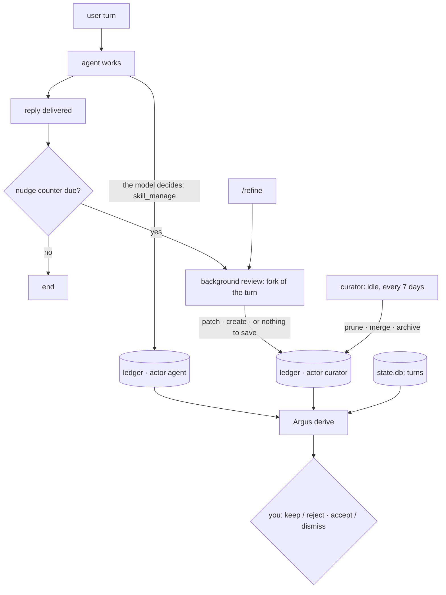

<p align="center"></p>

# Argus

**See what your Hermes agent was asked to do, and decide what it keeps of what it learns.**

[Hermes Agent](https://hermes-agent.nousresearch.com/) rewrites its own skills while it works. Argus
is a Hermes plugin that reads that work from the side of the people using the agent:

- **Intents, not sessions.** Turns are grouped by what the person wanted, across sessions and days.
- **Edit review.** Every skill edit Hermes applies is checked against the run that produced it: did a
  failure, a success or a correction motivate it, or nothing?
- **Proposals.** Rules of its own, backed by several intents or a recurring error, as a minimal diff
  on the current `SKILL.md`.
- **A person decides.** Keep or reject each edit, accept or dismiss each proposal. Argus writes a
  skill only on an explicit apply.

<sub>Argus Panoptes was the hundred-eyed watchman whom Hermes lulled to sleep and slew; Hera set his
eyes in the peacock's tail. Here the eyes are given back, and they watch on Hermes' side.</sub>

## Intents

> **An intent is what someone wanted from the agent:** one expected result, however many turns,
> sessions or days it takes.

| The person says… | For Argus it is |
|---|---|
| "deploy the map", then "it fails on staging, fix it" | **the same intent**: a correction of the same result |
| "deploy the map" again next week, or each session of a cron job | **a new run** of that intent |
| "now write the release notes", in the same chat | **a new intent**: a different deliverable |
| "the mobile app" | **not an intent**: a project holds many |

Each intent keeps:

- **who and what**: title, goal, kind (task, probe, chat, routine) and who asked (a real user, the
  team, an automated test, a schedule);
- **runs**: one per session, with a status from evidence alone (ok, error, interrupted, cron failure,
  silent);
- **judgement**: achieved, partial, failed or unclear, stable across runs or not, risk, next step;
- **skills**: the ones it read and the edits Hermes wrote to them during it.

How they are made, in `hermes argus derive`:

1. **Assign** new turns: free rules first (cron job, short follow-up, repeated request), then one model
   call per session that picks one of up to 30 candidate intents or opens a new one.
2. **Consolidate** periodically: merge, split or rename the intents touched since the last pass. Ids
   stay stable; on four real instances 265 provisional intents became 113.
3. **Judge** an intent again only when a new run started. *Achieved* is a judgement, not a closed
   state: a new run reopens it.

Assignment and judgements are model output; run status, skill reads and skill edits are not. Rules,
gates and the full lifecycle: [docs/intents.md](docs/intents.md).

## Showcase

[](docs/showcase.md)

Three weeks of an agent on a fictional renewable-energy map: 35 intents, 125 turns, 121 skill edits by
Hermes. Its weekday catalog check was silent in 3 of 8 runs and failed in 2, while Hermes rewrote the
check's skill from v5 to v14, adding policies no run supported. Argus flags the skill, proposes one
rule drawn from two intents, and accepting it patches the skill through Hermes' own `skill_manage`.
[Walkthrough](docs/showcase.md), in the order of the demo video.

## Quick start

> [!WARNING]
> **Derive can be expensive.** It makes one model call per session with new turns and per skill
> edit Hermes applied, then judges the intents those turns land in and, for an intent with 3 or more
> sessions, each of its runs, on the `auxiliary.argus` slot (unset: the curator's model). On one
> busy personal agent (856 skill edits a week) a first derive over 2 days of history made 238 calls;
> 7 days would have been about 750 (635 edits to review), 20 days about 2,500 (291 sessions, 2,166
> ledger entries). Start with `--since 2` to `--since 7` on a busy agent: backfill and
> `hermes argus status` print the calls the next derive makes before it runs, as the part known now
> and an upper bound (the judging of intents the new turns open is known only once they are
> assigned), and a later `--since` widens the window. The window never narrows, so a too-wide first
> backfill commits that profile to its cost (without `--since`, the first backfill takes
> `since_days`, 30).

Needs Hermes 0.22.5 or newer, on Linux or macOS. Install it as the user Hermes runs as, from this
repository (`hermes plugins install albertodvp/argus#argus`), from the plugin catalog once it is
listed there (`hermes plugins install argus`), or from a checkout:

```bash
cp -r argus "${HERMES_HOME:-$HOME/.hermes}/plugins/argus"   # from a checkout; skip after `plugins install`
hermes plugins enable argus
hermes argus backfill --all --since 3    # read-only: sets each profile's history window, prints the next derive's calls
hermes argus derive --all                # model calls: intents, edit reviews, proposals
hermes argus status
```

Then open the **Argus** tab of `hermes dashboard` (a running dashboard: **Plugins → Rescan dashboard
extensions**; after updating Argus, restart `hermes dashboard`, whose API answers 503 until then). In
a chat, `/argus` shows the current intent and what waits for review. After that, derive runs by
itself when the agent has been idle 10 minutes, at most once an hour.

| | |
|---|---|
| **Cost** | one model call per session with new turns and per skill edit Hermes applied (a person's edits and no-diff cleanups excluded), one per intent judged and one per run of an intent with 3+ sessions, on the `auxiliary.argus` slot (unset: the curator's model). Backfill and `status` print the next derive's calls, known now and at most; see the warning above. |
| **History window** | set by the first backfill; `--since 90` widens it later, a narrower one is never applied, `--since 0` is the whole history. Derive skips a profile until it is backfilled, then starts each pass by catching up with the tool outcomes and ledger entries since the last one. |
| **Nix, containers** | use the instance's own `hermes`. On Nix, add `argus` to `plugins.enabled` and restart the gateway. |
| **Profiles** | hooks capture live data where the plugin is enabled; `--all` reads every profile, and each derive catches up with what no hook saw (a profile without the plugin). Skills are found where Hermes finds them: `skills/`, `skills.create_dir`, `skills.external_dirs`. |
| **Uninstall** | `hermes plugins remove argus` keeps each profile's `plugin-data/argus/` (decisions, derived data); delete those directories to remove them too (and `plugin-data/intents/` from pre-release versions). |
| **On your machine** | model calls, files read, background processes, skill writes: [plugin README](argus/README.md#what-argus-does-on-your-machine). |

## Learning

### How Hermes learns



| Who writes a skill | When | Ledger actor |
|---|---|---|
| **The agent**, guided by its system prompt ("record a non-trivial workflow") | during the task | `agent` |
| **The background review**: the same model in a fork of the turn, told that saving nothing is "a missed learning opportunity" | after the reply, when a nudge counter is due (10 loop iterations without `skill_manage`, or 10 user turns without a memory write), or on `/refine` | `curator` |
| **The curator**: archives unused skills, merges them with `curator.consolidate: true`, never deletes on its own | idle, at most every 7 days | `curator` |
| **A person**: `hermes curator rollback`, `hermes argus apply` | by hand | `user` |

Counters decide *when*; the model decides *what* to save and whether the work went well. With
`skills.ledger` on (the default), every write lands in the curator ledger, and one inside the profile
can be rolled back. Details, with references into the Hermes source:
[docs/hermes-learning-loop.md](docs/hermes-learning-loop.md).

### What Argus adds

| In Hermes | Argus |
|---|---|
| The model that saved a rule also judges it | a separate model slot reads the diff and the run before it, and labels the edit |
| The review is pushed to save something | edits without evidence are counted per skill among Hermes' own edits (not those a person wrote, such as an applied proposal); a skill where they are 3+ and 30%+ is flagged "needs review" |
| Edits are per skill, work is per goal | each edit is tied to its intent and to the intents that read the skill afterwards |
| The ledger writes `curator` for both review and curator | `review` when the entry's session has messages in `state.db`, else `curator` |
| No rule is drawn from several sessions | proposals need 2+ intents or an error seen 5+ times |
| Nothing waits for a person | keep / reject, accept / dismiss, then apply |

Edit labels:

| Label | Meaning |
|---|---|
| from failure · from success · from correction | the run before the edit motivates it (model) |
| no evidence | the run was read and nothing in it motivates the rule (model) |
| no run | `state.db` holds no messages of the edit's session (a curator pass, a deleted session): nothing to check |
| by a person | actor `user` or a rollback: not reviewed |

Labels are a model's judgement: open the edit to check. Before/after counts describe what happened
next; they do not prove an edit helped.

### Decisions

A decision is a row in the plugin database. The dashboard lists the command each one implies: **copy**
it, or **apply** it after a confirmation that shows what changes (`hermes argus apply` from
the terminal, `--dry-run` to preview). Apply goes through Hermes with ledger actor `user`:

- a rejected edit: `rollback_entry`, refused while a later change to the same file exists;
- an accepted proposal: `skill_manage` patch, refused when `SKILL.md` changed since the proposal or
  the skill is locked (`hermes curator lock`); with `skills.write_approval` on it waits for
  `/skills approve`;
- an accepted proposal for a new skill: `skill_manage` create, with the rule as the body and its first
  sentence, cut to the 60-character skill index, as the description; refused when a skill of that
  name exists by then, staged like a patch.

A proposal applied (or staged) leaves the proposed list and every count: the skill page folds it
under "carried out", without accept or dismiss, and the dock keeps the decision. Once the staged
write is approved it stays there, with the ledger entry the approval wrote; once rejected it is a
proposal again, like after a rollback of its ledger entry. The dashboard counts proposals not yet
carried out, accepted ones included; `/argus` and `/status` count proposals still undecided.

| | Background review | Curator | Argus |
|---|---|---|---|
| Unit | one turn | skill | intent |
| Question | what from this turn is worth saving? | is this skill still used? | did this edit come from evidence, and what should the agent learn next? |
| Runs | end of a turn whose counter is due | at most every 7 days | idle 10 minutes, at most hourly, or on demand |
| Model slot | `auxiliary.background_review` | `auxiliary.curator` | `auxiliary.argus` (inherits the curator's) |
| Writes skills | yes | yes | only on an explicit apply |

## What it adds to Hermes

Everything is registered in `register(ctx)` (`argus/__init__.py`) or declared in the manifests. No
tools, no middleware, no model calls in hooks.

| Surface | What |
|---|---|
| Hooks | `pre_llm_call`, `post_tool_call`, `on_session_end`, `on_skill_lifecycle`, `on_session_delete`: tool and turn outcomes, the ledger entry of each `skill_manage`, cleanup of deleted sessions. They only enqueue rows on a writer thread. |
| Model slot | `auxiliary.argus` (`ctx.register_auxiliary_task`), chosen in `hermes model`; every call has a JSON schema |
| CLI | `hermes argus backfill \| derive \| status \| export \| apply`, `-p <profile>` or `--all` |
| Slash command | `/argus`: intent of the current session, reviews waiting (on messaging platforms only the session's intents) |
| Dashboard | **Argus** tab, a banner on the Skills page, API at `/api/plugins/argus/` |
| Settings | `plugins.entries.argus.settings`: `idle_minutes` (10), `interval_minutes` (60), `since_days` (30) |
| Storage | `plugin-data/argus/` per profile: `data.db` (SQLite), run reports, logs, locks |

Argus reads `state.db`, the curator ledger and its blob store, and never writes them; skills change
only on apply, through Hermes' own functions. Storage in detail: [docs/data-model.md](docs/data-model.md).

## Limits

- `state.db`, the ledger, `rollback_entry` and `skill_manage` are not a documented plugin API. Argus
  checks the columns it reads and stops with a clear message when they change; if a function is
  missing, apply fails and the copied command still works. Floor Hermes 0.22.5; the stubs are
  verified against 0.22.7 and 0.23.0.
- Intent assignment, judgements and edit labels are model output and can be wrong.
- A background review whose session was deleted reads as `curator`: the ledger does not record the
  write origin.

## Development

Plain Python run by Hermes (3.11 to 3.14) with only what Hermes installs; copied into an install,
never built. Strict typing: mypy with no `Any`, ruff, pytest, and `tsc` over the dashboard's
JavaScript. Hermes is not installed for the checks: `typings/` stubs the few internals Argus imports.

```bash
nix develop -c just check        # lint, typecheck, typecheck-js, test; tools from flake.nix
just stubtest <hermes-checkout>   # typings/ against a Hermes checkout's runtime (needs its .venv)
just validate                    # the plugin catalog's admission check on the committed argus/ (Hermes main)
```

Without Nix: uv 0.13.0, just and Node.js with npm.

| Path | What |
|---|---|
| `argus/` | the plugin (schema in `argus/schema.sql`) |
| `tests/`, `typings/` | checks and Hermes stubs |
| `docs/` | [intents](docs/intents.md), [Hermes' learning loop](docs/hermes-learning-loop.md), [data model](docs/data-model.md), [showcase](docs/showcase.md) |
| `assets/` | mark, wordmark, banner, screenshots |

## License

MIT, see [LICENSE](LICENSE).
