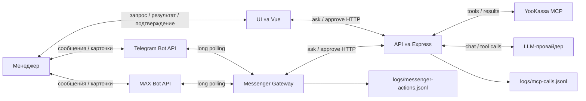

[English](README.en.md) | [Русский](README.md)

# ЮKassa MCP Payment Agent

[](https://www.typescriptlang.org/)
[](https://nodejs.org/)
[](https://vuejs.org/)
[](https://expressjs.com/)
[](https://mcp.yookassa.ru)
[](LICENSE)
[](https://github.com/alekstar79/ykassa-mcp-integrator/actions/workflows/ci.yml)
[](https://www.npmjs.com/package/@alekstar79/ykassa-mcp)

Сервис принимает запросы на естественном языке, выбирает доступный инструмент
YooKassa MCP и проверяет операцию перед выполнением. Запросы можно отправлять
через reference UI, Messenger Gateway (Telegram или MAX) или headless HTTP API.

- **LLM-оркестрация:** модель сопоставляет запрос с доступными инструментами.
- **Подтверждение человеком:** рискованная операция ждёт явного решения.
- **Несколько клиентов:** для каждого клиента задаются бренд, allowlist и лимиты.
- **Журнал операций:** вызовы MCP записываются в `logs/mcp-calls.jsonl`.

## Установка

CLI через `npx`:

```bash
npx @alekstar79/ykassa-mcp init my-client
npx @alekstar79/ykassa-mcp configurator
npx @alekstar79/ykassa-mcp start
npx @alekstar79/ykassa-mcp web
npx @alekstar79/ykassa-mcp messenger
npx @alekstar79/ykassa-mcp --help
```

`start`, `messenger` и веб-интерфейсы запускаются в **разных терминалах** (или API — в фоне). Reference UI открывайте с параметром `?client=<name>`, иначе он попытается загрузить `online-school` по умолчанию:

```bash
# терминал 1
npx @alekstar79/ykassa-mcp start
# терминал 2
npx @alekstar79/ykassa-mcp messenger
# терминал 3
npx @alekstar79/ykassa-mcp web
# браузер: http://127.0.0.1:5173/?client=my-client
```

Альтернативно, глобальная установка:

```bash
npm i -g @alekstar79/ykassa-mcp
ykassa-mcp init my-client
```

Пакеты для интеграции в собственное приложение:

```bash
npm i @alekstar79/ykassa-contracts   # типы, Zod-схема и палитра
npm i @alekstar79/ykassa-api         # headless API
```

Требуется Node.js 18 или новее. `YOOKASSA_SHOP_ID` и `YOOKASSA_MCP_TOKEN`
можно получить в личном кабинете ЮKassa, в разделе «Настройки → Магазин».
Храни их только в `clients/<name>/.env`; не коммить этот файл.

## Конфигурация клиента

Параметры клиента задаются в `clients/<name>/config.yaml`. Допустимые
сценарии ограничиваются как конфигурацией, так и фактическим списком
инструментов MCP и политикой API. `create_invoice` передаётся модели, если он
указан в `allowed_scenarios` и настроен `defaults.vat_code`.

| Поле                           | Тип                                                                       | Дефолт                           | Описание                                                                                                      |
|--------------------------------|---------------------------------------------------------------------------|----------------------------------|---------------------------------------------------------------------------------------------------------------|
| `allowed_scenarios`            | `string[]`                                                                | Все 7 известных MCP-инструментов | Сценарии, разрешённые для клиента                                                                             |
| `approval_threshold`           | `number`                                                                  | `4000`                           | Сумма в рублях; платёж или счёт выше порога требуют подтверждения                                             |
| `require_human_confirmation`   | `boolean`                                                                 | `false`                          | `true` требует подтверждения каждой рискованной операции                                                      |
| `limits.max_messages`          | `number` (1–100)                                                          | `20`                             | Максимум сообщений в одном запросе                                                                            |
| `limits.max_attachment_kb`     | `number` (1–1024)                                                         | `100`                            | Максимальный размер вложения                                                                                  |
| `defaults.currency`            | `RUB` \| `USD` \| `EUR`                                                   | `RUB`                            | Валюта по умолчанию                                                                                           |
| `defaults.vat_code`            | `1`–`12`                                                                  | `1`                              | Коды 1–12; базовая ставка с 2026 года: 11 (22%). Коды 4/6 (20% и 20/120) сохранены для случаев, где применимы |
| `defaults.capture`             | `boolean`                                                                 | `true`                           | Значение `capture` по умолчанию                                                                               |
| `defaults.return_url`          | `string` (URL), необязательно                                             | Не задан                         | URL возврата после оплаты                                                                                     |
| `defaults.invoice_expiry_days` | `number` (1–30)                                                           | `30`                             | Срок действия счёта в днях                                                                                    |
| `brand.display_name`           | `string`                                                                  | Не задан                         | Название сервиса в интерфейсе                                                                                 |
| `ui.mode`                      | `reference-ui` \| `custom-ui`                                             | `reference-ui`                   | Режим клиентского интерфейса                                                                                  |
| `ui.accent`                    | `navy` \| `terracotta` \| `forest` \| `graphite` \| `cobalt` \| `crimson` | `navy`                           | Цвет кнопок и акцентов                                                                                        |
| `ui.radius`                    | `0–24`                                                                    | `2`                              | Радиус углов в диапазоне от 0 до 24 px                                                                        |
| `ui.shadow`                    | `none` \| `soft` \| `medium`                                              | `soft`                           | Интенсивность теней                                                                                           |
| `ui.font_pair`                 | `manrope+jetbrains` \| `inter+jetbrains`                                  | `manrope+jetbrains`              | Шрифтовая пара                                                                                                |
| `ui.form_style`                | `flat` \| `card`                                                          | `flat`                           | Форма на фоне или в карточке                                                                                  |
| `ui.h1_size`                   | `s` \| `m` \| `l`                                                         | `m`                              | Размер основного заголовка                                                                                    |

Для `mode: custom-ui` указывай в YAML только `ui.mode`. Собственный интерфейс
работает по [HTTP-контракту](docs/api-contract.md).

## Архитектура

API, reference UI и клиентские интерфейсы независимы и связаны HTTP-контрактом
и форматом `config.yaml`.



Интерактивная карта — [architecture.html](https://alekstar79.github.io/ykassa-mcp-integrator/architecture.html). Она показывает основные компоненты API, Reference UI и Messenger Gateway. Клик по узлу открывает Semantic passport с назначением компонента, связями и потоками данных.

Презентация проекта (10 слайдов): [presentation.html](https://alekstar79.github.io/ykassa-mcp-integrator/presentation.html). Обзор Headless API, архитектура без общих импортов, поток `/api/ask → /api/approve`, три эндпоинта для собственного UI, MCP-инструменты и политика, LLM-провайдеры, аудит и метрики.

- `apps/api` - headless API: MCP-клиент, LLM-оркестрация, подтверждения и аудит.
  Пакет `@alekstar79/ykassa-api` можно использовать как библиотеку.
- `apps/web` - reference UI на Vue 3. Клиент может заменить его собственным
  интерфейсом, используя `docs/api-contract.md`.
- `apps/configurator` - веб-конфигуратор, который формирует архив клиента с
  `config.yaml`, `.env` и `README.md`, включая настройки Telegram/MAX и
  токены включённых ботов. Архив содержит секреты: храните его безопасно и
  не коммитьте `.env`.
- `apps/messenger` - отдельный шлюз Telegram и MAX. Он использует
  HTTP-контракт API, проверяет разрешённые ID отправителей и показывает
  карточки подтверждения; LLM и MCP-логика остаются в API.
- `apps/cli` (`@alekstar79/ykassa-mcp`) - команды для настройки клиента,
  запуска API и обслуживания пользовательских интерфейсов.
- `packages/contracts` (`@alekstar79/ykassa-contracts`) - общие типы,
  Zod-схема, перечисления и палитра.

Удаление `apps/web` не влияет на API. Интеграция с YooKassa выполняется через
MCP; при каждом запросе API получает список инструментов через `tools/list`.
Запусти API и Messenger Gateway в отдельных терминалах. Настройка ботов,
allowlist и команды чата описаны в [руководстве Messenger](apps/messenger/README.md).
MAX использует long polling для разработки и тестирования; webhook для
production пока не реализован.

### Команды ботов

Команды работают в личном чате с ID отправителя из allowlist:

- `/start` - приветствие; для незнакомого ID команда будет отклонена, чтобы
  оператор мог добавить его в allowlist.
- `/help` - список команд и подсказка по запросам.
- `/status` - бренд клиента и разрешённые сценарии MCP.
- `/reset` - очистить историю диалога в памяти. Это не отменяет уже ожидающее
  подтверждение; для него используй кнопки карточки.

Для рискованной операции нажми «Подтвердить» или «Отклонить» на карточке
Telegram или MAX. Текстовое «да» в чате не подтверждает операцию.

## Инструменты MCP

Список ниже относится к официальному YooKassa MCP. API проверяет доступность
инструментов через `tools/list` во время выполнения.

| Инструмент       | Статус                                            | Назначение                 |
|------------------|---------------------------------------------------|----------------------------|
| `create_payment` | Доступен                                          | Создание платежа           |
| `get_payment`    | Доступен                                          | Получение платежа          |
| `get_payments`   | Доступен                                          | Получение списка платежей  |
| `create_invoice` | Доступен в MCP; передаётся модели по конфигурации | Создание счёта             |
| `get_invoice`    | Доступен                                          | Получение счёта            |
| `get_refund`     | Доступен                                          | Получение возврата         |
| `get_refunds`    | Доступен                                          | Получение списка возвратов |

> `create_invoice` попадает в список инструментов модели, только если он есть
> в `allowed_scenarios` и задан `defaults.vat_code`. Перед вызовом MCP API
> обогащает корзину значениями по умолчанию и проверяет аргументы по схеме
> инструмента.

Официальный MCP не предоставляет `create_refund`; возврат оформляется в
личном кабинете ЮKassa или через API. `capture_payment` и создание
рекуррентных платежей не входят в официальный набор инструментов.

## Подтверждение операций

`create_payment` выше `approval_threshold`, `create_invoice` выше порога или
с неопределимой суммой, а также эти операции при
`require_human_confirmation: true` не выполняются автоматически. Человек
подтверждает или отклоняет предложение через UI или карточку Telegram/MAX,
которые вызывают `/api/approve`. После подтверждения API повторно проверяет
операцию по текущей конфигурации клиента, актуальному `tools/list` и
`allowed_scenarios`.

## LLM-провайдеры

Настрой провайдера и модель в корневом `.env`:

| `LLM_PROVIDER` | Переменные                                                                      |
|----------------|---------------------------------------------------------------------------------|
| `openai`       | `LLM_API_KEY`, `LLM_MODEL`, опционально `LLM_BASE_URL`                          |
| `anthropic`    | `LLM_API_KEY`, `LLM_MODEL`                                                      |
| `google`       | `LLM_API_KEY`, `LLM_MODEL`                                                      |
| `ollama`       | `LLM_MODEL`, опционально `LLM_BASE_URL` (по умолчанию `http://localhost:11434`) |

Для production используй API key выбранного провайдера. Настройка локального
OpenAI-совместимого proxy описана в [CONTRIBUTING.md](CONTRIBUTING.md).

## Журнал аудита

Вызовы MCP записываются в `logs/mcp-calls.jsonl` в формате JSON Lines:

```json
{"timestamp":"2026-11-13T14:13:19.948Z","shop_id":"<shop-id>","tool":"create_payment","args":{"amount":{"value":"100.00","currency":"RUB"},"description":"Order payment"},"result":"<tool result>"}
```

Запись содержит `timestamp`, `shop_id`, `tool`, `args` и `result` либо `error`.
Файл может содержать данные запроса и ответа, поэтому ограничь к нему доступ.

## Скриншоты

`01-08`: Reference UI (темы, мобильные экраны, подтверждение, результат и английский язык).
`09-14`: конфигуратор (настройки и предпросмотр в светлой, тёмной и мобильной версиях).

<details>
<summary>Скриншоты</summary>

<table>
  <tr>
    <td align="center"><a href="docs/screenshots/01-reference-light-desktop.png"></a><br><sub>01. Reference UI · light · desktop</sub></td>
    <td align="center"><a href="docs/screenshots/02-reference-dark-desktop.png"></a><br><sub>02. Reference UI · dark · desktop</sub></td>
  </tr>
  <tr>
    <td align="center"><a href="docs/screenshots/03-reference-light-mobile.png"></a><br><sub>03. Reference UI · light · mobile</sub></td>
    <td align="center"><a href="docs/screenshots/04-reference-dark-mobile.png"></a><br><sub>04. Reference UI · dark · mobile</sub></td>
  </tr>
  <tr>
    <td align="center"><a href="docs/screenshots/05-reference-approval.png"></a><br><sub>05. Reference UI · approval</sub></td>
    <td align="center"><a href="docs/screenshots/06-reference-result.png"></a><br><sub>06. Reference UI · result</sub></td>
  </tr>
  <tr>
    <td align="center"><a href="docs/screenshots/07-reference-settings.png"></a><br><sub>07. Reference UI · settings</sub></td>
    <td align="center"><a href="docs/screenshots/08-reference-en.png"></a><br><sub>08. Reference UI · English</sub></td>
  </tr>
  <tr>
    <td align="center"><a href="docs/screenshots/09-configurator-settings-light.png"></a><br><sub>09. Configurator · settings · light</sub></td>
    <td align="center"><a href="docs/screenshots/10-configurator-settings-dark.png"></a><br><sub>10. Configurator · settings · dark</sub></td>
  </tr>
  <tr>
    <td align="center"><a href="docs/screenshots/11-configurator-preview-light.png"></a><br><sub>11. Configurator · preview · light</sub></td>
    <td align="center"><a href="docs/screenshots/12-configurator-preview-dark.png"></a><br><sub>12. Configurator · preview · dark</sub></td>
  </tr>
  <tr>
    <td align="center"><a href="docs/screenshots/13-configurator-settings-mobile.png"></a><br><sub>13. Configurator · settings · mobile</sub></td>
    <td align="center"><a href="docs/screenshots/14-configurator-preview-mobile.png"></a><br><sub>14. Configurator · preview · mobile</sub></td>
  </tr>
</table>

</details>

## Известные ограничения

- Reference-реализация не включает аутентификацию и RBAC; добавь их перед
  production-развёртыванием.
- Ожидающие подтверждения хранятся в памяти и теряются при перезапуске API.
- Официальный MCP не создаёт возвраты.

## Production checklist

- JWT и RBAC перед API.
- HTTPS на домене продукта.
- CORS настроен на домен UI, не на `localhost`.
- API key выбранного LLM-провайдера.
- Rate limiting для `/api/ask` и `/api/approve`.
- Внешнее хранилище для ожидающих подтверждений, например Redis.

## Документация

- [Руководство контрибьютора](CONTRIBUTING.md)
- [Инструкции для AI-агентов](AGENTS.md)
- [Архитектура](docs/architecture.md)
- [Messenger Gateway и команды чата](apps/messenger/README.md)
- [HTTP-контракт](docs/api-contract.md)
- [Настройка локального LLM proxy](docs/copilot-proxy.md)
- [Лицензия MIT](LICENSE)
