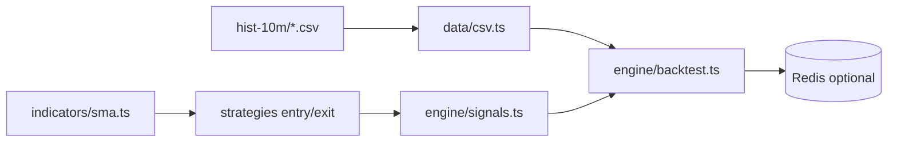

# Crypto AlgoTrading Framework (TypeScript)

> Algorithmic trading toolkit for crypto — **backtest**, **tick-by-tick replay**, and **simulation** modes. Ported from the original Python framework with matching strategy semantics.

```text
  hist-{interval}/*.csv
           │
           ▼
    Entry / exit strategies (SMA cross, …)
           │
           ▼
    Stop-loss + trailing stop
           │
           ▼
    Backtest P&L · optional Redis cache
```

---

## Quick start

```bash
cp .env.example .env
npm install
npm run check                    # typecheck + vitest + smoke backtest
npm run backtest                 # SMA cross on BTC-XRP (default)
npm run tick                     # tick-by-tick replay
```

Custom market:

```bash
npm start -- backtest BTC-SRN
```

---

## Project structure

```text
algotrading/
├── package.json
├── tsconfig.json
├── .env.example
├── hist-10m/                    # Sample CSV history (BTC-XRP, BTC-SRN)
│
├── src/
│   ├── index.ts                 # Public API exports
│   ├── cli.ts                   # backtest | tick commands
│   ├── config/
│   │   ├── vars.ts              # Env-driven defaults (interval, stops, …)
│   │   └── logger.ts
│   ├── types/market.ts          # MarketRow, EntryFn, ExitFn
│   ├── data/csv.ts              # loadMarketFromFile, listMarketsOnDisk
│   ├── indicators/
│   │   ├── sma.ts               # SMA crossover helpers
│   │   └── bollinger.ts         # Bollinger bands (pandas-compatible)
│   ├── strategies/
│   │   ├── entry.ts             # crossSmas entry
│   │   └── exit.ts              # crossSmas exit
│   ├── risk/stops.ts            # stopLoss, trailingStopLoss
│   ├── engine/
│   │   ├── signals.ts           # isTimeToBuy, isTimeToExit
│   │   ├── backtest.ts          # backtest(), backtestMarket()
│   │   ├── tickByTick.ts        # Candle replay loop
│   │   └── realtime.ts          # Live feed stub (extend for exchanges)
│   └── cache/                   # ioredis-os optional backtest cache
│
├── tests/                       # Vitest — parity with legacy Python tests
├── scripts/smoke-test.ts
│
└── cryptoalgotrading/           # Legacy Python implementation (reference)
```

---

## Operating modes

| Mode | API | Data source |
|------|-----|-------------|
| **Backtest** | `backtest()` | `hist-{interval}/*.csv` |
| **Tick-by-tick** | `tickByTick()` | CSV replay with optional delay |
| **Realtime** | `realtime()` | Stub — wire exchange WebSocket in `src/engine/realtime.ts` |

---

## Example (programmatic)

```typescript
import { backtest, entry, exit } from './src/index.js';

const total = await backtest({
  markets: ['BTC-XRP'],
  entryFns: [entry.crossSmas],
  exitFns: [exit.crossSmas],
  smas: [15, 40],
  interval: '10m',
  fromFile: true,
});

console.log(`Total P&L: ${total}%`);
```

---

## Configuration

| Variable | Default | Description |
|----------|---------|-------------|
| `DATA_DIR` | `.` | Root path for `hist-{interval}/` folders |
| `DEFAULT_INTERVAL` | `10m` | Candle folder suffix |
| `STOP_TYPE` | `3` | `0` off · `1` fixed · `2` trailing · `3` both |
| `STOP_LOSS_PCT` | `2` | Fixed stop % below entry |
| `TRAILING_LOSS_PCT` | `3` | Trailing stop % below peak |
| `COMMISSION_ENABLED` | `true` | Deduct `BNB_COMMISSION` on exits |
| `REDIS_URL` | — | Optional backtest result cache |

---

## Architecture



---

## Legacy Python

The original Python package lives in `cryptoalgotrading/`. It required Pandas, Matplotlib, InfluxDB, and Bittrex/Binance clients. The TypeScript edition keeps the **same SMA crossover logic** and CSV layout but drops matplotlib plotting and DB dependencies for a leaner Node.js runtime.

To run legacy Python tests: `pip install -r requirements.txt && python -m pytest test/`

---

## Risk disclaimer

USE AT YOUR OWN RISK. This software is not financial advice. Test in simulation before deploying capital.
