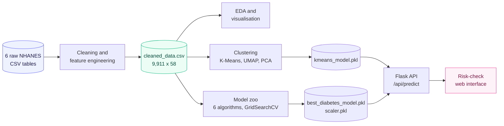
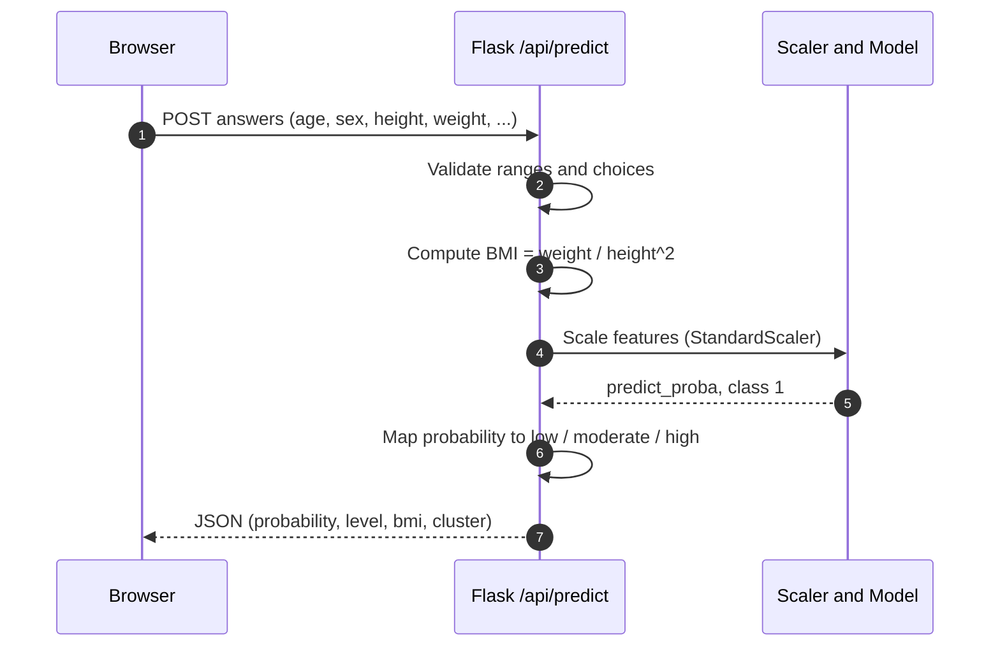

<div align="center">


<br/>


**Unsupervised patient phenotyping and supervised diabetes-risk scoring, served through a real-time web app.**
From six raw NHANES tables to a nine-question risk check, end to end.

</div>

<br/>

<table align="center">
<tr>
<td align="center"><h2>9,911</h2><sub>unique participants</sub></td>
<td align="center"><h2>58</h2><sub>engineered features</sub></td>
<td align="center"><h2>6</h2><sub>source tables fused</sub></td>
<td align="center"><h2>6</h2><sub>algorithms benchmarked</sub></td>
<td align="center"><h2>4</h2><sub>patient phenotypes</sub></td>
<td align="center"><h2>0.878</h2><sub>best CV ROC-AUC</sub></td>
</tr>
</table>

---

## Table of Contents

1. [Overview](#overview)
2. [Key Features](#key-features)
3. [Tech Stack](#tech-stack)
4. [Architecture](#architecture)
5. [Data](#data)
6. [Feature Dictionary](#feature-dictionary)
7. [Exploratory Insights](#exploratory-insights)
8. [Patient Phenotyping](#patient-phenotyping)
9. [Predictive Modeling](#predictive-modeling)
10. [Web Application](#web-application)
11. [Quickstart](#quickstart)
12. [Project Structure](#project-structure)
13. [Limitations and Roadmap](#limitations-and-roadmap)
14. [FAQ](#faq)
15. [Contributing](#contributing)
16. [Citation and Acknowledgments](#citation-and-acknowledgments)
17. [Disclaimer](#disclaimer)
18. [Author](#author)

---

## Overview

LatentHealth looks for hidden structure in population health data. It studies the same patients through two complementary lenses and ships the result as a usable product.

| Lens | Question | Technique |
|---|---|---|
| Unsupervised | Which natural patient groups exist in this population? | MinMax scaling, K-Means (k = 4), UMAP, PCA |
| Supervised | How likely is a person to have diabetes, given nine easy inputs? | Six classifiers, GridSearchCV, ROC-AUC |
| Deployed | Can a non-technical user get an answer in under a minute? | Flask REST API, multi-step questionnaire UI |

The project is built on the **NHANES 2013-2014** survey from the US CDC. Six raw tables, roughly 1,800 raw columns, are merged into one clean, model-ready dataset.

---

## Key Features

| Area | What was built |
|---|---|
| **Data fusion** | Six NHANES tables (demographics, diet, labs, examination, medications, questionnaire) joined on `SEQN` |
| **Cleaning** | 23 sparse or redundant columns dropped, NHANES sentinel codes (`77`, `777`) neutralised, domain-aware imputation |
| **Feature engineering** | `physically_active`, `smoking_status`, `alcohol_use`, `sugar_ratio`, `fiber_density`, `satfat_ratio`, `any_medication` |
| **Model zoo** | Logistic Regression, SVM, Decision Tree, Random Forest, Gradient Boosting, KNN, with 400+ cross-validated fits |
| **Latent-space analysis** | DBSCAN sweep, K-Means elbow, PCA variance curve, 2-D UMAP embedding |
| **Inference service** | Server-side validation, BMI computed on the server, probability mapped to a three-tier risk label |
| **Privacy** | Answers are processed in memory and never stored |

---

## Tech Stack

| Layer | Tools |
|---|---|
| Language | Python 3.10+ |
| Data | Pandas, NumPy |
| Machine learning | scikit-learn 1.6.1 (KMeans, DBSCAN, PCA, GridSearchCV, six classifiers) |
| Dimensionality reduction | UMAP-learn, PCA |
| Visualisation | Matplotlib, Seaborn |
| Serving | Flask, Joblib |
| Frontend | HTML, CSS, vanilla JavaScript (single-page questionnaire) |
| Notebooks | Jupyter |

---

## Architecture

### Research pipeline



### Inference flow



---

## Data

| Source table | Raw columns | Role |
|---|---:|---|
| `demographic.csv` | 47 | Age, sex, ethnicity, education, household, income |
| `diet.csv` | 168 | Calories, carbohydrates, sugar, fibre, fat, saturated fat |
| `examination.csv` | 224 | Weight, height, BMI |
| `labs.csv` | 424 | HbA1c, insulin, triglycerides, cholesterol, haemoglobin |
| `medications.csv` | 13 | Prescription usage |
| `questionnaire.csv` | 953 | Diabetes status, activity, smoking, alcohol, sleep |

**Target:** `diabetes`, defined as a self-reported physician diagnosis (`DIQ010 == 1`).

| Metric | Value |
|---|---|
| Survey cycle | NHANES 2013-2014 |
| Unique participants | 9,911 (19,390 rows before deduplication, because multi-medication participants repeat) |
| Final columns | 58 |
| Diabetes prevalence | about 7.3 % of unique participants (strong class imbalance) |
| Age range | 0 to 80 years |

<details>
<summary><b>Cleaning and feature-engineering steps</b></summary>

<br/>

1. **Select** relevant columns from each table and left-merge on `SEQN`.
2. **Handle sentinels**: `SLD010H >= 77` becomes `NaN`; `alcohol_use >= 777` becomes `NaN` then `0`; implausible alcohol values (11 or more drinks per day) are removed.
3. **Drop** 23 columns with excessive missingness or redundancy (for example `DMQADFC`, `DRQSDT4`, `LBDLDL`, `PAQ650`).
4. **Impute**
   - Domain-aware constants for questionnaire gaps ("No", "Unknown", "Not a smoker").
   - Mean imputation (`SimpleImputer`) for 28 continuous variables.
5. **Engineer**
   - `physically_active`: any vigorous or moderate activity.
   - `smoking_status`: 0 never, 1 former, 2 current.
   - `alcohol_use`: drinks on a typical drinking day.
   - `sugar_ratio` = sugar / carbs, `fiber_density` = fibre / kcal, `satfat_ratio` = saturated fat / total fat.
   - `any_medication`: binary flag from the medication table.
6. **Label** `diabetes` from `DIQ010` and drop the source questionnaire columns that would leak it.

</details>

---

## Feature Dictionary

The nine model inputs, all of which a user can answer without a lab test.

| Feature | NHANES code | Type | Description |
|---|---|---|---|
| Age | `RIDAGEYR` | numeric | Age in years |
| Sex | `RIAGENDR` | categorical | 1 = male, 2 = female |
| Height | `BMXHT` | numeric | Standing height, cm |
| Weight | `BMXWT` | numeric | Body weight, kg |
| BMI | `BMXBMI` | numeric | kg/m2, computed server-side at inference |
| Sleep | `SLD010H` | numeric | Usual sleep hours per night |
| Physical activity | `physically_active` | binary | Engineered from `PAQ605` and `PAQ620` |
| Smoking | `smoking_status` | ordinal | 0 never, 1 former, 2 current |
| Alcohol | `alcohol_use` | numeric | Drinks on a typical drinking day |

---

## Exploratory Insights

Balanced samples (4,000 diabetic and 4,000 non-diabetic) were used for the visual analysis.

<table>
<tr>
<td align="center" width="50%">
<br/>
<sub><b>BMI.</b> The diabetic cohort sits higher (median 30.6 vs 25.3 kg/m2).</sub>
</td>
<td align="center" width="50%">
<br/>
<sub><b>Smoking.</b> Former smokers show the highest prevalence (about 17 % vs 5 % for never-smokers).</sub>
</td>
</tr>
<tr>
<td align="center">
<br/>
<sub><b>Physical activity</b> split by diabetes status.</sub>
</td>
<td align="center">
<br/>
<sub><b>Socio-economics.</b> Prevalence across four household-income tiers.</sub>
</td>
</tr>
<tr>
<td align="center" colspan="2">
<br/>
<sub><b>Anthropometrics.</b> Weight against height, coloured by diabetes status.</sub>
</td>
</tr>
</table>

**Strongest signals** (absolute correlation with the target): HbA1c `LBXGH` (0.55), age (0.34), medication use (0.32), BMI (0.23). Median HbA1c is 6.8 % in the diabetic group against 5.7 % otherwise, straddling the 6.5 % clinical threshold.

Alcohol consumption, sleep duration and the triglyceride-cholesterol relationship are covered in `notebooks/virtualization.ipynb`.

---

## Patient Phenotyping

Unsupervised learning tests whether the cohort splits into meaningful groups without the model ever being shown a label.

<table>
<tr>
<td align="center" width="50%">
<br/>
<sub><b>K-Means elbow.</b> Inertia for k = 1 to 20.</sub>
</td>
<td align="center" width="50%">
<br/>
<sub><b>PCA.</b> Explained variance against number of components.</sub>
</td>
</tr>
<tr>
<td align="center">
<br/>
<sub><b>UMAP 2-D.</b> Diabetic patients (red) concentrate toward the periphery of the embedding.</sub>
</td>
<td align="center">
<br/>
<sub><b>KNN.</b> Test error against k, used to sanity-check the neighbour count.</sub>
</td>
</tr>
</table>

**Methods compared:** DBSCAN (epsilon and min-samples sweep) was rejected because it produced up to about 1,900 micro-clusters and as much as 60 % noise points. **K-Means with k = 4** was selected.

### Resulting cohorts

| Cluster | Records | Diabetes prevalence | Reading |
|:---:|---:|:---:|---|
| 0 | 6,941 | **31.1 %** | High-burden group |
| 1 | 3,159 | 0.7 % | Very low-risk group |
| 2 | 4,205 | 0.4 % | Very low-risk group |
| 3 | 5,085 | **39.0 %** | Highest-burden group |

Two groups carry nearly all of the disease burden while the other two sit close to zero. Coordinates and labels are in `outputs/clustering_results.csv`. Counts are on the pre-deduplication table (19,390 rows).

---

## Predictive Modeling

**Inputs:** the nine features listed in the [Feature Dictionary](#feature-dictionary).
**Protocol:** stratified 75/25 split (`random_state=119`), `StandardScaler`, 3-fold `GridSearchCV` scored on ROC-AUC.

### Cross-validated ROC-AUC per algorithm

| Rank | Model | Best CV ROC-AUC | Best hyper-parameters |
|:---:|---|:---:|---|
| 1 | Random Forest | **0.878** | `entropy`, depth 7, min-split 4 |
| 2 | Logistic Regression | 0.873 | `l2`, `liblinear` |
| 3 | Gradient Boosting | 0.871 | learning rate 0.2, 50 trees, `exponential` |
| 4 | Decision Tree | 0.808 | `gini`, depth 7, min-split 6 |
| 5 | KNN | 0.777 | k = 9, `distance`, `brute` |
| 6 | SVM | 0.773 | `poly`, degree 3 |

### Deployed model: tuned KNN on the hold-out set (n = 2,478)

| Class | Precision | Recall | F1 | Support |
|---|:---:|:---:|:---:|:---:|
| Non-diabetic | 0.93 | 0.99 | 0.96 | 2,296 |
| Diabetic | 0.42 | 0.09 | 0.15 | 182 |
| **Accuracy** | | | **0.92** | 2,478 |

Accuracy is high mainly because 93 % of the test set is negative; the recall on the diabetic class is the number to watch. See the [roadmap](#limitations-and-roadmap) for how this is addressed. Full KNN search results: [`outputs/grid_search_results.csv`](outputs/grid_search_results.csv).

---

## Web Application

A guided four-step questionnaire (About you, Body, Lifestyle, Result) backed by a JSON API. The output is a probability ring, a three-tier risk label and a plain-language message.

<table>
<tr>
<td></td>
<td></td>
<td></td>
</tr>
<tr>
<td></td>
<td></td>
<td align="center"><sub>Guided steps, live validation, instant risk gauge</sub></td>
</tr>
</table>

### API reference

```http
POST /api/predict
Content-Type: application/json
```

Request:

```json
{
  "age": 52, "sex": 1, "height": 175, "weight": 92,
  "sleep": 6, "active": 0, "smoking": 1, "alcohol": 2
}
```

Response (illustrative):

```json
{
  "probability": 0.2143,
  "level": "moderate",
  "bmi": 30.0,
  "cluster": null
}
```

| Field | Allowed values |
|---|---|
| `age` | 1 to 110 |
| `sex` | `1` male, `2` female (NHANES coding) |
| `height` / `weight` | 80 to 230 cm / 10 to 250 kg |
| `sleep` | 2 to 14 hours |
| `active` | `0` no, `1` yes |
| `smoking` | `0` never, `1` former, `2` current |
| `alcohol` | `0` to `5` drinks on a typical day |

Invalid input returns HTTP `400` with `{"error": "..."}`.

**Risk tiers:** below 0.33 is low, 0.33 to 0.66 is moderate, 0.66 and above is high.

---

## Quickstart

```bash
# 1. Clone
git clone https://github.com/ali-119/LatentHealth.git
cd LatentHealth

# 2. Environment
python -m venv .venv
source .venv/bin/activate        # Windows: .venv\Scripts\activate
pip install -r requirements.txt

# 3. Launch
python app.py
# open http://127.0.0.1:5000
```

The pickled models were serialised with scikit-learn 1.6.1, so keep that exact version.

### Reproduce the research

```bash
jupyter lab
# 1. data/data_cleaning.ipynb          -> data/cleaned_data.csv
# 2. notebooks/virtualization.ipynb    -> exploratory figures
# 3. notebooks/clusters.ipynb          -> K-Means, UMAP, PCA
# 4. notebooks/ml_algorithms.ipynb     -> model zoo, best_diabetes_model.pkl
```

Notebook paths are set for the author's machine or Google Colab; adjust the `read_csv` paths before running locally.

---

## Project Structure

```text
LatentHealth/
├── app.py                      # Flask app and /api/predict
├── requirements.txt
├── templates/
│   └── questions.html          # Multi-step questionnaire UI
├── data/
│   ├── raw_data/               # Six original NHANES tables
│   ├── cleaned_data.csv        # Model-ready dataset
│   └── data_cleaning.ipynb
├── notebooks/
│   ├── virtualization.ipynb    # Exploratory analysis
│   ├── clusters.ipynb          # Unsupervised learning
│   └── ml_algorithms.ipynb     # Supervised learning
├── models/
│   ├── best_diabetes_model.pkl
│   ├── scaler.pkl
│   ├── kmeans_model.pkl
│   └── grid_search_results.pkl
├── outputs/
│   ├── clustering_results.csv
│   ├── cluster_summary.csv
│   └── grid_search_results.csv
└── images/
    ├── banner.svg
    ├── data_plots/
    ├── cluster_plot/
    └── tem/
```

---

## Limitations and Roadmap

| Area | Current state | Next step |
|---|---|---|
| Class imbalance | About 7 % positives, recall of 0.09 for the diabetic class | `class_weight="balanced"`, SMOTE, threshold tuning on a PR curve |
| Model selection | Deployed KNN; Random Forest, Logistic Regression and Gradient Boosting score higher CV ROC-AUC (0.87 to 0.88) | Export the top ROC-AUC model, add calibration and PR-AUC |
| Cluster serving | K-Means was fit on the full 58-column matrix, so the API returns `cluster: null` until a compatible feature set is wired in | Retrain on the nine questionnaire features and set `KMEANS_FEATURES` |
| Cluster purity | Label and identifier columns were present when scaling for clustering | Re-cluster on features only and confirm the split holds |
| Explainability | Not yet implemented | SHAP summaries and per-user feature contributions |
| Deployment | Local Flask development server | Docker image, Gunicorn, CI with model-version checks |

Planned milestones:

- [ ] Retrain with class-imbalance handling and report PR-AUC
- [ ] Ship the best ROC-AUC model with probability calibration
- [ ] Serve cluster membership and cohort descriptions in the UI
- [ ] Add SHAP-based explanations to the result screen
- [ ] Containerise and add automated tests

---

## FAQ

**Is this a diagnosis tool?**
No. It is an educational estimate learned from public survey data. See the [disclaimer](#disclaimer).

**Why are the inputs limited to nine features, when HbA1c is the strongest predictor?**
HbA1c requires a blood test. The app is designed so anyone can use it with no lab values, which trades accuracy for accessibility.

**Why is accuracy 92 % but recall only 9 %?**
About 93 % of the test participants are non-diabetic, so a model that rarely predicts "diabetic" still scores high accuracy. ROC-AUC and per-class recall are the honest metrics here.

**Why are there 19,390 rows but 9,911 participants?**
Joining the medication table repeats a participant once per prescription. Models were trained on the deduplicated table.

**Is my data stored?**
No. Requests are handled in memory and discarded.

**Can I use a different dataset?**
Yes. Replace the raw tables, rerun `data_cleaning.ipynb`, then retrain through the notebooks.

---

## Contributing

Issues and pull requests are welcome.

1. Fork the repository and create a branch: `git checkout -b feature/your-idea`
2. Keep changes focused and document new parameters in the relevant notebook
3. Commit with a clear message and open a pull request describing what changed and why

---

## Citation and Acknowledgments

If you use this project in academic or technical work, please cite it:

```bibtex
@software{latenthealth2025,
  author  = {Ali},
  title   = {LatentHealth: Patient Phenotyping and Diabetes-Risk Scoring from NHANES},
  year    = {2025},
  url     = {https://github.com/ali-119/LatentHealth}
}
```

**Data:** National Health and Nutrition Examination Survey (NHANES) 2013-2014, US Centers for Disease Control and Prevention, National Center for Health Statistics.
**Libraries:** scikit-learn, UMAP-learn, Pandas, NumPy, Matplotlib, Seaborn, Flask.

---

## Disclaimer

> LatentHealth is an educational and research project. It is not a medical device and does not provide a diagnosis. Results are statistical estimates learned from a public survey. Always consult a qualified healthcare professional about any health concern.

---

## Author

<div align="center">

**Ali**
Data Science and Machine Learning Student

[](https://github.com/ali-119)
[](mailto:ali.hz87980@gmail.com)

<br/>

Released under the [MIT License](LICENSE). Copyright 2025 Ali.

</div>
