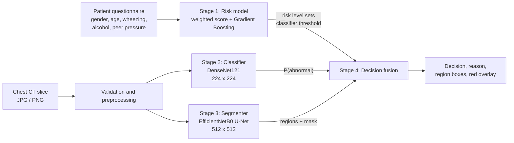

<p align="center">
  
</p>

<h1 align="center">PulmoScope</h1>

<p align="center">
  <b>A multi-stage AI system for pulmonary lesion detection and localization on chest CT</b><br>
  Questionnaire risk scoring, CT slice classification, and nodule segmentation, fused into a single decision pipeline and served through a FastAPI web application.
</p>

<p align="center">
  
  
  
  
  
  
  
</p>

> **Notice.** PulmoScope is a research and educational project. It is not a medical device and must not be used for diagnosis, screening decisions, or any clinical purpose. See [Limitations and Responsible Use](#limitations-and-responsible-use).

---

## Table of Contents

1. [Overview](#overview)
2. [Key Features](#key-features)
3. [System Architecture](#system-architecture)
4. [Models and Methodology](#models-and-methodology)
5. [Datasets](#datasets)
6. [Results](#results)
7. [Getting Started](#getting-started)
8. [API Reference](#api-reference)
9. [Project Structure](#project-structure)
10. [Limitations and Responsible Use](#limitations-and-responsible-use)
11. [Roadmap](#roadmap)
12. [License](#license)
13. [Author](#author)

---

## Overview

Single-model medical imaging tools tend to fail silently: one network produces one number, and there is no mechanism to tell the user when that number should not be trusted. PulmoScope addresses this by combining **three independent models** that answer different questions about the same case, and by explicitly reporting **disagreement** between them instead of hiding it.

Given a short patient questionnaire and one chest CT slice, the system:

1. Estimates a **baseline risk level** from demographic and lifestyle answers.
2. Classifies the slice as **normal or abnormal** with a fine-tuned DenseNet121.
3. **Segments** candidate nodules with a transfer-learning U-Net (EfficientNetB0 encoder) and returns their location.
4. **Fuses** the outputs into one of three decisions (`suspicious`, `uncertain`, `no_findings`) and renders a red overlay on the detected regions.

### At a Glance

| Component | Architecture | Input | Output |
|---|---|---|---|
| Risk model | Gradient Boosting + weighted score | 5 questionnaire answers | Risk level (Low / Medium / High) and probability |
| Classifier | DenseNet121 (transfer learning) | 224 x 224 RGB slice | P(abnormal) |
| Segmenter | U-Net, EfficientNetB0 encoder | 512 x 512 slice | Per-pixel nodule probability map |
| Decision layer | Rule-based fusion | Outputs of the three models | Decision code, reason, overlay |
| Serving | FastAPI + single-page UI | Form + image upload | JSON + base64 PNG overlay |

---

## Key Features

- **Multi-model decision pipeline.** Three models with different roles are combined through explicit, auditable rules rather than a single opaque score.
- **Disagreement-aware output.** When the classifier and segmenter disagree, the system returns `uncertain` and states which model flagged the slice.
- **Risk-adaptive sensitivity.** A High questionnaire risk lowers the classifier threshold from 0.50 to 0.40, trading specificity for sensitivity on higher-risk patients.
- **Localization, not only classification.** Connected-component analysis converts the probability map into bounding boxes, areas, and peak confidence per region.
- **Input validation.** Rejects empty, oversized, undersized, and colour-photo uploads before they reach the models. Handles RGBA, palette, and 16-bit images.
- **Leakage-aware training.** Grouped splits (by scan block for the classifier, by scan for the segmenter) keep neighbouring slices of the same case out of different partitions.
- **Self-contained serving.** The web UI is a single HTML page with no CDN or external font dependency. Model inference is guarded by a lock for thread safety.
- **Transparent explanation.** The API returns per-factor points and model feature importances for the questionnaire stage.

---

## System Architecture



### Decision Logic

| Classifier flagged | Segmenter flagged | Decision code | Meaning |
|:---:|:---:|---|---|
| Yes | Yes | `suspicious` | Both models independently flagged the slice. |
| Yes | No | `uncertain` | Only the classifier flagged the slice; manual review needed. |
| No | Yes | `uncertain` | Only the segmenter flagged the slice; manual review needed. |
| No | No | `no_findings` | Neither model flagged this slice. Other slices may differ. |

### Runtime Parameters

| Parameter | Value | Role |
|---|---|---|
| `CLS_THRESHOLD` | 0.50 | Classifier threshold for Low and Medium risk |
| `CLS_THRESHOLD_HIGH_RISK` | 0.40 | Classifier threshold when questionnaire risk is High |
| `SEG_THRESHOLD` | 0.50 | Binarization threshold on the probability map |
| `SEG_MIN_AREA` | 8 px | Minimum connected-component area kept as a region |
| `MAX_UPLOAD_MB` | 10 | Upload size limit |
| `MIN_SIDE_PX` | 64 | Minimum accepted image side |
| `MAX_COLORFULNESS` | 25 | Rejects colour photographs (CT slices are grayscale) |

---

## Models and Methodology

### Stage 1: Questionnaire Risk Model

| Item | Detail |
|---|---|
| Data | Survey-based lung cancer dataset, 309 records, 16 original columns |
| Selected features | Gender, age, wheezing, alcohol consumption, peer pressure (chosen after exploratory analysis) |
| Preprocessing | Binary encoding, `StandardScaler` fitted on the training split |
| Split | 75 / 25 train / test, `random_state=10` |
| Model search | `GridSearchCV` (3-fold) over SVC, Decision Tree, Random Forest, Gradient Boosting, KNN |
| Final model | `GradientBoostingClassifier` (learning rate 0.2, exponential loss, 50 estimators) |
| Persistence | `joblib` artifact containing model, scaler, and feature names |

The feature importances of the final model are rescaled to sum to 11.1 and form an interpretable **weighted score** (maximum 11.1), split into three equal bands:

| Feature | Weight |
|---|:---:|
| Age (normalized, capped at 100) | 4.4 |
| Peer pressure | 2.6 |
| Alcohol consumption | 1.9 |
| Wheezing | 1.2 |
| Gender | 1.0 |

| Risk level | Score range |
|---|:---:|
| Low | 0.0 to 3.7 |
| Medium | 3.8 to 7.4 |
| High | 7.5 to 11.1 |

The risk **level** drives the classifier threshold. The Gradient Boosting **probability** is returned for display only and does not influence the decision.

<p align="center">
  <br>
  <sub>Feature importance of the final Gradient Boosting model, used to derive the score weights.</sub>
</p>

### Stage 2: CT Slice Classifier

| Item | Detail |
|---|---|
| Backbone | DenseNet121, ImageNet weights, last 20 layers fine-tuned |
| Head | Global average pooling, batch normalization, dense layers 256 / 128 / 64, dropout 0.25 after each block, sigmoid output |
| In-model augmentation | Random horizontal flip, random rotation (0.05) |
| Parameters | 7,345,217 total, 672,833 trainable |
| Task | Binary: Normal vs Abnormal (Benign and Malignant merged) |
| Optimizer | Adam, learning rate 1e-4, binary cross-entropy |
| Callbacks | Model checkpoint, ReduceLROnPlateau, EarlyStopping (best weights restored) |
| Preprocessing | 224 x 224 nearest-neighbour resize, ImageNet normalization |
| Split | 658 train / 220 validation / 219 test images, grouped by scan block |

The sigmoid output corresponds to the `Normal` class because training used `classes=['Abnormal', 'Normal']`. At inference, `P(abnormal) = 1 - output`.

### Stage 3: Nodule Segmentation

| Item | Detail |
|---|---|
| Architecture | U-Net with an EfficientNetB0 encoder (ImageNet weights) |
| Skip connections | `block2a`, `block3a`, `block4a`, `block6a` expansion activations, plus a full-resolution shallow branch |
| Decoder | Transposed-convolution blocks (256, 128, 64, 32 filters) with batch normalization |
| Output | 512 x 512 sigmoid map, output bias initialized to -5 to counter extreme foreground sparsity |
| Loss | Focal Tversky (alpha 0.7 on false positives, beta 0.3 on false negatives, gamma 1.3) |
| Metric | Dice coefficient |
| Optimizer | Adam, learning rate 3e-4, ReduceLROnPlateau, EarlyStopping on validation Dice |
| Intensity handling | Hounsfield window of [-1000, 400] mapped to 0 to 255 |
| Augmentation | Horizontal flip, rotation within 10 degrees, scaling 0.9 to 1.1, brightness and contrast jitter, Gaussian noise |
| Split | Grouped by original scan (no scan appears in both train and validation) |
| Post-processing | Threshold, 8-connected component analysis, removal of regions under 8 px |

### Stage 4: Decision Fusion

The fusion layer is deliberately rule-based. Each rule is documented, testable, and explainable to a non-technical reviewer, which is preferable to a learned meta-model on a dataset of this size.

---

## Datasets

| Dataset | Used for | Size | Notes |
|---|---|---|---|
| IQ-OTHNCCD Lung Cancer Dataset (Kaggle) | Classifier | 1,097 CT images: 416 Normal, 120 Benign, 561 Malignant | Benign and Malignant merged into Abnormal (681 vs 416) |
| LUNA16-derived 2D slices with nodule masks | Segmenter | 6,216 slices (5,536 retained after lung-area filtering) | 220 nodule-positive slices; balanced to 220 positive and 220 negative |
| Lung cancer survey dataset (Kaggle) | Risk model | 309 records, 16 columns | Small, self-reported, class-imbalanced |

<p align="center">
  <br>
  <sub>Sample slices from the classifier dataset (Normal, Malignant, Benign).</sub>
</p>

<table>
  <tr>
    <td align="center"><br><sub>Classifier class distribution after merging</sub></td>
    <td align="center"><br><sub>Segmentation sample: CT slice and nodule mask</sub></td>
  </tr>
</table>

**Data handling decisions**

- The Benign class (120 images) was too small to model separately and too valuable to discard, so it was merged with Malignant, leaving a mild and tolerable imbalance.
- Non-lung slices (neck, abdomen) were removed from the segmentation data using a lung-mask pixel-count criterion (680 of 6,216 slices rejected).
- Splits are **grouped** (by scan block for the classifier, by scan identifier for the segmenter) so that neighbouring slices of the same case do not leak across partitions.

---

## Results

All figures below are taken from the training notebooks in this repository.

### CT Classifier (validation split, 220 images)

| Metric | Value |
|---|:---:|
| Accuracy | 0.85 |
| ROC AUC | 0.913 |
| Loss | 0.374 |

| Class | Precision | Recall | F1 | Support |
|---|:---:|:---:|:---:|:---:|
| Abnormal | 0.98 | 0.77 | 0.86 | 130 |
| Normal | 0.75 | 0.98 | 0.85 | 90 |
| Macro average | 0.86 | 0.87 | 0.85 | 220 |

<p align="center">
  <br>
  <sub>At the default 0.5 threshold the classifier is conservative: only 2 of 90 normal slices are misclassified, while 30 of 130 abnormal slices are missed. The risk-adaptive 0.4 threshold exists to recover sensitivity for high-risk patients.</sub>
</p>

### Nodule Segmenter (validation split, 61 slices from unseen scans)

| Metric | Value |
|---|:---:|
| Dice coefficient (threshold 0.5) | 0.626 |
| Positive slices with a correctly localized nodule | 17 of 29 |
| False-positive components (min area 8 px) | 12 |

Dice was stable at approximately 0.625 across thresholds from 0.3 to 0.7, indicating a well-separated probability map rather than a threshold-sensitive one.

<p align="center">
  <br>
  <sub>Columns: input CT slice, ground-truth mask, predicted probability map, thresholded prediction. Larger nodules are recovered well; the first row shows a failure case, a very small (21 px) lesion missed entirely.</sub>
</p>

### Questionnaire Risk Model (test split, 78 records)

| Metric | Value |
|---|:---:|
| Accuracy | 0.91 |

| Class | Precision | Recall | F1 | Support |
|---|:---:|:---:|:---:|:---:|
| NO | 0.56 | 0.62 | 0.59 | 8 |
| YES | 0.96 | 0.94 | 0.95 | 70 |

The test set contains only 8 negative cases, so the minority-class figures carry high variance and should be read as indicative, not conclusive.

---

## Getting Started

### Requirements

- Python 3.10 or newer
- A GPU is recommended but not required for inference
- Dependencies are listed in [`requirements.txt`](requirements.txt)

### Option A: Google Colab (recommended)

1. Upload the repository to Colab (or mount it from Google Drive).
2. Open `main.ipynb`.
3. In the **Settings** cell, set `MODELS_DIR` to the location of the `Models/` folder and confirm the three model filenames.
4. Run all cells from top to bottom.
5. After the final cell, a link to the application appears together with an embedded view of the page. No account, token, or tunnelling service is required because Colab's own proxy is used.

### Option B: Local machine

```bash
git clone https://github.com/<your-username>/PulmoScope.git
cd PulmoScope
python -m venv .venv
source .venv/bin/activate          # Windows: .venv\Scripts\activate
pip install -r requirements.txt
```

`main.ipynb` was written for Colab. For local execution, set `MODELS_DIR` to `./Models`, run the cells up to the FastAPI definition, and start the server with Uvicorn. Then open `http://localhost:8000`. The Colab-specific display lines in the final cell (`google.colab.output`) can be omitted.

> **Compatibility note.** `ml_model.pkl` is a scikit-learn pickle. Load it with a scikit-learn version close to the one used for training, otherwise deserialization may fail. The application is designed to keep working without it (the weighted score does not depend on the pickle).

### Model Files

| File | Size | Purpose |
|---|---|---|
| `Models/dl_classification_model.keras` | about 36 MB | DenseNet121 classifier |
| `Models/dl_segmentation_model.keras` | about 43 MB | EfficientNetB0 U-Net segmenter |
| `Models/ml_model.pkl` | about 75 KB | Questionnaire model, scaler, feature names |

---

## API Reference

| Method | Endpoint | Description |
|---|---|---|
| `GET` | `/` | Serves the web interface |
| `GET` | `/health` | Reports which models are loaded |
| `POST` | `/predict` | Runs the full pipeline on a questionnaire and one image |
| `GET` | `/docs` | Interactive OpenAPI documentation (FastAPI default) |

### `POST /predict`

Multipart form fields:

| Field | Type | Constraint |
|---|---|---|
| `gender` | string | `male` or `female` |
| `age` | integer | 1 to 120 |
| `wheezing` | boolean | |
| `alcohol` | boolean | |
| `peer_pressure` | boolean | |
| `image` | file | JPG or PNG, up to 10 MB, shortest side at least 64 px |

```bash
curl -X POST http://localhost:8000/predict \
  -F "gender=male" \
  -F "age=63" \
  -F "wheezing=true" \
  -F "alcohol=false" \
  -F "peer_pressure=true" \
  -F "image=@ct_slice.png"
```

Example response (abridged, illustrative values):

```json
{
  "decision": "Suspicious",
  "decision_code": "suspicious",
  "reason": "Both the classifier and the segmentation model flagged this slice.",
  "questionnaire": {
    "simulated_risk_score": 6.12,
    "max_score": 11.1,
    "risk_level": "Medium",
    "ml_probability": 0.874,
    "factors": [
      { "key": "age", "value": 0.63, "weight": 4.4, "points": 2.77, "ml_importance": 0.394 }
    ]
  },
  "classifier": {
    "abnormal_probability": 0.91,
    "threshold_used": 0.5,
    "flagged": true
  },
  "segmentation": {
    "flagged": true,
    "regions": [
      { "x": 311, "y": 244, "width": 18, "height": 17, "area_px": 238, "max_probability": 0.97 }
    ],
    "note": "Region coordinates are in a 512x512 resized frame."
  },
  "disclaimer": "This tool is for education/simulation only and is NOT a medical diagnosis. ...",
  "overlay_png_base64": "<base64-encoded PNG>"
}
```

Validation failures (empty file, oversized file, invalid image, colour photograph, image too small) return `HTTP 400` with a descriptive `detail` message.

---

## Project Structure

```text
PulmoScope/
├── main.ipynb                          # End-to-end pipeline, FastAPI app, and web UI
├── Models/                             # Deployable model artifacts
│   ├── dl_classification_model.keras
│   ├── dl_segmentation_model.keras
│   └── ml_model.pkl
├── Algorithms/                         # Training notebooks
│   ├── classification/                 # DenseNet121 classifier
│   ├── segmentation/                   # EfficientNetB0 U-Net
│   └── machine learning/               # Questionnaire risk model
├── EDA/                                # Exploratory data analysis
│   ├── dl_classification_dataset.ipynb
│   ├── dl_segmentation_dataset.ipynb
│   └── ml_dataset.ipynb
├── docs/
│   └── images/                         # Figures used in this README
├── requirements.txt
├── LICENSE
└── README.md
```

---

## Limitations and Responsible Use

This section documents known weaknesses so that results are interpreted correctly.

**Intended use.** Education, coursework, portfolio demonstration, and research prototyping of multi-model medical imaging pipelines.

**Out of scope.** Clinical diagnosis, patient triage, screening programmes, or any decision that affects a real person's care.

**Known limitations**

- **Single-slice analysis.** The system sees one 2D slice. A nodule can be absent from that slice, and a negative result says nothing about the rest of the scan.
- **Domain shift at inference.** The segmenter was trained on Hounsfield-windowed DICOM-derived slices, while the application accepts generic JPG and PNG exports with unknown windowing and compression. Performance on such inputs is not validated.
- **Small training sets.** The classifier uses 1,097 images and the segmenter 440 balanced slices. Generalization to other scanners, institutions, and populations has not been measured.
- **Validation reuse.** Classifier metrics are reported on the validation split that was also used for checkpoint selection and early stopping, so they are mildly optimistic. A separate 219-image test split was prepared but is not reported here.
- **Limited sensitivity on small lesions.** The segmenter localized 17 of 29 positive validation slices, and very small nodules are the main failure mode.
- **Weak clinical validity of the questionnaire.** The survey dataset is small and self-reported, and features such as peer pressure are statistical correlates in that dataset, not established clinical risk factors. The risk score is a simulation that shapes a threshold, not a clinical risk assessment.
- **No demographic subgroup analysis.** Performance across age, sex, and ethnicity has not been evaluated.
- **Benign and malignant are not distinguished.** They are merged into a single Abnormal class.
- **Balanced validation set.** The segmenter was validated on a roughly balanced set (32 positive / 29 negative slices) with no held-out test split; false-positive counts on real scans, where nodules are rare, are expected to be higher.
---

## Roadmap

- [ ] Evaluate all models on the held-out test split and add confidence intervals
- [ ] Add Grad-CAM explanations for the classifier
- [ ] Extend inference from single slices to full 3D volumes (DICOM and NIfTI input)
- [ ] Calibrate classifier probabilities (temperature scaling or isotonic regression)
- [ ] Validate on an external dataset to measure domain shift
- [ ] Containerize the service (Docker) and add automated tests and CI
- [ ] Export models to ONNX or TensorFlow Lite for lighter deployment

---

## License

Distributed under the MIT License. See [`LICENSE`](LICENSE) for details.

## Acknowledgements

- IQ-OTHNCCD Lung Cancer Dataset, Kaggle
- LUNA16 challenge (Lung Nodule Analysis 2016)
- Lung cancer survey dataset, Kaggle
- TensorFlow / Keras, scikit-learn, FastAPI, OpenCV

---

## Author
**Author:** Ali  
**Field:** Data Science & Machine Learning Student  
**Email:** ali.hz87980@gmail.com  
**GitHub:** [ali-119](https://github.com/ali-119)
