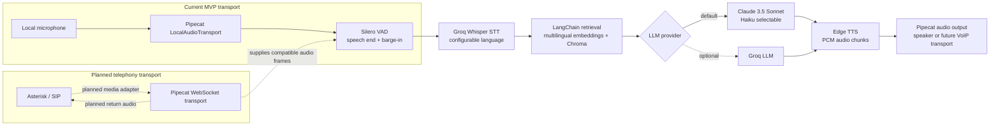

# OpenVoice-CRM

[](LICENSE)
[](#requirements)
[](https://www.anthropic.com/claude)

An open-source foundation for real-time, multilingual voice support and sales agents. OpenVoice-CRM combines Pipecat audio orchestration, Silero voice activity detection, Groq Whisper speech recognition, LangChain retrieval-augmented generation, Anthropic Claude, and Edge TTS.

> **Runtime note:** This version targets Python 3.11+. Pipecat 1.17's local-audio/Silero dependencies require Python 3.11 or newer; the badge reflects the supported runtime rather than advertising an incompatible minimum.

## Architecture



The microphone/speaker path, VAD, STT, local knowledge retrieval, LLM selection, and TTS are implemented in this MVP. The Asterisk/SIP and Pipecat WebSocket transport path is an architecture target; those telephony adapters are not included yet.

## Capabilities

- **Asynchronous Pipecat pipeline:** currently uses local microphone and speaker I/O, with a transport-neutral agent processor.
- **Voice activity and interruption:** Silero VAD detects user speech boundaries; new speech can interrupt an in-flight response.
- **Speech recognition:** Groq Whisper (`whisper-large-v3`) with configurable `STT_LANGUAGE`.
- **Grounded answers:** local text knowledge base, Chroma persistence, multilingual ONNX embeddings, and LangChain retrieval.
- **Claude-first LLM:** Anthropic Claude 3.5 Sonnet by default; Claude 3.5 Haiku is configurable for a lower-latency option. Groq is an optional selectable LLM provider.
- **Speech synthesis:** Edge TTS voice is configurable. Edge offers voices across 40+ languages and locales; choose a voice that matches the language you want spoken.
- **Privacy-minded defaults:** audio and transcripts are not written to disk by this MVP. Avoid putting secrets or customer data in the sample knowledge base.

## Requirements

- Python 3.11 or newer
- An Anthropic API key for the default Claude RAG/chat provider
- A Groq API key for Whisper STT (also used if selecting Groq as the LLM provider)
- A working microphone and speaker for local mode
- A system audio backend supported by Pipecat's local transport; Linux systems may need PortAudio development/runtime packages
- Network access to Anthropic, Groq, Edge TTS, and the model registry on first startup

## Quick start

```bash
python -m venv .venv
source .venv/bin/activate          # Windows: .venv\Scripts\activate
python -m pip install --upgrade pip
pip install -r requirements.txt
cp .env.example .env              # Windows: copy .env.example .env
```

Set `ANTHROPIC_API_KEY` and `GROQ_API_KEY` in `.env`, then run from the repository root:

```bash
python -m src.main
```

The first run downloads the multilingual `sentence-transformers/paraphrase-multilingual-MiniLM-L12-v2` ONNX embedding model through FastEmbed and builds the Chroma index at `data/chroma_db/`. Edit `data/knowledge_base.txt` to adapt the sample business context; restart the agent to re-index it. The index reconciles updated passages at startup.

### Docker Compose

The Compose setup is intended for local audio testing on a Linux Docker host with `/dev/snd` available. It passes the host audio device into the container; the audio group ID may need adjustment.

```bash
cp .env.example .env
# Set ANTHROPIC_API_KEY and GROQ_API_KEY in .env
# Optional: set AUDIO_GID to the host audio group's numeric ID
docker compose up --build
```

On non-Linux hosts, run the Python process directly or add a supported network transport adapter. The current container is not an Asterisk/SIP deployment.

## Configuration

| Variable | Default | Purpose |
|---|---|---|
| `ANTHROPIC_API_KEY` | — | Required for the default Claude provider |
| `LLM_PROVIDER` | `anthropic` | Select `anthropic` or `groq`; no automatic provider failover is configured |
| `ANTHROPIC_MODEL` | `claude-3-5-sonnet-20241022` | Claude model; `claude-3-5-haiku-20241022` is also supported by this configuration |
| `GROQ_API_KEY` | — | Required for Whisper STT; also authenticates Groq chat when selected |
| `GROQ_STT_MODEL` | `whisper-large-v3` | Groq speech recognition model |
| `GROQ_LLM_MODEL` | `llama-3.3-70b-versatile` | Secondary/selectable Groq chat model |
| `STT_LANGUAGE` | `en` | Language code sent to Whisper |
| `EDGE_TTS_VOICE` | `en-US-AriaNeural` | Edge TTS voice/locale; select a voice compatible with the desired spoken language |
| `KNOWLEDGE_BASE_PATH` | `data/knowledge_base.txt` | Local plain-text business knowledge source |
| `CHROMA_PERSIST_DIRECTORY` | `data/chroma_db` | Persistent local vector index |
| `AUDIO_SAMPLE_RATE` | `16000` | Local input sample rate; Silero supports 8 kHz or 16 kHz |
| `AUDIO_CHANNELS` | `1` | Local microphone channel count |
| `VAD_STOP_SECS` | `0.65` | Silence duration used to end a user turn |
| `VAD_CONFIDENCE` | `0.65` | Silero speech confidence threshold |

To use Groq for chat instead of Claude, set `LLM_PROVIDER=groq`. Groq credentials are still needed for STT in the current implementation.

## Project layout

```text
.env.example
CODE_OF_CONDUCT.md
CONTRIBUTING.md
SECURITY.md
.dockerignore
Dockerfile
docker-compose.yml
LICENSE
requirements.txt
data/
  knowledge_base.txt
src/
  __init__.py
  config.py
  rag_engine.py
  custom_edge_tts.py
  main.py
```

## Roadmap

- **Django Admin CRM Dashboard:** manage workspaces, customer records, and business knowledge through an operator-facing admin console.
- **Native Asterisk ARI bridge:** add call lifecycle control and a production-grade bridge between Asterisk audio and Pipecat.
- **Claude prompt caching:** cache stable system instructions and retrieved business context to target sub-500 ms model-side latency where provider, workload, and network conditions allow. This is a goal, not a current performance guarantee.
- WebSocket transport adapter, deployment examples, integration tests, and operational metrics.

## Contributing

Contributions are welcome! Read [CONTRIBUTING.md](CONTRIBUTING.md) for local setup, project guidelines, and pull request expectations. Please report security issues privately rather than publishing exploitable details in an issue; see [SECURITY.md](SECURITY.md).

## License

OpenVoice-CRM is distributed under the [MIT License](LICENSE).
