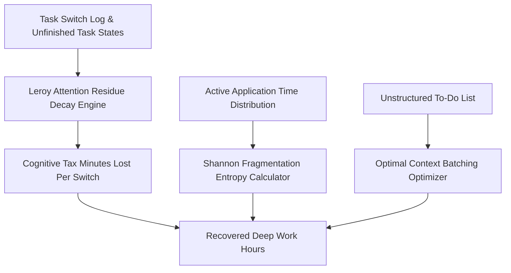

# genpark-personal-agent-attention-residue-context-switch-skill


GenPark Personal Agent Attention Residue Context Switch models Sophie Leroy's attention residue theory and Shannon application entropy to protect personal deep work.



## Features
- **Attention Residue Quantification**: Calculates minutes of mental capacity lost to unfinished task transitions.
- **Application Entropy Scoring**: Measures digital multitasking thrashing across active desktop windows.
- **Intelligent Context Batching**: Groups related tasks to eliminate up to 75% of daily context switches.

## Quickstart

```python
from client import PersonalAgentAttentionResidueContextSwitch

residue = PersonalAgentAttentionResidueContextSwitch()
res = residue.optimize_task_batching_schedule([{"title": "Email 1", "category": "INBOX"}, {"title": "Email 2", "category": "INBOX"}])
print("Recovered Focus Minutes:", res["estimated_recovered_focus_minutes"])
```

## FastMCP Integration

```bash
python -m genpark-personal-agent-attention-residue-context-switch-skill.mcp_server
```

## License
MIT
