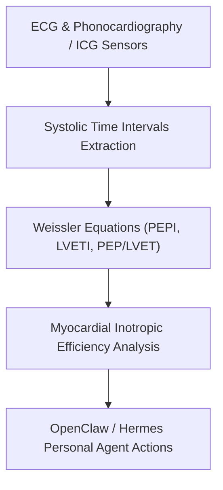

# Cardiac Systolic Time Intervals (PEP/LVET) & Inotropy Skill

[](LICENSE)
[](https://www.python.org/)
[](requirements.txt)
[](mcp_server.py)
[](SKILL.md)

Zero-dependency sovereign personal agent skill for non-invasive evaluation of Pre-Ejection Period (PEP), Left Ventricular Ejection Time (LVET), Weissler rate-corrected indices, and myocardial inotropic kinetics.



## Features
- **Deterministic Math**: Pure Python standard library implementation with zero external dependencies.
- **Weissler Standard Indices**: Automatic rate correction according to standard non-invasive cardiography formulas.
- **Inotropic Performance Stratification**: Quantitative evaluation of sympathetic vs depressed myocardial contractility.
- **Model Context Protocol (MCP)**: Native JSON-RPC tool integration for LLMs and autonomous agents.

## Quickstart

```python
from client import SystolicTimeIntervalsClient

client = SystolicTimeIntervalsClient()
result = client.evaluate_systolic_intervals(
    pep_ms=96.0,
    lvet_ms=295.0,
    heart_rate_bpm=70.0
)
print("PEP/LVET Ratio:", result["pep_lvet_ratio"])
print("Classification:", result["classification"])
```

## License
Apache-2.0
