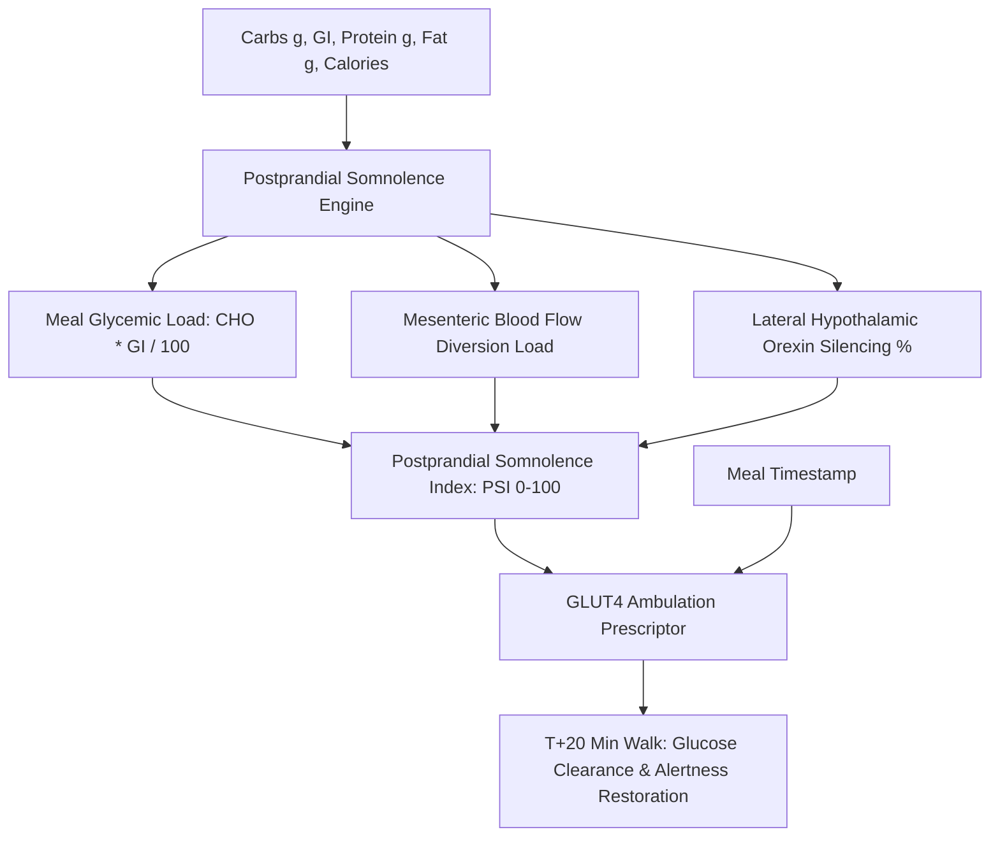

# Personal Agent Postprandial Somnolence Glycemic Dip Skill

[](https://github.com/Alpha-Park)
[](https://github.com/alphaparkinc)
[](https://www.python.org/)
[](https://modelcontextprotocol.io/)
[](https://github.com/Alpha-Park)

Zero-dependency postprandial somnolence modeler, lateral hypothalamic orexin suppression indexer, and post-meal glucose clearing ambulation scheduler.

## Architecture



## Quickstart

```python
from client import PersonalAgentPostprandialSomnolenceGlycemicDip

agent = PersonalAgentPostprandialSomnolenceGlycemicDip()
res = agent.evaluate_meal_somnolence_risk(carbohydrate_grams=85.0, glycemic_index=70.0, meal_calories=650.0)
print(f"PSI: {res['postprandial_somnolence_index_psi']}/100 | Tier: {res['somnolence_severity_tier']}")
```
