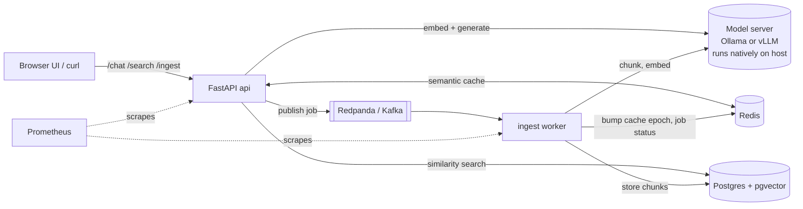

# local-llm-platform

A self-hosted, private ChatGPT-style platform that runs open-source LLMs **entirely on your own machine**, with
document Q&A (RAG), a web chat UI, a semantic response cache, async ingestion and Prometheus metrics.


<sub>Recorded on an 8 GB Apple M1. Waits while a model loads into memory are fast-forwarded (marked ⏩); everything else is real time.</sub>

- **Chat UI** at `http://localhost:8000`: streaming answers, markdown/code, conversations, document upload
- **RAG**: add PDF, Word or text files, ask questions, get answers with `[n]` source citations
- **Model switcher**: pick a model per conversation, download or delete models from the UI
- **Compare mode**: run one prompt on two models side by side with first-token time, total time and tokens/s
- **Live stats panel**: tokens/s, p50/p95 latency, cache hit rate, queue depth, which models are in memory
- **Local models** through [Ollama](https://ollama.com) (or any OpenAI-compatible server such as vLLM)
- **Hardware-aware setup**: a detection script inspects your RAM/GPU/installed models and picks sensible defaults
- **Production-style backend**: FastAPI, Postgres + pgvector, Redis, Redpanda (Kafka API), Prometheus
- Nothing leaves your machine. No API keys required.

## Contents
[Requirements](#requirements) · [Install](#install) · [Quick start](#quick-start) · [Using it](#using-it) ·
[Configuration](#configuration) · [Switching models](#switching-models) · [API reference](#api-reference) ·
[Troubleshooting](#troubleshooting) · [Development and tests](#development-and-tests) · [Benchmark](#benchmark) ·
[Architecture](#architecture) · [Design notes](#design-notes) · [Known limitations](#known-limitations)

---

## Requirements

| | Minimum | Recommended |
|---|---|---|
| RAM | 8 GB (3-4B models) | 16 GB+ (7-8B models) |
| Disk | 10 GB free | 30 GB+ |
| GPU | none needed | Apple Silicon, or NVIDIA 8GB+ VRAM for vLLM |
| OS | macOS (tested), Linux | Windows via WSL2 (untested) |

Software you need to install first:

1. **Docker** with Compose v2 ([Docker Desktop](https://www.docker.com/products/docker-desktop) on macOS/Windows, Docker Engine on Linux)
2. **Ollama**: https://ollama.com/download
3. **Python 3.10+** (only used by the hardware-detection script and the test suite)
4. **git**

> Tested on: macOS 26 (Apple M1, 8 GB RAM), Docker Desktop 29, Ollama 0.35, Python 3.10.
> Linux and Windows/WSL2 should work but have not been exercised; see [Troubleshooting](#troubleshooting) for Linux notes.

## Install

```bash
git clone https://github.com/amarpit33/local-llm-platform.git
cd local-llm-platform
```

Make sure Docker Desktop is open and Ollama is running (`ollama list` should work), then:

```bash
./start.sh
```

`start.sh` does everything:
1. checks Docker, Ollama and Python are available and running
2. runs `scripts/detect_environment.py`, which writes `config/detected.json` (chosen engine + models)
3. runs any `ollama pull` the detector says is missing (chat model and the `nomic-embed-text` embedding model)
4. copies `.env.example` to `.env` if you have no `.env`
5. runs `docker compose up --build -d` (Postgres, Redis, Redpanda, API+UI, ingest worker, Prometheus)
6. waits for `/readyz` and opens `http://localhost:8000`

First run downloads models and container images (several GB), so it can take 10+ minutes.

### Doing it step by step instead

```bash
python3 scripts/detect_environment.py     # prints what it picked; writes config/detected.json
ollama pull <chat model>                  # whatever it printed under "needed:" (if anything)
ollama pull nomic-embed-text              # embeddings, if not already installed
cp .env.example .env
docker compose up --build -d
curl localhost:8000/readyz                # expect {"model":true,"postgres":true,"redis":true}
```

Open http://localhost:8000.

### Which model does it choose?

`detect_environment.py` applies this policy and **reuses a model you already have** in the right size class:

| Hardware | Engine | Model tier |
|---|---|---|
| NVIDIA GPU, 8GB+ VRAM | vLLM | by VRAM |
| everything else | Ollama | by RAM below |
| 32GB+ RAM (or 16GB+ VRAM) | | ~8B (Llama 3.1 8B) |
| 16-32GB RAM (or 8-16GB VRAM) | | 7B Q4 (Mistral 7B) |
| under 16GB RAM | | ~3-4B (Qwen3.5 4B, Qwen2.5 3B, Phi-3.5) |

Re-run it any time: `python3 scripts/detect_environment.py` (safe to repeat; add `--json` for the full report).

## Quick start

1. Open http://localhost:8000
2. Toggle **Use knowledge base** off and ask anything: it is plain local chat.
3. Click **📚 Knowledge base** and drop in a PDF, Word or text file (try [`docs/sample-handbook.pdf`](docs/sample-handbook.pdf)), wait for `done`.
4. Toggle **Use knowledge base** on and ask about it, e.g. *"How many vacation days do I get, and do unused days roll over?"*. Expand **sources** under the answer.
5. Try **⚖ Compare** and **📊 Live stats** in the header.

Stop and start later:

```bash
docker compose down        # stop (keeps your documents)
docker compose up -d       # start again
docker compose down -v     # stop AND delete all ingested documents
```

Ollama and Docker Desktop must be running whenever you use it.

## Using it

**Chat UI** (`services/web/`, plain HTML/CSS/JS, no build step)
- Streaming replies with a stop button; markdown and code blocks with copy buttons
- Per-answer badges: tokens, seconds, tokens/s, and `cached` (with match percentage)
- Conversations are stored in your browser (localStorage), never on the server
- **Model picker** (header): choose the model for the current conversation; ● marks models loaded in memory
- **🧩 Models**: list installed models with size, download new ones with a progress bar, delete ones you don't use
  (the default chat model and the embedding model are protected)
- **⚖ Compare**: pick two models, enter one prompt, and see both answers with first-token time, total time,
  token count and tokens/s; the faster one is highlighted. Runs sequentially so timings are fair. Caching is bypassed.
  Tokens/s counts generation only; if a model first had to be loaded into memory, the load time is shown separately.
- **📊 Live stats**: tokens/s (last and median), p50/p95 latency, cache hit rate, ingest queue depth, documents and
  chunks, and loaded models with their GPU share. Refreshes every 2 seconds.
- Settings (⚙): temperature, max tokens, retrieved chunks (top-k), history length
- Status light (bottom-left) shows model/Postgres/Redis health
- Light/dark follows your OS; works at phone width

**Supported documents** (up to 5 MB): PDF (text-based; scanned PDFs without a text layer are rejected),
Word `.docx` (paragraphs and tables), and UTF-8 text (`.txt .md .csv .json .py .js ...`), or pasted text.
Legacy `.doc` files are not supported.

**Example with curl**

```bash
curl -X POST localhost:8000/ingest -H 'content-type: application/json' \
  -d '{"text":"The Zorblax-9 reactor was invented in 1987 by Dr. Mina Okafor.","source":"zorblax.md"}'
# -> {"job_id":"...","status":"queued"}      check: curl localhost:8000/ingest/<job_id>

curl -X POST localhost:8000/chat -H 'content-type: application/json' \
  -d '{"message":"Who invented the Zorblax-9 reactor?","use_rag":true}'
```

Interactive API docs: http://localhost:8000/docs

## Configuration

Everything is configured by environment variables (put them in `.env`). Anything unset falls back to
`config/detected.json`. After changing `.env`:

```bash
docker compose up -d --force-recreate api worker
```

> If you change **code**, use `docker compose up --build -d api worker`. `--force-recreate` alone reuses the old image.

| Variable | Default | Meaning |
|---|---|---|
| `LLM_BACKEND` | detected (`ollama`) | `ollama` or `vllm` (any OpenAI-compatible server) |
| `LLM_BASE_URL` | `http://host.docker.internal:11434` in compose | Where the model server is |
| `LLM_MODEL` | detected | Chat model name, e.g. `llama3.2:latest` |
| `EMBEDDING_MODEL` | detected (`nomic-embed-text`) | Embedding model |
| `EMBEDDING_DIM` | detected (768) | Vector size; must match the embedding model |
| `LLM_THINK` | `false` | Let reasoning models think before answering (slower; can exhaust `max_tokens`) |
| `LLM_TIMEOUT_SECONDS` | 300 | Model request timeout (includes loading the model into memory) |
| `CHUNK_SIZE` / `CHUNK_OVERLAP` | 800 / 100 | Document splitting (characters) |
| `RAG_TOP_K` | 4 | Chunks retrieved per question |
| `CACHE_ENABLED` | true | Semantic response cache |
| `CACHE_SIMILARITY_THRESHOLD` | 0.95 | Cosine similarity needed for a fuzzy cache hit |
| `CACHE_TTL_SECONDS` | 3600 | Cache entry lifetime |
| `DATABASE_URL` `REDIS_URL` `KAFKA_BOOTSTRAP_SERVERS` | set by compose | Infrastructure endpoints |
| `ANTHROPIC_API_KEY` etc. | unset | Only for the optional commercial benchmark |

Full list with comments: [.env.example](.env.example).

## Switching models

Models are fully switchable; no code refers to a specific model name.

**From the UI:** pick a model in the header dropdown (applies to the current conversation), or open 🧩 Models to
download one. No restart needed.

**Change the default** (used for new conversations and the API when no `model` is sent):

```bash
ollama pull llama3.2                       # any model from https://ollama.com/library
echo 'LLM_MODEL=llama3.2:latest' >> .env
docker compose up -d --force-recreate api worker
```

The UI header shows the active model. To use **vLLM** (NVIDIA GPU) or another OpenAI-compatible server:

```bash
LLM_BACKEND=vllm
LLM_BASE_URL=http://host.docker.internal:8001
LLM_MODEL=<model id served by vLLM>
```

**Do not change the embedding model** after ingesting documents. Vectors are a fixed size and the database is built
around it; if you must, run `docker compose down -v` and re-ingest.

## API reference

| Method | Path | Purpose |
|---|---|---|
| POST | `/chat` | `{message, history?, use_rag?, top_k?, stream?, temperature?, max_tokens?, model?, cache?}`. `stream:true` returns SSE (`token`, `done`, `error` events). `model` must be installed (else 422) |
| POST | `/search` | `{query, top_k?, min_score?}` returns the nearest chunks |
| POST | `/ingest` | `{text, source?, metadata?}` queues a job, `202 {job_id}` |
| POST | `/ingest/file` | multipart `file` (PDF, DOCX or text; + optional `source`) queues a job; 415 if unreadable |
| GET | `/ingest/{job_id}` | `queued` / `processing` / `done` / `failed` |
| GET | `/documents` | list ingested documents |
| DELETE | `/documents/{id}` | delete a document and its chunks |
| GET | `/models` | installed chat models, default, loaded-in-memory flags |
| POST | `/models/pull` | `{name}` downloads a model, SSE progress (`progress`, `done`, `error`) |
| DELETE | `/models/{name}` | deletes a model (409 for the default or embedding model) |
| GET | `/api/stats` | live stats snapshot used by the 📊 panel |
| GET | `/api/info` | active model/backend |
| GET | `/healthz` `/readyz` | liveness / readiness (model, Postgres, Redis) |
| GET | `/metrics` | Prometheus metrics |

Ports: `8000` app + UI, `9090` Prometheus, `19092` Redpanda (external), worker metrics `9101` (inside the network).
**There is no authentication.** Keep it bound to your own machine; do not expose it to the internet.

Metrics and ready-made PromQL (p50/p95 latency, tokens/s, cache hit rate, queue depth):
[deploy/alerts-and-queries.md](deploy/alerts-and-queries.md). Prometheus UI: http://localhost:9090.

## Troubleshooting

| Symptom | Fix |
|---|---|
| `docker: command not found` | Open Docker Desktop. If installed to `~/Applications`: `export PATH="$HOME/Applications/Docker.app/Contents/Resources/bin:$PATH"` |
| `start.sh`: "Docker is not running" / "Ollama is not running" | Start Docker Desktop; start Ollama (menu-bar app or `ollama serve`) |
| `/readyz` shows `"model": false` | Ollama not reachable from the container. Check `curl localhost:11434/api/tags` on the host. **Linux:** Ollama binds to 127.0.0.1 by default; run it with `OLLAMA_HOST=0.0.0.0` so containers can reach it via `host.docker.internal` |
| Everything is slow on an 8 GB Mac; model loads take 30-100 s | Docker Desktop reserves ~half your RAM by default (3.8 GB on 8 GB) while this stack's containers use ~400 MB. Lower it in Docker Desktop > Settings > Resources > Memory to **2 GB**, apply and restart. That memory goes back to the models |
| Replies take 10-40 s or the first message is slow | Normal for CPU/low-RAM laptops: the model loads on first use, and a 4B model runs ~15 tokens/s on 8GB. Close heavy apps, or switch to a smaller model (e.g. `llama3.2:latest`) |
| "model returned an empty answer" | A thinking model used all `max_tokens` reasoning. Keep `LLM_THINK=false`, raise max tokens in Settings, and make sure containers were **rebuilt** after updates (`docker compose up --build -d`) |
| Upload rejected: "PDF has no extractable text" | It is a scanned PDF (images only). Run OCR first (e.g. `ocrmypdf`), then upload |
| Compare mode is slow or the machine stalls | Two models don't fit in RAM at once, so Ollama unloads one and loads the other each run (4-20 s per load on 8 GB; shown as "model load"). Generation itself is fast. Expected on 8 GB |
| "model backend timed out after 300s" | The model could not load in time, usually from low memory. Close other apps, lower Docker's memory (row above), use a smaller model, or raise `LLM_TIMEOUT_SECONDS` |
| First answer after switching models is slow | Same cause: the model is being loaded into memory. The answer badge shows "model load Xs" |
| Answer says it doesn't know although the document is ingested | Toggle **Use knowledge base** on, check the job reached `done`, ask a more specific question, or raise top-k in Settings |
| Ingest job stuck on `queued` | Worker or Redpanda down: `docker compose logs worker redpanda` |
| `port is already allocated` | Something else uses 8000/9090/19092. Stop it or change the port mapping in `docker-compose.yml` |
| Config error "'chat_model' not set" | Run `python3 scripts/detect_environment.py` (creates `config/detected.json`) or set `LLM_MODEL` etc. in `.env` |
| Old cached/wrong answers | `docker compose exec redis redis-cli FLUSHDB` |
| Start completely fresh | `docker compose down -v && ./start.sh` |

Logs: `docker compose logs -f api worker`.

## Development and tests

```bash
python3 -m venv .venv && .venv/bin/pip install -r requirements-dev.txt
.venv/bin/python -m pytest -v            # 40+ tests, no Docker or Ollama needed (fakes for Postgres/Redis/Kafka/model)
node tests/js/markdown.test.js           # UI markdown renderer: XSS escaping, citations, code fences
```

CI runs both on every push (`.github/workflows/ci.yml`). The tests cover the model-client abstraction (both backends,
streaming, error mapping), chunking and the ingestion pipeline, the cache, environment detection, the HTTP API and
the benchmark helpers. The Postgres/pgvector SQL and the Kafka consumer are exercised only by running the real stack.

```
local-llm-platform/
├── start.sh                    one-command launcher
├── docker-compose.yml          postgres+pgvector, redis, redpanda, api, worker, prometheus
├── scripts/detect_environment.py   hardware/engine/model detection -> config/detected.json
├── services/
│   ├── api/
│   │   ├── main.py             FastAPI app, lifespan, /metrics, serves the UI
│   │   ├── config.py           settings; single source of truth for model names
│   │   ├── routers/            chat, ingest, search, documents
│   │   ├── services/           model_client, embeddings, chunking, ingestion, vectorstore, cache, queue, metrics
│   │   └── workers/ingest_worker.py   async Kafka consumer
│   ├── web/                    chat UI (index.html, app.js, style.css)
│   └── benchmark/eval.py       local vs commercial benchmark
├── k8s/                        Kubernetes / minikube manifests
├── deploy/                     Prometheus config + PromQL
└── tests/
```

### Kubernetes (minikube) — experimental

```bash
eval $(minikube docker-env)
docker build -f services/api/Dockerfile -t local-llm-platform:latest .
# edit k8s/config.yaml (model names) and the Secret password first
kubectl apply -k k8s/
```
The manifests are validated as YAML only; they have not been deployed.

## Benchmark

```bash
.venv/bin/python -m services.benchmark.eval --runs 1            # real commercial call if ANTHROPIC_API_KEY is set
.venv/bin/python -m services.benchmark.eval --mock-commercial   # simulate it
LLM_MODEL=llama3.2:latest .venv/bin/python -m services.benchmark.eval --mock-commercial
```

8 fixed prompts, max 200 output tokens, temperature 0, one pass, thinking off. Measured on an Apple M1 / 8 GB:

| Model | Size | p50 latency | p95 | Tokens/s | Quality* |
|---|---|---|---|---|---|
| llama3.2 3B | 2.0 GB | 7.4 s | 7.5 s | 27.0 | 92% |
| qwen3.5 4B | 3.4 GB | 12.2 s | 14.6 s | 15.6 | 83% |
| gemma4 8B | 9.6 GB | 47.8 s | 103.3 s | 3.7 | 81% |
| deepseek-r1 1.5B | 1.1 GB | 5.4 s | 5.7 s | 38.2 | 12% |

\*Keyword coverage against a fixed rubric: a crude smoke signal, not a quality eval; gaps of ~10 points are noise at this sample size.
deepseek-r1 scores low because it is a reasoning model run with thinking disabled.

Commercial comparison (llama3.2 vs a hosted model; the hosted row is **simulated** unless you set `ANTHROPIC_API_KEY`):

| System | p50 | Tokens/s | Est. cost / 1k requests |
|---|---|---|---|
| local llama3.2 (measured) | 7.4 s | 27.0 | $0.075 |
| commercial (simulated) | 3.1 s | 64.4 | $3.03 |

- Commercial latency in simulation is a fixed model (0.6 s + tokens/80 tps); the pricing defaults ($3/$15 per million
  tokens) are unverified placeholders. Override with `COMMERCIAL_*` env vars.
- Local cost = busy seconds x `LOCAL_COST_USD_PER_HOUR` (default $0.04, a power + hardware guess). It ignores idle time;
  at low utilisation real per-request cost is much higher.

## Architecture



`/chat` flow: embed query once -> semantic cache lookup -> (RAG) pgvector top-k -> generate -> cache write.
The model server runs **natively** (not in Docker) so it can use Metal/CUDA; containers reach it at `host.docker.internal`.

## Design notes

**Local vs hosted.** Marginal cost per request is near zero and data never leaves the machine, but latency is ~2x worse on a laptop
and quality is that of a small model. Savings only materialise at sustained utilisation.

**Batching.** The API does not batch generation itself (single-stream latency matters on a laptop). It batches embeddings
(bounded `EMBED_BATCH_SIZE`) and moves ingestion off the request path via a queue. On a CUDA box, vLLM's continuous batching
handles concurrent generations, which is why it is the preferred backend there and why the client speaks the OpenAI protocol.

**Cache.** Two tiers: exact (sha256 of the normalised query) then semantic (cosine >= 0.95 over the 500 most recent entries,
numpy). Plain Redis has no vector index, so the scan is bounded; beyond a few thousand entries move to Redis Stack HNSW.
Keys are namespaced by model + RAG flag + a *corpus epoch* bumped on every ingest/delete so changed documents invalidate stale
RAG answers. Requests with chat history or temperature > 0.3 bypass the cache, and empty answers are never cached.
Trade-off: 0.95 can occasionally return a near-but-wrong answer for questions differing by a negation or number.

**Redpanda over Kafka.** Same client API, one container, no ZooKeeper. The worker commits offsets after processing
(at-least-once); documents are keyed by job id and replaced on redelivery, so processing is idempotent.

**pgvector.** Chunks and metadata live in one transactional store with an HNSW cosine index, plenty at this scale.

## Known limitations

- Verified on macOS (Apple M1, 8 GB) only. Not exercised: Linux, Windows/WSL2, NVIDIA/vLLM, the Kubernetes manifests,
  and the fuzzy (non-exact) cache path against real Redis.
- No OCR: scanned PDFs and images inside documents are not read. No legacy `.doc`.
- Model download/delete from the UI works with Ollama only (vLLM serves a fixed model).
- **No authentication or rate limiting.** Run on localhost only.
- Chat history is per-browser (localStorage), not synced.
- Queue-depth gauge is a Redis counter, not broker consumer lag.
- Small local models make mistakes and have no internet access.

## License

MIT. See [LICENSE](LICENSE).
