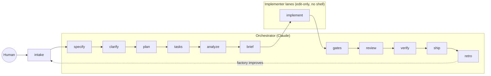

# Software Factory

A reference pipeline for building production software with Claude as the orchestrator and
cheaper models as implementers. Every stage has a machine-checked exit criterion, the rules that
matter are enforced by hooks instead of requested in prompts, and every implementer run is
scored in a ledger.

It ships as documentation **and** a working kit: a zero-dependency CLI, Claude Code hooks,
role subagents, an orchestrator skill, implementer adapters, and templates.

### Install as a Claude Code plugin (recommended)

The plugin brings the skill, the subagents and the hooks, and it updates with each release.
Your repository keeps the CLI and its config, so CI and the gates work without the plugin.

```bash
claude plugin marketplace add ameenmv/software-factory
claude plugin install software-factory@software-factory --scope project

git clone https://github.com/ameenmv/software-factory.git
node software-factory/bin/factory.mjs init /path/to/your/repo --plugin
```

`init --plugin` also writes the `.env` deny list to `.claude/settings.json`, because plugins
cannot ship permissions. It registers the plugin there as well, so teammates see it. Each
teammate still runs the `claude plugin install` line once per clone.

### Or vendor everything into the repository

```bash
node software-factory/bin/factory.mjs init /path/to/your/repo
```

This copies the hooks, agents and skill into `.claude/`. Choose one mode. `init --plugin`
refuses to run in a repo that already has the vendored hooks, so they never run twice.

---

## Why

A strong model in a chat window writes good code. It also forgets the rules it agreed to three
hours ago, reports work as tested after editing it again, wanders outside the change it was
asked for, and costs the same whether it is designing a payment flow or renaming a variable.

Longer prompts do not fix any of that. Structure does.

| Failure | The factory's answer |
|---|---|
| Forgets rules | Hooks block the action: `.env` reads in Claude Code; force push, branch deletion and ungated commits in real git hooks |
| Claims "tests pass" without proof | A gate stamp tied to a fingerprint of the exact tree; commits are refused without it |
| Scope creep | Each brief lists `allowed_files`; `factory scope` fails the diff otherwise |
| Expensive model doing cheap work | Briefs are delegated to implementer lanes, cheapest first, with quota fall-through |
| "This model is good" by reputation | A ledger of every run: accept rate, minutes, cost per accepted slice |
| Lost context between sessions | Pipeline state per feature, injected at session start |
| Same mistake twice | Retro turns each escaped defect into a hook, gate, checklist entry or catalog entry |

## How it works



1. **Define**: the request becomes `intake.md`, then a spec through [Spec Kit](https://github.com/github/spec-kit). Ambiguities are asked, never guessed.
2. **Design**: the `architect` subagent writes contracts and slices; Spec Kit produces tasks and a cross-artifact analysis that must report `CRITICAL: 0`.
3. **Build**: the `brief-writer` turns each slice into a validated brief. `factory delegate` sends it to the first available implementer lane, falls through on quota, and checks the diff's scope.
4. **Prove**: gates run and stamp the tree. Review is layered (free model, reviewer subagent, security auditor for risky paths) and every finding is reproduced before it is acted on. The verifier runs the app and records evidence.
5. **Close**: one commit per slice, then a retro that changes the factory itself.

`factory advance` refuses to move a feature past a stage whose exit criterion is not met. You
can override, but the reason is written to the feature's history.

## What is in the box

```
bin/factory.mjs          CLI: pipeline state, brief validation, scope, gates, ledger, report, init
lib/                     core logic, zero dependencies
kit/                     what `init` installs into your repo
  .claude/settings.json    hook wiring + secret deny list
  .claude/hooks/           guard-bash, guard-files, post-edit, stop-gates, session-context
  .claude/agents/          architect, brief-writer, reviewer, security-auditor, test-author, verifier
  .claude/skills/          software-factory: the orchestrator procedure
  scripts/                 delegate.sh, review.sh, adapters/ (opencode, claude, template)
templates/               intake, brief, review, verify, retro, ADR, AGENTS.md, CLAUDE.md, handbook skill
docs/                    the reference: 13 chapters
examples/                one feature through all 13 stages, every artifact included
tests/                   end-to-end tests of the CLI, hooks and delegation
```

## Quick tour

```bash
factory feature new partial-refunds        # specs/001-partial-refunds at stage intake
factory feature new fix-typo --lane quick  # small change: intake, brief, implement, gates, review, ship
factory status                             # every feature, its stage, its blockers
factory check partial-refunds              # what blocks the current stage
factory advance partial-refunds            # next stage, only if the exit criterion holds

factory brief new partial-refunds B001     # scaffold a brief
factory brief check specs/001-*/briefs/*.md
factory delegate specs/001-partial-refunds/briefs/B001.md
factory scope specs/001-partial-refunds/briefs/B001.md
factory risk                               # exit 3 if auth, payments or migrations changed

factory gates                              # run every gate, stamp the tree
factory ledger add --feature 001-partial-refunds --brief B001 --implementer opencode --outcome accepted --minutes 4
factory report --html scorecard.html       # implementer scorecard
factory eval --min-pass 0.8                # fixed cases on every lane, scored by gates and checks
```

(`factory` is `node factory/cli/bin/factory.mjs` inside an installed repo.)

## Documentation

| | Chapter | Read it for |
|---|---|---|
| 1 | [Philosophy](docs/01-philosophy.md) | the five principles, and when not to use the full line |
| 2 | [The pipeline](docs/02-pipeline.md) | every stage: owner, output, exit criterion |
| 3 | [Roles](docs/03-roles.md) | who may do what, and which model each role gets |
| 4 | [Delegation](docs/04-delegation.md) | writing briefs that do not get rejected; the adapter contract |
| 5 | [Quality gates](docs/05-quality-gates.md) | the tree-bound stamp; gates as project invariants |
| 6 | [Review](docs/06-review.md) | layered review; why every finding is a hypothesis |
| 7 | [Verification](docs/07-verification.md) | evidence; where tests are blind |
| 8 | [Knowledge layers](docs/08-knowledge-layers.md) | what goes in AGENTS.md, the handbook, ADRs, memory |
| 9 | [Hooks and guardrails](docs/09-hooks-and-guardrails.md) | every rule the hooks enforce, and writing your own |
| 10 | [Safety](docs/10-safety.md) | threat model: secrets, injection, supply chain, cost |
| 11 | [Metrics](docs/11-metrics.md) | the ledger, the scorecard, routing by evidence |
| 12 | [Failure catalog](docs/12-failure-catalog.md) | known failures with symptom, cause, fix and prevention |
| 13 | [Adoption](docs/13-adoption.md) | install, a first week, configuration reference |

Start with the [worked example](examples/README.md) if you learn better from artifacts than from prose.

## Design choices

- **Claude orchestrates; implementers are interchangeable.** The orchestrator role needs judgment
  and tool access that should not change month to month. Implementers sit behind a five-line
  shell contract, so a new model is a new adapter, not a new process.
- **Implementers never get a shell.** It is the single control that prevents the most damage:
  no installs, no deletions, no "fixing" a test by removing it.
- **Files over services.** State, briefs, reviews and the ledger are markdown and JSONL in the
  repository. They diff, they merge, they survive any tool.
- **Zero dependencies.** The CLI and hooks are plain Node. `init` vendors them into your repo, so
  nothing breaks when a package is unpublished.
- **Exceptions are recorded, never silent.** Every stage can be overridden, and every override
  is a line in the history that the retro reads.

## Requirements

- Node 20 or newer, git, [Claude Code](https://docs.claude.com/en/docs/claude-code).
- [Spec Kit](https://github.com/github/spec-kit) for the specify to analyze stages.
- Optional: [OpenCode](https://opencode.ai) for the free implementer lane.

## Contributing

The best contributions come from real retros: failure catalog entries, adapters for new
implementers, hook rules with tests. See [CONTRIBUTING.md](CONTRIBUTING.md).

## License

[MIT](LICENSE)
