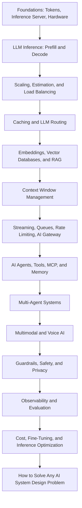

<p align="center">
    
</p>

# AI System Design

**AI System Design - A complete guide to learn AI System Design step by step - from LLM inference, GPUs, KV Cache, and caching to RAG, Vector Databases, AI Agents, MCP, Multi-Agent Systems, Voice AI, Guardrails, Evaluation, Observability, Cost Optimization, and a step-by-step framework to crack any AI System Design interview. Everything in one place, explained in simple words, with detailed blogs for every deep dive.**

> This AI System Design guide is helpful for anyone who wants to become:
>
> - AI Engineer
> - Gen AI Engineer
> - LLM Engineer
> - Agentic AI Engineer
> - AI Agent Engineer
> - Forward Deployed Engineer
> - AI Solutions Architect
> - AI Platform Engineer
> - Applied AI Engineer
> - Machine Learning Engineer
> - MLOps Engineer
> - LLMOps Engineer
> - Backend Engineer building AI products

---

### Prepared and maintained by the **Founder** of [Outcome School](https://outcomeschool.com): Amit Shekhar

### Follow Amit Shekhar

- [X/Twitter](https://twitter.com/amitiitbhu)
- [LinkedIn](https://www.linkedin.com/in/amit-shekhar-iitbhu)
- [GitHub](https://github.com/amitshekhariitbhu)

### Follow Outcome School

- [YouTube](https://youtube.com/@OutcomeSchool)
- [X/Twitter](https://x.com/outcome_school)
- [LinkedIn](https://www.linkedin.com/company/outcomeschool)
- [GitHub](https://github.com/OutcomeSchool)

## I teach at Outcome School

- [AI and Machine Learning](https://outcomeschool.com/program/ai-and-machine-learning)

---

> **Note: AI System Design is moving very fast, so this guide will continue to grow as I write more blogs on new topics. Bookmark it and come back whenever you want a refresher. Keep learning.**

---

## Table of Contents

- [About This AI System Design Guide](#about-this-ai-system-design-guide)
- [What is AI System Design?](#what-is-ai-system-design)
- [Who is This AI System Design Guide For?](#who-is-this-ai-system-design-guide-for)
- [What Will We Learn in This AI System Design Guide?](#what-will-we-learn-in-this-ai-system-design-guide)
- [How to Use This AI System Design Guide](#how-to-use-this-ai-system-design-guide)
- [AI System Design Learning Path](#ai-system-design-learning-path)
- [Why study AI System Design?](#why-study-ai-system-design)
- [How is AI System Design different from regular System Design?](#how-is-ai-system-design-different-from-regular-system-design)
- [LLM Recap](#llm-recap)
- [The Big Picture](#the-big-picture)
- [Inference Server](#inference-server)
  - [Choosing an Inference Engine](#choosing-an-inference-engine)
- [AI Hardware: GPU, TPU, and LPU](#ai-hardware-gpu-tpu-and-lpu)
- [Tokens, Latency, and Throughput](#tokens-latency-and-throughput)
  - [Time to First Token (TTFT)](#time-to-first-token-ttft)
  - [Tokens per Second (TPS)](#tokens-per-second-tps)
  - [Throughput](#throughput)
  - [Cost per Token](#cost-per-token)
- [Prefill and Decode: The Two Phases of LLM Inference](#prefill-and-decode-the-two-phases-of-llm-inference)
  - [Prefill](#prefill)
  - [Decode](#decode)
  - [Chunked Prefill](#chunked-prefill)
  - [Prefill-Decode Disaggregation](#prefill-decode-disaggregation)
- [Scaling AI Systems](#scaling-ai-systems)
  - [Vertical Scaling](#vertical-scaling)
  - [Horizontal Scaling](#horizontal-scaling)
  - [Tensor Parallelism](#tensor-parallelism)
  - [Pipeline Parallelism](#pipeline-parallelism)
  - [How to choose](#how-to-choose)
- [Auto Scaling for AI](#auto-scaling-for-ai)
- [Back-of-the-envelope Estimation for AI](#back-of-the-envelope-estimation-for-ai)
  - [Token Estimation](#token-estimation)
  - [GPU Estimation](#gpu-estimation)
  - [Cost Estimation](#cost-estimation)
- [Load Balancing for LLM Servers](#load-balancing-for-llm-servers)
  - [Least Outstanding Tokens](#least-outstanding-tokens)
  - [Prefix-Aware Routing](#prefix-aware-routing)
  - [Sticky Sessions](#sticky-sessions)
- [Caching in AI](#caching-in-ai)
  - [KV Cache](#kv-cache)
  - [KV Cache Compression](#kv-cache-compression)
  - [Prompt Cache](#prompt-cache)
  - [Semantic Cache](#semantic-cache)
  - [Embedding Cache](#embedding-cache)
- [LLM Routing (Model Routing)](#llm-routing-model-routing)
- [Vector Database](#vector-database)
  - [Vector Index Types](#vector-index-types)
- [RAG (Retrieval Augmented Generation)](#rag-retrieval-augmented-generation)
  - [Document Parsing and Ingestion](#document-parsing-and-ingestion)
  - [Chunking Strategies](#chunking-strategies)
  - [Hybrid Search](#hybrid-search)
  - [Query Transformation with HyDE](#query-transformation-with-hyde)
  - [Reranking](#reranking)
  - [ColBERT and Late Interaction](#colbert-and-late-interaction)
  - [Agentic RAG](#agentic-rag)
  - [GraphRAG](#graphrag)
  - [Vectorless RAG](#vectorless-rag)
- [Context Window Management](#context-window-management)
  - [Context Rot, Lost in the Middle, and RoPE Decay](#context-rot-lost-in-the-middle-and-rope-decay)
  - [Context Engineering](#context-engineering)
  - [Truncation](#truncation)
  - [Summarization](#summarization)
  - [Sliding Window](#sliding-window)
  - [Compaction](#compaction)
  - [Hierarchical Memory](#hierarchical-memory)
- [Streaming Responses](#streaming-responses)
  - [Server-Sent Events (SSE)](#server-sent-events-sse)
  - [WebSockets](#websockets)
- [Async Processing for Long AI Tasks](#async-processing-for-long-ai-tasks)
- [Message Queues in AI Systems](#message-queues-in-ai-systems)
- [Rate Limiting in AI](#rate-limiting-in-ai)
  - [Tokens Per Minute (TPM)](#tokens-per-minute-tpm)
  - [Requests Per Minute (RPM)](#requests-per-minute-rpm)
  - [Concurrent Requests](#concurrent-requests)
  - [Cost-Based Rate Limiting](#cost-based-rate-limiting)
- [AI Gateway](#ai-gateway)
- [Embeddings Pipeline](#embeddings-pipeline)
  - [Choosing an Embedding Model](#choosing-an-embedding-model)
  - [Matryoshka Embeddings](#matryoshka-embeddings)
- [AI Agents and Agentic Systems](#ai-agents-and-agentic-systems)
  - [The Five Core Parts](#the-five-core-parts)
  - [How an AI Agent Works End to End](#how-an-ai-agent-works-end-to-end)
  - [Types of AI Agents](#types-of-ai-agents)
  - [Computer Use and Browser Agents](#computer-use-and-browser-agents)
  - [Common Failure Modes](#common-failure-modes)
  - [AI Orchestration vs AI Agents](#ai-orchestration-vs-ai-agents)
  - [Loop Engineering](#loop-engineering)
  - [Graph Engineering](#graph-engineering)
- [Tool Calling](#tool-calling)
- [Model Context Protocol (MCP)](#model-context-protocol-mcp)
  - [How MCP works](#how-mcp-works)
  - [Why MCP matters for AI System Design](#why-mcp-matters-for-ai-system-design)
  - [When to use MCP](#when-to-use-mcp)
  - [When MCP is overkill](#when-mcp-is-overkill)
- [Agent Skills](#agent-skills)
- [Structured Output](#structured-output)
- [Memory for AI Agents](#memory-for-ai-agents)
  - [The Memory Stack](#the-memory-stack)
  - [The Four Core Operations](#the-four-core-operations)
  - [How Memory Flows at Runtime](#how-memory-flows-at-runtime)
  - [What to Store and What Not to Store](#what-to-store-and-what-not-to-store)
- [Multi-Agent Systems](#multi-agent-systems)
  - [The Three Pillars](#the-three-pillars)
  - [Common Agent Roles](#common-agent-roles)
  - [A Concrete Example: Customer Support](#a-concrete-example-customer-support)
  - [Coordination Patterns](#coordination-patterns)
  - [AI SubAgents](#ai-subagents)
  - [Trade-offs](#trade-offs)
  - [A2A (Agent2Agent Protocol)](#a2a-agent2agent-protocol)
  - [How A2A works](#how-a2a-works)
  - [How MCP and A2A fit together](#how-mcp-and-a2a-fit-together)
- [Multimodal Systems](#multimodal-systems)
  - [Storage](#storage)
  - [Pre-processing Pipeline](#pre-processing-pipeline)
  - [Token Cost](#token-cost)
  - [Output Modalities](#output-modalities)
  - [Latency](#latency)
  - [Voice and Realtime APIs](#voice-and-realtime-apis)
  - [Edge AI and On-Device Inference](#edge-ai-and-on-device-inference)
- [Guardrails and Safety](#guardrails-and-safety)
  - [Input Guardrails](#input-guardrails)
  - [Output Guardrails](#output-guardrails)
  - [Prompt Injection](#prompt-injection)
  - [AI Red Teaming](#ai-red-teaming)
  - [LLM Watermarking](#llm-watermarking)
- [Data Privacy and Compliance](#data-privacy-and-compliance)
  - [PII Redaction](#pii-redaction)
  - [Data Residency](#data-residency)
  - [No-Train and BAA Clauses](#no-train-and-baa-clauses)
  - [Voice and Multimodal Privacy](#voice-and-multimodal-privacy)
  - [Audit Logs](#audit-logs)
- [Observability in AI Systems](#observability-in-ai-systems)
- [Evaluation Pipeline](#evaluation-pipeline)
  - [LLM as a Judge](#llm-as-a-judge)
  - [Evaluating AI Agents](#evaluating-ai-agents)
- [Prompt Management](#prompt-management)
  - [Programmatic Prompting with DSPy](#programmatic-prompting-with-dspy)
- [Cost Optimization](#cost-optimization)
  - [1. Use a cheaper model when possible](#1-use-a-cheaper-model-when-possible)
  - [2. Use prompt caching](#2-use-prompt-caching)
  - [3. Use semantic cache](#3-use-semantic-cache)
  - [4. Shorter outputs](#4-shorter-outputs)
  - [5. Self-host smaller models](#5-self-host-smaller-models)
  - [6. Batch inference](#6-batch-inference)
  - [7. Better retrieval (for RAG)](#7-better-retrieval-for-rag)
- [Multi-Tenancy](#multi-tenancy)
- [Fine-Tuning Infrastructure](#fine-tuning-infrastructure)
  - [Training Cluster](#training-cluster)
  - [Training Data Pipeline](#training-data-pipeline)
  - [Experiment Tracking](#experiment-tracking)
  - [Model Registry](#model-registry)
  - [Evaluation](#evaluation)
- [Inference Optimization](#inference-optimization)
  - [Quantization](#quantization)
  - [Continuous Batching](#continuous-batching)
  - [Speculative Decoding](#speculative-decoding)
  - [Test-time Compute (Inference-time Scaling)](#test-time-compute-inference-time-scaling)
  - [Flash Attention](#flash-attention)
  - [Mixture of Experts (MoE)](#mixture-of-experts-moe)
  - [Model Distillation](#model-distillation)
  - [Grouped Query Attention (GQA)](#grouped-query-attention-gqa)
- [Fault Tolerance](#fault-tolerance)
  - [Timeouts](#timeouts)
  - [Retries with Backoff](#retries-with-backoff)
  - [Fallback Models](#fallback-models)
  - [Graceful Degradation](#graceful-degradation)
  - [Output Validation](#output-validation)
- [How to Solve Any AI System Design Problem](#how-to-solve-any-ai-system-design-problem)
  - [Step 1: Requirements](#step-1-requirements)
  - [Step 2: AI Objective](#step-2-ai-objective)
  - [Step 3: Data Preparation](#step-3-data-preparation)
  - [Step 4: Architecture Design](#step-4-architecture-design)
  - [Step 5: Model Selection and Prompting](#step-5-model-selection-and-prompting)
  - [Step 6: Evaluation](#step-6-evaluation)
  - [Step 7: Deployment and Serving](#step-7-deployment-and-serving)
  - [Step 8: Monitoring](#step-8-monitoring)
- [Real-World AI System Case Studies](#real-world-ai-system-case-studies)
  - [Case Study 1: How Claude Code Works](#case-study-1-how-claude-code-works)
  - [Case Study 2: How Cursor Works](#case-study-2-how-cursor-works)
  - [Case Study 3: Design a Real-Time Voice AI Agent](#case-study-3-design-a-real-time-voice-ai-agent)
- [AI System Design Interview Questions](#ai-system-design-interview-questions)
- [Quick Summary](#quick-summary)
- [AI System Design Key Concepts Glossary](#ai-system-design-key-concepts-glossary)
- [AI System Design FAQs](#ai-system-design-faqs)
- [License](#license)

## About This AI System Design Guide

In this guide, we will learn about AI System Design, the discipline of putting GPUs, inference servers, caches, vector databases, AI agents, gateways, guardrails, and evals together into one system that is fast, cheap, reliable, and safe. We will also see how an LLM actually runs on a GPU, how prefill and decode shape latency, how caching, routing, and batching cut the cost, how RAG and AI Agents are built for production, how we keep the system safe and measurable, and a step-by-step framework to solve any AI System Design problem in an interview or in real production.

When we use a product like ChatGPT, Cursor, Perplexity, or Claude Code, we see a simple chat box and a streamed response. Behind that simple interface, there is a lot more happening - GPUs, inference servers, vector databases, agent loops, caches, gateways, guardrails, and a long list of design decisions that all have to work together.

This guide is everything we need in one place. We start with the basics like tokens and the inference server, build up through hardware, prefill and decode, scaling, caching, RAG, agentic systems, multi-agent systems, multimodal and voice systems, safety, observability, evaluation, and inference optimization, and finish with a step-by-step framework to solve any AI System Design problem.

Every section is:

- **Written for beginners.** No jargon. No assumptions. Every term is explained before it is used.
- **Practical.** Real numbers, real trade-offs, real tools, and real architecture diagrams.
- **Connected to a deep dive.** Wherever a topic deserves more depth, we link to a detailed blog that explains it from the ground up.

This guide focuses on the System Design side of AI. To learn the complete AI Engineering path - Machine Learning, Deep Learning, Transformers, LLMs, Fine-Tuning, RAG, AI Agents, and more - check out the [AI Engineering Course](https://github.com/amitshekhariitbhu/ai-engineering-course).

## What is AI System Design?

**AI System Design is the discipline of designing the complete system around an AI model, especially a Large Language Model (LLM), so that it can serve real users in a way that is fast, cheap, reliable, safe, and measurable.**

In simple words:

**AI System Design = System Design + The new constraints of AI models.**

The new constraints are GPUs, tokens, long and streamed responses, non-deterministic output, and a real cost on every single request. AI System Design is how we design caches, queues, databases, gateways, retrieval, agents, guardrails, and evals around these constraints.

Let's say we want to build a customer support chatbot. Calling an LLM API in a script takes ten lines of code. But serving 100,000 users with an answer that starts in under a second, stays grounded in our own documents, never leaks private data, and fits within a monthly budget - that is AI System Design.

## Who is This AI System Design Guide For?

This AI System Design guide is for:

- **Software Engineers** who want to move into AI Engineering.
- **Backend, Mobile, and Frontend Developers** who want to build AI-powered products.
- **Machine Learning Engineers and Data Scientists** who want to take models to production.
- **Engineering Managers, Tech Leads, and Architects** who want to understand how modern AI systems are built.
- **Students and freshers** who want to start a career in AI.
- **Anyone preparing for AI System Design interviews**, AI Engineer interviews, and GenAI Engineer interviews.

## What Will We Learn in This AI System Design Guide?

In this AI System Design guide, we will learn:

- **The foundations:** how AI System Design differs from regular System Design, tokens, the inference server, choosing an inference engine, and the hardware (GPU, TPU, LPU).
- **LLM inference:** prefill vs decode, TTFT, TPOT, throughput, chunked prefill, and prefill-decode disaggregation.
- **Scaling:** vertical and horizontal scaling, tensor parallelism, pipeline parallelism, auto scaling with warm pools, back-of-the-envelope estimation, and load balancing for LLM servers.
- **Caching:** KV Cache, Paged Attention, KV Cache Compression, Prompt Cache, Semantic Cache, and Embedding Cache.
- **LLM Routing:** rule-based, classifier-based, embedding-based, LLM-as-router, and cascade routing.
- **Retrieval:** embeddings, vector databases, vector indexes, RAG, document parsing, chunking, hybrid search, HyDE, reranking, ColBERT, Agentic RAG, GraphRAG, and Vectorless RAG.
- **Context:** context window management, context rot, lost in the middle, context engineering, and context compaction.
- **Serving patterns:** token streaming, async processing, message queues, rate limiting, and the AI Gateway.
- **AI Agents:** the five core parts, the agent loop, the harness, AI Orchestration vs AI Agents, Loop Engineering, Graph Engineering, ReAct, Plan-and-Execute, Reflection, and computer-use agents.
- **Tools and knowledge:** tool calling, MCP, Agent Skills, structured output, and agent memory.
- **Multi-Agent Systems:** the three pillars, agent roles, coordination patterns, SubAgents, and A2A.
- **Multimodal and Voice AI:** voice AI agents, the latency budget, barge-in, cloud vs on-device deployment, and edge AI.
- **Safety:** guardrails, prompt injection, AI red teaming, LLM watermarking, and data privacy and compliance.
- **Quality:** observability with traces and spans, LLM evaluation, LLM as a Judge, and AI Agent evaluation.
- **Operations:** prompt management, DSPy, cost optimization, multi-tenancy, fine-tuning infrastructure, and fault tolerance.
- **Inference optimization:** quantization, continuous batching, speculative decoding, test-time compute, Flash Attention, Mixture of Experts, distillation, and Grouped Query Attention.
- **Interviews:** a step-by-step framework to solve any AI System Design problem, real-world case studies, and common AI System Design interview questions.

## How to Use This AI System Design Guide

- If we are new to AI System Design, we read it from top to bottom. Each section builds on top of the previous one.
- If we are preparing for an interview, we read [How to Solve Any AI System Design Problem](#how-to-solve-any-ai-system-design-problem) first, and then come back to the building blocks.
- If we want to go deep into any topic, we open the linked blog. Every linked blog explains one concept from the ground up.
- After every section, we try to explain it to a friend in our own words. If we can explain it, we have learned it.

## AI System Design Learning Path



I am **Amit Shekhar**, Founder @ [Outcome School](https://outcomeschool.com), I have taught and mentored many developers, and their efforts landed them high-paying tech jobs, helped many tech companies in solving their unique problems, and created many open-source libraries being used by top companies. I am passionate about sharing knowledge through open-source, blogs, and videos.

I teach [AI and Machine Learning](https://outcomeschool.com/program/ai-and-machine-learning) at Outcome School.

Let's get started.

## Why study AI System Design?

When most of us start with AI, we just pick an OpenAI or Anthropic API key, write a small script that calls the API, and get a response back. We feel that our AI app is built.

For a small project or a personal demo, this is good enough.

But the real world is very different.

In the real world, an AI product serves millions of users. Each user sends long prompts. Each response is streamed token by token. Models are slow. GPUs are expensive. Costs add up fast. Hallucinations creep in. Latency matters.

A single API call cannot handle all of this.

To make our AI product reliable, fast, cheap, and safe, we have to think about many things together. This is where **AI System Design** comes into the picture.

## How is AI System Design different from regular System Design?

In regular [system design](https://outcomeschool.com/blog/system-design), we deal with CPU, RAM, disk, databases, and network.

In AI System Design, we deal with all of these, and on top of that, we deal with:

- **GPUs:** LLMs run on GPUs, not CPUs. GPUs are expensive and limited.
- **Tokens:** LLMs do not work with characters. They work with tokens. Both input and output are billed per token.
- **Long requests:** A single LLM call can take 30 seconds or even minutes. Regular APIs return in milliseconds.
- **Streaming:** LLM responses are [streamed token by token](https://outcomeschool.com/blog/how-does-token-streaming-work). Not a single big response.
- **Non-deterministic output:** The same input can give different outputs. We cannot just unit-test like regular code.
- **Cost per request:** Every API call costs real money. A bug in a loop can burn thousands of dollars overnight.

So all the regular system design concepts (load balancers, caches, queues, databases) still apply. But we have to use them differently because the workload is different.

## LLM Recap

Before we go into AI System Design, let's quickly recap what an LLM is.

LLM stands for **Large Language Model**. It is a model that takes some text as input and predicts the next token. It does this again and again until the full response is generated.

The text is not directly given to the model. It is first broken into smaller pieces called **tokens**. Think of it like a chocolate bar. The full bar is the sentence. Each small part we break off is a token. The model processes multiple tokens at a time. We have a detailed blog on [Tokenization in LLMs](https://outcomeschool.com/blog/tokenization-in-llms). Most modern LLMs use [BPE (Byte Pair Encoding)](https://outcomeschool.com/blog/bpe-in-llms) to do this tokenization. One token is roughly 4 characters in English. So short common words like "AI" or "Hello" are one token. Longer words like "Bangalore" are 2 tokens. Compound names like "ChatGPT" are 2 to 3 tokens depending on the tokenizer.

LLMs generate text **one token at a time**. This is called [**autoregressive**](https://outcomeschool.com/blog/autoregressive-models) generation, which means the model keeps feeding its own output back as the new input. Let's say we give the model this input:

```
"I love"
```

The model looks at "I" and "love", and predicts the next token: "teaching". The full sequence becomes "I love teaching". The model now looks at "I", "love", and "teaching" and predicts the next token: "AI". The full sequence becomes "I love teaching AI". This process continues, one token at a time, until the model decides to stop.

At every step, the model does not know the next token for sure. It gives a probability to every possible token, and then one token is picked. Settings like [Temperature](https://outcomeschool.com/blog/how-does-temperature-control-llm-output) and [Top-k and Top-p Sampling](https://outcomeschool.com/blog/how-do-top-k-and-top-p-sampling-work) control how this pick happens. This is also why the same prompt can give different outputs, which is one of the biggest reasons AI System Design is different from regular System Design.

Internally, the LLM is a [Transformer](https://outcomeschool.com/blog/decoding-transformer-architecture) - a stack of attention and feed-forward layers. The single most important idea inside it is the **attention mechanism**, where each token converts itself into three vectors - **Query (Q)**, **Key (K)**, and **Value (V)** - and uses them to figure out which previous tokens matter most for predicting the next one. We have a detailed blog on the [math behind Attention - Q, K, and V](https://outcomeschool.com/blog/math-behind-attention-qkv) that goes into the math step by step.

When we use an API like OpenAI, Anthropic, or Google, we send a prompt, and we get a streamed response back, one token at a time.

Examples of LLMs: GPT-5.5, Claude Opus 4.8, Gemini 3.5, Llama 4, Mistral.

If we want to go deep into LLM internals - tokenization, positional encodings, Q/K/V matrices, attention, transformer architecture, KV Cache, Paged Attention, Mixture of Experts - the [AI and Machine Learning Program](https://outcomeschool.com/program/ai-and-machine-learning) by Outcome School covers all of these from scratch.

This is enough recap. Now, let's move to the actual System Design part.

## The Big Picture

Before we go into the details, let's understand the big picture.

An AI system is just a regular system with one new component in the middle: the LLM. Everything else (load balancer, cache, database, queue) is still there. The LLM brings new constraints (slow, expensive, non-deterministic, streaming), and we have to design the rest of the system around those constraints.

In short, **an AI system is a regular system with an LLM added in the middle, plus smarter caching, streaming, cost tracking, safety, and evals built around it.**

If we keep this in mind, every AI architecture decision becomes easy to reason about.

## Inference Server

In regular system design, a server runs our application code and returns a response.

In AI System Design, we have something called the **Inference Server**.

An inference server is a special kind of server that runs the LLM. It loads the model into the GPU memory and serves prediction requests.

Most teams do not write the inference server from scratch. They use famous open-source ones like:

- **[vLLM](https://outcomeschool.com/blog/how-does-vllm-work):** Most popular open-source inference server
- **TGI (Text Generation Inference):** Built by Hugging Face
- **[SGLang](https://outcomeschool.com/blog/how-does-sglang-work):** Very fast inference server
- **[TensorRT-LLM](https://outcomeschool.com/blog/how-does-tensorrt-llm-work):** Built by NVIDIA

When we use OpenAI or Anthropic API, we are not running the inference server. We are calling their inference server over the internet.

When we run our own LLM (like Llama or Mistral), we run vLLM or TGI on a GPU machine, and our backend calls this inference server.

So the architecture looks like below:

```
Client -> Backend Server -> Inference Server (with GPU) -> LLM
```

The inference server is the heaviest component of an AI system. It needs a GPU. GPUs are expensive. A single H100 GPU costs around $25,000 to $40,000 to buy (depending on the variant, like PCIe vs SXM, and vendor) or roughly $2 to $4 per hour to rent.

Here, the analogy is simple. A regular server is like a kitchen with a few cooks. An inference server is like a kitchen with one very expensive chef (the GPU). We do not want this chef sitting idle for even a second.

This is why in AI System Design, we put a lot of effort into:

- Making the GPU run at full capacity (so we do not waste money)
- Caching responses (so we do not call the GPU again and again)
- Routing cheap requests to cheap models

### Choosing an Inference Engine

Now, let's see which inference engine to use. There are four main inference engines we will see in production. Each one has a sweet spot.

- **[vLLM](https://outcomeschool.com/blog/how-does-vllm-work):** The most widely adopted, most community support, the broadest hardware support (NVIDIA, AMD, Intel, AWS Trainium). Famous for two big tricks - **[Paged Attention](https://outcomeschool.com/blog/paged-attention-in-llms)** (smarter GPU memory management for the KV cache) and **[continuous batching](https://outcomeschool.com/blog/continuous-batching-in-llms)** (keeping the GPU full by packing many requests together). We will explain both in detail later. Default choice for most teams. Up to 24x throughput over a naive deployment.
- **[SGLang](https://outcomeschool.com/blog/how-does-sglang-work):** A newer engine. Often higher throughput than vLLM on smaller models (7B to 8B) on H100, depending on the workload. Especially good for multi-turn conversations, structured outputs, and prefix-heavy pipelines like RAG, because it reuses the KV cache of a shared prefix across requests. The gap narrows on larger 70B+ models.
- **[TensorRT-LLM](https://outcomeschool.com/blog/how-does-tensorrt-llm-work):** NVIDIA's own engine. It prepares the model ahead of time for the exact GPU it will run on, instead of figuring things out on the fly. One of the fastest options for LLM inference on NVIDIA GPUs, but it ties us closely to the NVIDIA ecosystem. Best used when we are committed to NVIDIA infrastructure and need maximum throughput and lowest latency.
- **TGI (Text Generation Inference):** Once the default for self-hosting Hugging Face models. As of December 2025, Hugging Face moved TGI to maintenance mode and now points new deployments to vLLM or SGLang.
- **[llama.cpp](https://outcomeschool.com/blog/how-does-llama-cpp-run-llms-on-everyday-hardware):** Not a data center engine. It runs LLMs on everyday hardware like a laptop, a desktop, or a small server, by shrinking the model with [quantization](https://outcomeschool.com/blog/how-does-model-quantization-work) and sharing the work between the CPU and the GPU. It loads models stored in the [GGUF](https://outcomeschool.com/blog/how-does-gguf-work) format, which is a single self-contained file with everything needed to run the model. Tools like **[Ollama](https://outcomeschool.com/blog/how-does-ollama-work)** are built on top of it, so we can download and run a model locally with a single command.

Rule of thumb:

- Default to **vLLM**.
- Move to **SGLang** if our workload is multi-turn chat, structured output, or RAG (high prefix overlap across requests).
- Move to **TensorRT-LLM** only if we are NVIDIA-only and the extra speed is worth the lock-in.
- Use **llama.cpp** when we want to run the model locally, on a single machine, or on the edge.

Now, we know which inference engine to use based on our use case.

## AI Hardware: GPU, TPU, and LPU

The inference engine is the software. But the software runs on a chip, and the chip decides a lot of our speed and our cost. So, before jumping into latency, we must know the three chips that come up again and again in AI System Design.

- A **CPU** is a general worker. It can do almost anything, but it does only a few things at a time.
- A **[GPU](https://outcomeschool.com/blog/how-does-a-gpu-work-for-deep-learning)** is a huge team of workers. It was made for graphics, and later we found that it is also very good at the heavy parallel math that machine learning needs. This is why NVIDIA powers almost all of modern AI.
- A **[TPU](https://outcomeschool.com/blog/how-does-a-google-tpu-work)** (Tensor Processing Unit) is Google's own chip built for one main job: doing the math that machine learning needs, and doing it very fast. **TPU = Tensor + Processing + Unit**, where a tensor is just a grid of numbers.
- An **[LPU](https://outcomeschool.com/blog/how-does-an-lpu-work)** (Language Processing Unit) is a specialist chip, introduced by Groq, built for one single job: running a large language model that is already trained, and producing text as fast as possible.

Here, the most important lesson is this: **while an LLM writes the answer, the bottleneck is memory, not math.** To produce every single token, the chip must read the full model weights from memory. A GPU keeps the weights in HBM (High Bandwidth Memory), which sits next to the chip. An LPU keeps the weights in SRAM, inside the chip itself, so the data does not have to travel.

Let me tabulate the differences between a GPU and an LPU for your better understanding.

| Point                   | GPU                                       | LPU                                      |
| ----------------------- | ----------------------------------------- | ---------------------------------------- |
| Built for               | Any parallel math, training and inference | Running a trained language model         |
| Where the weights live  | HBM, next to the chip                     | SRAM, inside the chip                    |
| Memory speed            | Around 3 TB per second                    | Around 80 TB per second                  |
| Memory size per chip    | Tens of GB                                | Around 230 MB                            |
| Chips for a large model | A few                                     | Hundreds                                 |
| Speed for a single user | Moderate                                  | Very high                                |
| Batching                | Needed to get good total output           | Not needed to get good speed             |
| Training support        | Yes                                       | No                                       |
| Flexibility             | Very high                                 | Low, everything is planned ahead of time |

So, based on our use case:

- **Use a GPU** when we are training a model, experimenting often, running many different kinds of models, or running a large batch job where nobody is waiting for the output. This is the default for most teams.
- **Use a TPU** when we are on Google Cloud and running large training or inference jobs that fit the TPU software stack.
- **Use an LPU** when the model is fixed and already trained, and the speed of the answer is what our users actually feel. Chat, voice, agents, and reasoning models fall in this bucket.

The bigger lesson goes beyond one chip. Once a workload becomes memory bound, the win comes from moving data less, not from computing more. We will see this same idea again in prefill vs decode, KV Cache, and [Flash Attention](https://outcomeschool.com/blog/decoding-flash-attention).

## Tokens, Latency, and Throughput

In regular system design, we measure latency in milliseconds and throughput in requests per second.

In AI, we have the same metrics, but we add a few new ones because of how LLMs generate output token by token.

### Time to First Token (TTFT)

This is the time it takes from sending the prompt to receiving the very first token back.

Example: We send "Tell me a story" to ChatGPT. It takes 800 ms before the first word "Once" appears on screen. TTFT is 800 ms.

This matters a lot for user experience. If the first token shows up fast, the user feels the app is responsive even if the full answer takes 10 seconds to finish.

### Tokens per Second (TPS)

This is the speed at which the model generates tokens after the first one.

Example: After the first token shows up, the model generates 50 tokens per second. So a 500-token response takes 10 seconds to fully appear.

This depends on the model size and the GPU. Smaller models are faster. Bigger models are slower but more accurate.

The same speed is often measured the other way around, as **TPOT (Time Per Output Token)**, which is the time taken to produce each token after the first one. 50 tokens per second means a TPOT of 20 ms.

### Throughput

This is the total number of tokens the inference server can produce per second across all users.

Example: If 100 users are using the system at the same time, and each one is getting 20 tokens per second, the total throughput is 2000 tokens per second.

A good AI system has:

- Low TTFT (so the user sees the response fast)
- High TPS (so the response finishes fast)
- High Throughput (so we can serve many users at once)

These three are in tension with each other. If we batch many requests together, throughput goes up but TTFT goes up too. We will see this trade-off later in continuous batching.

### Cost per Token

Every request costs money based on the number of tokens.

Modern LLM APIs now bill on three categories of tokens:

- **Input tokens:** The text we send into the model. Cheapest to compute because they are processed in parallel.
- **Output tokens:** The text the model generates. Roughly 4x to 5x more expensive than input tokens because they are produced sequentially, one token at a time.
- **Reasoning tokens:** The hidden "thinking" tokens used by [reasoning models](https://outcomeschool.com/blog/large-reasoning-models) (like the o1 and o3 family). They never appear in the visible response, but we are billed for them. For some hard prompts, reasoning tokens can be 10x or more than the visible output.

Example: Suppose a model charges $3 per 1 million input tokens and $15 per 1 million output tokens. If a user sends 1000 input tokens and gets 500 output tokens back, the cost of that one request is:

```
(1000 / 1,000,000) * $3 + (500 / 1,000,000) * $15
= $0.003 + $0.0075
= $0.0105 (about 1 cent)
```

If we are using a reasoning model, we have to add the cost of reasoning tokens too, which can be much larger than the visible output for hard prompts.

In AI System Design, we watch cost the same way we watch latency. Every dashboard, every alert, every postmortem includes the dollar number.

In short:

- **TTFT** measures how fast the first token arrives.
- **TPS** measures how fast the rest of the tokens arrive.
- **Throughput** measures how many users we can serve at the same time.
- **Cost per token** measures how much we pay for each request.

## Prefill and Decode: The Two Phases of LLM Inference

Now, let's understand why TTFT and TPS behave so differently. The answer lies in how an LLM actually answers a request. Every request goes through two distinct phases.

- **Prefill** is the first phase. It reads and processes the whole input prompt.
- **Decode** is the second phase. It generates the output tokens one at a time.

In simple words, **prefill is the model reading our question, and decode is the model writing the answer.** We have a detailed blog on [Prefill vs Decode](https://outcomeschool.com/blog/prefill-vs-decode-llm-inference-optimization) that explains both phases step by step.

Both phases use the exact same model and the exact same weights. Only the way the two phases work is different, and that small difference changes everything.

### Prefill

**Prefill is the phase where the model reads and processes our entire input prompt in one single pass and produces the very first output token.**

Let's say a student walks into an exam hall. Before writing anything, the student silently reads the entire question paper. This reading-the-whole-paper part is prefill.

Because the whole prompt is already known up front, the model can process every input token at the same time. While reading the prompt, it also computes and stores the Key (K) and Value (V) of every input token. All of these stored Keys and Values together form the **KV Cache** (we will learn about it in detail soon). At the end of prefill, the model produces the very first output token.

**Prefill is compute-bound.** It multiplies big tables of numbers with big tables of numbers, which is exactly what GPUs are built for. The math units of the GPU stay very busy, often approaching 90 percent or more on large prompts.

Longer prompts mean longer prefill. So, **faster prefill means sooner we see the first token (lower TTFT).**

### Decode

**Decode is the phase where the model generates the output tokens one at a time, reusing the KV Cache that prefill prepared.**

Continuing our exam example, the student now starts writing the answer, word by word. This slow, word-by-word writing is decode.

In decode, only one token is processed per step. The math for one token is tiny. But to produce even that one token, the GPU must still read the entire model weights and the whole growing KV Cache from its memory. So, the GPU spends most of its time waiting for data to arrive, and its math units sit only around 20 to 40 percent busy for a single request.

**Decode is memory-bandwidth-bound.** Think of a chef who must walk into a giant pantry, grab one ingredient, walk back, chop it, and repeat, one ingredient per trip. The walking back and forth (moving data from memory) takes far longer than the chopping (the tiny math).

For a typical request, prefill finishes in a fraction of a second, but decode can run for several seconds. So, **faster decode means faster we see the rest of the answer (lower TPOT).**

Let me tabulate the differences between Prefill and Decode for your better understanding.

| Aspect          | Prefill                                                 | Decode                                                |
| --------------- | ------------------------------------------------------- | ----------------------------------------------------- |
| What it does    | Processes the whole input prompt                        | Generates output tokens one by one                    |
| Parallelism     | Parallel (all prompt tokens at once)                    | Sequential (one token at a time)                      |
| Steps           | One big step                                            | Many small steps                                      |
| Bottleneck      | Compute-bound (limited by math speed)                   | Memory-bandwidth-bound (limited by data movement)     |
| GPU utilization | High (math units busy, can approach 90 percent or more) | Low (math units mostly idle, around 20 to 40 percent) |
| KV cache action | Writes the cache                                        | Reads and extends the cache                           |
| Latency metric  | Time To First Token (TTFT)                              | Time Per Output Token (TPOT)                          |
| Cost driver     | Grows with prompt length                                | Streams full weights plus KV cache every step         |

This split explains a lot of AI System Design. It is why input tokens are cheaper than output tokens. It is why a long prompt makes the first token slow. And it is why so many optimizations focus on the decode phase.

### Chunked Prefill

But, here is the catch. When prefill and decode run on the same GPU, they fight with each other. A very long prompt's prefill runs as one giant step. While that giant step runs, it hogs the GPU and freezes the token streaming of other users who are already in their decode phase. Their answers stutter.

**Chunked prefill** splits one long prompt's prefill into several smaller chunks, and slips small decode steps in between the chunks.

```
WITHOUT chunked prefill:
  long prompt: [============= ONE BIG PREFILL =============]
  other users: tok ....... (frozen, stuttering) ....... tok

WITH chunked prefill:
  long prompt: [chunk 1][chunk 2][chunk 3][chunk 4][chunk 5]
  other users: tok   tok   tok   tok   tok   tok
                  ^ a decode step slips in between the chunks
```

Here, we can see that one giant prefill freezes the other users, while chunked prefill lets their tokens keep flowing between the chunks. It is like a chef with one stove. If a customer orders a huge banquet, cooking it all at once freezes every other table's food. Instead, the chef cooks the banquet in small batches, slipping in the quick single dishes between them.

**Note:** Chunked prefill protects ongoing answers from stalling. It does not make prefill itself faster.

### Prefill-Decode Disaggregation

At large scale, we can go one step further. So, here comes [**Prefill-Decode Disaggregation**](https://outcomeschool.com/blog/prefill-decode-disaggregation) to the rescue.

**Prefill-Decode Disaggregation = Prefill + Decode + Disaggregation**, where disaggregation simply means separating things that were joined together.

**Prefill-Decode Disaggregation is the technique of running the prefill phase and the decode phase on separate GPUs, so that they never fight for the same hardware.**

In simple words, we have one group of GPUs whose only job is to read prompts, and another group of GPUs whose only job is to write answers. There are four main parts:

- **Router:** Receives every request and decides which prefill worker and which decode worker will handle it.
- **Prefill workers:** GPUs that only do prefill. They process the prompt, produce the first token, and build the KV Cache. They are tuned for heavy compute.
- **Decode workers:** GPUs that only do decode. They receive the KV Cache and generate the answer one token at a time. They are tuned for fast memory access.
- **KV Cache transfer:** The bridge between the two. The prefill worker sends the KV Cache to the decode worker over a very fast connection like NVLink, InfiniBand, or RDMA.

The flow looks like below:

```
Request
   |
   v
[Router] --> picks a Prefill worker and a Decode worker
   |
   v
[Prefill worker] --> reads the full prompt
                 --> builds the KV Cache
                 --> produces the first token
   |
   v  (KV Cache is sent over the network)
   |
[Decode worker]  --> loads the KV Cache
                 --> writes token 2, token 3, token 4 ...
   |
   v
Answer streamed to the user
```

Let's take one request with example numbers, just for the sake of understanding. A user sends a prompt of 4000 tokens and the answer will be 200 tokens long. The prefill worker processes all 4000 tokens in, say, 400 ms and produces the first token along with a KV Cache of, say, 2 GB. The user sees the answer start, so our TTFT is around 400 ms. The 2 GB KV Cache is copied to the decode worker in 20 to 50 ms. The decode worker then produces each token in, say, 20 ms, so the 200 tokens take about 4 seconds. The prefill worker has already moved on to the next user's prompt, and the decode worker is never interrupted by a big prefill.

So, the user gets a quick start (low TTFT) and a smooth flow (low TPOT), both at the same time.

Let me tabulate the differences between co-located serving and disaggregated serving for your better understanding so that you can decide which one to use based on your use case.

| Point                        | Co-located Serving                       | Disaggregated Serving                 |
| ---------------------------- | ---------------------------------------- | ------------------------------------- |
| Where prefill and decode run | Same GPU                                 | Separate prefill and decode workers   |
| Interference between phases  | Yes, prefill stalls decode               | No                                    |
| TTFT and TPOT                | Trade-off, improving one hurts the other | Both can be tuned separately          |
| Scaling                      | Scale both phases together               | Scale each phase independently        |
| KV Cache transfer            | Not needed                               | Needed for every request              |
| Network requirement          | None                                     | Fast interconnect is a must           |
| Complexity                   | Low                                      | High                                  |
| Best for                     | Small scale, single GPU, short prompts   | Large scale, many users, long prompts |

For a small setup, chunked prefill on a single GPU is simpler and good enough. For a large setup, disaggregation is the way to go. Serving systems like SGLang support it out of the box.

## Scaling AI Systems

When traffic grows, we need to scale.

In regular system design, scaling means more CPU, more RAM, or more machines.

In AI System Design, scaling has more flavors because LLMs are huge. A model like Llama 70B does not even fit in a single GPU. We need to split the model across multiple GPUs.

Let's see the different ways to scale.

### Vertical Scaling

Use a bigger machine. In AI, this means a bigger GPU.

Example: Move from an A100 (80 GB) to an H100 (80 GB but faster) or to an H200 (141 GB).

This works only up to a point. The biggest GPU on the market is still limited. Big models do not fit.

### Horizontal Scaling

Add more GPU machines and put a load balancer in front of them.

Example: We have 4 inference servers, each running Llama 8B on a single A100. The load balancer distributes user requests across these servers.

This is the most common form of scaling. It works perfectly when the model fits in one GPU.

### Tensor Parallelism

When the model does not fit in one GPU, we split the model itself across multiple GPUs.

Example: Llama 70B in 16-bit precision needs around 140 GB. A single A100 has 80 GB. So we split the model across 2 A100s. Each GPU holds half of the model weights. When a forward pass happens, the GPUs talk to each other very fast over **NVLink** (a high-speed direct connection between NVIDIA GPUs that is much faster than going over a regular network) to compute the result.

This is called **tensor parallelism** because we split the tensors (weight matrices) of the model across GPUs.

### Pipeline Parallelism

In pipeline parallelism, we put different layers of the model on different GPUs.

Example: A model has 80 layers. We put layers 1 to 40 on GPU 1 and layers 41 to 80 on GPU 2. The token first goes through GPU 1, then to GPU 2.

This is good for very large models that have many layers.

Here is a side-by-side picture of the two parallelism styles:

```
Tensor Parallelism                         Pipeline Parallelism
(split each layer across GPUs)             (split layers across GPUs)

         Input                                    Input
           |                                        |
           v                                        v
   +--------+--------+                         +---------+
   | GPU 1  | GPU 2  |  layer 1                |  GPU 1  |   layers 1..40
   | weight | weight |  (weights split)        +---------+
   | half A | half B |                              |
   +--------+--------+                              v
           |                                   +---------+
           v                                   |  GPU 2  |   layers 41..80
   +--------+--------+                         +---------+
   | GPU 1  | GPU 2  |  layer 2                     |
   |  ...   |  ...   |                              v
   +--------+--------+                            Output
           |
           v
        Output
```

In tensor parallelism, the GPUs talk to each other inside every layer. In pipeline parallelism, each GPU finishes its layers before passing the token to the next GPU. Both can be combined for very large models.

### How to choose

We pick the scaling strategy based on our model size and traffic:

- Small model + low traffic: One GPU is enough.
- Small model + high traffic: Horizontal scaling with a load balancer.
- Big model + low traffic: Tensor parallelism within one machine (multiple GPUs).
- Big model + high traffic: Tensor parallelism for the model + horizontal scaling for the traffic.

## Auto Scaling for AI

This is similar to regular auto scaling, but with one big difference.

In regular auto scaling, we add a new EC2 instance (a virtual server on AWS) when CPU usage crosses a threshold. This takes 30 seconds to 2 minutes.

In AI, when we add a new inference server, the GPU has to load the model first. A 70B model can take anywhere from 1 to 10 minutes to load into GPU memory, depending on whether the weights live on local SSD, network storage, or remote object storage. So we cannot just spin up a new GPU when traffic suddenly spikes.

So, here comes the **warm pool** to the rescue. We keep some inference servers always warm (always running, model already loaded). When traffic spikes, we route to these warm pools first, and in the background, we spin up more machines.

So in AI, auto scaling is slower and more careful. We always keep extra capacity ready because cold starts are very expensive.

## Back-of-the-envelope Estimation for AI

In AI System Design interviews, we estimate three things:

1. Token Estimation
2. GPU Estimation
3. Storage Estimation (for vector DB, embeddings, logs)

Let's take an example. We are building a ChatGPT-like product. Suppose we have 10 million daily active users, and each user has 5 conversations per day with an average of 2000 input tokens and 500 output tokens per conversation.

### Token Estimation

```
Daily input tokens  = 10 million * 5 * 2000 = 100 billion tokens per day
Daily output tokens = 10 million * 5 * 500  = 25  billion tokens per day
Total tokens per day = 125 billion tokens
```

### GPU Estimation

Suppose one H100 GPU can produce 5000 tokens per second on a Llama-70B-class model.

```
Tokens per H100 per day = 5000 * 60 * 60 * 24 = 432 million tokens per day
Total H100 GPUs needed  = 25 billion / 432 million = ~58 GPUs (just for output)
```

For input processing, we usually need fewer GPUs because input tokens are processed in parallel (we will see this in continuous batching).

So roughly 60 to 100 H100 GPUs are needed.

### Cost Estimation

```
H100 cost per hour = $3 (rented)
Daily cost  = 60 * 24 * 3 = $4320 per day
Monthly cost = ~$130,000 per month
```

This is for the inference alone. Storage, vector DB, observability, etc. add more cost.

This kind of estimation is what we do in AI System Design interviews. The numbers here are just examples, but the method is what matters.

## Load Balancing for LLM Servers

In regular system design, we use round-robin or least-connection algorithms to distribute requests.

In AI, round-robin is a bad choice. Why?

Because LLM requests are not equal. One request can take 1 second (short answer) and another can take 60 seconds (long answer). If we use round-robin, one server can get stuck on long requests while another sits idle.

So in AI, we use smarter load balancing.

### Least Outstanding Tokens

The load balancer tracks how many tokens each server is currently generating. The next request goes to the server with the fewest outstanding tokens. This is much more accurate than counting connections.

### Prefix-Aware Routing

When two requests share a long common prefix (like a long system prompt), routing them to the same server is faster because the [KV cache](https://outcomeschool.com/blog/kv-cache-in-llms) (we will learn about this soon) for that prefix is already warm.

Example: A coding assistant has the same 5000-token system prompt for every request. If we route all requests to different servers, each server has to recompute that prefix from scratch. If we route them to the same server, the prefix is already cached.

### Sticky Sessions

For a long conversation with the same user, we sometimes want to send all requests of that user to the same server, so the conversation history stays warm in cache.

So in AI, the load balancer is much smarter than in regular system design.

## Caching in AI

Caching in AI is much richer than caching in regular systems. The basic shape of any cache is the same. On every request, we check the cache first. If the data is there (a **cache hit**), we return it without calling the LLM. If not (a **cache miss**), we call the LLM, store the result in the cache, and return the answer.

```
Cache Hit (data already cached, skip the LLM)

   Client  --->  Server  --->  Cache
                                  |
                                  | (found)
                                  v
   Client  <---  Server  <-----  Cache


Cache Miss (data not in cache, call the LLM and store)

   Client  --->  Server  --->  Cache
                                  |
                                  | (not found)
                                  v
                  Server  --->  LLM
                                  |
                                  v
                  Server  --->  Cache (store for next time)
                                  |
   Client  <---  Server  <--------+
```

The win from caching is the size of the gap between a cache hit and a cache miss. In AI, that gap is huge - a hit costs us a few milliseconds in Redis, a miss costs us a full LLM call (seconds and tokens).

We have four major types of cache.

### KV Cache

This is the most important cache in AI. We have a detailed blog on [KV Cache](https://outcomeschool.com/blog/kv-cache-in-llms) that explains it from the ground up.

When an LLM generates one token at a time, for each new token, the model has to look at all the previous tokens. If we recompute everything from scratch for every new token, it is extremely slow.

Inside the attention layer, every token is converted into a **Query (Q)**, a **Key (K)**, and a **Value (V)**. The current token uses its Query to compare against the Keys of all previous tokens, and then collects the Values from the relevant ones. So at every step, the model needs the Keys and Values of all previous tokens.

Without caching, the model would recompute Key and Value for every previous token at every step. Let's see this with our running example:

- **Step 1:** Input is "I love". Model computes K, V, Q for "I" and "love". Predicts "teaching".
- **Step 2:** Input is "I love teaching". Model recomputes K and V for "I" and "love" (already computed in Step 1) and computes K, V, Q for the new token "teaching". Predicts "AI".
- **Step 3:** Input is "I love teaching AI". Model recomputes K and V for "I", "love", and "teaching" (all already computed) and computes K, V, Q for the new token "AI".

The model is repeating the same work for tokens it has already seen. This is wasted computation.

Do you see the problem? We are paying the GPU to redo work it has already done.

This stored memory is called the [**KV Cache**](https://outcomeschool.com/blog/kv-cache-in-llms). The idea is simple: compute the Key and Value for each token once, store them, and reuse them in every future step.

Think of it like taking notes in a meeting. Every time someone new speaks, instead of asking all the previous speakers to repeat what they said, we simply read from our notes and only listen to the new speaker. The notes are the cache.

To put this into perspective with real numbers - if the model is generating 100 tokens, without KV Cache the total Key and Value computations are `2 + 3 + 4 + ... + 100 = 5,049`. With KV Cache, it is `2 + 1 + 1 + ... + 1 = 101`. That is roughly **50 times fewer computations**. The longer the sequence, the bigger the savings.

We cache only the Keys and Values, not the Queries. During autoregressive generation, the Query is only needed for the **current token** being generated. Once the prediction is done, that Query is no longer needed. But the Key and Value of every past token are needed at **every future step**.

KV Cache makes generation much faster, but it has to sit in memory the entire time the conversation is active. A long conversation can use gigabytes of KV cache. This is why we cannot serve too many long conversations at the same time on the same machine.

To manage the KV Cache memory more efficiently, modern inference servers use **[Paged Attention](https://outcomeschool.com/blog/paged-attention-in-llms)** - the same idea operating systems use to manage memory. Instead of reserving one big block of memory upfront for each request (which wastes a lot of memory because we do not know in advance how long the response will be), Paged Attention allocates small fixed-size **pages** of KV cache as the response grows.

Think of it like a hotel where guests check in but do not know how many nights they will stay. The traditional approach reserves 30 rooms in a row for every guest, even if most stay only 2 nights. Hundreds of rooms sit empty. The paged approach gives guests one room at a time, as needed, wherever a room is available. The hotel keeps a list (the page table) of which rooms belong to which guest. The same idea applies to KV Cache - the system can serve far more users with the same amount of memory.

### KV Cache Compression

Paged Attention stops us from wasting memory. But the KV Cache itself is still huge. Let's see how huge with a model close to Llama 2: 32 layers, 32 attention heads, a Key and a Value of 128 numbers each per head, and each number stored in 2 bytes.

```python
layers = 32
heads = 32
head_dim = 128
bytes_per_number = 2

# Key and Value, so multiply by 2
per_token = 2 * layers * heads * head_dim * bytes_per_number
print(per_token / (1024 * 1024))  # 0.5 MB
```

Here, we are multiplying the number of layers, the number of heads, the size of each head, and the bytes per number. We multiply by 2 because we store both the Key and the Value. So, one token needs 0.5 MB.

A conversation of 4,000 tokens needs 2 GB. A document of 100,000 tokens needs 50 GB - just for the cache of one user. A GPU has 24 GB to 80 GB, and a big part of it is already taken by the model weights. **The KV Cache grows with the length of the text and with the number of users, and it eats the memory of the GPU.**

So, here comes [**KV Cache Compression**](https://outcomeschool.com/blog/kv-cache-compression) to the rescue. **KV Cache Compression is the set of techniques that make the KV Cache smaller while keeping the quality of the model output almost the same.**

Let me tabulate the four main approaches for your better understanding.

|                     | Quantization          | Token Eviction      | Sharing across Heads            | Low-Rank Compression     |
| ------------------- | --------------------- | ------------------- | ------------------------------- | ------------------------ |
| How it saves memory | Fewer bits per number | Fewer tokens stored | Fewer Keys and Values per layer | Smaller vector per token |
| Needs retraining    | No                    | No                  | Yes                             | Yes                      |
| Throws away tokens  | No                    | Yes                 | No                              | No                       |
| Typical saving      | 2x to 4x              | Fixed cache size    | 4x to 8x                        | 10x or more              |
| Quality loss        | Very less             | Depends on the task | Very less                       | Almost none              |
| Example             | KIVI                  | H2O, StreamingLLM   | GQA, MQA                        | MLA (DeepSeek)           |

So, based on our use case:

- If we are running an existing model and want a quick memory saving, use **Quantization** of the cache.
- If we have a very long conversation, or text that keeps coming in without an end, use **Token Eviction** with [Attention Sinks](https://outcomeschool.com/blog/how-do-attention-sinks-work).
- If we need exact recall of everything in a long document, do not use Token Eviction.
- If we are training a new model, use **GQA** or **MLA** in the design from day one.

**Note:** GQA ([Grouped Query Attention](https://outcomeschool.com/blog/grouped-query-attention)) and MQA (Multi-Query Attention) let many attention heads share the same Keys and Values, and MLA (Multi-head Latent Attention) stores a small compressed vector per token instead of the full Keys and Values. We will see GQA in detail in Inference Optimization.

These approaches can be combined. A smaller KV Cache means more users per GPU, longer contexts, and faster decode, and that too without buying a bigger GPU.

### Prompt Cache

Many apps send the same long system prompt with every request.

Example: A customer support bot has a 3000-token system prompt that explains the rules. Every user message goes with this same system prompt.

Without prompt cache, the inference server processes those 3000 tokens for every single request.

With [prompt cache](https://outcomeschool.com/blog/how-does-prompt-caching-work), the inference server processes the system prompt once and stores the result. For the next request with the same prompt, it reuses the stored result and only processes the new user message.

What is actually stored is the KV Cache of that shared beginning, which is called the **prefix**. This is why prompt caching is also called **prefix caching**, and why it cuts the prefill work and the TTFT. It is like a teacher who writes the same long instructions on the board at the start of every class. Instead of rewriting them each time, the teacher keeps a photo of the board and reuses it.

**Note:** Prompt caching only helps when requests share the exact same beginning. So, we must put the fixed parts (system prompt, tool definitions, long documents) at the start of the prompt, and the changing parts (the user message) at the end.

Both OpenAI and Anthropic support prompt caching. It can cut input cost by up to 90% and reduce TTFT massively. It makes our life easy.

### Semantic Cache

This is unique to AI.

Suppose two users ask:

- "What is the capital of France?"
- "Tell me the capital city of France."

These are different sentences but mean the same thing. In a regular cache, we would call the LLM twice because the input strings are different.

In a [semantic cache](https://outcomeschool.com/blog/how-does-semantic-caching-work), we convert each query into an embedding (a vector). We store the embedding and the response. When a new query comes in, we convert it to an embedding and search for similar embeddings in the cache. If we find a close match, we return the cached response without calling the LLM.

This saves cost and latency.

But here is the catch. "Close enough" is not always "the same". We need to set a **similarity threshold** carefully.

- If we set the threshold too high, like `0.99`, almost nothing matches. Only an exact copy would pass, and we lose most of the benefit.
- If we set the threshold too low, like `0.50`, very different questions start matching. "Capital of France" could wrongly match "Capital of Germany" and return the wrong city.

A value around `0.85` to `0.95` works well for many apps, but the right value depends on our use case. We must test it with real questions from our users and adjust it.

> A high threshold means fewer matches but safer answers. A low threshold means more matches but a higher chance of a wrong answer.

**Note:** Never share a semantic cache across tenants or users when the answer depends on private data. "What is my account balance?" must never be served from someone else's cache entry.

### Embedding Cache

When we build a RAG system (we will see this soon), we convert lots of documents into embeddings. Computing embeddings is itself an expensive operation.

We cache the embeddings of common queries and documents in Redis or any key-value store. The key is the text (or its hash), and the value is the embedding vector. We have a detailed blog on [how an Embedding Cache works](https://outcomeschool.com/blog/how-does-an-embedding-cache-work) that explains how the cache key is built.

**Note:** The cache key must include the name and version of the embedding model too. The same text gives different vectors in different models, so mixing them silently breaks the search.

Next time we see the same text, we read the embedding from cache instead of recomputing it.

In short:

- **KV Cache** speeds up the next-token generation inside one request.
- **Prompt Cache** speeds up repeated long prompts across requests.
- **Semantic Cache** skips the LLM call entirely when a similar question was answered before.
- **Embedding Cache** skips the embedding model when the same text is seen again.

## LLM Routing (Model Routing)

In production AI, we rarely use one single model.

We have many models with different cost, speed, and quality:

- A small model (like Haiku 4.5): cheap, fast, less accurate
- A medium model (like Sonnet 4.6): balanced
- A big model (like Opus 4.8): expensive, slow, most accurate

For every user request, we ask: which model should we use?

This is **model routing**, also called [**LLM Routing**](https://outcomeschool.com/blog/llm-routing).

**LLM Routing is the practice of choosing the right LLM for each user query, instead of sending every query to the same LLM.**

A simple router can decide based on the question:

- "Hi, how are you?" goes to the small model.
- "Write me a long detailed business plan." goes to the big model.

The high-level picture looks like below:

```
                  +----------------+
   user query --> |   LLM Router   |
                  +----------------+
                          |
              +-----------+-----------+
              v           v           v
        +----------+ +----------+ +----------+
        |  Small   | |   Mid    | | Frontier |
        |   LLM    | |   LLM    | |   LLM    |
        +----------+ +----------+ +----------+
```

A model router is just a regular function, a classifier, or a tiny model that runs before the actual LLM call. It can save 50% to 70% of cost without hurting quality much.

**Note:** The router itself must be very fast. A good rule of thumb is to keep the router's own latency under 10 percent of the chosen LLM's latency. If the chosen LLM takes 1 second, the router should add at most 100 ms.

There are five common routing strategies:

- **Rule-based Routing:** Look at keywords, length, or patterns in the query and pick an LLM. Very fast and cheap, but brittle.
- **Classifier-based Routing:** Train a small classifier on past `(query, best-LLM)` pairs. It learns from real data but needs labeled data and retraining.
- **Embedding-based Routing:** Convert the query into an embedding and find the closest reference embedding, one per LLM. No training needed.
- **LLM-as-Router:** Use a small, cheap LLM whose only job is to read the query and pick the target LLM. Very flexible, but adds one extra LLM call.
- **Cascade Routing:** Send the query to the cheapest LLM first. If the answer looks low-confidence, escalate to a bigger LLM.

Cascade routing is the most cost-saving strategy, so let's see it in code:

```python
def cascade(query: str) -> str:
    answer = small_llm(query)
    if is_confident(answer):
        return answer
    answer = mid_llm(query)
    if is_confident(answer):
        return answer
    return frontier_llm(query)
```

Here, each step either returns the answer or escalates to the next LLM. The `is_confident` check can be a self-rating from the LLM, a verifier model, or a simple heuristic like the presence of "I do not know". Most queries get solved by the cheapest LLM. The hard queries pay for two or three calls.

Let me tabulate the differences between the routing strategies for your better understanding so that you can decide which one to use based on your use case.

| Strategy         | Speed                | Cost              | Flexibility | Needs Training |
| ---------------- | -------------------- | ----------------- | ----------- | -------------- |
| Rule-based       | Very Fast            | Very Low          | Low         | No             |
| Classifier-based | Fast                 | Low               | Medium      | Yes            |
| Embedding-based  | Fast                 | Low               | Medium      | No             |
| LLM-as-Router    | Medium               | Medium            | High        | No             |
| Cascade          | Slow on hard queries | Lowest on average | High        | No             |

There is no clear winner here. For a small system with a few clear query types, rule-based is enough. For a large product with mixed queries, cascade or LLM-as-router works better.

Common mistakes to avoid:

- **The router is too heavy.** Using a frontier LLM as the router can cost more than it saves.
- **No fallback path.** If the chosen LLM fails or times out, always fall back to another one.
- **Routing on the wrong signal.** "Prove the Riemann hypothesis" is short but hard. "Please summarize this email for me, thanks" is long but easy. Route on intent and difficulty, not just length.
- **No observability.** Log which LLM handled which query, the cost, the latency, and the quality. Without these logs, we cannot tune the router.

**Note:** LLM Routing is not the same as Mixture of Experts. LLM Routing picks one full LLM for a full query, outside the model. Mixture of Experts picks a few expert sub-networks for each token, inside one model. We will see Mixture of Experts later.

Tools like OpenRouter provide model routing as a service.

## Vector Database

Regular databases store rows and columns. They are good for exact-match queries.

But in AI, we deal with embeddings. An [**embedding**](https://outcomeschool.com/blog/what-are-embeddings) is a long list of numbers (typically 768, 1024, 1536, or 3072 numbers depending on the model) that represents a piece of text in a way that captures its meaning. Two pieces of text that mean similar things get numbers that sit close together. This is what lets us do [**Semantic Search**](https://outcomeschool.com/blog/how-does-semantic-search-work), which means searching by meaning instead of by exact words. Images can be turned into embeddings too, and we have a detailed blog on [how Image Embeddings work](https://outcomeschool.com/blog/how-do-image-embeddings-work).

When we want to find similar pieces of text, we cannot use SQL `WHERE`. We have to compute the similarity between two embeddings using a math formula like **cosine similarity** (which measures how close the two vectors point in the same direction) or **dot product** (which multiplies and sums the numbers in the two vectors). Both give a single similarity score we can sort by.

A normal database is too slow for this. So we use a [**Vector Database**](https://outcomeschool.com/blog/how-does-a-vector-database-work).

A Vector DB is specially built to:

- Store embeddings
- Search for the most similar embeddings to a given query, very fast

Examples of Vector DBs: Pinecone, Weaviate, Qdrant, Chroma. Some regular databases also have vector support: PostgreSQL with pgvector, MongoDB, and Redis.

Internally, Vector DBs use special algorithms called **vector indexes** to make similarity search fast even with millions or billions of vectors.

Comparing the query with every single stored vector one by one is exact, but far too slow at scale. So, vector indexes use [**Approximate Nearest Neighbor (ANN) search**](https://outcomeschool.com/blog/how-does-approximate-nearest-neighbor-ann-search-work). ANN gives up a tiny bit of accuracy to become thousands of times faster. It finds vectors that are almost certainly the closest, without checking all of them.

### Vector Index Types

Now, let's understand the different types of vector indexes. There are four indexes that come up again and again. Each one has a sweet spot based on dataset size and memory budget.

- **HNSW (Hierarchical Navigable Small World):** Builds a graph and walks it greedily to find nearest neighbors. Fast, accurate, easy to use. Default choice for most teams. Works great when the index fits in RAM (typically up to ~100 million vectors).
- **IVF (Inverted File Index):** Clusters vectors and only searches the most relevant clusters. Good when memory is tight. Often combined with **PQ (Product Quantization)** to compress vectors. We trade a small recall hit for big memory savings.
- **DiskANN:** Designed for the case where the index does not fit in RAM. Stores the graph on disk in a way that minimizes random reads. Good for large datasets on a single machine with SSDs.
- **ScaNN (from Google):** Used at billion-vector scale. Combines quantization (compressing vectors to use less memory) with a smart clustering trick that focuses on the directions that matter most for similarity, giving high recall at huge scale.

Rule of thumb:

- Up to ~100 million vectors and the index fits in RAM: use **HNSW**.
- Memory cost dominates and we can absorb a small recall drop: use **IVF + PQ**.
- Index does not fit in RAM but we have SSDs: use **DiskANN**.
- Billion-scale vectors: use **ScaNN**.

For most apps, pgvector inside PostgreSQL with HNSW is enough. We do not always need a dedicated vector database.

## RAG (Retrieval Augmented Generation)

LLMs do not know our company data. They were trained on public data with a cutoff date.

If a user asks our chatbot "What is the refund policy of our store?", the LLM does not know.

To solve this, we use **RAG (Retrieval Augmented Generation)**.

**RAG = Retrieval + Augmented + Generation.** The idea is simple:

1. **Retrieval:** Find the relevant pieces of our private data using a vector search.
2. **Augmented:** Add those pieces into the prompt as context.
3. **Generation:** Let the LLM generate the answer using that context.

Let's see the flow.

**Step 1: Indexing (offline, done once)**

- We take all our documents (PDFs, web pages, knowledge base).
- We chunk them into smaller pieces (say 500 tokens each).
- We compute the embedding of each chunk using an embedding model.
- We store all these embeddings in a Vector DB along with the original text.

**Step 2: Query time (online, done for every user query)**

- User asks "What is the refund policy?"
- We compute the embedding of the question.
- We search the Vector DB for the top 5 most similar chunks.
- We put those chunks into the prompt: "Here is some context. Answer based on this. Context: [chunks]. Question: What is the refund policy?"
- We send this to the LLM.
- The LLM gives the answer based on our private context.

The architecture looks like below:

```
Indexing (offline)
Documents -> Chunker -> Embedding Model -> Vector DB

Query (online)
User -> Backend -> Embedding Model -> Vector DB (top-k chunks)
                                              |
                                              v
                       LLM <- (Prompt + chunks)
                        |
                        v
                     Response
```

The best way to think about RAG is with a real-world analogy. Suppose we want to find an answer in a big library. **Standard RAG is like a librarian who fetches one book.** We hand over the question. The librarian picks the book that matches the words best, gives it to us, and the LLM reads it to write the answer. One shot. Done.

The librarian flow is fast but cannot adapt to the question. For more complex questions that need many steps, we need a researcher instead of a librarian. That is **[Agentic RAG](https://outcomeschool.com/blog/agentic-rag)**, where an [AI Agent](https://outcomeschool.com/blog/ai-agent) drives the retrieval process and decides every step. We will see Agentic RAG in detail below.

RAG is the most popular architecture for AI products today. ChatGPT search, Perplexity, customer support bots, code assistants - all of them use RAG in some form.

### Document Parsing and Ingestion

Now, let's discuss the part that most RAG tutorials skip: getting clean text out of real-world documents. In production, our source data is rarely clean Markdown. It is PDFs, scanned images, slides, web pages, spreadsheets, Word documents, and emails.

If we feed messy text into the pipeline, no amount of clever retrieval can save us. The model can only answer from what it was given.

A real document parsing pipeline does the following:

- **Format detection:** Figure out what kind of file this is (PDF, image, HTML, DOCX, audio, etc.).
- **Layout-aware parsing:** Preserve headings, lists, columns, and reading order. A two-column PDF naively flattened becomes nonsense.
- **OCR (Optical Character Recognition):** For scanned PDFs and images, convert pixels to text. Quality depends on image clarity, font, language, and skew, so preprocessing (deskewing, denoising) matters as much as the OCR engine.
- **Table extraction:** Tables are the single hardest part. We want to keep cell boundaries and headers, often emitting HTML or a row/column model instead of flattening the table into prose. Tables usually carry the most valuable data, so this step is critical.
- **Image and figure handling:** Caption images, run a vision model to describe charts, store the image in blob storage, and link it from the chunk.
- **Metadata enrichment:** Add document title, author, date, source URL, page number, section heading. This metadata becomes filters for retrieval later.

A common pattern is **confidence-based routing**: high-confidence parses flow straight through, medium-confidence get flagged for spot-check, low-confidence go to manual review.

Tools used: Unstructured, LlamaParse, Mistral OCR, Nemotron Doc Pipeline, AWS Textract, Azure Document Intelligence.

In real RAG projects, 60% to 80% of the engineering effort goes into this step. We must build the document pipeline with the same care we give to the LLM call itself.

### Chunking Strategies

The way we cut documents into chunks decides the quality of RAG. A **chunk** is a small piece of text that we cut out from a bigger document. We have a detailed blog on [Chunking Strategies for RAG](https://outcomeschool.com/blog/chunking-strategies-for-rag) that explains each strategy with examples.

If chunks are too big, the LLM gets too much noise. If chunks are too small, we lose context and the chunks do not make sense on their own.

Common chunking strategies:

- **Fixed-size chunking:** Cut every 500 tokens. Simple but breaks sentences in the middle.
- **Sentence-based chunking:** Cut at sentence boundaries. Better for natural reading.
- **Recursive chunking:** Try to cut on big breaks first (paragraph), then medium (sentence), then small (word).
- **Semantic chunking:** Use embeddings to detect topic shifts and cut there. Best quality but slowest.
- **Document-structure chunking:** For code, cut at function boundaries. For markdown, cut at headings.

**Chunk overlap** means we repeat the last few lines of one chunk at the start of the next chunk, so that an idea cut at the boundary still appears whole in at least one chunk. A common setting is an overlap of about 10 to 20 percent of the chunk size. So, for a chunk of 500 tokens, an overlap of 50 to 100 tokens works well.

The right chunk size depends on the kind of answer:

- **Short and factual answers** (FAQ pages, product catalogues): small chunks of about 200 to 300 tokens.
- **Explanations and procedures** (policy handbooks, technical docs): medium chunks of about 500 to 800 tokens. This is the safe default for most projects.
- **Long reasoning and narratives** (research papers, legal contracts, meeting transcripts): larger chunks of about 1000 to 1500 tokens.

We start with the default and then tune it with evals on our own data.

Even with good chunking, a chunk can lose its context. A chunk that says "Revenue grew by 3% over the previous quarter" does not tell us which company or which quarter it is about. To fix this, we use **Contextual Retrieval**: before storing each chunk, an LLM writes a short note that explains where the chunk comes from, and we add that note to the chunk before computing its embedding and its BM25 index. We have a detailed blog on [How does Contextual Retrieval work?](https://outcomeschool.com/blog/how-does-contextual-retrieval-work)

### Hybrid Search

Vector search is great at finding meaning. But it is bad at exact-match queries like "Order ID 12345" or "Section 4.2.1".

For exact-match, the old keyword search (**BM25** - Best Matching 25) is much better.

So in production RAG, we use [**Hybrid Search**](https://outcomeschool.com/blog/how-does-hybrid-search-work): run both vector search and BM25, combine the scores, and return the best results from both.

The two lists have scores on different scales, so we cannot just add them. A popular way to merge them is **Reciprocal Rank Fusion (RRF)**, which ignores the raw scores and only uses the position of each chunk in each list. A chunk that ranks high in both lists ends up at the top.

Tools like Elasticsearch, OpenSearch, Weaviate, and Qdrant support hybrid search natively.

### Query Transformation with HyDE

There is one more problem in retrieval. The user's question and the real answer often look very different. A question is short and question-like. The answer in our documents is long and answer-like. So, their embeddings do not always sit close together.

So, here comes [**HyDE**](https://outcomeschool.com/blog/how-does-hyde-work) into the picture.

**HyDE stands for Hypothetical Document Embeddings. It is a technique where we first ask the AI model to write a fake answer to the question, and then we search using that fake answer instead of the question.**

HyDE = Hypothetical + Document + Embeddings. The core idea is simple: an answer looks like an answer. So, if we want to find a real answer, we must search using something that looks like an answer.

We do not show this fake answer to the user. We do not even trust that it is correct. We only use it as a better search key. The final answer is still written from the real documents.

Just for the sake of understanding, let's say closeness is measured from 0 to 1:

- Question embedding compared to the real answer chunk: closeness is 0.55.
- Fake answer embedding compared to the real answer chunk: closeness is 0.88.

Here, we can notice that the fake answer is much closer to the real answer, so the search picks the correct chunk more easily.

**Advantage:** Better chunks for short, vague, or technical questions, with no extra training.

**Disadvantage:** One extra LLM call, which means more latency and more cost. The fake answer can also drift off topic.

A good practice is to test both plain search and HyDE on the same set of questions, and keep the one that finds better chunks for our data.

HyDE is not the only way to transform the query. With **Query Rewriting**, an LLM rewrites the user's question into a clear, standalone search query before retrieval, which helps a lot with follow-up and vague questions. With **Multi-Query Retrieval**, an LLM generates several versions of the question from different angles, we search with each of them, and we merge the results using Reciprocal Rank Fusion (RRF). We have a detailed blog on [How do Query Rewriting and Multi-Query Retrieval work?](https://outcomeschool.com/blog/how-do-query-rewriting-and-multi-query-retrieval-work)

### Reranking

The first retrieval is fast but not very accurate. We pull, say, the top 50 chunks. Then we use a smaller, slower, but very accurate model called a [**reranker**](https://outcomeschool.com/blog/how-does-a-reranker-work) to score these 50 chunks again. We keep only the top 5.

A reranker is usually a **cross-encoder** model. The difference from regular vector search is simple. Vector search encodes the question and the chunk separately and then compares the two vectors - this is fast but a bit shallow. A cross-encoder feeds the question and the chunk together into the model and produces a single relevance score - this is slower but much more accurate because the model can directly compare the words in the question against the words in the chunk.

The two-stage funnel looks like below:

```
              User Question
                   |
                   v
      +---------------------------+
      |  Stage 1: Retrieval       |
      |  (vector + BM25)          |
      |  Fast, cheap, ~ok recall  |
      +-------------+-------------+
                    |
                    | top 50 chunks
                    v
      +---------------------------+
      |  Stage 2: Reranker        |
      |  (cross-encoder model)    |
      |  Slower, very accurate    |
      +-------------+-------------+
                    |
                    | top 5 chunks
                    v
                   LLM
```

This two-stage retrieval (cheap retrieval + accurate reranking) is the standard for high-quality RAG. Stage 1 casts a wide net cheaply. Stage 2 picks the best ones precisely.

Examples of rerankers: Cohere Rerank, BGE Reranker, Jina Reranker.

A reranker is one of the simplest changes that gives a big jump in RAG quality. It also helps with the Lost in the Middle problem (we will see it soon), because sending 5 good chunks is better than sending 50 average ones.

### ColBERT and Late Interaction

Now, the following question arises. The cross-encoder reranker is accurate but slow. Vector search is fast but blunt, because it squeezes a whole passage into one single vector and loses word-level detail. Can we get both?

So, here comes [**ColBERT**](https://outcomeschool.com/blog/decoding-colbert) to the rescue. ColBERT keeps **one vector per token** instead of one vector per passage, and matches them with a cheap step called **late interaction**.

```
  1. Cross-encoder  (accurate, slow)

     query + document together  ->  BERT  ->  score
     BERT runs once per pair, nothing can be stored ahead of time


  2. Single-vector dual encoder  (fast, blunt)

     query     ->  BERT  ->  [ one vector ]
                                          >--  one dot product  ->  score
     document  ->  BERT  ->  [ one vector ]


  3. Late interaction, ColBERT  (accurate and fast)

     query     ->  BERT  ->  [ v1  v2  v3 ]
                                          >--  MaxSim  ->  score
     document  ->  BERT  ->  [ v1  v2  v3  v4  v5 ]
```

Here, we can see the difference clearly. Because the document is encoded without seeing the query, every document's vectors can be computed once, offline. At query time, each query token finds its best matching document token (this is called **MaxSim**), and the scores are added up.

The price is storage. A 100-token passage needs 100 vectors instead of 1, which is 100 times more storage. So, ColBERT buys its accuracy with disk space. We use it as a strong reranker, or for end-to-end retrieval when quality matters more than storage cost.

### Agentic RAG

Standard RAG works for simple questions. But the moment the question gets harder, it breaks down. The librarian only knows how to match words. The librarian cannot think, cannot ask follow-up questions, and cannot decide where to look.

Standard RAG fails when:

- **Multi-hop questions:** "What was the Q4 revenue of the company that acquired Acme in 2023?" - one retrieval cannot answer this.
- **Ambiguous queries:** "What about the new policy?" - the system has no idea which policy.
- **Multiple data sources:** Some questions need a SQL database, some need a vector store, some need a live web search.
- **Bad retrieval quality:** The top retrieved chunks are not relevant. Standard RAG does not know this and just passes them to the LLM.

So, here comes [**Agentic RAG**](https://outcomeschool.com/blog/agentic-rag) to the rescue. We replace the librarian with a researcher.

In simple words:

**Agentic RAG = RAG + an AI Agent that controls the retrieval steps.**

In Agentic RAG, the agent decides every step:

- Does this question even need retrieval?
- Which tool or data source should we use?
- What should the search query look like?
- Are the retrieved chunks good enough to answer?
- Should we retrieve again with a better query?
- Should we combine results from multiple sources?
- When can we stop and write the final answer?

The Agentic RAG loop:

```
User Question
     |
     v
+------------------+
|    AI Agent      |
|   (the LLM)      |
+------------------+
     |
     | thinks: "Do I need to retrieve?
     |          Which tool? What query?"
     v
+------------------+
|  Retrieval Tool  |
|  (vector / SQL / |
|   web / graph)   |
+------------------+
     |
     | returns chunks
     v
+------------------+
|    AI Agent      |
|   evaluates:     |
|  "Good enough?"  |
+------------------+
     |
     +--- No  --> retrieve again with a new query
     |
     +--- Yes --> generate the final answer
```

Common patterns of Agentic RAG: **[ReAct-style RAG](https://outcomeschool.com/blog/react-agent)** (think, act, observe loop), **Self-RAG** (the agent grades its own retrievals), and **Corrective RAG (CRAG)** (the agent recommends a fallback source when the main retrieval is bad).

The trade-off is real: Agentic RAG has higher latency, higher cost, and is harder to debug. We use Agentic RAG only when standard RAG cannot do the job.

Let me tabulate the differences between Standard RAG and Agentic RAG for your better understanding so that you can decide which one to use based on your use case.

| Aspect                            | Standard RAG                | Agentic RAG                       |
| --------------------------------- | --------------------------- | --------------------------------- |
| Flow                              | Fixed pipeline              | Dynamic loop                      |
| Number of retrievals              | One                         | Many, as needed                   |
| Tools used                        | One (usually vector search) | Many (vector, SQL, web, and etc.) |
| Query rewriting                   | No                          | Yes                               |
| Quality check on retrieved chunks | No                          | Yes                               |
| Multi-hop questions               | Cannot handle               | Can handle                        |
| Latency                           | Low                         | Higher                            |
| Cost                              | Low                         | Higher                            |
| Complexity to build               | Simple                      | More complex                      |

### GraphRAG

Now, let's move to a more advanced form of RAG. Vector RAG is great when the answer lives in one chunk. It struggles when the answer requires connecting facts across many chunks. For questions like "How are these two people connected?" or "What policies apply to all products in this category?", vector search just pulls a few related chunks and the LLM has to guess the connections.

So, here comes [**GraphRAG**](https://outcomeschool.com/blog/graphrag) to the rescue. It solves this problem by building a **knowledge graph** from the corpus first.

In simple words:

**[GraphRAG](https://outcomeschool.com/blog/graphrag) = Knowledge Graph + RAG. Retrieve relationships, not just chunks.**

The flow has two stages.

**Stage 1: Indexing (offline)**

- Read every document.
- Use an LLM to extract **entities** (people, products, places, concepts) and **relationships** (who works for whom, what is part of what).
- Store these in a graph database (Neo4j, Memgraph) along with the original text chunks.
- Optionally, group entities into **communities** and generate community summaries.

**Stage 2: Query time**

- The user asks a question.
- We extract the entities mentioned in the question.
- We traverse the graph to find related entities, paths, and community summaries.
- We pass those (plus relevant text chunks) to the LLM as context.

A small example of a knowledge graph extracted from a corpus looks like below:

```
                +-----------+
                | Jane Doe  |
                +-----------+
                      |
                      | is_CEO_of
                      v
                +-----------+      acquires       +-----------+
                |  Globex   | -----------------> |   Acme    |
                |           |     (in 2023)      +-----------+
                +-----------+
                      |
                      | has_report
                      v
                +-----------+
                | Q4 2023   |
                | revenue   |
                +-----------+

Question: "Q4 revenue of the company that acquired Acme in 2023?"
Traversal: Acme <- (acquires) <- Globex -> (has_report) -> Q4 2023 revenue
```

The arrows read in active voice: Globex `acquires` Acme, Globex `has_report` Q4 2023 revenue, Jane Doe `is_CEO_of` Globex. To answer the question, we walk **backward** along the `acquires` edge from Acme (which gives us Globex), then **forward** along the `has_report` edge (which gives us Q4 2023 revenue).

Vector RAG would never make this connection in a single retrieval. GraphRAG walks the edges and finds the answer by following the relationships.

GraphRAG is much better at:

- Multi-hop questions ("What was the Q4 revenue of the company that acquired Acme?")
- Holistic summaries ("What are the main themes in this dataset?")
- Entity-centric queries ("Show me everything related to Customer X")

The trade-off: GraphRAG is much more expensive to index (every document goes through LLM extraction) and harder to update incrementally. We use it when relationships matter and the data is fairly stable.

Microsoft Research's GraphRAG project is the most well-known implementation. Other tools: LlamaIndex Knowledge Graph Index, Neo4j LLM Graph Builder.

In short:

- **Vector RAG** is best for "find the chunk that talks about X".
- **GraphRAG** is best for "explain how X, Y, and Z are connected".

In production, the two are often used together.

### Vectorless RAG

Now, let's see the opposite direction. Vector RAG has some real problems:

- **Chunking breaks the meaning.** "Dental treatment is covered" can land in one chunk, and "All treatments in Chapter 3 apply only after a waiting period of one year" in another. The system picks the first one and gives a confidently wrong answer.
- **Similar is not the same as correct.** In "Which policy does **not** cover dental treatment?", the tiny word "not" barely moves the numbers.
- **Special words and numbers suffer.** `Clause 14.2.b` and `Clause 14.3.b` look almost identical to an embedding model.
- **We cannot explain the result.** When a wrong chunk is picked, the vector database cannot tell us why.

So, here comes [**Vectorless RAG**](https://outcomeschool.com/blog/vectorless-rag) to the rescue.

**Vectorless RAG = RAG without the vectors.** Instead of searching by number similarity, we let the LLM itself look at the structure of the document and decide which part to open, exactly the way a human finds an answer in a book.

Suppose we buy a washing machine and want to know about the warranty. We get a 200-page manual. We do not measure the similarity of anything. We open the table of contents, see "Chapter 9: Warranty and Service", jump to page 154, and read it. That is the whole idea.

It works in two phases:

- **Preparing the document:** We build a tree out of the document, which is the same thing as a table of contents. For every node, we store the title, a one or two line summary, and the location of the real text. We do not cut anything.
- **Answering the question:** We show the LLM only the top level of the tree and ask which chapters can hold the answer. We open only those chapters and ask again. We keep going down, level by level (this is called **tree search**), until we reach the right sections. Then we send the full text of those sections to the LLM to write the final answer, along with the section number it used.

Let me tabulate the differences between Vector RAG and Vectorless RAG for your better understanding so that you can decide which one to use based on your use case.

| Vector RAG                                         | Vectorless RAG                                         |
| -------------------------------------------------- | ------------------------------------------------------ |
| Needs an embedding model and a vector database.    | Needs neither.                                         |
| Documents are cut into fixed size chunks.          | Documents are kept whole and read section by section.  |
| Search by measuring distance between numbers.      | Search by the LLM reading titles and summaries.        |
| No reasoning during the search.                    | Reasoning at every step of the search.                 |
| Very fast and very cheap for each question.        | Slower and costlier, because it needs a few LLM calls. |
| Hard to explain why a chunk was picked.            | Easy to explain, because the LLM gives its reason.     |
| Scales very well to millions of documents.         | Works best on long and well structured documents.      |
| Struggles with exact codes, numbers, and negation. | Handles exact codes, numbers, and negation well.       |

We must use **Vector RAG** for a very large number of short documents where speed and low cost matter, like a help center with a million articles. We must use **Vectorless RAG** for long, well structured documents where a wrong answer is expensive, like insurance policies, legal contracts, annual reports, and technical manuals. Many strong systems use both: a cheap vector or keyword search narrows millions of documents down to twenty, and then tree search finds the exact section inside those twenty.

To learn RAG, Vector Databases, embeddings, and retrieval pipelines end to end with hands-on projects, check out the [AI and Machine Learning Program](https://outcomeschool.com/program/ai-and-machine-learning) by Outcome School.

## Context Window Management

Every LLM has a maximum context window. GPT-5.5 has up to 400k tokens. Claude Sonnet 4.6 and Opus 4.8 have up to 1 million tokens. Some models go even further. But all of them are finite.

In production, we hit context limits all the time:

- A long chat conversation grows past the limit.
- A RAG system retrieves too many chunks.
- An agent loop accumulates too many tool results.

But there is a deeper problem. The maximum context window is the size we are _allowed_ to use, not the size we must use.

### Context Rot, Lost in the Middle, and RoPE Decay

As we fill the context with more tokens, three things happen, and they all hurt quality.

**1. Context Rot.** As the number of tokens in the context grows, the model's ability to recall information from anywhere in that context drops. Long-context evaluations (such as **Needle-in-a-Haystack** style tests and the more recent RULER and LongBench benchmarks) show that even models that advertise very long context windows start losing accuracy well before they hit that limit. So a large advertised context does not mean an equally large effective context.

**2. [Lost in the Middle](https://outcomeschool.com/blog/lost-in-the-middle-problem-in-llms).** Research by Liu et al. (2023) showed that models pay the most attention to the start and the end of the context, and the least attention to the middle. If we plot accuracy against the position of the fact, we get a U-shaped curve. So a critical fact placed in the middle of a long context is more likely to be ignored than the same fact placed at the top or bottom. This silently breaks RAG systems that dump 50 chunks into the prompt. The fix is to send less but send the right thing (use a reranker and keep the top few chunks), and to place the most relevant chunks at the start and the end.

**3. RoPE Positional Decay.** Modern LLMs use [**Rotary Position Embedding (RoPE)**](https://outcomeschool.com/blog/math-behind-rope-rotary-position-embedding) to encode the position of each token. RoP