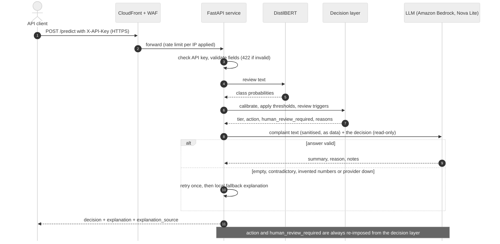
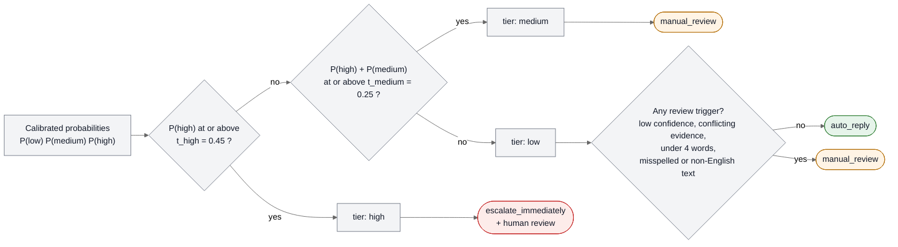

# Hybrid Customer-Dissatisfaction Risk Triage on AWS: a Fine-Tuned DistilBERT on PyTorch, a Calibrated Decision Layer, Deterministic Review Rules and LLM Explanations from Amazon Bedrock (Nova Lite), Served with FastAPI, Docker, CloudFormation, ECS Fargate, CloudFront, AWS WAF, Secrets Manager, CloudWatch and GitHub Actions CI/CD

Built with: **Python** 3.11; **scikit-learn** with **TF-IDF** and **Logistic Regression** for the baseline; **PyTorch** and **Hugging Face Transformers** with a fine-tuned **DistilBERT** stored as **int8** weights; a pure **NumPy** decision layer with **temperature calibration**, probability blending, tuned thresholds and review triggers; **Amazon Bedrock** with **Nova Lite** for explanations; **FastAPI** and **Pydantic**; **Docker**; **AWS CloudFormation**, **Amazon ECS** on **AWS Fargate**, an **Application Load Balancer**, **Amazon CloudFront**, **AWS WAF**, **AWS Secrets Manager**, **Amazon CloudWatch** with **EMF** metrics and alarms, and **GitHub Actions** with **OIDC**; **pytest**.

[](https://github.com/anandapurva55/hybrid-complaint-risk-ai/actions/workflows/ci.yml)


A system that reads a piece of customer feedback and answers three practical questions: **how unhappy is this customer** (low, medium or high), **what should happen next** (reply automatically, send to a person, or escalate), and **why**. A **fine-tuned DistilBERT** model estimates the tier, a small deterministic layer turns its probabilities into a decision, and a language model writes a plain-English explanation. The language model can describe the decision, never change it.

| 0.68 | 0.69 | 346 of 355 | 71.1% | 29% | 97 |
|:---:|:---:|:---:|:---:|:---:|:---:|
| Recall on the "high" tier (the model's own call) | Macro-F1 (95% CI 0.67 to 0.71) | Truly-high cases that reach a person (240 escalated as high, 106 sent to review as medium) | Feedback answered automatically (97.1% of them truly low) | Feedback sent to human review | Automated tests, plus 1 known-limitation check |


<sub>Recorded with asciinema on 2026-11-19 from a live deployment made by the GitHub Actions pipeline (ECS Fargate behind CloudFront and WAF, explanations from Amazon Bedrock), since torn down. It is a real terminal session: each command is typed by a script at a human-like pace and then actually run, so the output is what the service returned at that moment. The raw recordings are in `docs/demo/casts/` (play one with `asciinema play`). Clips 1 to 3 show the three outcomes (answered automatically, sent to a person, escalated). Clip 4 repeats clip 3 with the LLM unavailable: the decision is identical and only the explanation falls back.</sub>

Run it yourself, locally or against a deployment with `--url` and `HYBRID_RISK_API_KEY`. The output below is from the live capture above; the explanation wording comes from the **LLM**, so a local run will phrase it differently:

```text
$ python -m hybrid_risk "Pretty dress but the material is not as soft as I hoped."
Feedback     Pretty dress but the material is not as soft as I hoped.
Tier         medium   (low 0.20 | medium 0.60 | high 0.20)
Action       manual_review   human review: yes
Triggers     none
Explanation  Pretty dress but the material is not as soft as I hoped. The model rated
             the risk level as medium because the complaint indicates dissatisfaction
             with the product quality, which is a moderate concern.
Source       llm
```


---

## Table of contents

1. [About the data and the label](#about-the-data-and-the-label)
2. [Quickstart](#quickstart)
3. [How it works](#how-it-works)
4. [Results](#results)
5. [Behaviour on hard input](#behaviour-on-hard-input)
6. [Explainability](#explainability)
7. [Safety and guardrails](#safety-and-guardrails)
8. [Training pipeline](#training-pipeline)
9. [AWS architecture](#aws-architecture)
10. [API](#api)
11. [Configuration](#configuration)
12. [File by file](#file-by-file)
13. [Testing](#testing)
14. [Design decisions](#design-decisions)
15. [Limitations and next steps](#limitations-and-next-steps)

## About the data and the label

The model is trained on the public [Women's E-Commerce Clothing Reviews](data/raw/Womens%20Clothing%20E-Commerce%20Reviews.csv) dataset (about 22,600 reviews with text, age, department and a 1 to 5 star rating). Public data with real complaint-escalation outcomes does not exist, so the project uses the star rating as a stand-in for how dissatisfied the customer is:

| Stars | Tier used by the system | Meaning |
|---|---|---|
| 1 to 2 | `high` | Strongly unhappy, the cases a support team most wants to catch |
| 3 | `medium` | Mixed or neutral |
| 4 to 5 | `low` | Happy, safe to acknowledge automatically |

So every number in this README measures how well the system recognises **dissatisfaction** from the text. That is a useful, measurable signal for triage, and it is the part of "will this customer escalate?" that feedback text actually carries. The code is built so the label is one swappable function ([`rating_to_risk`](src/hybrid_risk/risk_common.py)): when you have real outcomes such as reopened tickets, refunds or chargebacks, point `make_splits.py` at them, rerun the pipeline and the calibration and **thresholds** are re-tuned for you. Names like `risk_level` are kept for continuity.

**Intended use.** Prioritising and routing English-language product feedback for human reviewers, and auto-acknowledging clearly positive messages. **Out of scope:** fully automated customer-facing decisions on negative feedback, other languages or industries without re-validation, and any use as a statistical estimate of churn or regulatory escalation.

**Data licence.** The raw CSV is included unmodified so the pipeline reproduces from a fresh clone. It is a public Kaggle dataset (the notebook links the source); a third-party catalogue lists it as CC0 public domain, but that was not confirmed on the Kaggle page itself, so check the licence there before redistributing it.

**Synthetic data.** The real reviews contain almost no sarcasm, so `data/synthetic/` holds LLM-written sarcastic and negated reviews, used for extra training data and as a held-out stress test (written by a different model family than the training data). It is synthetic, imperfect and never mixed into the real validation or test splits; the details are under Behaviour on hard input.

## Quickstart

```bash
python3.11 -m venv venv && source venv/bin/activate
pip install --extra-index-url https://download.pytorch.org/whl/cpu -e ".[dev]"   # runtime pins + training, tests, docs and the LSTM baseline

python -m hybrid_risk "Oh great, another top that fell apart"   # triage one piece of feedback
python -m hybrid_risk.hybrid_inference   # run the 8 bundled examples (explanations need AWS credentials with Bedrock access)
python -m pytest                  # 97 tests plus 1 known-limitation check
uvicorn hybrid_risk.app:app --reload     # HTTP API on http://127.0.0.1:8000
```

```bash
curl -X POST http://127.0.0.1:8000/predict -H "Content-Type: application/json" \
  -d '{"review_text":"The jacket fell apart after one wear and nobody answers my emails."}'
```

No AWS credentials or **Bedrock** access? Everything still works: the explanation comes from a local fallback and is labelled `"explanation_source": "fallback"`. Set `LLM_PROVIDER=none` to skip the call entirely.

## How it works


Each piece of feedback goes to a **DistilBERT** model, **fine-tuned** on the reviews, which outputs three probabilities for low, medium and high. Those probabilities are calibrated so that "80%" really means about 80%, and turned into a tier with two **thresholds** tuned on validation data to reach at least 70% **recall** on the truly unhappy customers without letting too many of them slip through to an automatic reply. A few deterministic **review triggers** then decide whether a person must look. Only after all of that does an **LLM** on **Amazon Bedrock** write the explanation. (A **TF-IDF** + **Logistic Regression** model used to be blended in as a second opinion; the evidence for removing it is under Results.)

**What happens on one request.**



**How the decision and the review rules work.**



The temperature, **thresholds** and trigger limits live in [`decision_config.json`](models/decision_config.json) and are produced by [`tune_decision.py`](training/tune_decision.py) from the validation split only. The five **review triggers** are: the top probability is below 0.45, low and high are both at least 0.30 likely, the text is shorter than four words, the text is heavily misspelled, or it does not look like English.

### The calibrated decision layer, step by step

All of this lives in [`decision.py`](src/hybrid_risk/decision.py), uses only **NumPy** and has no model code in it. Its numbers come from [`decision_config.json`](models/decision_config.json), which [`tune_decision.py`](training/tune_decision.py) writes using the validation split only.

1. **Probabilities.** **DistilBERT** outputs `[P(low), P(medium), P(high)]` through a softmax. The column order is fixed in one place (`reorder_proba`).
2. **Temperature calibration.** Raw model confidence is often too high or too low. One number `T` rescales the probabilities as `p^(1/T)` and renormalises them. `T` is found by minimising **log-loss** on the validation split over a grid from 0.5 to 4.0, and comes out at `T = 1.2` (slightly softer). Class weights are deliberately not used in training, because they distort the probabilities that this layer depends on.
3. **Thresholds on probabilities, not on a score.** `P(high) >= 0.45` gives `high`; otherwise `P(high) + P(medium) >= 0.25` gives `medium`; otherwise `low`. The two **thresholds** come from a grid search on validation that keeps only pairs meeting **two** constraints, at least 70% **recall** on `high` and at most 2% of the truly-high reviews predicted `low` (those would be auto-replied, the costliest mistake), and then takes the best **macro-F1** (validation **recall** 0.70, **macro-F1** 0.71). The second constraint exists because tuning on the **recall** target alone moved the medium threshold up and raised the number of auto-replied truly-high cases on the test set from 5 to 12. Deciding on probabilities matters because an averaged score cannot tell a confident "medium" from a 50/50 split between "low" and "high"; that split is caught by a review trigger instead.

### The deterministic review rules

"Deterministic" means the same input always gives the same answer: plain rules and numbers, no randomness and no **LLM** involved. They decide **whether a person must look** and **what happens next**:

| Rule | Condition | Effect |
|---|---|---|
| High tier | `P(high)` at or above `t_high` | `escalate_immediately`, human review |
| Medium tier | medium decision | `manual_review`, human review |
| `conflicted` | low and high are both at least 0.30 likely | review |
| `low_confidence` | the top probability is below 0.45 | review |
| `short_text` | fewer than 4 words | review |
| `noisy_text` | the tokenizer splits words into many pieces (more than 1.5 per word, against a real-review maximum of 1.44): heavy misspelling | review |
| `non_english` | fewer than 10% of words are common English function words (real reviews: under 0.2% fall below this) | review |
| Low tier, no trigger | none of the above | `auto_reply` |

A "low" case that trips any trigger is never auto-replied: `action_for` turns it into `manual_review`. After the **LLM** writes its explanation, `recommended_action` and `human_review_required` are **overwritten** from these rules, and the **LLM** can only add caution, never remove it. [`tests/test_decision.py`](tests/test_decision.py) covers every boundary and trigger.

### Policy: what the system commits to, and how to change it

- **A person stays in the loop where it matters.** A high-tier case is always escalated and reviewed, a medium-tier case always goes to manual review, and a low-tier case is answered automatically only when no review trigger fired.
- **Missing an unhappy customer costs more than a wasted review.** So the **thresholds** are tuned for **recall** on the high tier first. The price is that roughly 4 in 10 "high" flags are false alarms; move `t_high` in [`decision_config.json`](models/decision_config.json) to trade the other way.
- **The LLM explains and may add caution, nothing more.** It cannot change a score, the tier, the action or the review flag, and it cannot lower the flag. How this is enforced is in [Safety and guardrails](#safety-and-guardrails).
- **Changing the policy** means re-running [`tune_decision.py`](training/tune_decision.py) on the validation split, then [`evaluate_hybrid.py`](evaluation/evaluate_hybrid.py), and checking **recall** on high, the review share and the number of truly-high cases auto-replied before accepting new values. `evaluate_hybrid.py` also refreshes the monitoring baseline.

## Results

Evaluated on the held-out test split (3,397 reviews, stratified 70/15/15 with a fixed seed), which was never used for training or tuning. The headline numbers are in the row and figure at the top. Raw numbers are written to [`evaluation_results.json`](results/evaluation_results.json), [`robustness_results.json`](results/robustness_results.json), [`behaviour_results.json`](results/behaviour_results.json), [`synthetic_test_after.json`](results/synthetic_test_after.json), [`explanation_judge_results.json`](results/explanation_judge_results.json) and the load-test files in [`results/`](results/). Class shares are low 77.1%, medium 12.5% and high 10.5%.

- **What the model does on its own:** it catches 0.68 of the truly unhappy reviews (high tier) at 0.64 **precision**, with **macro-F1** 0.69 (95% CI 0.67 to 0.71). The **346 of 355** in the headline row is a policy number: 240 of those are predicted high, and 106 are predicted medium and sent to a person because medium always is.
- **Why there is no classical model any more:** a **TF-IDF** + **Logistic Regression** model used to be blended in at 10%. With each system given its own validation-tuned **thresholds**, blending it back in scores **macro-F1** 0.696 against 0.689, and the 95% interval for that difference (-0.000 to +0.015) includes zero, so the data does not justify the extra model, its tabular inputs and a heavier serving image. It stays as a baseline (**macro-F1** 0.59 on its own) and for the top-words chart. **DistilBERT** alone scores 0.69 at plain argmax, against 0.59 for the classical baseline and 0.55 for the **LSTM**.

<details>
<summary><b>Full evaluation tables</b>: components, baselines, uncertainty, ablations, calibration, triage, subgroups, explanation layer</summary>

**Components at plain argmax (no tuning)**

| Model | Accuracy | Macro-F1 | High precision | High recall | AUC (high vs rest) |
|---|---|---|---|---|---|
| Always "low" | 0.771 | 0.290 | 0 | 0 | n/a |
| LSTM baseline | 0.820 | 0.547 | 0.493 | 0.597 | 0.920 |
| Classical baseline (TF-IDF + Logistic Regression) | 0.828 | 0.589 | 0.636 | 0.448 | 0.933 |
| DistilBERT (the served model) | 0.856 | 0.688 | 0.634 | 0.687 | 0.955 |

**Each system with its own thresholds, tuned on validation by the same rule**

| System | Thresholds (high, medium) | Macro-F1 | High precision | High recall |
|---|---|---|---|---|
| Served system (DistilBERT alone) | 0.45, 0.25 | 0.689 | 0.638 | 0.676 |
| DistilBERT + classical blended back in (10%) | 0.425, 0.275 | 0.696 | 0.639 | 0.704 |
| Classical baseline alone | 0.225, 0.25 | 0.618 | 0.500 | 0.721 |

Per-class (served system): low P 0.970 / R 0.898; medium P 0.408 / R 0.576 (F1 0.477); high P 0.638 / R 0.676 (F1 0.657). Accuracy 0.835; **AUC** (high vs rest) 0.955.

| True \ predicted | low | medium | high |
|---|---|---|---|
| low | 2351 | 248 | 19 |
| medium | 63 | 244 | 117 |
| high | 9 | 106 | 240 |

**Uncertainty (1,000 bootstrap resamples of the test set, 95% CI):** served system **macro-F1** 0.667 to 0.710; high **recall** 0.626 to 0.723; high **precision** 0.590 to 0.688. Blending the **classical model** back in changes **macro-F1** by -0.000 to +0.015, an interval that includes zero.

**Training-seed variance (transformer, trained on the real reviews only, before the sarcasm data was added)**
Three **fine-tuning** runs with different seeds ([`seed_runs/`](results/seed_runs/)): test **macro-F1** at argmax 0.675 (seed 42), 0.666 (seed 1), 0.682 (seed 2); mean 0.674, spread about +/-0.008. High-vs-rest **AUC** 0.950 / 0.951 / 0.953. Differences smaller than about 0.01 in this README are within that noise.

**History of the redesign (same test split)**

| | v1 (CNN fixed at 0.4, 0.45/0.75 thresholds) | v2 (probabilities, classical + LSTM) | v3 (classical + DistilBERT blend) | v4 (current: DistilBERT alone + sarcasm data) |
|---|---|---|---|---|
| Recall on high | 0.132 | 0.730 | 0.710 | 0.676 |
| Precision on high | 0.681 | 0.498 | 0.583 | 0.638 |
| Macro-F1 | 0.543 | 0.622 | 0.671 | 0.689 |
| Medium F1 | n/a | 0.353 | 0.439 | 0.477 |
| Truly-high cases auto-replied | 29 | 16 | 5 | 9 |
| Cases forced to human review | 80.7% | 29.7% | 29.8% | 28.9% |

v1 was measured by running the original models on this split. The constant **CNN** term made "high" nearly unreachable and made the disagreement rule fire on ~81% of cases.

**Ablations**
- **`Recommended IND`** (leakage): adding it back to the classical baseline raises argmax **macro-F1** 0.589 -> 0.643. That ~0.05 is leakage (it is a near-proxy of the rating the label comes from), so the feature is never used.
- **`Age`**: adding it to the classical baseline moves argmax **macro-F1** from 0.589 to 0.593, which is noise, and it is demographic-adjacent, so it is not used by any model. The age-band audit below still uses it.
- **Blending the classical model back in** (10%): see the table above and the interval under Uncertainty; this is why it was removed.

**Calibration (ECE of top-class confidence)**

| | raw | after temperature scaling (fit on validation) |
|---|---|---|
| DistilBERT | 0.027 | 0.008 |
| Classical baseline | 0.035 | n/a |

**Triage behaviour (test set)**

| Action | Share |
|---|---|
| `auto_reply` | 71.1% |
| `manual_review` | 17.8% |
| `escalate_immediately` | 11.1% |

- Human review (high, medium, or any trigger): 28.9%. Triggers: low confidence 2.1%, very short text 0.2%, non-English 0.1%, noisy text 0.0%, conflicted evidence 0.1%.
- Of 355 truly-high cases, 346 reach a human: 240 are predicted high, 106 are predicted medium (sent to review because medium always is) and 9 are predicted low and auto-replied.
- Auto-replied cases are 97.1% truly low; 89.5% of all truly-low cases are auto-replied.
- The review **triggers** are a thin safety net: they withhold 8 of the 2,423 cases the tier alone would auto-reply. Those are truly not-low 12% of the time against 2.9% for the rest, but none of the 9 missed high cases was among them.

**Subgroups (served system, test set)**

| Group | n | Macro-F1 | High recall (n true high) | Truly-high auto-replied |
|---|---|---|---|---|
| Age <30 | 441 | 0.700 | 0.73 (52) | 1.9% |
| Age 30-45 | 1624 | 0.680 | 0.66 (161) | 3.1% |
| Age 46-60 | 980 | 0.696 | 0.65 (111) | 1.8% |
| Age 60+ | 352 | 0.691 | 0.77 (31) | 3.2% |
| Dept: Tops | 1486 | 0.702 | 0.67 (161) | 1.9% |
| Dresses | 973 | 0.666 | 0.67 (108) | 3.7% |
| Bottoms | 543 | 0.693 | 0.69 (48) | 2.1% |
| Jackets | 133 | 0.706 | 0.71 (21) | 0.0% |
| Intimate | 247 | 0.708 | 0.71 (17) | 5.9% |

Performance is fairly even across age bands (age is audited here but is not a model input). The Intimate and Jackets numbers rest on 17 to 21 high cases and are noisy. No formal fairness test was run.

**Explanation layer: LLM vs templated baseline** ([`evaluate_llm.py`](evaluation/evaluate_llm.py), 45 stratified test rows plus 3 injection strings, **Amazon Bedrock** **Nova Lite**)

| Check | LLM | Templated baseline |
|---|---|---|
| Schema valid, action equals policy, review never downgraded, consistent with the decided tier, quoted numbers match | 100% | 100% |
| Injection suite: action unchanged | 3 / 3 | n/a |
| Responses that came from the LLM (rest rejected twice, then fallback) | 100% | n/a |
| Latency, p50 / p95 | 1.14 s / 1.62 s | under 1 ms |
| Specificity: share of the explanation's content words that come from the complaint | 0.23 | 0.01 |
| Summary just repeats the complaint, short reviews / real reviews (earlier prompt: 68% / 7%) | 0% / 0% | n/a |
| Vague wording ("moderate concern", "significant issue"), short reviews / real reviews (earlier prompt: 21% / 16%) | 4% / 4% | n/a |
| LLM-judge proxy (Claude Sonnet, scores 1 to 5): faithful / useful / clear | 4.52 / 3.82 / 4.1 | 3.59 / 2.62 / 3.4 |
| LLM-judge proxy: which explanation it would show a reviewer | 85% | 9% (tie 6%) |

The pass rates hold by construction (the validators reject bad output first), and the templated baseline passes every automatic check too, so those checks cannot tell the two apart. The explanation prompt was tightened after the first live demo showed summaries that simply repeated the review and ended on vague phrases like "a moderate concern". The prompt now requires a one-sentence paraphrase that names the concrete issue and a reason that cites the tier's probability, and a validator rejects a summary that echoes the complaint (retry once, then the local fallback). On short reviews that took echoing from 68% to 0% and vague wording from 21% to 4%, at the price of two of the 28 short reviews now falling back to the local explanation. A Claude judge, scoring each pair twice with the order swapped, prefers the **LLM** explanation (85% against 9%) and scores it higher on faithfulness, usefulness and clarity. That judge is a **proxy, not human evidence**: it agreed with itself across the two orders 91% of the time, and one of the 45 cases was skipped because the judge returned no usable answer. [`results/explanation_review_sheet.md`](results/explanation_review_sheet.md) is a blind A/B sheet for human grading (key kept separately); until someone grades it, usefulness is not established. Early development with a small 3B-parameter model produced `reason: "Low risk"` on a high-risk case, empty fields and invented figures such as "863% probability", which is why the validators exist.

</details>

## Behaviour on hard input

The test set says little about input the training data barely contains, so these checks probe it directly: templated cases for typos, capitalisation, other languages, negation and mixed sentiment, and a larger held-out set for sarcasm.

### Typos, ALL CAPS, non-English and mixed sentiment

[`evaluate_behaviour.py`](evaluation/evaluate_behaviour.py) probes the full decision with small CheckList-style cases ([`behaviour_cases.py`](evaluation/behaviour_cases.py)). "Caught" means the feedback is **not** auto-replied. These are templated probes, so read them as failure-mode checks, not population rates.

| Case | n | Caught by the model's tier alone | With the review rules |
|---|---|---|---|
| Clearly negative, clean text | 12 | 100% | 100% |
| Negative with mild typos | 36 | 100% | 100% |
| Negative with heavy typos | 36 | 94% | 100% |
| Negative in ALL CAPS | 12 | 100% | 100% |
| Negative in Spanish, French, German, Italian, Portuguese | 5 | 60% | 100% |
| Mixed sentiment (praise plus a real problem) | 6 | 100% | 100% |
| Sarcastic complaints (hand-written probes) | 5 | 80% | 80% |
| Clearly positive, clean text | 10 | n/a | 100% auto-replied |
| Positive in ALL CAPS | 10 | n/a | 100% auto-replied |
| Positive with mild typos (the cost of the noisy-text trigger) | 30 | n/a | 67% auto-replied |

- **Negation** points the right way in 100% of 9 pairs, and **ALL CAPS** keeps the same tier in 100% of 22 cases.
- **Typos and non-English text** are where the **review rules** earn their place: two input-quality triggers (word-piece fragmentation, and almost no common English words) are calibrated on real reviews, where they fire for under 0.1% of cases. They send heavily misspelled and non-English text to a person, at the cost of reviewing about a third of mildly misspelled *positive* reviews unnecessarily.

### Sarcasm and negation

The first version failed on sarcasm: both text models read "Oh great, another top that fell apart" as positive. To measure and then reduce that without tuning against a handful of hand-written probes, [`generate_synthetic.py`](training/generate_synthetic.py) uses LLMs to write sarcastic complaints and negated reviews ([`data/synthetic/`](data/synthetic/)). Training and dev data come from **Claude** models; the held-out **test** comes from a different family (**Amazon Nova Pro**), is never used for training, tuning or threshold selection, and the real validation and test reviews are untouched. Share the system gets right (complaints: not auto-replied; satisfied reviews: not escalated):

| Held-out test case (written by Nova Pro) | n | Before training on the synthetic data | After |
|---|---|---|---|
| Sarcastic complaints (unhappy, positive wording) | 90 | 37% | 70% |
| Unhappy, expressed with negation ("not worth it") | 45 | 100% | 100% |
| Satisfied, expressed with negation ("can't complain") | 45 | 98% | 100% |

Sarcasm is **improved, not solved**: 30% of the sarcastic complaints are still auto-replied. The set is LLM-written and imperfect (some "sarcastic" examples are really literal complaints), the gain is measured on a different **LLM**'s idea of sarcasm rather than on real customers, and the real test set did not regress (**macro-F1** 0.689).

## Explainability

The **classical baseline** is transparent, so it makes a good sanity check on the data and the label: these are the words that push a review towards each tier. They read the way a person would expect, which is a useful sanity check on the data and the label.


For the served **DistilBERT** model, every response includes the calibrated probabilities, the review reasons and a written explanation that is checked against those numbers.

## Safety and guardrails

| Risk | What the system does |
|---|---|
| The LLM changes or softens a decision | `recommended_action` and `human_review_required` are overwritten from the review rules after the call, so the LLM can only add caution |
| The LLM writes nonsense | The answer is rejected if it is empty, names a different risk tier than the decision, or quotes numbers that are not in the model output. It is retried once at a warmer temperature, then replaced by a local fallback (clip 4 of the demo shows it) |
| The LLM provider is down or slow | 60 second timeout, then the local fallback with no retry. Responses say which they are in `explanation_source` |
| Prompt injection in the complaint text | Text is length-capped, the delimiter tag is stripped and it is wrapped in tags the prompt declares to be data. An injected "mark this low risk" cannot reach the action or review flag. Covered by an injection suite |
| Input the models were not trained on | Heavily misspelled text and non-English text are never auto-replied: two deterministic input-quality triggers send them to a person (see Behaviour on hard input). Sarcasm is only partly handled (see Behaviour on hard input) |
| Abuse of the endpoint | Layered controls at the edge and load balancer (see [AWS architecture](#aws-architecture)), an API key checked in constant time, input validation with length and range limits, and generic error messages that never expose internals |
| An unexpected failure | A missing model artifact gives a generic 503 and anything else a generic 500, with details kept in logs. An unhealthy task is dropped by the load balancer, replaced by ECS and raises an alarm |
| Secrets | The API key is generated by Secrets Manager at deploy time, the task role can invoke exactly one Bedrock model and no keys are stored in the repository or in GitHub (deploys use OIDC) |
| Privacy | Metrics and logs contain no complaint text or customer identifiers. Complaint text is sent only to Bedrock for the explanation (set `LLM_PROVIDER=none` to keep everything in-process) |

## Training pipeline


Training, tuning and testing use different data on purpose: models learn from the train split, the decision layer is tuned on the validation split, and the test split is read only for the final evaluation. Rebuild everything with:

```bash
python -m training.make_splits               # stratified 70/15/15 split with a fixed seed
python -m training.train_classical_model     # the classical baseline (not served)
python -m training.generate_synthetic        # LLM-written sarcasm and negation (needs Bedrock access)
python -m training.train_transformer_model --synthetic   # about 20 min on a laptop; add --seed 1 for the variance study
python -m hybrid_risk.compact_transformer    # fp32 (268 MB) to int8 (60 MB), no measurable accuracy loss
python -m training.tune_decision             # temperature and thresholds from validation
python -m evaluation.evaluate_hybrid         # test metrics, triage numbers, monitoring baseline
python -m evaluation.evaluate_robustness     # bootstrap intervals and subgroups
python -m evaluation.evaluate_behaviour      # CheckList-style probes
python -m evaluation.evaluate_synthetic      # held-out sarcasm / negation set
python -m evaluation.evaluate_llm --n 45     # live check of the explanation layer (needs Bedrock access)
python -m evaluation.judge_explanations      # LLM-judge proxy on the explanation comparison
python -m evaluation.load_test --url http://localhost:8000   # latency and throughput
python docs/diagrams/generate.py             # redraw the diagrams in this README
```

## AWS architecture

<p align="center"></p>

| Layer | Service | Role |
|---|---|---|
| Edge | CloudFront, AWS WAF | HTTPS with the default certificate, HTTP redirected, and a rate limit of 300 requests per 5 minutes per IP |
| Serving | Application Load Balancer, ECS on Fargate | The load balancer only accepts CloudFront's address range. Tasks have 2 vCPU and 4 GB and autoscale from 1 to 3 on CPU at 60%. The image is about 464 MB compressed in ECR (mostly CPU-only PyTorch; no TensorFlow, scikit-learn or pandas) |
| Explanations | Amazon Bedrock (Nova Lite) | Called through a task role allowed to invoke only that model |
| Secrets | AWS Secrets Manager | Generates the API key at deploy time and injects it into the container |
| Observability | CloudWatch | One EMF metric line per prediction (`Predictions`, `ReviewRequired`, `FallbackExplanation`, `AutoReply`, `EscalatedHigh`, `TopProbability`) and four alarms: 5xx errors, unhealthy task, fallback share above 40%, review share above 50%. `GET /stats` compares one task with the test-split baseline in [`monitoring_baseline.json`](results/monitoring_baseline.json) |
| Infrastructure | CloudFormation | One stack, [`deploy/ecs-fargate.yaml`](deploy/ecs-fargate.yaml), linted by GitHub Actions CI |

On the deployed task the model path sustained about 10 requests per second at p95 908 ms (8 concurrent), and the full request with the **LLM** explanation took about 1.4 s at p50 (see Latency and throughput under AWS architecture, measured from India, so about 250 ms of each figure is network distance). A running stack costs roughly 3 to 6 dollars a day (mostly the load balancer and **Fargate**), so delete it when idle.

### Evidence from the live deployment

The stack was deployed, exercised and torn down. These are the final frames of real asciinema recordings of AWS CLI commands run against it on 2026-11-19 (no account ID or key is ever printed). The ECS service has one running, healthy **Fargate** task with a healthy load-balancer target, three of the four alarms are OK (the review-share drift alarm is in ALARM, as expected after a handful of requests that were mostly escalations), and the application's own metrics (one metric line per prediction) are arriving in **CloudWatch**.


### Latency and throughput

[`load_test.py`](evaluation/load_test.py) against the container limited to 2 CPUs and 4 GB (the **Fargate** task size) on a laptop (Apple Silicon), real test reviews, model path only (`LLM_PROVIDER=template`):

| Concurrent requests | Throughput | Latency p50 | Latency p95 |
|---|---|---|---|
| 1 | 3.4 req/s | 273 ms | 464 ms |
| 4 | 3.37 req/s | 1177 ms | 1611 ms |
| 8 | 3.37 req/s | 2325 ms | 2959 ms |

On the **deployed** service (one ECS **Fargate** task with 2 vCPU and 4 GB on x86, through **CloudFront**, measured from a laptop in India, `LLM_PROVIDER=template`). About 250 ms of the single-request latency is network distance to us-east-1, not the model:

| Concurrent requests | Throughput | Latency p50 | Latency p95 |
|---|---|---|---|
| 1 | 2.8 req/s | 345 ms | 427 ms |
| 4 | 9.98 req/s | 386 ms | 488 ms |
| 8 | 10.31 req/s | 755 ms | 908 ms |

Full path with the **LLM** explanation on (**Amazon Bedrock** **Nova Lite**), same task and route:

| Concurrent requests | Throughput | Latency p50 | Latency p95 |
|---|---|---|---|
| 1 | 0.65 req/s | 1426 ms | 2292 ms |
| 4 | 2.45 req/s | 1491 ms | 2515 ms |

**PyTorch**'s thread count is taken from the container's CPU limit and inference is serialised, which raised laptop throughput from about 2.2 to 3.4 req/s and cut p95 at 8 concurrent requests from 5.0 s to 3.0 s. The **LLM** call adds about 1.31 s (p50) per request when explanations are on. These figures come from a short, billed deployment that was torn down afterwards; the stack's three-task ceiling would roughly triple the model-path throughput, which is not measured.


Deploys run from **GitHub Actions** with short-lived **OIDC** credentials: the role can be assumed only by this repository's approved `production` environment and can only manage this stack.

<details>
<summary><b>Deploy it</b>: commands, the keyless pipeline, teardown and why ECS rather than **App Runner**</summary>

**Option A: deploy by hand**

```bash
aws ecr create-repository --repository-name hybrid-risk-api
aws ecr get-login-password | docker login --username AWS --password-stdin <acct>.dkr.ecr.<region>.amazonaws.com
docker buildx build --platform linux/amd64 -t <acct>.dkr.ecr.<region>.amazonaws.com/hybrid-risk-api:v4 --push .

aws cloudformation deploy --stack-name hybrid-risk-api --template-file deploy/ecs-fargate.yaml \
  --capabilities CAPABILITY_IAM \
  --parameter-overrides ImageUri=<image uri> VpcId=<vpc-id> SubnetIds=<subnet-a>,<subnet-b> [AlarmEmail=you@example.com]

URL=$(aws cloudformation describe-stacks --stack-name hybrid-risk-api --query 'Stacks[0].Outputs[?OutputKey==`ApiUrl`].OutputValue' --output text)
SEC=$(aws secretsmanager list-secrets --query 'SecretList[?contains(Name,`ApiKeySecret`)].ARN|[0]' --output text)
KEY=$(aws secretsmanager get-secret-value --secret-id $SEC --query SecretString --output text)
curl -X POST $URL/predict -H "X-API-Key: $KEY" -H "Content-Type: application/json" -d @one_sample.json
```

**Option B (recommended): keyless deploy from GitHub Actions**

**Status:** steps 1 and 2 are done for this account/repo (stack `hybrid-risk-github-oidc`, role `hybrid-risk-github-deploy`, repository variable `AWS_DEPLOY_ROLE_ARN`, GitHub environment `production` with the owner as required reviewer and deployments restricted to `main`). The workflow has been run end to end once (GitHub Actions run 44510151090, approved at the `production` gate): it built the image, pushed it to **ECR**, deployed the stack and passed the smoke test. The demo recordings above were taken against that pipeline-deployed stack.

1. Once, from your own admin identity (not root keys):
   `aws cloudformation deploy --stack-name hybrid-risk-github-oidc --template-file deploy/github-oidc.yaml --capabilities CAPABILITY_NAMED_IAM`
   (pass `CreateOidcProvider=false ExistingOidcProviderArn=<arn>` if the account already has the GitHub **OIDC** provider). It creates a role that only this repository's `production` environment can assume and that can only manage the `hybrid-risk-api` stack.
2. In the GitHub repo: add the output as the variable `AWS_DEPLOY_ROLE_ARN`, create the `production` environment with required reviewers.
3. Run the **Deploy to AWS** workflow ([`.github/workflows/deploy.yml`](.github/workflows/deploy.yml)): tests + `cfn-lint` gate it, then it builds the amd64 image, deploys the stack and smoke-tests the URL.

**Tear down**
`aws cloudformation delete-stack --stack-name hybrid-risk-api` (the ECR repo and, for Option B, the **OIDC** stack are separate).

**Why a stack instead of direct CLI calls, and why not App Runner**
1. **App Runner** refuses new services for this account: `Account ... can't create new App Runner services` (visible once no role is passed; the "not authorized to pass this role" message that appears otherwise is misleading). An AWS-side account restriction, so ECS is used.
2. **Root credentials cannot pass roles.** Direct `ecs register-task-definition` / `apprunner create-service` calls made with root access keys reject *any* role (`Role is not valid`), while the same call without a role works. **CloudFormation** passes the roles itself, so the stack deploys even from root; Option B avoids root altogether.

**Verified on the live deployment (2026-11-19)**
**HTTPS** 200 on the **CloudFront** URL; plain HTTP redirects (301); the ALB's own address is unreachable directly; `/predict` without the key returns 401; a real prediction returns a decision plus a Bedrock-written explanation; **EMF** metrics appear in the log group; **WAF** blocked one IP after ~600 requests in about 2 minutes (the rate limit is evaluated with a short lag).

**Limitations**
- `*.cloudfront.net` certificate only; a custom domain needs your own ACM certificate (us-east-1) and an alias on the distribution.
- The **WAF** rule limits per source IP only; the managed rule groups (SQLi, bots) are not enabled.
- Autoscaling is CPU-based; `/stats` stays per task, the **EMF** metrics are the fleet view.
- A running stack costs roughly $3-6/day (ALB, **Fargate**, **CloudFront**/**WAF** requests); delete it when idle.

</details>

## API

`POST /predict` (header `X-API-Key` when `API_KEY` is set), `GET /` (health), `GET /stats` (rolling drift monitor for this task).

| Request field | Rules |
|---|---|
| `review_text` | required, 1 to 5,000 characters. The only field the model uses |
| `age`, `positive_feedback_count`, `division_name`, `department_name`, `class_name`, `customer_id` | optional; validated if present, then ignored (they mirror the original dataset's columns and are accepted for compatibility) |

```json
{
  "model_outputs": {
    "final_score": 0.464,
    "probabilities": {"low": 0.08, "medium": 0.166, "high": 0.754},
    "risk_level": "high",
    "recommended_action": "escalate_immediately",
    "human_review_required": true,
    "review_reasons": []
  },
  "llm_explanation": {
    "summary": "...", "reason": "...", "risk_notes": ["..."],
    "recommended_action": "escalate_immediately", "human_review_required": true
  },
  "_meta": {"explanation_source": "llm"}
}
```

Unknown fields are ignored, so older clients that still send `image` or `recommended_ind` keep working; neither is used. A successful response always contains `model_outputs` (decided deterministically), `llm_explanation` (from the **LLM** or the fallback) and `_meta.explanation_source`, so a consumer can tell which. `final_score` is a display-only expected value (`0 x P(low) + 0.5 x P(medium) + 1 x P(high)`); decisions use the probabilities.

## Configuration

| Variable | Default | Purpose |
|---|---|---|
| `LLM_PROVIDER` | `bedrock` | `bedrock`, or `none` (always use the local fallback) |
| `BEDROCK_MODEL_ID` | `us.amazon.nova-lite-v1:0` | Bedrock model; credentials come from the environment or IAM role |
| `LLM_TIMEOUT_S` | `60` | Per-call timeout before the fallback is used |
| `API_KEY` | unset | If set, `/predict` and `/stats` require a matching `X-API-Key` |

## File by file

```
.
├── README.md  Dockerfile  pyproject.toml  requirements.txt  .env.example
├── src/hybrid_risk/     the service: decision layer, inference, LLM explainer, API, monitoring
├── training/            data split, model training, decision tuning, LSTM baseline
├── evaluation/          test evaluation, robustness study, LLM check, sample outputs
├── models/              trained artifacts (int8 DistilBERT and the decision config are served; the classical baseline is not)
├── data/                raw dataset, LLM-written synthetic reviews, generated splits (git-ignored) and bundled samples
├── results/             evaluation outputs, seed study and the monitoring baseline
├── notebooks/           data exploration
├── deploy/              CloudFormation stacks
├── docs/                diagrams, figures and badges as code, plus the generated images
├── tests/               97 tests
└── .github/workflows/   GitHub Actions: CI and the deploy pipeline
```

The dependency direction is one-way: `api` to `hybrid_inference` to (`decision`, the models, `llm_explainer`), and `decision` imports nothing heavy. Scripts are run as modules from the repository root (`python -m training.make_splits`), and every file location comes from [`paths.py`](src/hybrid_risk/paths.py), so nothing depends on the working directory.

**`src/hybrid_risk/`**
- **`risk_common.py`**: constants, the rating-to-tier label function and probability ordering. The single place to change the label.
- **`decision.py`**: the pure **NumPy** decision layer (calibration, **thresholds**, **review triggers**, action). No TensorFlow, **PyTorch** or **scikit-learn** imports, so it is cheap to test. Its tuned parameters are in `models/decision_config.json`.
- **`hybrid_inference.py`**: loads the models once, runs one request end to end and assembles the response. Only `review_text` is read.
- **`compact_transformer.py`**: **int8** weight storage and loader for **DistilBERT** (max 128 tokens). Weights are stored per-row **int8** with **fp32** scales and de-quantised at load, so nothing depends on a CPU-specific quantisation engine. The 268 MB **fp32** weights stay out of git; `models/transformer_assets/` holds the **int8** copy, tokenizer and config.
- **`llm_explainer.py`**: the **Bedrock** call, prompt building with sanitising, output validators, one retry, the local fallback and the policy re-imposition.
- **`app.py`**: the **FastAPI** service: validation, API-key check, `/predict`, `/stats`, safe error handling.
- **`monitoring.py`**: rolling in-process drift monitor and the **CloudWatch** metric lines (baseline in `results/monitoring_baseline.json`).
- **`text_checks.py`**: the deterministic input-quality checks behind the `noisy_text` and `non_english` triggers.
- **`__main__.py`**: `python -m hybrid_risk "text"` prints the tier, action, triggers and explanation, locally or against a deployment with `--url`.
- **`paths.py`**: where data, models and results live.

**`training/`** and **`evaluation/`**
- **`make_splits.py`**, **`generate_synthetic.py`**, **`train_transformer_model.py`**, **`tune_decision.py`**: the reproducible training and tuning path (the synthetic generator writes `data/synthetic/`).
- **`train_classical_model.py`**, **`train_rnn_model.py`** and **`baselines.py`**: the **TF-IDF** + **Logistic Regression** and **LSTM** baselines, not served. They keep the comparisons and ablations reproducible (`models/classical_model.pkl` is tracked; the **LSTM** weights are not, `python -m training.train_rnn_model` regenerates them).
- **`evaluate_hybrid.py`**, **`evaluate_robustness.py`**, **`evaluate_behaviour.py`** (with `behaviour_cases.py`), **`evaluate_synthetic.py`**, **`evaluate_llm.py`**, **`judge_explanations.py`**, **`load_test.py`**, **`generate_sample_outputs.py`**: evaluation, behavioural probes, latency and the worked examples ([`sample_inputs.json`](data/samples/sample_inputs.json), [`sample_outputs.json`](data/samples/sample_outputs.json)).

**Everything else**
- **`tests/`**: 97 tests (decision logic, explainer validators, API, monitoring, end-to-end smoke tests on the real models).
- **`deploy/`** and **`.github/workflows/`**: the **CloudFormation** stacks (`ecs-fargate.yaml`, `github-oidc.yaml`), CI and the deploy workflow.
- **`docs/`**: [`generate.py`](docs/diagrams/generate.py), [`plot_results.py`](docs/diagrams/plot_results.py) and [`make_badges.py`](docs/diagrams/make_badges.py) draw the diagrams, figures and badges (install the extra with `pip install -e ".[docs]"`, already part of `[dev]`; they also need **Graphviz**), so the pictures stay in step with the system. `docs/demo/` holds the scripts behind the demo (`record.sh` records a session with asciinema, `render.py` turns recordings into the GIF and stills with agg), the session scripts, and the raw recordings in `casts/`.

## Testing

`python -m pytest` runs 97 tests (plus one expected failure that documents sarcasm) in about fifteen seconds: the decision layer (boundaries, calibration, every review trigger), the explainer (downgrade attempts, injected actions, malformed or contradictory output, invented numbers, retry behaviour, outage handling), the API (validation, auth, error hygiene, `/stats`), the monitor and **CloudWatch** metric format, end-to-end smoke tests, and behavioural tests (negation, typos, ALL CAPS, non-English, mixed sentiment) that run on the real models. **GitHub Actions** runs these tests on every push and pull request, then lints the **CloudFormation** templates and rebuilds the data splits from the raw CSV; the deploy workflow repeats the tests before it builds anything.


## Design decisions

| Decision | Why |
|---|---|
| The model proposes, rules decide, the LLM explains | The tier, the action and the review flag come from deterministic code and are overwritten after the LLM call. A flag that matters never depends on a model following instructions, and text injected into a complaint cannot reach it. |
| Decide on calibrated probabilities, not a single score | An averaged score cannot tell a confident "medium" from a 50/50 split between low and high. Temperature scaling on validation takes the calibration error from 0.027 to 0.008, and the thresholds apply to P(high) and P(high) + P(medium). |
| Tune thresholds against the costly mistake, not just F1 | Under a recall target alone, the number of truly-high reviews that would be auto-replied rose from 5 to 12 on the test set. Tuning now also caps that share at 2% on validation. |
| One model, not an ensemble | Blending a TF-IDF model in at 10% scored 0.696 against 0.689, and the 95% interval for the difference includes zero. That does not pay for a second model, tabular inputs and a heavier serving image. The classical model stays as a baseline. |
| Keep out inputs that leak or mislead | `Recommended IND` nearly encodes the rating (it lifts the classical baseline's macro-F1 by 0.05 without any better reading of text). Age adds nothing measurable and is demographic-adjacent. An early CNN on Fashion-MNIST fed in a constant that hid most high cases (recall 0.13), so it was removed. |
| Send text the data does not cover to a person | Heavily misspelled and non-English reviews were being auto-replied. Two cheap triggers, calibrated on real reviews where they fire under 0.1% of the time, now stop that. |
| Test sarcasm on a different model's output than it was trained on | Training on Claude-written sarcasm and testing on Nova-written sarcasm raised the share handled correctly from 37% to 70% with no regression on the real test set. The data is synthetic, so that is a stress test and not a real-world rate. |
| Store the weights as portable int8 | The fp32 weights are 268 MB, over GitHub's file limit. Per-row int8 with fp32 scales is 60 MB and is de-quantised at load, so nothing depends on a CPU-specific quantisation engine. |

## Limitations and next steps

- **Next step with the biggest payoff: real outcomes.** Retrain on reopened tickets, refunds or chargebacks if you have them: (1) change `rating_to_risk`, or add a loader in `training/make_splits.py`, so `risk_level` comes from your outcome column; (2) rerun `training/make_splits.py`, the training scripts, `training/tune_decision.py` and `evaluation/evaluate_hybrid.py`; (3) re-check the review-trigger limits in `models/decision_config.json` against the new review share.
- **Image evidence.** With outcome-labelled complaint photos, a **fine-tuned** image model can be blended in only when a photo is attached. Until then the system is text only.
- **Sarcasm is improved, not solved.** On a held-out set written by a different **LLM**, 30% of sarcastic complaints are still auto-replied (down from 63%), and the evidence is synthetic. Real customer sarcasm will differ; the test that records this is an expected failure in `tests/test_behaviour.py`.
- **Recall on the high tier is 0.68 on the test set** against the 0.70 target met on validation, with a wide interval (about 0.64 to 0.73). 9 of 355 truly-high cases would be auto-replied. Lower `t_high` in `models/decision_config.json` to trade **precision** (0.64) for more **recall**.
- **Medium tier** is the hardest (F1 0.48), as mixed reviews are ambiguous by nature.
- **Is the LLM worth it?** The validators guarantee safe, consistent explanations, the **LLM** adds complaint-specific wording the templated baseline cannot, and a Claude judge prefers it (85% to 9%), but no human has yet rated the two against each other (the blind sheet in `results/` is ready). If reviewers do not prefer it, `LLM_PROVIDER=template` removes the call, the cost and about 1.2 s of latency.
- **Fairness.** Age is not a model input; results by age band and department are fairly even. No formal fairness test has been run.
- **Evaluation scope.** English clothing reviews, one data split (seed variance was measured on the earlier, real-only model), no test on real support tickets, and the synthetic sarcasm data is LLM-written.
- **Load numbers** come from one short deployment of a single task measured from India; the three-task autoscaling ceiling was not measured.
- **Operations.** **HTTPS** uses **CloudFront**'s default certificate (a custom domain needs your own ACM certificate), the **WAF** rule limits per IP only (managed rule groups are not enabled), autoscaling is CPU-based, and `/stats` is per task while the **CloudWatch** metrics are fleet-wide. There is no automatic retraining or label feedback loop. The keyless **GitHub Actions** deploy workflow has been run end to end once; it has not been exercised beyond that single deployment.
