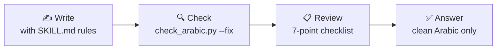

<div align="center">

```text
 ____   _  _                                      _
/ ___| (_)| |__    __ _ __      __   __ _  _   _ | |__
\___ \ | || '_ \  / _` |\ \ /\ / /  / _` || | | || '_ \
 ___) || || |_) || (_| | \ V  V /  | (_| || |_| || | | |
|____/ |_||_.__/  \__,_|  \_/\_/    \__,_| \__, ||_| |_|
                                           |___/
```

# سيبويه · Sibawayh: Arabic writing skill and grammar checker for AI agents

**Your AI writes Arabic. Sibawayh makes it _correct_ Arabic.**

An open-source Agent Skill (`SKILL.md`) and Arabic spelling, grammar and punctuation checker. It makes Claude Code, Cursor, GitHub Copilot and other AI coding agents write correct, natural Modern Standard Arabic (MSA, فصحى), and check it before they answer.

<p dir="rtl"><b>سيبويه</b> مهارة مفتوحة المصدر لوكلاء الذكاء الاصطناعي (Agent Skill)، ومدقّق إملائي ونحوي للغة العربية. تجعل Claude Code وCursor وGitHub Copilot وغيرها تكتب العربية الفصحى سليمةً وطبيعية، ثم تراجعها قبل الإجابة: الهمزات والإملاء وعلامات الترقيم والنحو والأسلوب واتجاه النص من اليمين إلى اليسار.</p>

[](LICENSE)
[](#-run-the-checker-yourself)
[](#-run-the-checker-yourself)
[](skills/arabic-writing/SKILL.md)
[](#-install)
[](evals/full_eval.md)


[Install](#-install) · [How it works](#-how-it-works) · [What it catches](#-what-it-catches) · [Checker](#-run-the-checker-yourself) · [FAQ](#-faq) · [Contribute](#-contribute)

</div>

---

## 🤔 Why AI-generated Arabic needs checking

Ask ChatGPT, Claude or any other AI model for Arabic and you get text that is *understandable*, but that a native reader spots in a second:

| What goes wrong | Looks like |
|---|---|
| English grammar in Arabic words | تم إنشاء الملف من قبل المستخدم |
| Broken agreement | الملفات الذين تم رفعهم موجودين |
| Wrong number–noun gender | ثلاث مهندسين |
| Wrong hamza | إستخدام، الى |
| English punctuation | نعم, ولكن? |
| Scrambled RTL | lines starting with an English word flip direction |
| Dialect slipping into formal text | عشان، بدي، هيك |

Sibawayh is named after **سيبويه**, the 8th-century scholar whose *al-Kitāb* is the foundational book of Arabic grammar. It gives the agent the rules, a checker and a review checklist, so that its Arabic reads as if a careful native writer wrote it.

## ✨ Before and after: AI Arabic with and without Sibawayh

<div align="center">

<br><sub>Real Claude Code outputs for the same prompt, with and without the skill.</sub>
</div>

<table>
<tr><th>✗ Typical AI output</th><th>✓ With Sibawayh</th></tr>
<tr>
<td dir="rtl">

تم إستخدام الأداة من قبل الفريق, وهاذا ساعدنا كثيرا.<br>
لدينا 3 ملفات و٤ مجلدات.<br>
الملفات الذين تم رفعهم موجودين هنا

</td>
<td dir="rtl">

استخدم الفريق الأداة، وهذا ساعدنا كثيرًا.<br>
لدينا 3 ملفات و4 مجلدات.<br>
الملفات التي رُفعت موجودة هنا

</td>
</tr>
</table>

<details>
<summary><b>See what the checker reported on the left-hand text</b></summary>

```
1:1   INFO   translationese-density  Translationese density 15.8 per 100 words (تم/يتم: 2, من قبل: 1) …
1:4   ERROR  hamza-wasl    Hamzat al-wasl: write a bare alif, not إ (form X masdar)  → استخدام
1:32  FIX    punct-latin   Latin punctuation between Arabic words  → ،
1:34  ERROR  misspelling   Misspelling (no alif after ها)  → وهذا
2:16  WARN   digit-mix     Mixed digit systems; this text uses Western (0-9) digits  → 4
```

The script finds nothing on line 3: a regex can't reliably catch agreement with non-human plurals. That line gets fixed in the model's checklist review. This is exactly the split Sibawayh is designed around.

</details>

## ⚙️ How it works



1. **Write.** The skill loads whenever the agent is about to produce Arabic: answers, docs, emails, posts, translations, summaries, UI strings and commit messages. While writing, the agent follows the rules in `SKILL.md`: verb-first active sentences, correct agreement and numbers, Arabic punctuation, one digit system, and RTL-safe lines.
2. **Check.** It runs a tiny Python script with no dependencies. The script auto-fixes what is certain and flags the rest.
3. **Review.** It works through a prioritized checklist: agreement, numbers, case endings, إنّ/أنّ, translationese, register, formatting. It changes only what is wrong.
4. **Answer.** The user gets clean Arabic, with no checker noise.

> **🛡️ Golden rule: never over-correct.**
> Forms that purists reject but the Cairo Arabic Language Academy approved are never flagged. Examples: يعتبر، ساهم في، أكد على، في نفس الوقت، أبحاث. Contested forms are left alone, and auto-fixes run only where they can't be wrong.

## 🎯 What it catches

| | Area | Examples | Handled by |
|---|---|---|---|
| ✏️ | Punctuation | `,` `?` `;` → ، ؟ ؛, spacing | 🤖 checker (auto-fix) |
| 🔤 | Unicode | Persian ک/ی, presentation forms, tatweel | 🤖 checker |
| 📝 | Spelling | إستخدام, هاذا, الى, الاطفال, المدرسه, المصرى, و الكتاب, لايوجد | 🤖 checker (word lists + frequency lexicons) |
| 🔢 | Digits and RTL | mixed 3 / ٣, lines that flip direction | 🤖 checker |
| 🗣️ | Dialect leakage | عشان, بدي, هيك in formal text | 🤖 checker |
| ⚖️ | Verb endings | لم يكونون, لن يذهبون, سوف لن | 🤖 checker + 🧠 checklist |
| 🧮 | Agreement and numbers | non-human plurals, العدد والمعدود (ثلاث ملفات → ثلاثة ملفات) | 🤖 checker (numbers 3–10) + 🧠 checklist + 📚 tables |
| 🌐 | Translationese | تم + masdar, قام بـ, من قبل, كـ "as a"; idioms translated word for word (يصنع الفرق) | 🤖 density and idiom list + 🧠 checklist |
| 💻 | Tech terms | واجهة برمجة التطبيقات (API) | 📚 glossary (450+ terms) |

## 📦 Install

### Claude Code

```
/plugin marketplace add anasAsh/Sibawayh
/plugin install arabic-writing@sibawayh
```

That's it. The skill now loads by itself whenever Claude writes Arabic.

<details>
<summary>Prefer a manual install?</summary>

```bash
git clone https://github.com/anasAsh/Sibawayh.git
cd Sibawayh
ln -s "$PWD/skills/arabic-writing" ~/.claude/skills/arabic-writing
# or: cp -r skills/arabic-writing ~/.claude/skills/
```

From a shell, the plugin commands are `claude plugin marketplace add anasAsh/Sibawayh` and `claude plugin install arabic-writing@sibawayh`.

</details>

### Cursor, GitHub Copilot and other agents

Copy `skills/arabic-writing/` into your tool's skills folder; check its documentation for the path. The skill uses the standard `SKILL.md` format. If an agent has no shell, it falls back to the checklist alone.

## 🔍 Run the checker yourself

It needs Python 3.8 or later and nothing else.

```bash
python3 skills/arabic-writing/scripts/check_arabic.py file.md          # report findings
python3 skills/arabic-writing/scripts/check_arabic.py --fix file.md    # print text with safe fixes applied
python3 skills/arabic-writing/scripts/check_arabic.py --json -         # JSON findings from stdin
```

| Severity | Meaning |
|---|---|
| `fix` | certain; applied by `--fix` |
| `error` | almost always wrong |
| `warn` | probably wrong; check the context |
| `info` | style or consistency note |

<details>
<summary>More options</summary>

- `--digits western|arabic|auto` sets the expected digit system. The default, `auto`, follows the majority in the text.
- Exit code: `1` when findings above `info` remain, otherwise `0`.
- Never touched: code blocks, inline code, URLs, file paths, emails, YAML front matter, Qur'an quotes in ﴿…﴾, and anything between `<!-- arabic-check: off -->` and `<!-- arabic-check: on -->`.

</details>

## 🗂️ What's inside

```
skills/arabic-writing/
├── SKILL.md                  writing rules, workflow, checklist
├── references/
│   ├── grammar.md            agreement, numbers, case endings
│   ├── orthography.md        hamza, ة/ه, ى/ي, punctuation, digits, RTL
│   ├── style.md              translationese → natural Arabic
│   ├── common-errors.md      قل ولا تقل
│   ├── approved-forms.md     never "fix" these
│   └── glossary.md           450+ tech terms, English → Arabic
└── scripts/
    ├── check_arabic.py       the checker (stdlib only)
    ├── archeck/              rules
    └── data/                 word lists
evals/                        before/after evaluation harness
tests/                        unit tests
research/                     the research the rules are built on
```

## 📊 Evaluation

The harness in [`evals/`](evals/README.md) answers 50 realistic prompts with and without the skill, and a judge scores both versions blind, without knowing which is which. So far the judge is an AI model from a different family; a native-speaker round is planned. The success bar is **zero over-corrections** and **about 50% fewer errors per 100 words**, with no category getting worse. **Triggering** (does the skill load when it should?): **20/20** (18/20 in the first run).
- All 14 requests in Arabic, or for Arabic output, loaded the skill. That includes summarise, rewrite and proofread.
- All 4 English-only requests correctly left it unloaded.
- The 2 dialect requests load it too, for the formatting checks only. In the first run they did not.

**Full evaluation** (50 prompts, judged blind by an AI model from a different family; see [`evals/full_eval.md`](evals/full_eval.md)):
- Errors per 100 words went from **2.02 to 0.09 (−96%)**, averaged over three blind judgings (−94%, −96%, −96%). Register errors fell to 0 and translationese by 86%.
- The Sibawayh version was preferred in **42–46** of the 50 pairs, the baseline in 0–3.
- **0** over-corrections. The success bar (≤50% of the baseline's errors, no category worse, no over-corrections) is met in all three judgings. The first run (2026-11-20, one judging) was −88%.

An AI judge is not a native reader, so a human-scored round is still to come. The answers and scores are in [`evals/results/`](evals/results/) for anyone to check.

**The checker against human corrections** ([`evals/benchmarks.md`](evals/benchmarks.md)): on two public corpora that people corrected word by word, it catches **52%** of all errors in student essays (ZAEBUC) and **41%** in native-speaker comments (QALB), up from 23% and 20% in release 0.1.2. For hamza it catches 68% and 59%; for و written apart from its word, 98% and 86%. Every flag on a word the annotators left unchanged was a real error they missed, or (in ZAEBUC) a Latin comma they chose to keep.

**Over-correction check** ([`evals/corpus_check.md`](evals/corpus_check.md)): on Arabic Wikipedia featured articles, every error-level flag was a real error, including in a held-out set used for no tuning.

## ❓ FAQ

**How do I make Claude or another AI agent write better Arabic?**
Install Sibawayh (see [Install](#-install)). The skill loads by itself whenever the agent writes Arabic. It gives the agent the writing rules, runs the checker, and reviews the text against a checklist before answering.

**Is it an Arabic spell checker?**
Partly. The checker catches Arabic spelling (hamza, ة/ه, ى/ي, tanween), punctuation, digit and RTL errors, some grammar (verb endings, number–noun gender, compound numbers), and English idioms translated word for word. A script can't reliably catch agreement and case endings, so the model's checklist review handles those.

**Can I use the checker without an AI agent?**
Yes. `check_arabic.py` is a standalone Python script with no dependencies. Run it on any Markdown or text file to proofread Arabic, or use `--json` in CI. See [Run the checker yourself](#-run-the-checker-yourself).

**Does it change correct Arabic?**
No, that is the golden rule. It never flags forms approved by the Cairo Arabic Language Academy, or contested forms. Its false flags are measured on Arabic Wikipedia featured articles.

**Does it work with Arabic dialects?**
Yes. When you ask for Egyptian, Gulf, Levantine or another dialect, the agent writes in that dialect. The skill then fixes only formatting (punctuation, digits, RTL lines), never the dialect itself.

**Which agents does it work with?**
Any agent that supports the `SKILL.md` Agent Skills format, including Claude Code (as a plugin), Cursor and GitHub Copilot. Agents without a shell use the checklist alone.

## 🤝 Contribute

Native-speaker review is the most valuable contribution. Three ways to help:

- 💻 **Glossary.** Suggest better or more standard terms in [`glossary.md`](skills/arabic-writing/references/glossary.md). Some terms, such as epoch, tokenization and pipeline, still have no settled Arabic equivalent.
- 📝 **Word lists.** Add misspellings to `scripts/data/*.tsv`. The rule is strict: an entry must be wrong in *every* context, and each entry needs a test.
- 🚩 **False flags.** If the checker flags correct Arabic, [open an issue](https://github.com/anasAsh/Sibawayh/issues) with the sentence.

Run the tests before opening a pull request:

```bash
python3 -m unittest discover -s tests -t .
```

## 📄 License

MIT, see [`LICENSE`](LICENSE). The project contains no GPL code. Any entries adapted from LanguageTool (LGPL) would live only in `skills/arabic-writing/scripts/data/third_party/`, with their own licence notice. The frequency lexicons (`scripts/data/lexicon_*`) are word counts derived from [Arabic Wikipedia](https://ar.wikipedia.org/) featured articles, whose text is licensed CC BY-SA 4.0.

<div align="center">
<br>
<sub>Built for Arabic speakers who are tired of AI that writes <i>almost</i> right. 🌙</sub>
</div>
