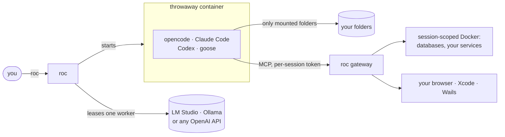

<div align="center">

# roc

**Let your coding agent run without asking, inside a box it can't escape.**

roc runs [opencode](https://opencode.ai), [Claude Code](https://docs.claude.com/en/docs/claude-code),
[Codex](https://github.com/openai/codex) or [goose](https://block.github.io/goose/) in a throwaway
Docker container. The container sees only the folders you hand it, and the agent gets real
infrastructure through MCP: databases and services it starts itself, language servers, live
docs and your browser. When the agent quits, everything it made is gone.

[](LICENSE)
[](https://github.com/andreimerlescu/roc/releases)
[](https://www.rust-lang.org)


[Quick start](#quick-start) · [Backend work](#built-for-backend-work) · [MCP stacks](#mcp-stacks) ·
[Security](#security-at-a-glance) · [Docs](#documentation)

</div>

```sh
cd ~/work/billing-api
roc                      # opencode, no approval prompts, sees only this folder
roc -dry-run             # or see exactly what would run: mounts, docker run, agent config
```

## Why roc

Running an agent on your laptop leaves you two bad options. You can approve every `ls`,
`go test` and file edit by hand, or you can grant broad permissions and hope it never wanders
into `~/.ssh`, another client's repo or your Docker socket.

roc replaces permission lists with hard walls, and then takes the leash off:

- **It sees only what you mount.** Read-only folders are read-only in the kernel, not in a
  config file. Your home directory, `~/.ssh`, cloud credentials and the Docker socket can't be
  mounted at all.
- **It never asks.** Inside the container every agent runs with approvals off and is told to
  keep going until your `AGENTS.md` is satisfied. The container is the sandbox.
- **It cleans up after itself.** Containers, images, networks and leases the session created
  are tracked in a state file and removed on exit, even after a crash.
- **It works with your tools.** Paths inside the container are the same as on your machine,
  so an agent can hand a path straight to Xcode, your browser or a native build.

## Built for backend work

Agents write better backend code when they can run it against real services. roc gives the
agent its own Docker without giving it yours.

| The agent can… | Through |
|---|---|
| Start Postgres, Redis, Kafka or your other services and reach them by name (`roc-<session>-db:5432`) | the built-in `docker` MCP server, scoped to this session |
| Build and run your service's image, read its logs, exec into it | the same server: `docker_build`, `docker_run`, `docker_logs`, `docker_exec` |
| Read schemas and run SQL against your Postgres, MySQL, SQLite or SQL Server (`DATABASE_URL`) | `database` (DBHub) |
| Navigate Go code with references and diagnostics | `gopls` (in the image) |
| Check library APIs against current docs instead of stale training data | `context7` |
| Plan long changes and remember decisions across sessions | `sequential-thinking`, `memory` |
| Use Go, Rust, Node 22, Python 3, PHP and `uv`, all preinstalled | the agent image |

The `docker` server can't touch anything else on your machine. It refuses containers from
other sessions or outside roc, and it has no privileged mode, host network or arbitrary flags.
It may only bind-mount the session's own folders, and its published ports listen on `127.0.0.1`
only. A typical session:

1. You run `roc -publish 8080` in your service's folder.
2. The agent starts `postgres:17` with `docker_run`, applies the migrations and runs the
   integration tests against it.
3. It builds the service image, runs it on the session network, and `curl`s it by container
   name until the tests and the endpoints agree.
4. You open `http://localhost:8080` to see it for yourself.
5. You quit, and the database, the image and the network are gone.

Frontend, desktop and mobile work are covered too: a real browser and DevTools, Figma,
shadcn/ui, Next.js, Wails, Xcode and the iOS simulators, plus D3 for charts and documentation
diagrams. See [MCP stacks](#mcp-stacks).

## How it works



1. roc checks your folders and mounts each one at the path it has on your machine.
2. It leases a model **worker** from your pool, so four copies of a model in LM Studio means four
   agents working at once, each in its own container.
3. It starts an MCP gateway with a fresh token. Secrets for MCP servers stay on your machine;
   the agent never sees them.
4. It drops you into the agent's terminal UI, with the agent told which tools it has and how
   to use them.
5. When the agent exits, roc removes everything the session created.

## Quick start

You need Docker (Desktop, OrbStack or Engine), Rust 1.85+ to build roc, and either a model
server (LM Studio, Ollama, any OpenAI-compatible API) or an agent you're already logged in to.

```sh
git clone https://github.com/andreimerlescu/roc.git && cd roc
make install image      # roc into ~/.local/bin, then the agent image (5–10 minutes)
roc -init               # model server, folders, agent and MCP stacks, each checked as you go
roc -doctor             # Docker, image, models and every MCP server, with a fix for each problem

cd ~/work/my-api && roc
```

[INSTALL.md](INSTALL.md) has every step, prebuilt binaries and Windows notes.

## Agents and models

| Agents | Models |
|---|---|
| **opencode** (default), **Claude Code**, **Codex**, **goose**. Pick one per session with `-binary`. roc writes each agent's config with approvals off and your MCP servers wired in; your own settings in `~/.local/roc/agents/` win. | **LM Studio** (one worker per loaded copy), **Ollama**, **any OpenAI-compatible API**, or **none** to use the agent's own login (Claude, ChatGPT, …). |

Several sessions run side by side, one per worker. `roc -ps` lists them and `roc -kill 2` stops one.
opencode sessions can be [driven remotely](docs/usage.md#remote-control-for-opencode-toktail),
for example by [Toktail](https://github.com/playandprosper/toktail), to answer the agent's
questions and keep it working while you're away.

## MCP stacks

One command gives the agent a set of tools for a kind of work:

```sh
roc -stack data          # turn on a stack
roc -mcp add github      # or one server from the catalog
roc -mcp test            # start them now and list their tools
```

| Stack | Servers | For |
|---|---|---|
| `data` | database, memory | SQL databases and persistent memory |
| `research` | context7, brave-search, sequential-thinking, memory | docs, web search, planning |
| `github` | github | issues, pull requests, Actions |
| `frontend` | context7, shadcn, figma, browsermcp, chrome-devtools | React/Tailwind web apps |
| `nextjs` | the frontend stack + nextjs | Next.js apps |
| `wails` | wails, wails-app, gopls, context7, shadcn, chrome-devtools | Wails v3 desktop apps |
| `ios` | xcodebuildmcp, xcode, context7 | iOS and macOS apps |
| `dataviz` | d3, context7, chrome-devtools | D3.js charts and documentation diagrams |

The scoped `docker` server is always on. The catalog has 22 servers; any other MCP server is
one line away (`roc -mcp add api=https://mcp.example.com/mcp`). See the
[catalog, secrets and transports](docs/mcp.md).

## Security at a glance

| Concern | Agent on your laptop | With roc |
|---|---|---|
| Files it can read | allow/deny globs | only the folders you mount |
| Files it can change | edit globs per project | read-only mounts enforced by the kernel |
| Shell commands | an allowlist | anything, as your uid with `--cap-drop=ALL` and `no-new-privileges` |
| Docker | the full socket (root on the host) or nothing | tools scoped to the session's own resources |
| MCP secrets | in the agent's config | kept on the host and added by roc's gateway |
| Leftovers | manual | tracked and removed on exit |

roc isolates files and processes, not the network: the agent can reach your model server, your
LAN and package registries. Read the [security model](docs/security.md) before turning on
servers that act on your machine.

## Everyday commands

| Command | What it does |
|---|---|
| `roc` | Start a session in the current folder (or your saved folders) |
| `roc -w ~/proj -r ~/libs` | Mount `~/proj` read-write and `~/libs` read-only |
| `roc -publish 5173,8080` | Reach the agent's dev servers from your browser |
| `roc -binary claudecode` | Use another agent this time |
| `roc -list` / `roc -ps` | Workers and running sessions |
| `roc -kill 2` | Stop the session on worker 2 and clean up after it |
| `roc -dry-run` | Show the mounts, `docker run` and generated agent config without running |
| `roc -cleanup` | Remove anything left behind by crashed sessions |

## Documentation

- [Install](INSTALL.md): prerequisites, binaries, the agent image, model servers
- [Using roc](docs/usage.md): every flag, model providers, the worker pool, mounts, per-agent settings
- [MCP servers](docs/mcp.md): the catalog, stacks, transports, secrets, the Docker server, workflows
- [The state file](docs/configuration.md): roc's single source of truth and how to edit it
- [Security model](docs/security.md): what's isolated, what isn't, cleanup and logs
- [Troubleshooting](docs/troubleshooting.md): common problems, and moving from a host opencode install
- [Development](docs/development.md): building, testing, cross-compiling, the source map
- [Changelog](CHANGELOG.md)

## Contributing

Issues and pull requests are welcome. `make test` runs the full suite without Docker or a
model server, and `make lint` runs rustfmt and clippy. Please report security issues privately
(see [SECURITY.md](SECURITY.md)).

If roc saves you from approving one more `ls`, a ⭐ helps other people find it.

## License

Apache License 2.0. See [LICENSE](LICENSE) and [NOTICE](NOTICE).