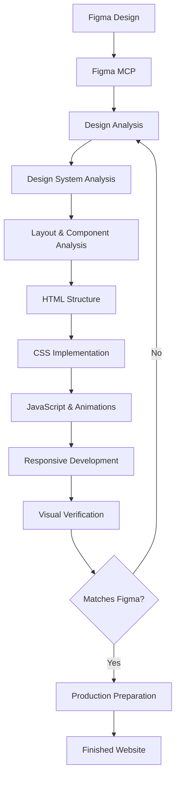

# Figma to Vanilla

<p align="center">
  <strong>From Figma designs to production-ready websites.</strong>
  <br>
  A modular AI Agent Skill for building responsive websites with HTML, CSS, and Vanilla JavaScript.
</p>

<p align="center">
  <a href="https://developer.mozilla.org/en-US/docs/Web/HTML">
    
  </a>
  <a href="https://developer.mozilla.org/en-US/docs/Web/CSS">
    
  </a>
  <a href="https://developer.mozilla.org/en-US/docs/Web/JavaScript">
    
  </a>
  <a href="https://www.figma.com/">
    
  </a>
</p>

<p align="center">
  <a href="#overview">Overview</a> ·
  <a href="#who-is-this-project-for">Who Is This Project For?</a> ·
  <a href="#features">Features</a> ·
  <a href="#technology-stack">Technology Stack</a> ·
  <a href="#architecture">Architecture</a> ·
  <a href="#supported-ai-agents">Supported AI Agents</a> ·
  <a href="#installation">Installation</a> ·
  <a href="#workflow">Workflow</a> ·
  <a href="#limitations">Limitations</a> ·
  <a href="#requirements">Requirements</a>
</p>

---

## Overview

**Figma to Vanilla** is a modular AI Agent Skill designed to turn Figma designs into accurate, responsive, and maintainable websites using native web technologies.

It provides AI coding agents with a structured development methodology covering the entire Figma-to-Web workflow — from design analysis and layout implementation to responsive behavior, animations, visual verification, and production preparation.

Instead of relying on a single large prompt, the project uses a modular architecture with a main skill and dedicated technical references.

<blockquote>
  <p><strong>One design. One structured workflow. Clean, framework-free code.</strong></p>
</blockquote>

## Who Is This Project For?

**figma-to-vanilla** is designed for developers, web studios, and designers who need to turn Figma designs into high-quality, responsive, and functional web interfaces using native HTML, CSS, and JavaScript.

The project is intended for several audiences:

- **HTML/CSS developers and frontend engineers.** To quickly generate ready-to-use HTML/CSS/JS markup from Figma without being tied to React, Vue, or other frameworks.
- **Web studios and freelancers.** To speed up the development of landing pages, corporate websites, promotional pages, and other web projects.
- **CMS developers.** To prepare HTML/CSS/JS markup that can be integrated into WordPress, Laravel, PHP projects, and other CMS or backend systems.
- **Designers and product teams.** To quickly generate a responsive web version of a design that can be presented to clients and team members, used to discuss its structure and visual implementation, and serve as a starting point for further development.

**The main goal of the project** is to shorten the path from a Figma design to finished web markup while keeping the output technology-independent, easy to customize, and ready for integration into existing projects.

## Features

<table border="1">
  <tr>
    <td width="33.33%" valign="top">
      <strong>🎨 Figma Integration</strong><br>
      <p>Retrieve and analyze design information directly through Figma MCP.</p>
    </td>
    <td width="33.33%" valign="top">
      <strong>📐 Layout Analysis</strong><br>
      <p>Understand Auto Layout, Layout Grid, spacing, dimensions, and positioning.</p>
    </td>
    <td width="33.33%" valign="top">
      <strong>🧩 Component Implementation</strong><br>
      <p>Translate Figma Components, Component Sets, and Variants into reusable structures.</p>
    </td>
  </tr>
  <tr>
    <td width="33.33%" valign="top">
      <strong>📱 Responsive Development</strong><br>
      <p>Build fluid layouts, responsive containers, and breakpoint-specific adjustments.</p>
    </td>
    <td width="33.33%" valign="top">
      <strong>🎯 CSS Architecture</strong><br>
      <p>Apply CSS variables, BEM methodology, and consistent styling conventions.</p>
    </td>
    <td width="33.33%" valign="top">
      <strong>🔤 Typography & Assets</strong><br>
      <p>Implement fonts, typography, images, SVG files, and favicons.</p>
    </td>
  </tr>
  <tr>
    <td width="33.33%" valign="top">
      <strong>✨ Animations</strong><br>
      <p>Implement animations, transitions, and interactive states.</p>
    </td>
    <td width="33.33%" valign="top">
      <strong>🔍 Visual Verification</strong><br>
      <p>Compare the implementation with the original Figma design and refine visual discrepancies.</p>
    </td>
    <td width="33.33%" valign="top">
      <strong>🚀 Production Preparation</strong><br>
      <p>Prepare production files, minify CSS and JavaScript, convert raster images to WebP, and organize the website for deployment.</p>
    </td>
  </tr>
</table>

### Figma Design Support

The skill supports the analysis and implementation of the following Figma design features:

| Figma Feature | Implementation |
|:---|:---|
| Auto Layout | CSS Flexbox layouts |
| Layout Grid | CSS Grid and responsive containers |
| Components | Reusable HTML structures |
| Component Sets & Variants | Component states and variations |
| Styles | Typography, colors, and effects (shadows, blurs, etc.) |
| Variables | Reusable design tokens for colors, spacing, dimensions, and other design properties |
| Assets | Images, SVG files, and fonts |
| Interactive States | CSS transitions, animations, and JavaScript interactions |

The implementation approach is selected according to the structure and properties of the original Figma design.

## Technology Stack

The project focuses on native web technologies without frontend frameworks or component libraries.

| Technology | Application |
|:---|:---|
| HTML5 | Semantic markup and website structure |
| CSS3 | Layout, styling, and responsive behavior |
| Vanilla JavaScript | Interactions and dynamic functionality |
| Figma MCP | Design data retrieval and analysis |
| BEM | CSS naming methodology |

<p align="center">
  <strong>No framework dependencies.</strong>
  <br>
  Just native web technologies.
</p>

## Architecture

Figma to Vanilla follows a modular skill architecture.

The main `SKILL.md` defines the overall workflow and determines which technical references are relevant to the current task. Each reference focuses on a specific area of implementation.

### Repository Structure

```text
figma-to-vanilla/
├── .agents/
│   └── skills/
│       └── figma-to-vanilla/
│           ├── SKILL.md
│           └── references/
│               ├── animations.md
│               ├── assets.md
│               ├── css-conventions.md
│               ├── design-system.md
│               ├── figma-components.md
│               ├── figma-layout.md
│               ├── fluid-responsive.md
│               ├── mcp-rules.md
│               ├── production-git.md
│               ├── structure.md
│               └── verification.md
│
├── .claude/
│   └── skills/
│       └── figma-to-vanilla  # Same skill, provided separately for Claude Code
│
├── .github/
│   └── workflows/
│       └── release.yml
│
├── .vscode/
│   └── settings.json
│
├── .mcp.json
├── .gitignore
├── AGENTS.md
├── CLAUDE.md
├── LICENSE
└── README.md
```

### Generated Website Structure

The skill supports two website architectures. The following examples illustrate the typical source and production structures.

**Single-page**

```text
project/
├── build/
│   ├── index.html
│   ├── styles/
│   │   └── styles.min.css
│   ├── scripts/
│   │   └── scripts.min.js
│   ├── fonts/
│   └── images/
│       └── favicons/
│
└── src/
    ├── index.html
    ├── styles/
    │   └── styles.css
    ├── scripts/
    │   └── scripts.js
    ├── fonts/
    └── images/
        └── favicons/
```

**Multi-page**

```text
project/
├── build/
│   ├── index.html
│   ├── about.html
│   ├── contacts.html
│   ├── styles/
│   │   └── styles.min.css
│   ├── scripts/
│   │   └── scripts.min.js
│   ├── fonts/
│   └── images/
│       └── favicons/
│
└── src/
    ├── index.html
    ├── pages/
    │   ├── about.html
    │   └── contacts.html
    ├── styles/
    │   └── styles.css
    ├── scripts/
    │   └── scripts.js
    ├── fonts/
    └── images/
        └── favicons/
```

The source structure keeps individual pages organized, while the production build places all HTML documents directly in the `build/` directory.

- `src/` contains the original source files used during development.
- `build/` contains optimized files prepared for production.
- CSS and JavaScript files are minified during production preparation.
- Original source files are preserved in `src/`.

This separation keeps development files organized and prevents production output from interfering with the source code.

### Development Configuration

| File | Purpose |
|---|---|
| `.mcp.json` | Figma MCP server configuration for VS Code AI extensions that support this file. |
| `.vscode/settings.json` | [Live Server](https://marketplace.visualstudio.com/items?itemName=ritwickdey.LiveServer) configuration for local website preview. |

The MCP configuration uses [figma-console-mcp](https://github.com/southleft/figma-console-mcp) and can serve as a reference when setting up the server in other AI coding agents.

### Skill References

| Reference | Responsibility |
|:---|:---|
| `mcp-rules.md` | Figma MCP integration and usage rules |
| `structure.md` | Project structure, HTML, JavaScript, and favicons |
| `fluid-responsive.md` | Responsive layouts and fluid containers |
| `css-conventions.md` | CSS variables, BEM, and typography |
| `design-system.md` | Design tokens and reusable design system rules |
| `figma-components.md` | Figma Components, Component Sets, and Variants |
| `figma-layout.md` | Figma layout analysis and implementation |
| `assets.md` | Fonts, images, and SVG assets |
| `animations.md` | Animations and interactive states |
| `verification.md` | Visual verification and Live Server |
| `production-git.md` | Minification, WebP, production, Git, and GitHub |

This separation keeps the main skill concise while allowing detailed technical instructions to be loaded when needed.

## Supported AI Agents

The skill uses the Agent Skills format and is intended for AI coding agents that support this format.

| AI Agent | Skill Directory |
|:---|:---|
| OpenCode, Codex, Cline, and other compatible AI agents | `.agents/skills/` |
| Claude Code | `.claude/skills/` |

## Installation

### 1. Clone the Repository

```bash
git clone https://github.com/andrewalexeich/figma-to-vanilla.git
```

Open the cloned repository directly in your AI coding agent. The skill is already included in the repository, so no additional copying or installation is required.

### 2. Prepare Figma MCP

Figma to Vanilla uses **`figma-console-mcp`** as its preferred MCP server for interacting with Figma.

Before using the skill for tasks involving Figma designs, make sure you have:

- Node.js 18 or later installed.
- Figma Desktop installed.
- A personal Figma access token.

No manual download of the package archive or global installation of `figma-console-mcp` is required. The package is downloaded automatically through `npx`.

**To download the MCP package, open a terminal and run:**

```bash
npx -y figma-console-mcp@latest --print-path
```

This command automatically downloads the package from npm if it is not already cached, prepares the Figma Desktop Bridge plugin files, and prints the plugin directory path. It exits without starting the MCP server.

The MCP server can then be launched automatically by your AI coding agent using the same command specified in its MCP configuration.

### 3. Import and Run Figma Desktop Bridge

The MCP server requires the **Figma Desktop Bridge** plugin to communicate with Figma Desktop.

You only need to import the plugin once initially. Re-importing may be required after certain server updates, as indicated in the release notes.

1. Open Figma Desktop.
2. Go to **Plugins → Development → Import plugin from manifest...**.
3. Navigate to the plugin directory printed by the `--print-path` command and select `manifest.json`.

**Default plugin locations:**

- **macOS:** `~/.figma-console-mcp/plugin/manifest.json`
- **Windows:** `%USERPROFILE%\.figma-console-mcp\plugin\manifest.json`

Use the path printed by `--print-path` if the plugin is installed in a different location.

4. After importing, open a Figma file and run **Plugins → Development → Figma Desktop Bridge**.
5. Wait until the plugin displays the `Local · ready` status.

The imported plugin remains available in Figma's Development plugins. You only need to run it when you want to use Figma MCP.

### 4. Configure Figma MCP

The MCP configuration depends on the AI coding agent you use.

#### For VS Code

The repository includes a preconfigured `.mcp.json` file in the project root containing the MCP server configuration for `figma-console-mcp`.

Set the `FIGMA_ACCESS_TOKEN` environment variable to your personal Figma access token in the environment where VS Code runs.

Open the project in VS Code and make sure GitHub Copilot uses the workspace MCP configuration. The `figma-console-mcp` server will be started by the Copilot agent when needed.

#### For OpenCode, Claude Code, Codex, and other AI Agents

You can ask your AI agent to read the preconfigured `.mcp.json` file, which contains the Figma MCP server command and required environment variables, and configure the `figma-console-mcp` server using the same settings in its own MCP configuration format.

Make sure to provide your personal Figma access token through the environment variables required by your AI agent.

After configuring the server, restart your AI agent if necessary and verify that the Figma MCP tools are available.

### 5. Start Building

Open your project in the AI coding agent and provide a task involving a Figma design.

The agent will first determine whether the project should be implemented as a single-page or multi-page website. It will then use the main skill to analyze the provided Figma design through Figma MCP and load the relevant technical references.

## Workflow

The development process follows a structured sequence:



Visual verification is an iterative part of the process. If discrepancies are found, the relevant implementation is reviewed and corrected before proceeding.

## Development Principles

The project is built around the following principles:

| Principle | Description |
|:---|:---|
| **Figma as the Source of Truth** | Use the original design as the primary source of layout and visual information. |
| **Native Web Technologies** | Implement websites with HTML, CSS, and Vanilla JavaScript. |
| **Design Accuracy** | Preserve the original layout, proportions, typography, colors, and spacing. |
| **Responsive by Design** | Maintain the design intent across different screen sizes. |
| **Modular Instructions** | Keep technical rules organized in specialized reference files. |
| **Maintainable Code** | Use consistent naming conventions and avoid unnecessary complexity. |

## Limitations

The accuracy and completeness of the generated website depend on several factors:

- **Figma Design Quality:** Missing, inconsistent, or incomplete design information may require additional interpretation.
- **MCP Capabilities:** Available design data and operations depend on the installed Figma MCP server and its supported functionality.
- **Visual Verification:** Some visual discrepancies may require manual inspection and adjustment.
- **Responsive Behavior:** Responsive layouts may require additional decisions when the original Figma file does not include designs for all screen sizes.

## Requirements

- An AI coding agent that supports the Agent Skills format.
- `figma-console-mcp` configured for tasks involving Figma designs.
- Access to the relevant Figma files and design information.
- A local development environment for running and previewing static websites.

### Figma Design Preparation

For accurate and reliable implementation, the Figma design should be properly structured before development begins.

- Use **Auto Layout** for frames and components wherever applicable.
- Use **Layout Grids** to define consistent alignment, columns, and page structure.
- Ensure that spacing, dimensions, alignment, and constraints are properly configured.
- Avoid relying on manually positioned elements when a layout-based structure is more appropriate.

Poorly structured designs or missing layout properties may require additional interpretation and can reduce implementation accuracy, responsiveness, and maintainability.

## Related Projects

[figma-console-mcp](https://github.com/southleft/figma-console-mcp) — the Figma MCP server used by this skill.

## License

Distributed under the [MIT License](LICENSE).