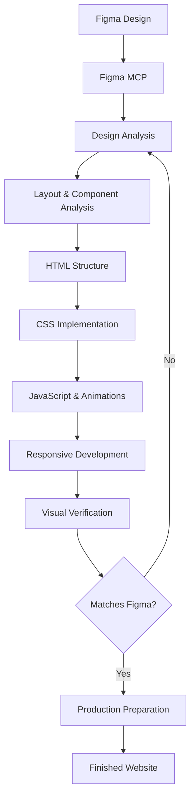

# Figma to Vanilla

<p align="center">
  <strong>From Figma designs to production-ready websites.</strong>
  <br>
  A modular collection of AI Agent Skills for building responsive websites with HTML, CSS, and Vanilla JavaScript.
</p>

<p align="center">
  <a href="https://developer.mozilla.org/en-US/docs/Web/HTML">
    
  </a>
  <a href="https://developer.mozilla.org/en-US/docs/Web/CSS">
    
  </a>
  <a href="https://developer.mozilla.org/en-US/docs/Web/JavaScript">
    
  </a>
  <a href="https://www.figma.com/">
    
  </a>
</p>

<p align="center">
  <a href="#overview">Overview</a> ·
  <a href="#features">Features</a> ·
  <a href="#technology-stack">Technology Stack</a> ·
  <a href="#architecture">Architecture</a> ·
  <a href="#supported-ai-agents">Supported AI Agents</a> ·
  <a href="#installation">Installation</a> ·
  <a href="#workflow">Workflow</a> ·
  <a href="#limitations">Limitations</a> ·
  <a href="#requirements">Requirements</a>
</p>

---

## Overview

**Figma to Vanilla** is a collection of specialized AI Agent Skills designed to turn Figma designs into accurate, responsive, and maintainable websites using native web technologies.

It provides AI coding agents with a structured development methodology covering the entire Figma-to-Web workflow — from design analysis and layout implementation to responsive behavior, animations, visual verification, and production preparation.

Instead of relying on a single large prompt, the project uses a modular architecture with a main skill and dedicated technical references.

<blockquote>
  <p><strong>One design. One structured workflow. Clean, framework-free code.</strong></p>
</blockquote>

## Features

<table border="1">
  <tr>
    <td width="33.33%" valign="top">
      <strong>🎨 Figma Integration</strong><br>
      <p>Retrieve and analyze design information directly through Figma MCP.</p>
    </td>
    <td width="33.33%" valign="top">
      <strong>📐 Layout Analysis</strong><br>
      <p>Understand Auto Layout, Layout Grid, spacing, dimensions, and positioning.</p>
    </td>
    <td width="33.33%" valign="top">
      <strong>🧩 Component Implementation</strong><br>
      <p>Translate Figma Components, Component Sets, and Variants into reusable structures.</p>
    </td>
  </tr>
  <tr>
    <td width="33.33%" valign="top">
      <strong>📱 Responsive Development</strong><br>
      <p>Build fluid layouts, responsive containers, and breakpoint-specific adjustments.</p>
    </td>
    <td width="33.33%" valign="top">
      <strong>🎯 CSS Architecture</strong><br>
      <p>Apply CSS variables, BEM methodology, and consistent styling conventions.</p>
    </td>
    <td width="33.33%" valign="top">
      <strong>🔤 Typography & Assets</strong><br>
      <p>Implement fonts, typography, images, SVG files, and favicons.</p>
    </td>
  </tr>
  <tr>
    <td width="33.33%" valign="top">
      <strong>✨ Animations</strong><br>
      <p>Implement animations, transitions, and interactive states.</p>
    </td>
    <td width="33.33%" valign="top">
      <strong>🔍 Visual Verification</strong><br>
      <p>Compare the implementation with the original Figma design and refine visual discrepancies.</p>
    </td>
    <td width="33.33%" valign="top">
      <strong>🚀 Production Preparation</strong><br>
      <p>Organize production files, minify CSS and JavaScript, optimize images, and prepare the website for deployment.</p>
    </td>
  </tr>
</table>

### Figma Design Support

The skill supports the analysis and implementation of the following Figma design features:

| Figma Feature | Implementation |
|:---|:---|
| Auto Layout | CSS Flexbox layouts |
| Layout Grid | CSS Grid and responsive containers |
| Components | Reusable HTML structures |
| Component Sets & Variants | Component states and variations |
| Styles | Typography, colors, and effects (shadows, blurs, etc) |
| Variables | Reusable design tokens for colors, spacing, dimensions, and other design properties |
| Assets | Images, SVG files, and fonts |
| Interactive States | CSS transitions, animations, and JavaScript interactions |

The implementation approach is selected according to the structure and properties of the original Figma design.

## Technology Stack

The project focuses on native web technologies without frontend frameworks or component libraries.

| Technology | Application |
|:---|:---|
| HTML5 | Semantic markup and website structure |
| CSS3 | Layout, styling, and responsive behavior |
| Vanilla JavaScript | Interactions and dynamic functionality |
| Figma MCP | Design data retrieval and analysis |
| BEM | CSS naming methodology |

<p align="center">
  <strong>No framework dependencies.</strong>
  <br>
  Just native web technologies.
</p>

## Architecture

Figma to Vanilla follows a modular skill architecture.

The main `SKILL.md` defines the overall workflow and determines which technical references are relevant to the current task. Each reference focuses on a specific area of implementation.

### Repository Structure

```text
figma-to-vanilla/
|
├── .agents/
│   └── skills/
│       └── figma-to-vanilla/
│           ├── SKILL.md
│           │
│           └── references/
│               ├── animations.md
│               ├── assets.md
│               ├── css-conventions.md
│               ├── figma-components.md
│               ├── figma-layout.md
│               ├── fluid-responsive.md
│               ├── mcp-rules.md
│               ├── production-git.md
│               ├── structure.md
│               ├── verification.md
|
├── .claude/
│   └── skills/
│       └── figma-to-vanilla -> ../../.agents/skills/figma-to-vanilla
|
├── .vscode/
│   ├── mcp.json
│   └── settings.json
|
├── AGENTS.md
├── CLAUDE.md
├── README.md
└── LICENSE
```

### Generated Website Structure

The skill follows a structured project layout that separates source files from production-ready output.

```text
project/
├── build/
│   ├── index.html
│   ├── styles/
│   │   └── styles.min.css
│   ├── scripts/
│   │   └── scripts.min.js
│   ├── fonts/
│   │   └── ...
│   └── images/
│       └── ...
├── src/
│   ├── index.html
│   ├── styles/
│   │   └── styles.css
│   ├── scripts/
│   │   └── scripts.js
│   ├── fonts/
│   │   └── ...
│   └── images/
│       └── favicon/
│           └── ...
└── .gitignore
```

- `src/` contains the original source files used during development.
- `build/` contains optimized files prepared for production.
- CSS and JavaScript files are minified when preparing the production build.

The separation keeps development files organized and prevents production output from interfering with the source code.

### Development Configuration

The repository includes a `.vscode/` directory with preconfigured Visual Studio Code settings.

| File | Description |
|:---|:---|
| `mcp.json` | Figma MCP server configuration for [figma-mcp-rust](https://github.com/alvinindra/figma-mcp-rust). |
| `settings.json` | [Live Server](https://marketplace.visualstudio.com/items?itemName=ritwickdey.LiveServer) configuration for local website preview. |

These configurations help streamline the development workflow by providing Figma integration and a ready-to-use local preview environment.

### Skill References

| Reference | Responsibility |
|:---|:---|
| `mcp-rules.md` | Figma MCP integration and usage rules |
| `structure.md` | Project structure, HTML, JavaScript, and favicons |
| `fluid-responsive.md` | Responsive layouts and fluid containers |
| `css-conventions.md` | CSS variables, BEM, and typography |
| `figma-components.md` | Figma Components, Component Sets, and Variants |
| `figma-layout.md` | Figma layout analysis and implementation |
| `assets.md` | Fonts, images, and SVG assets |
| `animations.md` | Animations and interactive states |
| `verification.md` | Visual verification and Live Server |
| `production-git.md` | Minification, WebP, production, Git, GitHub, and Vercel |

This separation keeps the main skill concise while allowing detailed technical instructions to be loaded when needed.

## Supported AI Agents

The skill uses the Agent Skills format and is intended for AI coding agents that support this format.

| AI Agent | Installation Directory |
|:---|:---|
| OpenCode, Codex | `.agents/skills/` |
| Claude Code, Cline | `.claude/skills/` |

A symbolic link can be used to share one skill directory between the `.agents/skills/` and `.claude/skills/` locations.

## Installation

### 1. Clone the Repository

```bash
git clone https://github.com/andrewalexeich/figma-to-vanilla.git
```

### 2. Install the Skill

Copy the `figma-to-vanilla` directory into the appropriate location inside your project.

**For OpenCode and Codex:**

```text
project/
└── .agents/
    └── skills/
        └── figma-to-vanilla/
            ├── SKILL.md
            └── references/
```

**For Claude Code and Cline:**

```text
project/
└── .claude/
    └── skills/
        └── figma-to-vanilla/
            ├── SKILL.md
            └── references/
```

You can also configure a symbolic link to avoid maintaining multiple copies of the same skill.

### 3. Install Figma MCP

Figma to Vanilla uses **figma-mcp-rust** as its preferred MCP server for interacting with Figma.

Before using the skill for tasks involving Figma designs, you must install and configure `figma-mcp-rust`.

Follow the installation and setup instructions provided in the official repository.

### 4. Configure Figma MCP in VS Code

The repository includes a preconfigured `.vscode/mcp.json` file containing the MCP server configuration for `figma-mcp-rust`.

After installing the MCP server, check that the configuration matches your local setup and that the server starts successfully.

The included configuration is intended for compatible VS Code-based AI coding agents. Other AI coding agents may require their own MCP configuration.

### 5. Start Building

Open your project in the AI coding agent and provide a task involving a Figma design.

The agent will use the main skill, analyze the design through Figma MCP, and load the relevant technical references.

## Workflow

The development process follows a structured sequence:



Visual verification is an iterative part of the process. If discrepancies are found, the relevant implementation is reviewed and corrected before proceeding.

## Development Principles

The project is built around the following principles:

| Principle | Description |
|:---|:---|
| **Figma as the Source of Truth** | Use the original design as the primary source of layout and visual information. |
| **Native Web Technologies** | Implement websites with HTML, CSS, and Vanilla JavaScript. |
| **Design Accuracy** | Preserve the original layout, proportions, typography, colors, and spacing. |
| **Responsive by Design** | Maintain the design intent across different screen sizes. |
| **Modular Instructions** | Keep technical rules organized in specialized reference files. |
| **Maintainable Code** | Use consistent naming conventions and avoid unnecessary complexity. |
| **Visual Verification** | Check the implementation against the original Figma design. |

## Limitations

The accuracy and completeness of the generated website depend on several factors:

- **Figma Design Quality:** Missing, inconsistent, or incomplete design information may require additional interpretation.
- **MCP Capabilities:** Available design data and operations depend on the installed Figma MCP server and its supported functionality.
- **Visual Verification:** Some visual discrepancies may require manual inspection and adjustment.
- **Responsive Behavior:** Responsive layouts may require additional decisions when the original Figma file does not include designs for all screen sizes.

## Requirements

- An AI coding agent that supports Agent Skills.
- figma-mcp-rust installed and configured for tasks involving Figma designs.
- Access to the relevant Figma files and design information.
- A local development environment for running and previewing static websites.

### Figma Design Preparation

For accurate and reliable implementation, the Figma design should be properly structured before development begins.

- Use **Auto Layout** for frames and components wherever applicable.
- Use **Layout Grids** to define consistent alignment, columns, and page structure.
- Ensure that spacing, dimensions, alignment, and constraints are properly configured.
- Avoid relying on manually positioned elements when a layout-based structure is more appropriate.

Poorly structured designs or missing layout properties may require additional interpretation and can reduce implementation accuracy, responsiveness, and maintainability.

## Related Projects

[figma-mcp-rust](https://github.com/alvinindra/figma-mcp-rust) — Figma MCP server prioritized by this skill.

## License

Distributed under the [MIT License](LICENSE).