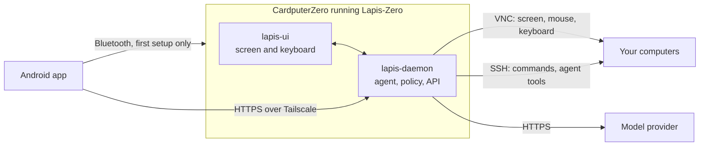

<p align="center">
  
</p>

<h1 align="center">Lapis-Zero</h1>

<p align="center">
  <b>Agentic firmware for the M5Stack CardputerZero.</b><br>
  A handheld that operates your computers for you. It looks at the screen, clicks, types and runs commands,<br>
  and it asks you before it does anything risky.
</p>

<p align="center">
  Apache-2.0 &nbsp;·&nbsp; Raspberry Pi CM0, 512 MB &nbsp;·&nbsp; Rust + Python + Kotlin &nbsp;·&nbsp; early release
</p>

---

## What it is

The CardputerZero is [M5Stack](https://m5stack.com/)'s card-sized Linux computer: a Raspberry Pi
CM0 with a 320×170 screen, a keyboard, a microphone and a battery. It has only just shipped.

**Lapis-Zero is one of the first custom firmwares for it, and an agentic one.** It replaces the stock
software with a single-purpose operating system. You give it a task in plain words. An AI agent then
carries the task out on one of your own computers, over your private network, while you watch from the
handheld or from your phone.

There is no cable between the handheld and the computer it controls, and nothing to install on that
computer beyond the screen sharing and remote login it already has.

## What you can ask it

> "What is on the screen of my Mac mini right now?"
>
> "Check last night's CI run and restart the worker if it failed."
>
> "Ask Claude Code on my desktop to fix the failing test in `~/code/app`."

The agent takes a screenshot, decides on a step, does it, and looks again. Each step shows up on the
handheld's screen and in the phone app as it happens.

## Features

**An agent that sees and acts**
- Sees the remote screen over VNC and uses the mouse and keyboard there.
- Runs shell commands over SSH when a command is quicker than clicking.
- Works on a host without SSH too: it then uses the screen alone.

**Your choice of model**
- Anthropic, or any OpenAI-compatible provider. One-tap presets for OpenRouter, MiniMax, OpenAI,
  Gemini, xAI, DeepSeek, Together and Fireworks; anything else by base URL.

**Hands tasks to the agent tools you already use**
- A chat can be run by a tool installed on the host: Claude Code, opencode, Freya, Gemini CLI,
  Cursor Agent or Codex, or one you configure. The handheld finds them, sends your message, and
  brings the answer back.

**You stay in charge**
- Three policies per host: *strict*, *balanced*, *autonomous*. Risky steps wait for your approval on
  the handheld or the phone, with a preview of where the click will land.
- A kill switch on both: hold <kbd>Esc</kbd> on the handheld, or tap it in the app.

**Private by design**
- Everything travels over [Tailscale](https://tailscale.com/). The handheld's control interface
  listens on loopback only and is reached through Tailscale's HTTPS.
- Keys and passwords are write-only: once stored on the handheld they are never sent back or shown.
- First-time setup is over Bluetooth, confirmed with a PIN shown on the handheld's screen.

**Built for 512 MB**
- No desktop, no X11, no Wayland. The interface is a small Rust program that draws straight to the
  screen; the agent is a Python service next to it.

## On the handheld

The interface is drawn for a 320×170 screen, in a light and a dark theme.

<table>
  <tr>
    <td width="50%"></td>
    <td width="50%"></td>
  </tr>
  <tr>
    <td align="center">Working on a task</td>
    <td align="center">Asking before a risky click</td>
  </tr>
  <tr>
    <td></td>
    <td></td>
  </tr>
  <tr>
    <td align="center">Every step, as it happens</td>
    <td align="center">Pairing with a phone</td>
  </tr>
</table>

### The agent has a face

A small 3D-style head shows what the agent is doing at a glance: idle, listening, thinking, working,
fetching, running a command, waiting for your approval, paused, done, or stopped on an error. It is
drawn entirely in code, with no image files.

<table>
  <tr>
    <td width="20%"></td>
    <td width="20%"></td>
    <td width="20%"></td>
    <td width="20%"></td>
    <td width="20%"></td>
  </tr>
  <tr>
    <td align="center">Idle</td>
    <td align="center">Listening</td>
    <td align="center">Thinking</td>
    <td align="center">Working</td>
    <td align="center">Fetching</td>
  </tr>
  <tr>
    <td width="20%"></td>
    <td width="20%"></td>
    <td width="20%"></td>
    <td width="20%"></td>
    <td width="20%"></td>
  </tr>
  <tr>
    <td align="center">Running a command</td>
    <td align="center">Needs your approval</td>
    <td align="center">Paused</td>
    <td align="center">Done</td>
    <td align="center">Error</td>
  </tr>
</table>

Each state is animated. [Every frame of every state](screenshots/cardputerZero/agent-head-all-states.png) is in the screenshots folder.

## On your phone

The Android companion app pairs the handheld, shows every chat and step, mirrors the remote screen,
and holds all the settings.

<table>
  <tr>
    <td width="25%"></td>
    <td width="25%"></td>
    <td width="25%"></td>
    <td width="25%"></td>
  </tr>
  <tr>
    <td align="center">Chats</td>
    <td align="center">Steps of a task</td>
    <td align="center">The handheld, live</td>
    <td align="center">Your computers</td>
  </tr>
  <tr>
    <td></td>
    <td></td>
    <td></td>
    <td></td>
  </tr>
  <tr>
    <td align="center">Live remote screen</td>
    <td align="center">Pick who runs the chat</td>
    <td align="center">Model and provider</td>
    <td align="center">Adding a computer</td>
  </tr>
</table>

<sub>Addresses, names and screen contents in these screenshots are blurred.</sub>

## How it works



1. You send a task from the handheld's keyboard or from the phone.
2. The agent asks the model for the next step, given the latest screenshot.
3. The policy for that host decides: run it, ask you first, or refuse.
4. The step runs over VNC or SSH, and the result goes back to the model.
5. This repeats until the task is done, you stop it, or the step limit is reached.

When a chat is set to run with a tool on the host, steps 2 to 4 are replaced by one: the message is
handed to that tool over SSH, under a permission mode that matches the host's policy.

## Getting started

### What you need

- An M5Stack CardputerZero and a microSD card
- A [Tailscale](https://tailscale.com/) account with MagicDNS and HTTPS certificates turned on
- An Android phone for setup
- An API key for a model that accepts images and tool calls
- A computer to control, on the same tailnet, with screen sharing (VNC) and, ideally, SSH enabled

To build from source: Rust with `cargo-zigbuild`, [`uv`](https://docs.astral.sh/uv/), Docker,
JDK 21 with the Android SDK, and SDL2 for the desktop simulator.

### 1. Build and flash the firmware

```bash
make cross-ui     # the screen program, for the handheld's CPU
make build-os     # the flashable image, in os/deploy/
```

Flash `os/deploy/lapis-zero-arm64.img.xz` with the M5Stack imager (*Choose OS → Use custom*), or from
the command line as described in [`os/README.md`](os/README.md).

### 2. Install the app

```bash
make apk              # builds android/app/build/outputs/apk/debug/app-debug.apk
make deploy-android   # installs it on a phone connected over USB
```

### 3. Pair

Power the handheld on. After about fifteen seconds it shows a PIN. In the app choose
**Pair a new CardputerZero**, enter the PIN, pick your Wi-Fi, and sign the handheld in to Tailscale.

### 4. Add a computer

In the app: **Config → KVM hosts → Add host**. Enter the computer's Tailscale name and its login.
On a Mac, turn on *Screen Sharing* and *Remote Login* under System Settings → General → Sharing; the
same login then serves both. **Test connection** tells you what works.

### 5. Choose a model

**Config → Agent & LLM**: tap a provider, then **Add key**.

### 6. Ask

Start a chat and type what you want done.

## Try it without the hardware

Everything runs on a desktop first.

```bash
make sim    # the handheld's interface in a window
make mock   # the agent with a simulated computer, on 127.0.0.1:8421
make test   # the Rust and Python test suites
```

With `make mock` running, `scripts/deploy_android.sh --reverse` connects a phone to it over USB; pair
from the app's **Dev connect** screen with the token `dev-local-token`.

## Safety and privacy

- **Approvals.** Under *strict* every action that changes something waits for you. *Balanced* asks
  for risky ones, and for shell commands that are not plainly read-only. *Autonomous* does not ask.
  A short list of destructive commands is refused under every policy.
- **Agent tools keep to the policy too.** A tool only runs under a policy it can be held to; for
  example Claude Code and Gemini CLI under all three, opencode and Codex only under *autonomous*.
- **Kill switch.** It stops the agent, the running command and, where it can find them, the programs
  that command started. When the handheld cannot confirm that something stopped, it says so.
- **Secrets.** API keys and passwords are stored on the handheld only and are never returned by
  any interface. The phone keeps its access token in the Android Keystore.
- **Network.** The control interface listens on loopback only. It is reachable through your tailnet
  and nowhere else.

This is software that acts on your computers with your login. Start with the *strict* policy.

## Status

Lapis-Zero is early. It runs on real hardware, and it has been used by one person on one device.

**Working on the device today**
- Boot to the interface, Bluetooth pairing, Wi-Fi and Tailscale setup from the phone
- Chats that see the screen and run commands on macOS computers, including multi-display desktops
- The kill switch, the connection test, finding agent tools on a host

**Built and tested on a desk, not yet proven on the device**
- Approval prompts on the handheld
- Chats run by an agent tool on a real host
- Push-to-talk voice input
- Linux and Windows computers as targets
- Scheduled tasks

**Known limits**
- Memory use runs above its budget once VNC and SSH are both in use.
- A desktop with several displays is captured as one picture, so text is small for the model.
- Updating the firmware means flashing the card again and pairing again.
- The app is a debug build; there is no store release.

## Repository

| Path | What is in it |
|---|---|
| [`ui/`](ui/) | The handheld's interface, in Rust: framebuffer drawing, keyboard, animations, desktop simulator |
| [`daemon/`](daemon/) | The agent, in Python: step loop, policy, VNC and SSH drivers, model adapters, API, Bluetooth setup |
| [`android/`](android/) | The companion app, in Kotlin and Jetpack Compose |
| [`os/`](os/) | The image build: a pi-gen stage on top of the CardputerZero board support |
| [`uConsoleCM4/`](uConsoleCM4/) | **Lapis-Deck**: a standalone cyberdeck OS for the ClockworkPi uConsole (Raspberry Pi CM4) — see below |
| [`config/`](config/) | Example configuration files |
| [`scripts/`](scripts/) | Helpers: app install, a VNC host check, Bluetooth test vectors |

## Lapis-Deck (uConsole)

The same agentic idea, on a bigger machine. **Lapis-Deck** is a standalone cyberdeck OS for the
[ClockworkPi uConsole](https://www.clockworkpi.com/uconsole) (Raspberry Pi CM4): no X11, no desktop.
It boots into a keyboard- and gamepad-first HUD on DRM/KMS, runs SDR / Meshtastic / GPS / NetOps
subsystems, and hosts a policy-gated agent that operates the deck's own radios and drives the
machines on your Tailscale tailnet (VNC/SSH, or the agent CLIs installed on them). The Lapis-Zero
Android companion app pairs with it and controls it, unchanged.

<table>
  <tr>
    <td width="50%"></td>
    <td width="50%"></td>
  </tr>
  <tr>
    <td align="center">Command center: chats on the deck or any tailnet machine</td>
    <td align="center">RF: spectrum and waterfall</td>
  </tr>
  <tr>
    <td></td>
    <td></td>
  </tr>
  <tr>
    <td align="center">Meshtastic nodes</td>
    <td align="center">Wi-Fi: scan, join, forget, or let the phone set it</td>
  </tr>
</table>

The HUD shown with dummy data from the host preview (`uConsoleCM4/scripts/preview.sh`).

It lives in [`uConsoleCM4/`](uConsoleCM4/) — Rust crates (`lapis-crypto`, `lapis-daemon`, `lapis-sdr`,
`lapis-ui`), a Python agent stack, the companion app, and a pi-gen image builder. See
[`uConsoleCM4/README.md`](uConsoleCM4/README.md) for the layout, build and flash steps.

**Further reading:** [`SPEC.md`](SPEC.md) (the system),
[`ANDROID_COMPANION_SPEC.md`](ANDROID_COMPANION_SPEC.md) (the app and the API),
[`BLE_PROVISIONING_PROTOCOL.md`](BLE_PROVISIONING_PROTOCOL.md) (first-time setup),
[`os/README.md`](os/README.md) (the image).

## Contributing

Issues and pull requests are welcome. Before sending a change, run `make test` and `make lint`, and
for the app `make test-android`. If your change touches what the handheld draws, `make dump-frames`
renders every screen to a PNG so you can show the result.

## License

Lapis-Zero is released under the [Apache License 2.0](LICENSE).

The firmware image is built on Raspberry Pi OS and M5Stack's CardputerZero board support, and includes
other open-source software, each under its own license.

Lapis-Zero is an independent project. It is not affiliated with or endorsed by M5Stack, Raspberry Pi,
Tailscale, or any model or tool provider named here. All product names are trademarks of their owners.
