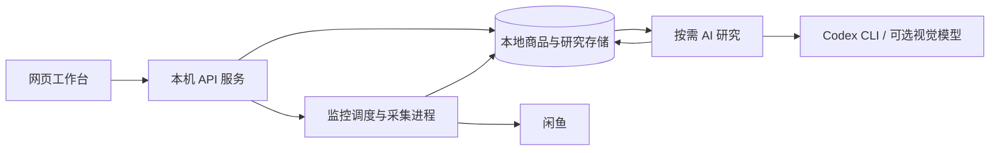

<div align="center">


# SecondPick

**持续发现二手商品，按需开展 AI 研究，让选购决策有据可查。**

本地商品监控与选购研究工作台 · 可独立采集，也可启用 AI 分析

**简体中文** | [English](README.en.md)

[项目介绍](#secondpick-是什么) · [使用模式](#灵活的使用模式) · [工作流程](#工作流程与心智模型) · [五大工作区](#五大工作区) · [系统架构](#系统架构与技术实现) · [快速开始](#快速开始) · [Agent 提示词](#agent-setup)

</div>


> 20 秒界面导览，按左侧导航顺序展示五个工作区：研究概览 → 候选清单 → 全部商品 → 监控任务 → Agent 研究。全部商品、卖家、报价和研究结果均为模拟数据；页面切换不代表真实抓取或 AI 调用。全新安装没有预置项目、商品或报告。

## SecondPick 是什么

选购二手商品，往往需要反复做几件事：搜索新商品、核对配置和报价、整理卖家描述、比较候选，再追问缺少的信息。商品越来越多，预算、必须条件和待核实问题却容易散落在不同页面里。

SecondPick 将这些工作放进一个持续维护的**选购项目**。你可以围绕同一目标收集商品、保留证据、管理候选，并在需要时让 Agent 协助分析，查看判断理由、信息缺口和后续变化。

它既可以作为**独立的监控采集与商品管理工具**，也可以作为**带 AI 能力的选购研究工作台**。是否使用分析，由你的需要和授权决定。

### 三个核心理念

- **先积累商品，再按需研究。** 持续发现和保存记录，不把每次采集绑定为一次 AI 调用。
- **让结论与证据对应。** 将价格、配置、卖家陈述、AI 判断和待核实信息放在同一个项目中，方便回查其来源与适用范围。
- **让研究服务于用户决策。** 帮你减少重复整理和比较的工作，最终选择、实物核验与交易仍由你完成。

## 灵活的使用模式

### 基础模式：仅监控与采集

适合想持续关注商品、集中管理信息，并自行判断价值的用户。

- 手动创建选购项目，填写商品目标和搜索范围。
- 配置单次采集、限时监控或长期监控。
- 将采集记录按商品标识归并，积累到可搜索的商品库。
- 在「全部商品」查看报价、搜索、筛选和收藏，进一步比较自己感兴趣的候选。

无需安装或配置 Codex CLI。首次引导选择“基础模式”，完成应用基础、采集环境和闲鱼连接检查，即可开始创建项目。不授权自动研究，也不发起 AI 整理或手动分析请求时，不会为了分析商品调用模型。

### AI 增强模式：监控采集＋AI 筛选与研究

适合希望在已有商品记录上，进一步获得分析和比较帮助的用户。

- 让 AI 辅助整理选购目标、预算、必须条件和偏好。
- 基于保存的证据研究价格、配置、条件匹配与信息缺口。
- 从研究结果中查看值得关注的候选、支持依据及待核实问题。
- 按需深入研究指定商品、已保存的卖家公开信息或获准的图片证据。
- 通过统一 Agent 入口继续追问、解释报告或比较商品；满足条件时安排后续研究。

在基础配置上，进一步配置 Codex CLI 并检查账号授权，即可完成 AI 增强配置。**CLI 账号授权用于连接 AI 服务，自动研究仍需在每个选购项目中单独授权，默认不授权。** 卖家自述、图片观察和 AI 判断都不等同于独立验真。

视觉模型在两种模式中始终可选，未配置或验证失败均不阻止完成引导。可以先使用基础模式，再从「设置 → 使用引导」补充 AI 配置；切换模式不会自动启动监控或研究，也不会改动已有项目的研究授权。

### 两种模式的能力对比

| 能力 | 基础模式 | AI 增强模式 |
| --- | --- | --- |
| 管理多个监控任务 | ✓ | ✓ |
| 单次、限时与长期采集 | ✓ | ✓ |
| 商品入库与同源记录归并 | ✓ | ✓ |
| 手动搜索、筛选、收藏 | ✓ | ✓ |
| 基于已有字段并排比较候选 | ✓，缺失信息显示未知 | ✓，可结合研究依据 |
| AI 辅助整理目标与条件 | — | 按需调用 |
| AI 商品判断、候选理由与研究报告 | — | 按需调用 |
| Agent 追问及进一步调查 | — | 按需发起 |
| 自动安排后续研究 | — | 授权且满足调度条件后 |
| 图片证据分析 | — | 可选，需额外配置与授权 |

记录归并以实际保存的商品标识和链接为基础，不代表能识别所有跨卖家同款商品。AI 覆盖范围以实际任务和报告为准。

### 平台支持范围

| 平台 | 当前状态 |
| --- | --- |
| Xianyu / Goofish（闲鱼） | 当前主要支持的平台；实际采集依赖项目指定的监控引擎、兼容浏览器环境和用户登录会话。 |
| JD（京东） | 尚未实现完整可用的搜索和详情采集。 |
| Taobao（淘宝） | 尚未实现完整可用的搜索和详情采集。 |
| Zhuanzhuan（转转） | 尚未实现完整可用的搜索和详情采集。 |

适配器接口、占位类或价格参考计划不等于已完成的平台集成。Agent 可以分析已有的卖家公开字段；监控支持在明确勾选并确认范围后采集公开卖家主页与发布记录，默认关闭。Agent 的进一步调查流程尚未提供完整的自动卖家主页调查执行能力。平台访问仍受登录、验证和访问限制影响。

## 工作流程与心智模型


这张概览图展示完整研究链路。实际使用中，**两种模式共享商品库，AI 研究不是必经步骤**；当前主要采集来源是闲鱼，图中的“多来源”不代表已支持多个交易平台。

1. **创建项目**：描述目标、预算和要求，可以手动填写，也可以让 AI 整理后核对。
2. **确认监控范围**：选择关键词、数量限制和运行方式，确认后开始按计划分轮采集。
3. **积累商品记录**：保存到「全部商品」，浏览、搜索、筛选和收藏。
4. **选择判断方式**：自己比较，或让 Agent 根据同一目标研究已有证据。
5. **核对候选并继续跟进**：查看支持理由、风险和待核实事项；需要时继续追问、调整目标或检查监控范围。

| 路径 | 工作方式 |
| --- | --- |
| **基础路径** | 监控采集 → 商品库 → 人工筛选与比较 → 用户决定 |
| **AI 增强路径** | 监控采集 → 商品库 → 按需研究 → 候选与证据 → 用户决定 |

监控与研究分别控制：开启监控不等于所有商品都会立即完成 AI 分析。自动研究取决于授权、暂停状态、样本及可用队列；报告只覆盖其实际输入的商品和目标版本，不代表整个市场。

## 五大工作区

以下截图均由 SecondPick 的实际前端渲染，使用模拟数据。它们展示界面与工作方式，不是模型质量、真实平台采集或交易验收证据。

### 1. 研究概览：现在知道什么，接下来做什么

集中查看当前目标、已有研究判断、报告候选和重要变化。可以带着已有结论继续追问，也可以回到商品与报告核对样本范围。


### 2. 候选清单：把值得比较的商品放在一起

区分报告候选与自己收藏的商品，查看支持条件、风险与冲突，以及购买前仍需核实的问题。支持按已有字段与证据并排比较；不会因为你收藏了商品，就把它标为 AI 推荐。


### 3. 全部商品：可搜索、可筛选的商品库

浏览采集记录、挂牌价和保存证据，区分条件匹配、AI 判断与研究状态。只使用监控采集的用户，也可以在这里完成日常查看与人工筛选。


### 4. 监控任务：管理发现商品的方式

管理多个已确认范围的任务，选择单次采集、限时监控或长期监控。可以查看运行记录、等待状态与异常，并控制持续监控的开启和暂停。任务开关表示调度是否允许，不等于此刻正在抓取。

AI 增强模式下，可以用自然语言描述选购目标和采集范围，让内部 Agent 生成可编辑的监控任务草案，再核对关键词、运行方式、间隔和每轮数量，预览确认后执行。生成草案需要 Codex CLI 与认证，会调用 AI，但不会直接开始采集；这是部署后的任务配置，与安装采集引擎是两个阶段。


### 5. Agent 研究：查看研究过程与证据

手动发起进一步研究，或查看已授权自动安排的任务。每次研究保留实际范围、结果和执行状态；可以继续追问已有答复，也可以核对逐项分析与尚未研究的覆盖情况。


### 跨页面的统一 Agent 助手

统一助手共享**当前选购项目**的上下文，可以围绕选中商品、报告或具体问题继续提问。它提供连贯的研究入口；长期目标和监控范围的变更仍需相应预览与确认，不会因为一次普通提问就静默更改配置。

### 目标会变化，历史仍可回查

从 M2 改为 M3、提高预算或新增偏好，可以描述修改意图，核对 AI 草案或手动编辑，预览影响后再保存。已有商品、收藏和历史研究保留；旧报告依然对应当时目标，监控关键词需要另行检查。


如果改买另一类商品，或希望同时比较两套目标，建议创建独立选购项目。

## 系统架构与技术实现

SecondPick 将**监控采集、商品持久化和 AI 研究**分开组织。它们共享项目与商品证据，但拥有独立的执行状态和授权条件。



- **采集与处理**：在确认范围、登录状态和环境条件允许时，通过独立采集进程读取商品信息，再导入本地项目；保留来源、运行记录与证据变化。
- **Agent 工作流**：围绕当前目标准备有限范围的证据快照，按授权和调度条件执行，保存研究结果、逐项判断及覆盖信息。后续证据或目标改变时，需要重新核对旧结论的适用性。
- **模型集成**：文字研究由本机 Codex CLI 驱动；可选视觉服务按配置处理获准图片。监控采集不要求每件商品都发送给模型。

| 层次 | 当前技术 |
| --- | --- |
| 网页界面 | React、TypeScript、Vite、TanStack Query |
| 本机 API | Python、FastAPI、Uvicorn |
| 数据与状态 | SQLite、本地文件与运行记录 |
| 浏览器与采集 | Playwright、独立采集引擎适配 |
| 文字研究 | Codex CLI 与结构化结果校验 |
| 可选图片研究 | 视觉模型配置、图片证据与授权处理 |

架构中的“本地存储”是逻辑概念，实际包含商品数据库、研究数据库及相关文件。模块映射、数据流、调度与部署边界见 [系统架构说明](docs/architecture.md)，开发命令见 [开发说明](docs/DEVELOPMENT.md)。

## 快速开始

<a id="agent-setup"></a>

### 推荐方式：让你的 AI Agent 帮你部署 SecondPick

适合使用**具备本机终端和文件操作能力的外部 AI Agent** 的用户。复制下面这段话即可开始，无需预先整理安装命令或填写一整张参数表：

```text
请帮我在这台电脑部署并运行 SecondPick。
先检查当前工作目录及常用项目位置是否已有该仓库；有则检查并复用，没有则从
https://github.com/appodd/SecondPick 获取项目。
阅读 README.md、docs/agent-prompts.md、docs/user-guide.md 和 docs/DEVELOPMENT.md，
按文档检查环境、自主规划并安装所需依赖、启动工作台，带我完成首次配置。
新安装使用 Python 3.12 创建项目环境并安装应用，再运行 python scripts/setup_monitor.py，
由统一程序准备固定版本引擎、独立依赖和浏览器；无需我手动获取或配置外部引擎。
已有安装先按授权正常停止工作台，再在原项目环境运行同一准备命令。
准备成功后在仓库根目录运行 shopping-agent-web，默认自动读取生成的本地配置；
已有显式自定义配置的安装，先核对并保留原启动方式和数据位置。
先问我只需基础监控采集，还是需要 AI 增强，再准备对应能力；基础采集不需要 Codex CLI，视觉模型可选。
需要 AI 时先检查本机已有 Codex CLI 及授权能否被 SecondPick 服务使用，满足要求
就直接复用，不重复安装或要求重新授权；不满足时再说明需要补充的配置。
保留已有项目数据和配置，登录由我本人完成；真实采集、持久化配置变更和
自动研究授权，在说明具体范围并获得相应确认后执行。
安装和引导不自动开始采集或授权研究，不以真实采集或模型调用作为默认部署测试。
最后给出访问地址、实际检查结果和仍需我完成的步骤。
```

完整模板见 [Agent 部署与使用 Prompt](docs/agent-prompts.md)：包含首次部署、更新现有安装和日常使用，以及中英文版本。

这里有两种不同的 Agent：**外部 AI Agent** 帮你部署、启动和操作 SecondPick；**SecondPick 内部 AI Runtime** 负责商品研究，目前文字研究使用 Codex CLI。外部 Agent 完成部署，不代表内部研究能力已配置好。基础监控采集无需 Codex CLI，需要研究时再按项目要求配置它和账号授权，并单独确认项目的自动研究授权。

### 方式二：手动部署与配置

没有本机 Agent，或希望自己控制环境时，按以下步骤操作。

#### 环境要求

| 项目 | 说明 |
| --- | --- |
| 主要验证环境 | Windows 10/11、PowerShell |
| Python | 推荐 Python 3.12 |
| Git 与网络 | 统一准备程序通过 Git 获取固定版本引擎，并下载依赖与浏览器 |
| 浏览器 | 统一准备程序安装用户级 Playwright Chromium，供登录和采集使用；无需系统级安装 Chrome |
| Node.js | 已包含前端构建产物，直接运行不需要；修改前端时按锁文件准备 |
| AI 驱动 | 仅在使用 AI 整理、研究或追问时需要准备 Codex CLI 与认证 |
| 视觉模型 | 两种模式均可跳过，不是完成引导或文字研究的必备条件 |

补充兼容性说明：应用在 [pyproject.toml](pyproject.toml) 中声明 Python 3.9+；[独立采集环境安装脚本](scripts/setup_monitor.py)要求 3.11+，Windows Python 3.12 使用仓库提供的[锁定依赖](requirements/monitor-engine-windows-py312.lock.txt)。其他版本仍需通过实际依赖安装与引擎检查，不表示均已完成验证。

#### 1. 安装应用、准备采集环境并启动

```powershell
git clone --branch main https://github.com/appodd/SecondPick.git
Set-Location SecondPick

py -3.12 -m venv .venv
.\.venv\Scripts\Activate.ps1
python -m pip install -e .
python scripts/setup_monitor.py

shopping-agent-web
```

准备程序会获取固定版本的闲鱼引擎、创建独立采集环境、安装锁定依赖和浏览器，并在检查通过后生成本地配置。普通启动命令自动使用该配置，无需记忆额外参数；不会登录、创建监控任务、启动采集或调用模型。Git 和网络须可用；失败时按终端报告的阶段处理后可重复执行。

应用登录浏览器与独立采集浏览器可能使用不同版本的 Playwright；统一程序会分别准备所需的 Chromium，无需用户单独安装。

打开 [http://127.0.0.1:8765](http://127.0.0.1:8765)，进入使用引导。

#### 2. 完成首次引导与闲鱼登录

上一步统一准备程序已准备采集引擎与浏览器。在引导中选择「基础模式」，重新检查采集环境，并完成闲鱼连接验证，点击「完成基础配置并开始使用」。如安装失败或已有自定义配置，见[安装与修复说明](docs/user-guide.md#准备独立采集环境)。

登录由本人操作：**保持弹出的闲鱼浏览器打开，返回应用验证连接，验证完成后再关闭。**

#### 3. 创建第一个选购项目

手动填写想买什么、预算、必须条件与偏好。随后设置关键词、监控方式和每轮范围，预览并确认后启动，在「全部商品」浏览、筛选和收藏。只采集不需要 Codex CLI，也不必授权自动研究；详细操作见[只抓取的使用方式](docs/user-guide.md#只抓取的使用方式)。

第一次使用是空业务数据库，不会自动导入 README 中的演示商品。已在使用的用户应保留原配置和数据目录，不要同时启动多个实例操作同一数据库。

#### 已有安装更新与只读诊断

正常停止工作台后，在仓库根目录、原有已激活的项目 Python 环境中执行：

```powershell
python scripts/setup_monitor.py
shopping-agent-web
```

只读检查使用 `python scripts/setup_monitor.py --check-only`。程序保留已有配置和数据，遇到版本冲突、修改或未知目录时停止并提示处理。已有显式自定义配置的安装，准备、诊断及启动均须沿用原 `--config` 路径；已有配置指定系统 Chrome 或 Edge 时仍需保证该浏览器可用，详见[安装与修复说明](docs/user-guide.md#准备独立采集环境)。

#### 按需开启 AI 与图片能力

需要 AI 整理、文字研究或追问时，再配置本机 Codex CLI 和账号授权，从「设置 → 使用引导」选择「AI 增强模式」，完成额外检查。自动研究仍需按项目单独授权，默认不授权；完成引导不会自动启动采集或研究。

需要视觉分析时，在已激活的项目虚拟环境和项目根目录中安装可选扩展，再到「设置 → 视觉模型」配置、验证并按需启用服务：

```powershell
python -m pip install -e ".[vision]"
```

该扩展包含 HTTP 客户端 `httpx` 和图片处理库 `Pillow`。商品图片缓存的解码校验也使用 Pillow；如果只需这项图片处理能力，可单独安装 `python -m pip install "Pillow>=10.0.0"`，无需配置视觉模型。纯商品记录采集和文字字段浏览不要求这些扩展。

视觉连接验证会在确认后发送内置测试图，可能产生费用。模型配置、图片范围审批与实际分析分别控制；默认启动的服务未开放项目图片分析执行，完成配置或范围确认不会自动分析商品图片。详见[视觉配置与图片审批](docs/user-guide.md#视觉配置与图片审批)。

视觉模型始终可选，不影响任一路径完成引导。后续切换模式或补充配置时，已有项目、商品和研究记录会保留。

## Roadmap 与已知限制

当前为**开发版本**。已完成指定环境下的完整后端回归及独立安装验证，结果与跳过原因见[验证记录](docs/VALIDATION.md)；真实平台采集、外部模型质量、长期运行及更多环境仍需单独验证。

后续维护重点：

- 随产品变更维护后端回归，处理新发现的行为差异。
- 验证长期、多项目运行、异常退出恢复与磁盘增长。
- 持续验证基础与 AI 增强模式的首次使用体验及配置升级流程。
- 拆分前端构建资源，降低初始包体积。
- 完善项目级研究授权与确认流程，继续保持发布内容与个人运行数据隔离。

这些是维护方向，不代表已完成或承诺交付时间。当前主要验证 Windows 环境和闲鱼采集，不将其他平台适配代码视为已完成的多平台能力。

## FAQ

### 不配置 AI 可以使用吗？

可以。在首次引导选择基础模式，完成采集环境与闲鱼连接检查，无需配置 CLI 即可完成基础配置。手动填写项目和监控，不授权自动研究，也不发起 AI 整理或分析。操作步骤见[只抓取的使用方式](docs/user-guide.md#只抓取的使用方式)。

### 每抓到一件商品就会调用一次 AI 吗？

不会。采集与研究解耦；研究按明确请求或已授权的调度条件安排。商品已入库、已排队、已逐项分析和已形成报告是不同状态。

### 关闭电脑后还能持续监控吗？

不能把本地运行理解为云端托管。持续监控需要承载服务的机器和相关进程保持运行，并满足网络、登录和计划条件；关闭网页不等于关闭后端服务。

### 图里的商品、报告和卖家是默认例子吗？

它们只是文档的模拟展示。新安装是空业务数据；沿用原数据目录时，已有项目和记录继续保留。

### 改变目标后，之前的数据怎么办？

已有商品、收藏和历史研究保留。新目标有独立版本，旧报告需按当时的条件理解；监控搜索范围不会自动改变，应检查是否需要新增或调整任务。

## 隐私与平台使用边界

- 项目、商品、研究记录与登录资料保存在本机；AI 请求会向配置的模型服务发送所需目标、证据及获准图片。应用并非完全离线，详见[隐私说明](docs/PRIVACY.md)。
- 不应上传运行数据库、Cookie、Token、密钥、真实商品截图或包含个人信息的日志。文档素材的生成方式见[图片说明](docs/images/README.md)。
- 闲鱼访问是非官方集成。遇到登录失效、验证码、限流或访问限制时停止并遵循平台正常流程，不绕过验证，详见[账号风险](docs/account-risk.md)。
- 联系卖家、实物核验与交易由用户自行完成。应用不自动发消息、议价、下单或支付，AI 判断不能替代用户的最终决定。

## License

SecondPick 采用 [MIT License](LICENSE)。第三方依赖和派生代码仍遵循各自的许可证，相关声明见 [THIRD_PARTY_NOTICES.md](THIRD_PARTY_NOTICES.md)。

---

[English README](README.en.md) · [文档索引](docs/README.md) · [详细使用指南](docs/user-guide.md) · [系统架构](docs/architecture.md) · [开发说明](docs/DEVELOPMENT.md) · [隐私说明](docs/PRIVACY.md)
