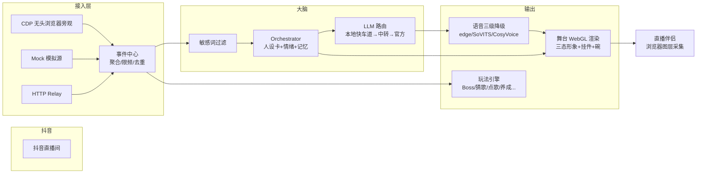

<div align="center">


# 🐟 雷霆小肥鱼 · AI 虚拟主播直播间

**一套跑在网页里的完整 AI 虚拟主播直播间 —— 抖音实时弹幕接入 · AI 大脑自动回复 · 三态绿幕形象 · 玩法系统 · 点赞喂饭特效 · 中控台，开箱即用。**

[](#-%E6%B1%82%E4%B8%80%E9%A2%97-star)
[](https://www.python.org/)
[](LICENSE)
[](#-抖音弹幕接入-cdp)
[](#-llm-接入)
[](#-快速开始)

**⭐ 如果这套系统帮到你开播了，请务必点一颗 Star —— 这是给开源作者最大的能量，也是持续更新的动力！⭐**

<br>


*▶ 真实运行截图：深海蓝娃娃房间 · 玻璃碗白米饭点赞特效 · 弹幕回复气泡 · 全部挂件接真实数据*

[]()

</div>

---

# 🔍 关键词（搜索直达）

`AI 虚拟主播` `抖音直播` `虚拟主播` `大肥鱼` `直播弹幕接入` `AI 主播` `vtuber` `直播陪聊` `绿幕虚拟形象` `直播伴侣` `AI 直播间` `弹幕互动玩法` `LLM 直播` `数字人直播` `点赞特效` `AI 女仆` `豆包 图生视频` `绿幕键控` `aiohttp`

---

# ✨ 它是什么

一个**把 AI 装进直播间**的完整开源系统：抖音直播间的弹幕、点赞、礼物、进场，全部实时喂给一个有记忆、有情绪、有人设的 AI 大脑；AI 的回复通过 TTS 说出来，配合三态绿幕虚拟形象（待机/说话/开心）+ 桌面玻璃碗点赞喂饭特效，组成一个 7×24 可运行的 AI 虚拟主播直播间。

**不是弹幕挂机工具，不是套壳 ChatGPT 页面** —— 是一整套：形象渲染器 + AI 大脑 + 玩法引擎 + 语音合成 + 中控台 + 数据面板，纯 Python 主栈 + 纯静态前端（零构建链）。

<div align="center">

| 🌙 待机 | 💬 说话 | 🎉 开心 |
|:---:|:---:|:---:|
|  |  |  |
| 安静时呼吸眨眼摆尾 | 弹幕回复口型+手势 | 收礼物眯眼大笑拍手 |

</div>

---

# 🖼 直播间实景

<div align="center">

**弹幕回复气泡 · 礼物事件卡**


</div>

> 💬 观众发弹幕 → AI 大脑实时回复 → 气泡打字机逐字吐出 + 礼物事件卡滑入 + 玻璃碗里的米粒跟着点赞飞进来。**所有挂件都是活的，全部接真实数据。**

---

# 📋 全功能清单

## 🎭 形象系统
| 功能 | 说明 |
|---|---|
| 三态绿幕形象 | 待机（呼吸眨眼摆尾）/ 说话（口型+手势）/ 开心（眯眼大笑拍手），弹幕回复自动切状态 |
| WebGL 双轨合成播放器 | RGB 轨 + 灰度遮罩轨双层合成，键控边缘干净，**无需 OBS 抠像插件** |
| 深海蓝娃娃房间 | 手绘风深海主题直播间背景 + 木纹桌板 |
| 玻璃碗点赞喂饭 | 观众点赞 → 米粒粒子飞进玻璃碗 → 饭堆上涨 → 攒满 250 她开吃（大笑+清空重攒） |
| 纯代码绘制 | 米堆/玻璃碗全部 canvas 代码绘制，贴合碗形，零图片依赖零物理引擎开销 |

## 🧠 AI 大脑
| 功能 | 说明 |
|---|---|
| 多通道路由 | 本地 LLM 快车道（1.6~3 秒回复）→ 云端中转 primary → 官方 API fallback，三级自动降级 |
| 人设卡系统 | `card.json + style.md`，语气样例注入 system prompt；观众发「人设傲娇/毒舌/高冷/病娇」实时换人设 |
| 情绪引擎 | 0-100 心情值（被夸+4 / 大礼+12 / 冷场衰减），低心情自动触发主动搭话 |
| 记忆系统 | 只记显式触发（"记住 xxx"），称呼/喜好/身份/约定四类键 |
| 每观众限频 | 同人 8s / 全局 2.5s / 滑动窗口 7 条，绝不刷屏 |
| 双向敏感词过滤 | 进来的弹幕过滤、出去的回复也过滤 |

## 💬 抖音弹幕接入（CDP）
| 功能 | 说明 |
|---|---|
| 五类事件 | 弹幕 / 进场 / 点赞 / 礼物 / 关注，实时接入 |
| 断线自动重连 | supervisor 循环 + 退避 |
| 只读旁观 | 不需要登录自己的账号，无互动风控 |
| 多源可插拔 | Mock 模拟源（不开播全流程演示）/ HTTP Relay / 官播 IPC |

## 🔊 语音合成（三级降级）
| 引擎 | 说明 |
|---|---|
| edge-tts | 在线合成，零成本开箱即用（元气少女音） |
| GPT-SoVITS | 本机 GPU 声线克隆 |
| CosyVoice | 备选引擎 |
| 流式切段 | 句级合成，字幕与语音逐句高亮同步，BGM 自动压音 |

## 🖥 中控台 + 数据面板
| 面板 | 内容 |
|---|---|
| 模块开关 | 每个模块独立启停，热生效 |
| AI 续航预算 | 余额 / 消耗速率 / **预计下播时间**实时推算 |
| 弹幕统计 | 事件分类计数 |
| LLM 追踪 | 每轮 prompt/模型/耗时全落盘 |
| 榜一榜二 + 养成 | 体重变身/投喂进度全落盘 |

<div align="center">


*▶ 中控台：语音层/大脑/配置全可视，密钥全本机存储*

</div>

## ⚡ 性能与稳定
- 舞台渲染 30fps 上限 + 暂停槽位零上传，CPU 占用低
- 服务掉线自动重连；模块级熔断，单模块故障不影响整体
- 39 个自动化测试覆盖核心链路

---

# 🏗️ 架构



---

# 🚀 快速开始（三步开播）

### ① 装 Python 3.12（勾选 Add to PATH）

### ② 安装依赖（6 个纯 Python 包，无编译无 GPU 要求）
```bash
cd 雷霆小肥鱼
pip install -r requirements.txt
```

### ③ 一键启动
```bash
启动.bat
```
> 自动起服务 + 自动开 Chrome 舞台窗口（免点击出声）。想先体验，`config/local.yaml` 打开 `ingress_mock` 即可看到全流程。

### 接入抖音真实弹幕
打开抖音直播间网页 → 复制网址里的房间号 → 填入 `config/local.yaml` 的 `ingress_cdp.room` → 重启。

### 开播（直播伴侣）
抖音直播伴侣 → 添加素材 → 浏览器图层 → `http://127.0.0.1:8188/`（720×1280）→ 开始直播。

---

# 🧠 LLM 接入

大脑走 **OpenAI 兼容协议**，任何一家中转/官方 API 都能接，支持三级降级路由（`config/config.yaml`）：

```yaml
brain:
  local_routes:                    # 本地 LLM 快车道（零 key，1.6~3s）
    - {url: "http://127.0.0.1:3425/v1", model: "auto/glm-5.3"}
  primary:                         # 主云通道
    base_url: "https://aimyria.com/v1"   # 源头中转站
    key_env: "AIMYRIA_KEY"               # 密钥走环境变量，绝不入库
    model: "deepseek-v4.1-flash"
  fallback:                        # 官方兜底
    base_url: "https://api.deepseek.com"
    key_env: "DEEPSEEK_API_KEY"
    model: "deepseek-chat"
```

---

# 🤝 合作伙伴 · LLM API 推荐

直播 7×24 在线，**AI 回复的稳定与成本就是生命线**。我们实测并推荐两家合作伙伴——正好对应本项目的「主云通道 + 官方兜底」三级路由架构：

<br>

### 🥇 AIMYRIA · 源头中转站 —— 稳定，是源头

[](https://aimyria.com)

| 卖点 | 说明 |
|---|---|
| 🗣 **稳定，是源头** | 源头中转，不做二手转售，稳定性第一 |
| 💰 **低于官方三折** | 按模型最低分组倍率计价，输入/输出分开计费，USD/百万 tokens |
| 🔌 **OpenAI 兼容** | 替换 baseURL 即用，零改造接入 |
| 📊 **模型状态广场** | 每个模型的可用状态实时可查 |
| 🎁 **注册送额度** | 三分钟跑通首条请求 |

> 本项目 `brain.primary` 主云通道指定接入 —— 直播间冷场 3 秒都是事故，我们把主通道交给它。

<br>

### 🥈 321AI · 模型广场 —— 全网大模型统一调度比价中心

[](https://321ai.cc)

| 卖点 | 说明 |
|---|---|
| ⚖️ **全网比价** | 各家大模型价格一目了然，先比价再接入 |
| 🔀 **统一调度** | 一套 Key 调用全网大模型，不用挨家开户 |
| 💡 **选型参考** | 直播场景选哪个性价比最高，看一眼就知道 |

> 搭配建议：在 321AI 比价选好模型 → 主力跑 AIMYRIA 源头中转 → 官方 API 兜底 —— 三级路由天然成型。

<br>

<div align="center">

*以上为合作伙伴推荐；本项目不绑定任何一家，OpenAI 兼容协议随意替换。*

</div>

---

# 🍚 点赞加饭 · 特效拆解

<div align="center">

| 🍚 空碗起步 | 🍚 米堆满碗 |
|:---:|:---:|
|  |  |
| 直播间冷启动 | 观众点赞喂饱 |

</div>

- 观众**每点一个赞** → 米粒粒子从点赞条飞进玻璃碗 → 饭堆上涨
- 攒满 **250** → 她大笑开吃 → 清空重攒
- **纯 canvas 代码绘制**：米粒 = 按碗内壁轮廓撒点的白色椭圆，贴合碗形，零图片零物理引擎开销
- 联动左侧「下播进度」：吃吃饭 N/2000 碗，攒满下播

---

# 🎨 素材与形象再生成

所有形象素材来自 **豆包图生视频 + 纯绿幕**（绿幕键控是数学最优情形）：

1. 豆包生成定稿形象立绘（纯绿幕 #00B140，全身不透明，禁用边缘光）
2. 图生视频：待机/说话/开心 三段，15 秒 1:1
3. 跑 `tools/make_assets_green.py`（绿幕键控管线：逐像素底板拟合 + 色度键控 + despill + 预乘存储）
4. 成品自动落到 `characters/avatar/`，舞台热生效

<div align="center">


*↑ 定稿形象（绿幕）*

</div>

> ⚠️ 设计纪律三条：**角色全身禁用绿色系**（绿幕会吃掉同色部位）、**全身不透明**（半透明无法完美还原）、**禁用边缘光**（毛边元凶）——守住这三条，键控质量直接拉满。详见 [docs/角色素材设计需求_v2.md](docs/角色素材设计需求_v2.md)。

---

# 📁 目录结构

```
├── server.py              主服务入口（aiohttp 单进程，端口 8188）
├── core/                  总线/事件中心/配置热加载
├── brain/                 AI 大脑（人设卡/情绪/记忆/LLM 路由/过滤）
├── ingress/               弹幕源（CDP 旁观/Mock/HTTP/官播 IPC）
├── shows/                 玩法引擎（Boss/猜歌/点歌/养成/纪念品/小游戏...）
├── voice/                 语音路由（edge/SoVITS/CosyVoice 三级降级）
├── console/               中控台桥接
├── web/static/            舞台页 + 中控台页 + 全部前端素材
│   └── vendor/            本地依赖（matter.js MIT / pixi / cubism）
├── characters/avatar/     三态绿幕键控成品（双轨 mp4）
├── tools/                 素材再生成管线
├── config/                配置（config.yaml 主配置 + local.yaml 本机覆盖）
├── docs/                  文档 + 截图
└── tests/                 自动化测试
```

---

# ❓ FAQ

**Q: 弹幕怎么接入的？需要登录我自己的抖音号吗？**
A: CDP 无头浏览器打开直播间网页版"旁观"，只读已鉴权连接的收帧，不登录不互动。存在账号风控风险，建议只挂自己的直播间。

**Q: 不开播能跑吗？**
A: 能。`config/local.yaml` 打开 `ingress_mock`，全流程（弹幕→大脑→语音→形象→玩法）本地即可演示。

**Q: AI 回复要花钱吗？**
A: 本地 LLM 快车道零成本；云通道按中转站计费。系统内置 AI 预算面板（余额/速率/预计下播时间），超支自动停。

**Q: 换个形象行不行？**
A: 行。豆包按设计纪律出三段绿幕视频，跑一遍 `tools/make_assets_green.py` 即可整套替换，管线全开源。

**Q: 语音一定要联网吗？**
A: edge-tts 在线合成（免费）；断网可接本机 GPT-SoVITS / CosyVoice，配置即切。

**Q: 和 Live2D / Neuro-sama 这类方案比呢？**
A: Live2D 需要建模师+美术管线；本项目用「绿幕视频 + 键控」路线，**个人开发者零美术成本**即可拥有会动的形象，且支持随时整只替换。

---

# ⚠️ 免责声明

- 抖音弹幕接入连接的是非公开私有协议，存在账号风控风险；**仅建议挂自己的直播间**，本项目只做只读旁观
- 虚拟主播内容为 AI 生成，请遵守平台 AI 内容标识规范（舞台已内置"AI 虚拟主播·非真人·内容由 AI 生成"标识）
- 请遵守各平台直播规范，合规开播

---

<div align="center">

**🐟 雷霆小肥鱼 · 让每个频道都有一条自己的 AI 美人鱼 🐟**

**⭐ 觉得有用？点一颗 Star 再走 —— 你的星星是我们更新的燃料 ⭐**

[](#-求一颗-star)

*LLM 算力由 [AIMYRIA 源头中转站](https://aimyria.com) 与 [321AI 模型广场](https://321ai.cc) 联合提供*

</div>
