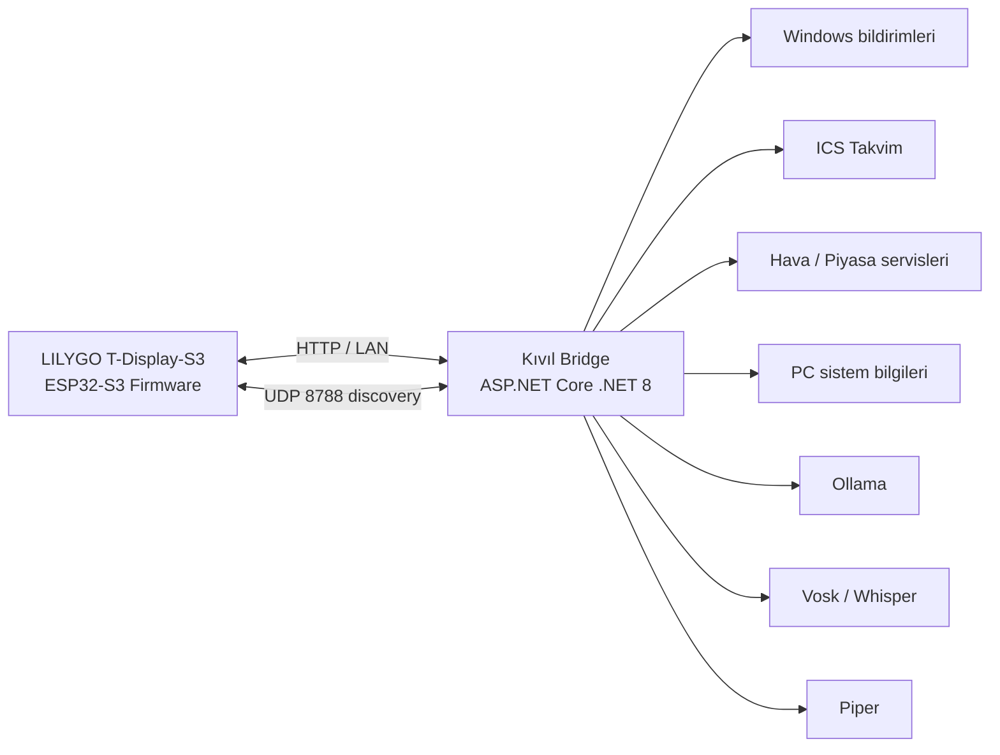

# Kıvıl v8.39

**Kıvıl**, LILYGO T-Display-S3 (ESP32-S3) üzerinde çalışan açık kaynak bir masaüstü asistanı projesidir. Proje iki ana parçadan oluşur:

1. **ESP32 firmware** — ekran, Kıvıl yüz animasyonları, saat, takvim, hava durumu, sistem bilgileri, bildirimler, kronometre ve mini oyunlar.
2. **Kıvıl Bridge (Windows)** — takvim/veri servisleri, bilgisayar sistem bilgileri, Windows bildirim aktarımı, Ollama tabanlı yerel yapay zekâ ve isteğe bağlı STT/TTS işlemleri.

> Bu depo **v8.39** kaynak kodunu temel alır. Bu, Retro Koşu ilerleme/engel aralığı düzeltmelerini içeren ve kullanıcının cihazında kurulu olduğu doğrulanan sürümdür.


## Neler yapabiliyor?

- Kıvıl yüzü ve durum animasyonları
- Saat ve tarih
- ICS takvim / yaklaşan toplantılar
- Hava durumu
- Döviz / piyasa ekranı
- PC CPU / RAM / GPU ve sıcaklık bilgileri
- Windows bildirimlerini cihaz ekranına aktarma
- Kronometre
- Kuş oyunu
- Retro Koşu oyunu
- Yerel ağ üzerinden web kontrol paneli
- OTA firmware güncelleme
- Ollama ile yerel yapay zekâ desteği
- Vosk veya Whisper ile konuşmayı yazıya çevirme (opsiyonel)
- Piper ile yerel seslendirme (opsiyonel)

## En hızlı başlangıç

Kıvıl'ı kullanmanın iki ayrı kurulumu vardır:

### A. Cihaza firmware yükle

Gerekli olanlar:

- **LILYGO T-Display-S3 / ESP32-S3R8**
- **USB-C veri kablosu** (yalnızca şarj kablosu olmamalı)
- Windows / macOS / Linux bilgisayar
- VS Code + PlatformIO
- LILYGO'nun resmi T-Display-S3 PlatformIO projesi

Bu v8.39 paketindeki firmware, tek başına bağımsız bir PlatformIO projesi değildir. `PortalSetup.ino` ve `pin_config.h`, LILYGO'nun T-Display-S3 PlatformIO ortamında derlenmek üzere hazırlanmıştır.

Ayrıntılı adımlar: **[Firmware Kurulum Rehberi](docs/FIRMWARE_INSTALL.md)**

### B. Windows Kıvıl Bridge'i kur

Son kullanıcı için en kolay yöntem, GitHub **Releases** bölümünden hazırlanmış `KivilBridgeSetup_v8_39.exe` dosyasını indirmektir.

Kaynak koddan üretmek için:

```bat
build_installer.cmd
```

Gerekli geliştirici araçları:

- Windows 10/11 x64
- .NET 8 SDK
- Inno Setup 6

Ayrıntılı adımlar: **[Windows Bridge Kurulum Rehberi](docs/WINDOWS_BRIDGE.md)**

## İlk Wi-Fi kurulumu

Firmware ilk açıldığında kayıtlı bir Wi-Fi ağı yoksa Kıvıl kendi kurulum ağını açar:

```text
Ağ adı: LILYGO-XXXX
Varsayılan şifre: 12345678
Kurulum adresi: http://192.168.4.1
```

1. Telefon veya bilgisayarla `LILYGO-XXXX` ağına bağlanın.
2. Tarayıcıda `http://192.168.4.1` adresini açın.
3. Kendi Wi-Fi ağınızı ve şifrenizi kaydedin.
4. Kıvıl yerel ağa bağlandıktan sonra cihaz ekranında/panelinde görünen IP adresini kullanın.
5. Windows'ta Kıvıl Bridge çalışıyorsa aynı yerel ağda otomatik olarak bulunur.

> **Güvenlik:** Firmware v8.39'da varsayılan admin şifresi `1234`, kurulum AP şifresi `12345678`'dir. İlk kurulumdan sonra admin şifresini değiştirin. Bridge portlarını internete yönlendirmeyin. Ayrıntılar için [SECURITY.md](SECURITY.md).

## Donanım

Test edilen temel kart:

| Bileşen | Özellik |
|---|---|
| Kart | LILYGO T-Display-S3 |
| MCU | ESP32-S3R8 |
| CPU | Çift çekirdek Xtensa LX7, 240 MHz'e kadar |
| Flash | 16 MB |
| PSRAM | 8 MB OPI |
| Ekran | 1.9 inç, 170×320 TFT |
| Kablosuz | 2.4 GHz Wi-Fi + Bluetooth LE |
| Kontrol | Kart üzerindeki 2 fiziksel tuş |
| Güç | USB-C veya uygun 1S LiPo/Li-ion |

**Pil uyarısı:** Yalnızca kartın desteklediği **1S 3.7 V LiPo/Li-ion** pil kullanın. 2S/7.4 V pil bağlamayın.

Daha fazla bilgi: **[Donanım ve Malzeme Listesi](docs/HARDWARE.md)**

## Proje yapısı

```text
Kivil/
├─ firmware/PortalSetup/
│  ├─ PortalSetup.ino          # ESP32-S3 ana firmware
│  └─ pin_config.h             # T-Display-S3 pin tanımları
├─ backend/KivilBridge/
│  ├─ Program.cs               # ASP.NET Core .NET 8 Bridge API
│  └─ KivilBridge.csproj
├─ windows/KivilBridgeTray/
│  ├─ Program.cs               # Windows tray + bildirim aktarımı
│  └─ KivilBridgeTray.csproj
├─ installer/
│  ├─ KivilSetup.iss           # Inno Setup tanımı
│  └─ SetupPrereqs.ps1         # Opsiyonel ön koşul kontrolleri
├─ assets/                     # Logo ve ikon
├─ previews/                   # Ekran önizlemeleri
├─ docs/                       # Kurulum ve teknik dokümantasyon
├─ build_installer.cmd
└─ build_tray.cmd
```

## Mimari



- ESP32 üzerindeki web sunucusu: **TCP 80**
- Bridge API: **TCP 8787**
- Bridge discovery: **UDP 8788**
- Ollama varsayılan yerel API: **TCP 11434**

Ayrıntılar: **[Mimari Dokümanı](docs/ARCHITECTURE.md)**

## Firmware teknolojileri

- C++
- Arduino framework
- PlatformIO
- TFT_eSPI
- WiFi / WiFiUDP
- WebServer / DNSServer
- Preferences (ESP32 NVS)
- HTTPClient
- Update (OTA)

## Windows tarafı

- C# / .NET 8
- ASP.NET Core Minimal API
- Windows Forms tray application
- NAudio 2.2.1
- Vosk 0.3.38
- LibreHardwareMonitorLib 0.9.6
- Inno Setup 6

Opsiyonel bileşenler:

- Ollama (`gemma3:1b` v8.39 varsayılan modeli)
- Piper TTS
- Vosk STT
- Whisper / faster-whisper
- Python 3.11 (Whisper kullanılırsa)

## Tuşlar

| İşlem | Davranış |
|---|---|
| Üst tuş kısa | Sıradaki widget |
| Üst tuş ~3 sn | Sesli dinleme |
| Alt tuş kısa | Aktif widget eylemi / oyunlarda uçma-zıplama |
| Alt tuş ~3 sn | Oyun sıfırlama veya ağ bilgi ekranı |
| İki tuş ~4 sn | Derin uyku / kapatma |
| Kapalıyken bir tuş ~2 sn | Uyandırma |

## Geliştirici kurulumu

Backend'i doğrudan çalıştırmak:

```powershell
cd backend/KivilBridge
dotnet restore
dotnet run
```

Kontrol:

```text
http://localhost:8787/api/ping
http://localhost:8787/api/status
```

Windows installer üretmek:

```bat
build_installer.cmd
```

Çıktı:

```text
installer\Output\KivilBridgeSetup_v8_39.exe
```

## GitHub Release önerisi

Kaynak kodu ana repoda tutun; büyük/derlenmiş dosyaları Git geçmişine koymak yerine GitHub **Releases** altında yayınlayın:

- `KivilBridgeSetup_v8_39.exe`
- `firmware.bin` — mevcut cihazlarda OTA güncelleme için
- İsteğe bağlı `SHA256SUMS.txt`

> İlk kez boş bir karta kurulum için yalnız `firmware.bin` dosyasını rastgele bir adrese yazmak yerine PlatformIO ile USB upload önerilir. Bootloader ve partition yapısı da doğru hazırlanmış olur.

Ayrıntılı yayın kontrol listesi: **[Open Source Release Checklist](docs/OPEN_SOURCE_RELEASE_CHECKLIST.md)**

## Güvenlik notu

v8.39 bir ev/ofis **güvenilir yerel ağ** projesi olarak tasarlanmıştır. Bridge varsayılan olarak `0.0.0.0:8787` üzerinde dinler; bu nedenle:

- TCP 8787 ve UDP 8788'i modem/router üzerinden internete açmayın.
- Windows Firewall'u kapatmayın; yalnız güvenilir Private network üzerinde izin verin.
- ESP32 admin şifresini değiştirin.
- Kişisel ICS takvim bağlantılarını, Wi-Fi şifrelerini ve `bridge-settings.json` gibi kullanıcı ayarlarını Git'e commit etmeyin.

Bkz. **[SECURITY.md](SECURITY.md)**.

## Katkı

Issue ve pull request'ler açıktır. Geliştirme akışı için [CONTRIBUTING.md](CONTRIBUTING.md) dosyasına bakın.

## Lisans

Kıvıl kaynak kodu **MIT License** ile yayınlanmaktadır. Ayrıntılar için [LICENSE](LICENSE).

Üçüncü taraf kütüphaneler, modeller ve dış servisler kendi lisans/şartlarına tabidir. Bkz. [THIRD_PARTY_NOTICES.md](THIRD_PARTY_NOTICES.md).

## Kaynaklar

- LILYGO T-Display-S3 resmi proje: https://github.com/Xinyuan-LilyGO/T-Display-S3
- PlatformIO: https://platformio.org/
- ESP32-S3: https://www.espressif.com/en/products/socs/esp32-s3
