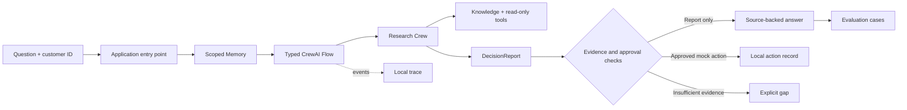

<p align="center">
  
</p>

<h1 align="center">Agentic Harness Engineering Workshop</h1>

<p align="center">
  A practical, zero-to-hero path from ordinary Python to a source-grounded CrewAI assistant you can inspect, test, and control.
</p>

<p align="center">
  
  
  
  
  <a href="LICENSE"></a>
</p>

<p align="center">
  <a href="#start-here">Start here</a> ·
  <a href="#check-your-machine">Check your machine</a> ·
  <a href="#learning-path">Learning path</a> ·
  <a href="#project-architecture">Architecture</a> ·
  <a href="#troubleshooting">Troubleshooting</a>
</p>

> [!NOTE]
> This is a **CrewAI** workshop. The sample company and research material are fictional. No lesson sends a real email, and the default path needs no paid API or external database server.

## What you will build

Start with a Python rule and a first model call. Add an agent loop, typed tools, an MCP connection, document Knowledge, scoped Memory, specialist Crews, a controlling Flow, approval gates, checkpoints, traces, and evaluations. The final project answers a question such as **“Should our company pilot this enterprise AI platform?”** with a conditional, source-backed recommendation.

Each topic is a folder with a runnable `1-topic.py` and a matching `1-topic.ipynb`. The notebook adds **Problem → Concept → Abstraction → Architecture → Steps → Failure mode → Production implication → Your turn** around the same executable code.

**Topics:** `agentic-ai` · `crewai` · `agent-harness` · `python` · `uv` · `mcp` · `rag` · `memory` · `multi-agent` · `flows` · `observability` · `evaluation`

The [technology stack and setup guide](setup.md) distinguishes the runnable core from the advanced FastAPI, Streamlit, LanceDB, PostgreSQL, Redis, NeMo Guardrails, Langfuse, Ragas, and Podman extensions.

## Start here

| Prerequisite | Why it is needed | How to get it |
| --- | --- | --- |
| **uv** on your operating system | Installs the locked Python environment and runs every command | [Official uv installation guide](https://docs.astral.sh/uv/getting-started/installation/) |
| **Python 3.12** | The workshop pins 3.12; `uv` can install it for you | `uv sync --locked --python 3.12` |
| **Ollama** for the default local path | Serves the chat and embedding models | [Official Ollama download](https://ollama.com/download) |
| **[`qwen3.5:4b`](https://ollama.com/library/qwen3.5:4b)** and **[`nomic-embed-text`](https://ollama.com/library/nomic-embed-text)** | Chat/tool use and Knowledge/Memory embeddings | `ollama pull qwen3.5:4b` and `ollama pull nomic-embed-text` |
| **A terminal and Jupyter-capable editor** | Runs scripts and notebooks | JupyterLab is installed by `uv sync` |

The **core track** needs no container engine, PostgreSQL, Qdrant, or separate SQLite installation. CrewAI's local Knowledge storage uses the installed Chroma package; Python supplies SQLite. Workshop runtime files are kept under ignored `workshop/.workshop-data/`. See the [CrewAI Knowledge documentation](https://docs.crewai.com/v1.15.22/en/concepts/knowledge) for the distinction between built-in Knowledge storage and optional vector-store integrations.

### Windows · PowerShell

Install [uv](https://docs.astral.sh/uv/getting-started/installation/) and [Ollama](https://ollama.com/download), open Ollama, then run from the repository root:

```powershell
powershell -ExecutionPolicy Bypass -File .\setup-windows.ps1
ollama pull qwen3.5:4b
ollama pull nomic-embed-text
uv run python tools\check_prerequisites.py
uv run python workshop\00-verify\1-verify_setup.py
```

`setup-windows.ps1` creates native Windows `.venv` from `uv.lock`, creates `.env` if missing, and checks the local MCP subprocess without a model call. It **replaces an incompatible Linux `.venv`** in this checkout; keep Windows and WSL environments separate.

### macOS · Linux

Install [uv](https://docs.astral.sh/uv/getting-started/installation/) and [Ollama](https://ollama.com/download), start the Ollama app or service, then run:

```bash
uv sync --locked --python 3.12
test -f .env || cp .env.example .env
ollama pull qwen3.5:4b
ollama pull nomic-embed-text
uv run python tools/check_prerequisites.py
uv run python workshop/00-verify/1-verify_setup.py
```

On Linux, if Ollama is not already running as a service, start `ollama serve` in another terminal before the two checks. On Windows/macOS, opening the Ollama application typically starts the local server.

### WSL with a Windows checkout

Do not run Linux Python from the Windows `.venv`. Use a separate checkout, or create a WSL-only environment in this checkout and keep the variable set for future `uv run` commands:

```bash
export UV_PROJECT_ENVIRONMENT="$PWD/.venv-wsl"
uv sync --locked --python 3.12
test -f .env || cp .env.example .env
uv run python tools/check_prerequisites.py
```

If Ollama runs on Windows rather than inside WSL, its `localhost:11434` endpoint must be reachable from WSL. If it is not, set `WORKSHOP_MODEL_BASE_URL` and `WORKSHOP_OLLAMA_EMBED_URL` in `.env` to an address WSL can reach; the prerequisite checker tests both.

## Check your machine

Run the reusable preflight after syncing dependencies:

```bash
uv run python tools/check_prerequisites.py --offline
uv run python tools/check_prerequisites.py
uv run pytest -q
```

The **offline** pass checks Python 3.12, `uv`, the installed CrewAI/MCP/Jupyter packages, embedded SQLite, and writable local storage. The **full** pass also queries the configured Ollama endpoint and confirms that both model names have been downloaded. It exits nonzero for a missing required item. The `pytest` suite checks deterministic contracts without making model calls.

> [!IMPORTANT]
> A successful package install does **not** mean Ollama is running. If the full checker reports `Ollama service FAIL`, start Ollama and rerun it before trying the model-dependent lessons.

For an approved hosted fallback, copy `.env.example` to `.env` and explicitly set `WORKSHOP_MODEL=openai/<approved-model>`, `WORKSHOP_EMBEDDING_PROVIDER=openai`, `WORKSHOP_EMBEDDING_MODEL=text-embedding-3-small`, and `OPENAI_API_KEY`. Do not commit `.env`, silently switch providers, or upload real company documents without approval. The local-model examples are the default teaching path.

## Learning path

| Stage | Lesson | You will be able to… |
| :--- | :--- | :--- |
| 00–02 | [Setup](workshop/00-verify/) · [Python to LLM](workshop/01-python-to-llm/) · [Agent loop](workshop/02-agent-loop/) | Separate a rule, a model call, and a bounded agent loop |
| 03–04 | [Typed tools](workshop/03-tools/) · [MCP](workshop/04-mcp/) | Validate a Python tool and discover one from a local server |
| 05–06 | [Knowledge](workshop/05-knowledge/) · [Memory](workshop/06-memory/) | Ground claims in documents and isolate customer context |
| 07–08 | [Crews](workshop/07-crews/) · [Flows](workshop/08-flows/) | Coordinate specialists with typed state and bounded branches |
| 09–10 | [Controls](workshop/09-control/) · [Recovery](workshop/10-resilience/) | Gate a mock action and resume interrupted work safely |
| 11–12 | [Observability](workshop/11-observability/) · [Evaluation](workshop/12-evaluation/) | Trace decisions and turn behavior into repeatable checks |
| 13–14 | [End-to-end project](workshop/13-project/) · [Capstone](workshop/14-capstone/) | Run the complete assistant and diagnose seeded harness faults |

### Advanced extension · topics 15–22

The [advanced setup](setup.md#advanced-track-end-to-end-application) adds a thin [FastAPI boundary](workshop/15-api/) and [Streamlit UI](workshop/16-ui/), a separate [LanceDB retriever](workshop/17-lancedb-rag/), [PostgreSQL and Redis](workshop/18-state/), [NeMo Guardrails using Ollama](workshop/19-nemo-guardrails/), opt-in [Langfuse traces](workshop/20-langfuse/), [Ragas evaluation](workshop/21-ragas/), and [Podman deployment](workshop/22-podman/). Each has the same script/notebook teaching pair. They do not change the core prerequisite path.

```bash
uv sync --locked --extra advanced --python 3.12
uv run --extra advanced python tools/check_prerequisites.py --offline --advanced
```

The advanced code and Compose manifest are in place; live Ollama/Redis/PostgreSQL/Langfuse runs still require those services. The API's mock approval is instructor-token protected and never sends email. Do not expose the demo's shared tokens or fictional customer-scoping scheme as production authentication.

Run a script or open its same-name notebook from the repository root:

```bash
uv run python workshop/03-tools/1-custom_tools.py
uv run jupyter lab workshop/03-tools/1-custom_tools.ipynb
```

Select the **project's uv Python environment** as the notebook kernel. The notebooks are saved without execution outputs so participants can produce and inspect their own runs. The capstone intentionally prints eight `FAIL` results before learners repair its seeded faults.

## Project architecture



The Flow owns routing and retry limits; agents do bounded research; Python owns validation and side effects. The MCP server exposes a local read-only ROI calculation. The mock email writes only a local record, never a real message. See the [workshop guide](workshop/README.md) for the full run order and [plan](plan.md) for the one-day schedule and project decisions.

## Troubleshooting

| Symptom | Check |
| --- | --- |
| `Ollama service FAIL` or connection refused | Open/start Ollama; run `ollama list`; verify the configured endpoint in `.env` |
| Chat works, Knowledge or Memory fails | Pull `nomic-embed-text` and verify `WORKSHOP_OLLAMA_EMBED_URL` separately |
| `uv run` selects an incompatible interpreter | Do not share `.venv` between Windows and WSL; use the WSL-only environment above |
| MCP tool is not discovered | Run `uv run python tools/verify_windows.py` on native Windows, or check that the local MCP server starts with the current interpreter |
| Notebook uses the wrong packages | Switch its kernel to the environment created by `uv sync` and start JupyterLab from the repository root |
| Mock email says `ALREADY_RECORDED` | The lesson reuses a stable action ID to demonstrate idempotency; this is expected on a second run |

## More than the README

- [Participant pre-work](workshop/PREWORK.md) and [guided labs](workshop/labs/lab-exercises.md)
- [Instructor runbook](workshop/INSTRUCTOR-RUNBOOK.md), [slides](workshop/slides/workshop-slides.md), and [capstone instructor notes](workshop/14-capstone/INSTRUCTOR.md)
- [Workshop implementation guide](workshop/README.md) and [full plan](plan.md)
- [CrewAI docs](https://docs.crewai.com/v1.15.22/en/concepts/production-architecture), [uv install](https://docs.astral.sh/uv/getting-started/installation/), and [Ollama download](https://ollama.com/download)

<p align="center"><sub>Built for learning with fictional data · CrewAI throughout · MIT licensed</sub></p>
