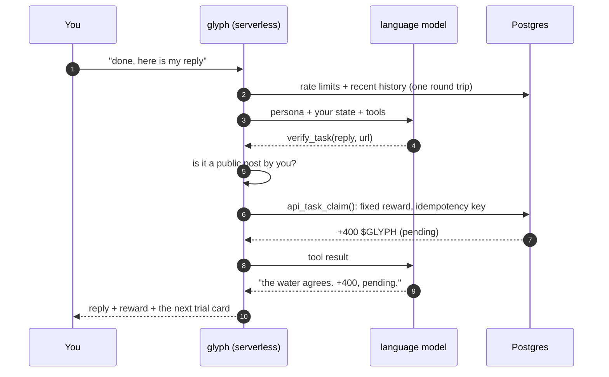
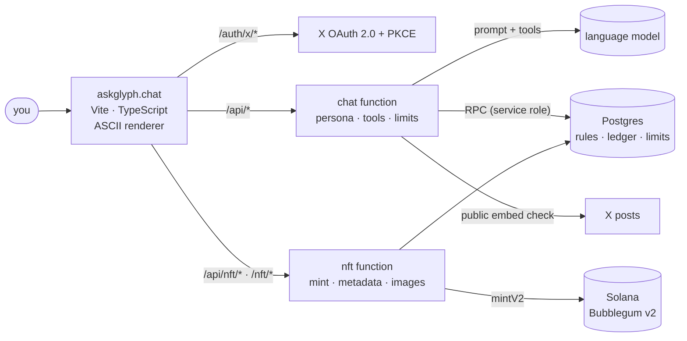

<p align="center">
  <picture>
    <source media="(prefers-color-scheme: dark)" srcset=".github/assets/banner-dark.jpg">
    
  </picture>
</p>

<h1 align="center">glyph</h1>

<p align="center">
  <b>an old manta made of ascii. keeper of the $GLYPH reserve.</b><br>
  talk to it, pass its trials on X, make your case, and leave with an on-chain card.
</p>

<p align="center">
  <a href="https://askglyph.chat"></a>
  <a href="https://x.com/askglyph"></a>
  
  
  
  
  <a href="LICENSE"></a>
</p>

<p align="center">
  <a href="#what-it-is">What it is</a> ·
  <a href="#how-a-turn-works">How a turn works</a> ·
  <a href="#the-glyph-card">The glyph card</a> ·
  <a href="#architecture">Architecture</a> ·
  <a href="#run-it">Run it</a> ·
  <a href="#security">Security</a>
</p>

---

## What it is

glyph is a conversational agent with a body: an ASCII manta rendered live in your browser, gliding through a field of glyphs. It runs the **$GLYPH reserve**. It hands out trials on X and checks them, credits a pending allocation, listens to your pitch for more, and mints your glyph card straight to your wallet as a compressed NFT.

No forms, no dashboard. One chat window and a creature that answers.

<p align="center">
  
</p>

## Highlights

- **A character, not a chatbot.** glyph's voice, pacing and rules live in one persona spec ([`shared/persona.mjs`](shared/persona.mjs)). It talks, teases, remembers what is already on screen, and only reaches for a card when the conversation gets there.
- **Words from the model, numbers from the database.** The language model can *propose* a tool call (`verify_task`, `judge_pitch`, `save_wallet` and so on). It can never say "add 500". Every reward is a fixed SQL function behind an idempotency key.
- **Sign in with X, nothing in between.** OAuth 2.0 + PKCE in two serverless functions, an HMAC-signed session cookie, and the X token is revoked as soon as the profile is read.
- **Real checks where they are free.** Reply and quote links must be public posts by the signed-in account (verified through X's public embed endpoint). Timer trials run on the server clock, not the browser's.
- **On-demand compressed NFTs.** Nothing is pre-minted. When you press mint, the server builds one Bubblegum v2 instruction for *your* wallet, signs it and sends it. The signature is stored before broadcast, so a retry can never mint twice.
- **Living metadata.** Each card is drawn on the server (SVG → PNG with resvg in WebAssembly) from the current database state, so the number on your NFT follows your allocation.
- **An ocean made of characters.** A Canvas2D engine turns a low-res simulation into cells of glyphs: mantas, schools of fish, ripples under your cursor. It respects `prefers-reduced-motion`.
- **Degrades gracefully.** No model endpoint, or a slow one? A scripted brain answers with the same tools. Per-user and site-wide budgets keep the bill flat.

## How a turn works



The model gets a strict tool interface and a hard deadline. If it is late or fails, the scripted brain answers in its place, with the same tools, so the user never waits on a spinner.

## The journey

| | Step | What happens |
|---|---|---|
| 1 | `/glyphfree` | The deal in one breath, and the first trial. |
| 2 | Trials on X | Follow, like, repost, reply, quote your card. Each one is checked and credited to your pending allocation. |
| 3 | The pitch | Three attempts to talk glyph into more. Tough but fair; it is capped and paid once per tier. |
| 4 | `/mintallo` | Your glyph card as a compressed NFT, minted to your wallet. The reserve pays the gas. |
| 5 | Quote it | Quote the pinned post with your NFT for a bonus, then watch the countdown to launch. |

## The glyph card

<p align="center">
  
</p>

Every card is unique to its owner. The manta's markings are seeded by your handle, and the card carries your diver number, rank, allocation and the reserve's stamp. The image and the Metaplex metadata are served from [`/nft/<id>.json`](netlify/functions/nft.mjs) and drawn from the database on request (CDN-cached), so the card stays current after it is minted.

| Card | Details |
|---|---|
| Standard | Metaplex Bubblegum v2 compressed NFT in an MPL Core collection |
| Mint | on demand, one per person, signed only for a transaction the server built itself |
| Cost | about 0.0001 SOL per card; the merkle tree is paid once |
| Safety | signature stored before broadcast; a failed or expired transaction is detected on chain before any retry |

## Architecture



| Layer | Built with |
|---|---|
| Front | Vite + strict TypeScript, no framework. Canvas2D ASCII ocean, FLIP-animated composer, light and dark water |
| Server | Netlify Functions (Node), edge rate limits, `no-store` on every API response |
| Data | Postgres reached only through RPC with a service role. RLS on every table with no policies, so the browser cannot touch it |
| Identity | X OAuth 2.0 + PKCE, HMAC-SHA256 session cookie, `timingSafeEqual` checks |
| Mind | a language model behind an OpenAI-compatible endpoint, with a scripted brain as fallback |
| Chain | Solana · Metaplex Bubblegum v2 · MPL Core collection · umi |
| Images | server-side SVG → PNG with resvg (WebAssembly) and bundled fonts |

### Repository layout

```
src/                 the site: chat UI, glyph card, ASCII ocean engine
  ocean/             renderer + creatures (mantas, fish, ripples)
  backend/           live API client and the localStorage DEMO backend
shared/              brand, persona, scripted brain, tasks: one source for client and server
netlify/functions/   api (chat, tasks), auth-start / auth-callback (X), nft (mint, metadata, images)
netlify/lib/         agent loop, sessions + CSRF, X post checks, NFT renderer, Solana mint
supabase/migrations/ 0001 → 0012: schema, rules, limits, ledger, NFT mints (run in order)
scripts/             nft-setup: minting wallet, merkle tree, collection
docs/                operations: rewards, limits, allowlist, minting
```

## Run it

```bash
npm install
npm run dev            # DEMO mode: scripted brain, everything in localStorage → http://127.0.0.1:5191
npx netlify-cli dev    # with the functions (needs .env) → http://127.0.0.1:8888
npm run build          # → dist/
```

**Database.** Create a Postgres project (Supabase works out of the box) and run `supabase/migrations/0001_init.sql` → `0012_mint_trials.sql` in order.

**Environment.** Copy `.env.example` to `.env`. Server-side only; nothing secret ever gets a `VITE_` prefix.

| Variable | What it is |
|---|---|
| `X_CLIENT_ID`, `X_CLIENT_SECRET` | X app (Web App, OAuth 2.0). Callback: `https://<your-domain>/auth/x/callback` |
| `SESSION_SECRET` | 32+ random characters |
| `SUPABASE_URL`, `SUPABASE_SERVICE_ROLE_KEY` | Postgres over RPC, server only |
| `SITE_URL` | your public origin, e.g. `https://askglyph.chat` |
| `MODEL_BASE_URL`, `MODEL_API_KEY`, `MODEL_NAME` | any OpenAI-compatible chat-completions endpoint. Without it, the scripted brain answers |
| `MODEL_OPTIONS` | optional JSON merged into each model request |
| `NFT_RPC_URL`, `NFT_SECRET_KEY`, `NFT_TREE`, `NFT_COLLECTION`, `NFT_NETWORK` | minting (see `scripts/nft-setup.mjs`) |

**Minting.** `node scripts/nft-setup.mjs keygen`, then `tree --yes` and `collection --site https://<your-domain> --yes`. Start on devnet. Operations and admin SQL: [`docs/OPERATIONS.md`](docs/OPERATIONS.md).

**Deploy.** `npx netlify-cli deploy --build --prod`. A drag-and-drop upload ships static files only, without the functions.

## Security

- The browser never talks to the database. No anon key, no service key, no table grants: only server functions call RPCs.
- Amounts never come from the client or the model. The client states an intent (`task_id`, a link); SQL decides what it is worth, once.
- Every mutation requires a JSON body and a same-origin `Origin` / `sec-fetch-site`. Every API response is `no-store`.
- The minting key signs only the one instruction the server built: our tree, the wallet from the database, metadata on our domain.
- Rate limits at the edge and in the database. Daily model budgets per user and for the whole site.

Found something? See [SECURITY.md](SECURITY.md).

## Disclaimer

Allocations shown in the app are **pending**, not a balance, and are reviewed before any distribution. Nothing here is financial advice. Not affiliated with X.

## License

[MIT](LICENSE) © 2026 glyph
