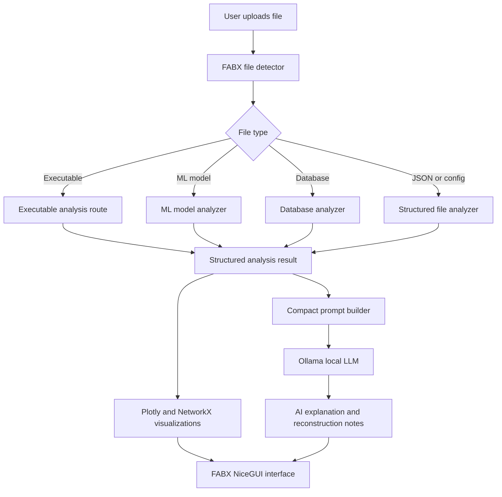
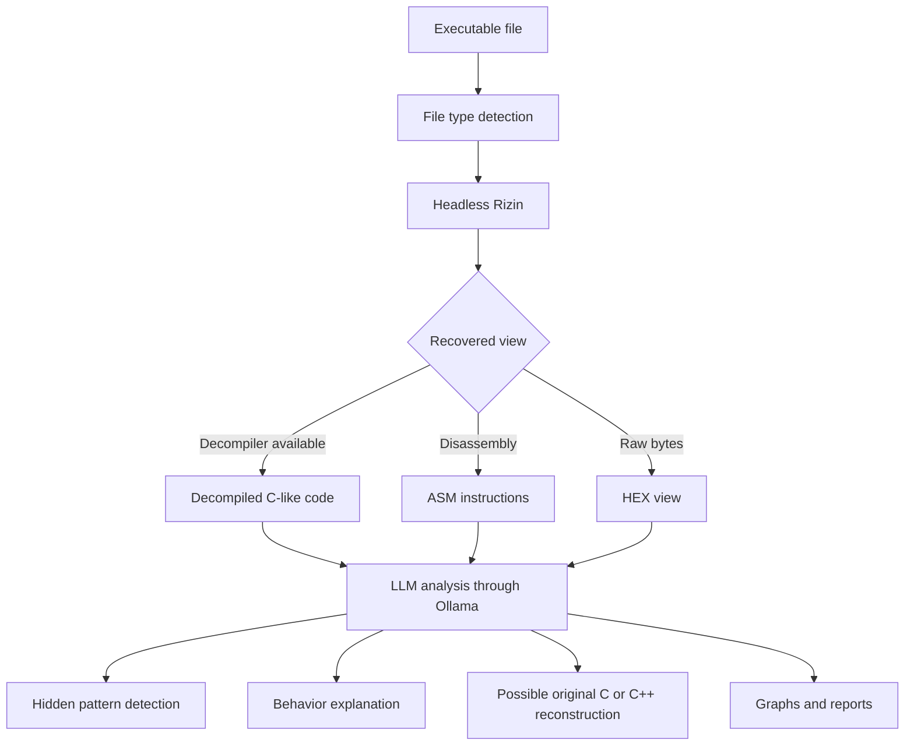
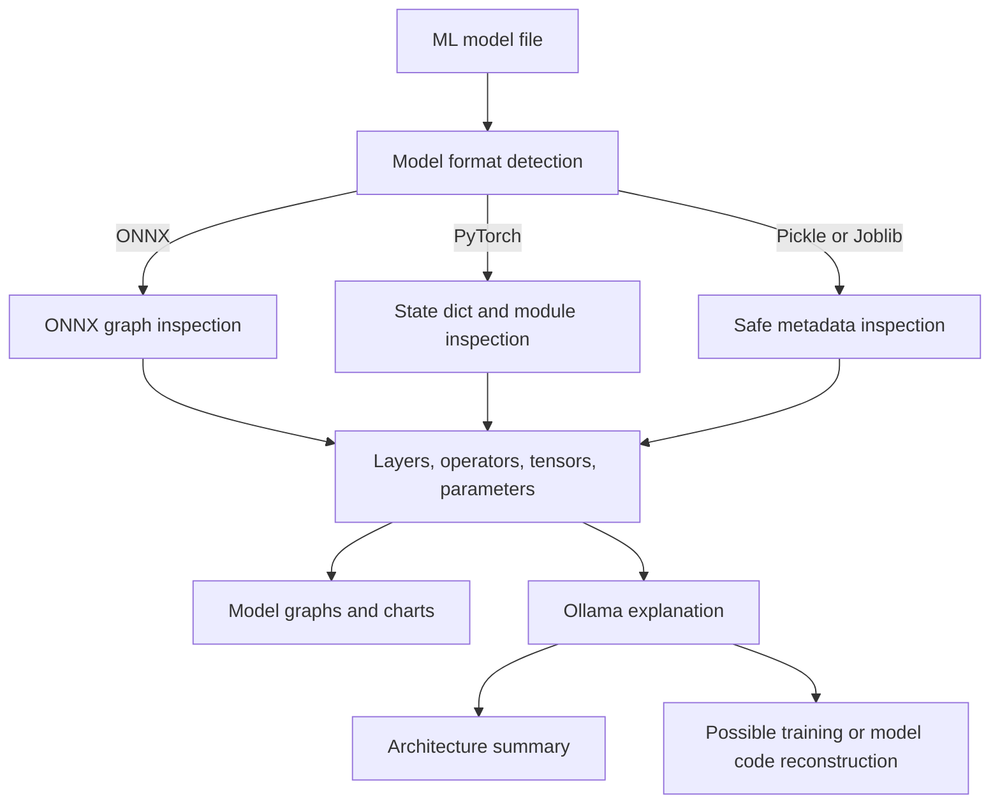
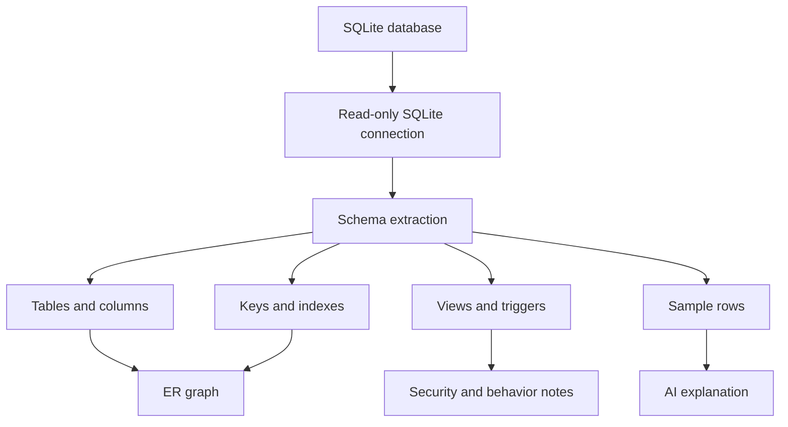
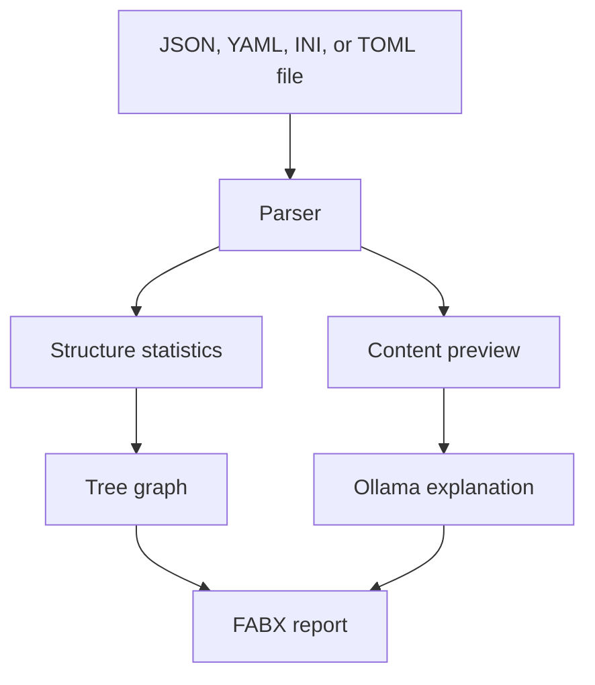

# FABX

FABX is an AI-powered reverse engineering and file intelligence tool. It is built to take complex files such as executables, machine learning models, databases, and structured data files, extract useful technical structure from them, draw visual maps, and use a local LLM through Ollama to explain what is happening.

The goal of FABX is simple: turn hard-to-read software artifacts into readable intelligence.

Instead of only showing raw bytes, tables, tensors, or assembly, FABX tries to answer practical questions:

- What type of file is this?
- What structure exists inside it?
- What functions, layers, tables, keys, or objects can be recovered?
- What hidden patterns or suspicious details are visible?
- What would the original source code or design have looked like?
- How can this be explained clearly to a developer, analyst, or researcher?

## What FABX Supports

Current analyzer routes in this codebase support:

- Executable detection: `.exe`, `.dll`, `.elf`, `.so`, `.bin`
- SQLite databases: `.db`, `.sqlite`, `.sqlite3`
- Machine learning models: `.onnx`, `.pt`, `.pth`, `.pkl`, `.joblib`
- Structured/config files: `.json`, `.yaml`, `.yml`, `.ini`, `.toml`

FABX is designed to expand into more executable and model formats, including Python executables, Java executables, other compiled languages, web language bundles, TensorFlow formats, GGUF models, and more.

## Core Idea

FABX detects the uploaded file type, sends it to the correct analyzer, builds structured results, generates plots, and then asks a local LLM to explain the result.



## Executable Reverse Engineering

For executable files, FABX is intended to use headless Rizin as the reverse engineering backend. The executable route detects files such as `.exe`, `.dll`, `.elf`, `.so`, and `.bin`, then routes them toward binary analysis.

The intended executable workflow is:



The AI reconstruction step is best-effort. Because compiled executables usually lose original variable names, comments, formatting, and some type information, FABX may rename variables and produce approximate C or C++ code. The generated code should be treated as readable reconstruction, not guaranteed original source.

In this repository snapshot, executable files are detected and routed to `exe_analyzer`. Deep Rizin-backed extraction is the expected engine for the full executable workflow.

## Machine Learning Model Analysis

FABX analyzes machine learning model files and extracts structural details where possible.

Supported model formats in the current code include:

- ONNX: `.onnx`
- PyTorch: `.pt`, `.pth`
- Pickle-based models: `.pkl`
- Joblib models: `.joblib`

The model analyzer can report:

- Model format
- Inputs and outputs
- Layers and operators
- Weight and bias shapes
- Parameter counts
- Activation layers when recoverable
- Checkpoint keys
- Pickle opcode summaries
- Safety warnings for formats that may execute code when loaded

FABX then builds model visualizations and asks Ollama to explain the model structure and, where reasonable, describe what code could have produced it.



## Database Analysis

For SQLite databases, FABX opens the database in read-only mode and extracts schema information.

Database analysis includes:

- SQLite metadata
- Tables and columns
- Data types
- Primary keys
- Foreign keys
- Indexes
- Views
- Triggers
- Row counts
- Sample rows
- Relationship maps



## JSON and Structured File Analysis

FABX also supports structured files such as JSON, YAML, INI, and TOML. These files are parsed into structured data and summarized.

Structured file analysis includes:

- Top-level keys
- Nested depth
- Object counts
- Array counts
- Scalar counts
- Section names
- Key counts
- Text preview
- Tree visualization



## AI Layer

FABX uses Ollama for local AI explanations. The LLM does not receive the raw uploaded file directly. Instead, FABX sends compact structured analyzer output, which keeps prompts smaller and easier to review.

The AI layer can:

- Explain the analyzed file
- Summarize important findings
- Highlight security notes
- Generate documentation-style reports
- Describe likely behavior
- Suggest possible original C/C++ or model-building code when enough evidence exists

If Ollama is unavailable, FABX shows a deterministic fallback explanation.

## Visualizations

FABX generates interactive Plotly visualizations using NetworkX graph data.

Available visualizations include:

- Database ER relationship graph
- Database table-column graph
- ONNX computation graph
- ONNX operator distribution chart
- PyTorch inferred layer graph
- PyTorch parameter chart
- JSON/config tree graph
- Summary metric charts

## Project Structure

```text
fabx/
|-- app.py
|-- ai/
|   |-- __init__.py
|   `-- ollama_client.py
|-- backend/
|   |-- __init__.py
|   |-- analyzer.py
|   |-- detector.py
|   `-- visualization.py
|-- frontend/
|   |-- __init__.py
|   `-- nicegui_app.py
|-- test_files/
|   |-- example.db
|   `-- test.json
|-- requirements.txt
|-- README.md
`-- LICENSE
```

## Installation

Create a virtual environment:

```bash
python -m venv venv
```

Activate it:

```bash
venv\Scripts\activate
```

On macOS or Linux:

```bash
source venv/bin/activate
```

Install dependencies:

```bash
pip install -r requirements.txt
```

## Running FABX

Start the application from the project root:

```bash
python app.py
```

Then open:

```text
http://127.0.0.1:8080
```

## Optional Ollama Setup

FABX can run without Ollama, but local AI explanations require Ollama and at least one local model.

Start Ollama:

```bash
ollama serve
```

Pull a model:

```bash
ollama pull llama3.1
```

Run FABX again:

```bash
python app.py
```

## Command Line Analyzer

You can also run the backend analyzer directly:

```bash
python backend/analyzer.py test_files/test.json
```

For trusted PyTorch, Pickle, or Joblib files that require deeper loading:

```bash
python backend/analyzer.py path/to/model.pkl --unsafe-load
```

Only use `--unsafe-load` for files you trust. Pickle-style formats can execute code during loading.

## Important Safety Notes

- Analyze only files you own or are authorized to inspect.
- Treat AI-generated source reconstruction as approximate.
- Original variable names and comments are usually not recoverable from compiled executables.
- Pickle, Joblib, and some PyTorch files can be unsafe to deserialize.
- Use `--unsafe-load` only with trusted files.
- Executable reverse engineering should be used for defensive research, education, interoperability, and authorized analysis.

## Roadmap

FABX is moving toward broader software reverse engineering support:

- Full Rizin headless integration for executables
- Decompiled C-like output, ASM output, and HEX output
- Control-flow and call graphs
- Suspicious API and behavior detection
- Python executable analysis
- Java executable analysis
- Web bundle and script analysis
- More ML formats such as TensorFlow and GGUF
- AI-assisted code reconstruction
- Exportable reports
- Project workspaces and batch analysis

## Author

Developed by **Arshvir**
`AI Researcher | Software Engineer`

```Built for reverse engineers, software engineers, security researchers, AI researchers, students, and anyone exploring complex software artifacts.```

## Contributing

FABX is open to collaboration.

You can help by:

- Raising issues
- Suggesting new analyzers
- Improving reverse engineering workflows
- Submitting pull requests
- Testing FABX with different file formats
- Sharing ideas for AI-powered software analysis

Contributions, feedback, and research ideas are welcome.

## License

FABX is released under the GNU Affero General Public License v3.0. See [LICENSE](LICENSE) for details.
