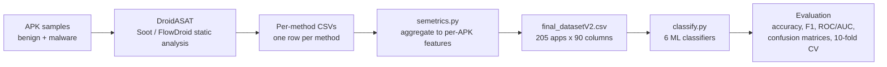

# SEMetrics: Android Malware Classification

Classifying Android apps as benign or malware using software-engineering metrics extracted by static analysis.

## Overview

This project detects Android malware without running or dynamically analyzing the apps. Instead, it statically extracts method-level software-engineering metrics (lines of code, control-flow complexity, fan-in/fan-out, number of branches and invokes, visibility flags) from each APK, aggregates those metrics into a per-app feature vector, and trains machine learning classifiers to separate benign apps from malware.

Software-engineering metrics are useful here because malicious and benign code tend to differ structurally even when their behavior is intentionally obfuscated: malware authored to evade dynamic/behavioral detection often still shows distinctive patterns in code complexity, method size distribution, and call structure. Because this approach only needs static metrics, it is cheap to compute at scale and does not require executing untrusted APKs.

## Pipeline



`DroidASAT` (not included in this repository) is a static analysis tool built on [Soot](https://github.com/soot-oss/soot) and [FlowDroid](https://github.com/secure-software-engineering/FlowDroid). It walks each APK's decompiled methods and writes one CSV per APK. `semetrics.py` reads a manifest of those CSVs, computes 8 statistics (`Sum, Var, Std, Mean, Median, Max, Min, Range`) over each of 11 method-level metrics for every APK, and writes the consolidated dataset. It then calls `classify.py`, which trains and evaluates 6 classifiers on that dataset.

## Dataset

`data/final_datasetV2.csv` — **205 apps** (103 benign, 102 adware), **90 columns**: 11 base method-level metrics (`CFG-Size, Fan-In, Fan-Out, Is-Private, Is-Protected, Is-Public, Is-Static, LOC, Number-Of-Branches, Number-Of-Invokes, Number-Of-Parameters`) each summarized by 8 statistics across all of an app's methods, plus `Number-Of-Methods` and the `Class` label (`0` = benign, `1` = malware). The malware samples are all drawn from a single malware category (adware) — see Limitations.

## Results

80/20 train/test split, held-out test set of 41 apps (21 benign, 20 malware):

- **Nearest Neighbors** — Accuracy 0.8780, F1 0.8769, ROC AUC 0.9476
- **Naive Bayes** — Accuracy 0.6341, F1 0.6306, ROC AUC 0.7810
- **Random Forest** — Accuracy 0.8537, F1 0.8514, ROC AUC 0.9833
- **Decision Tree** — Accuracy 0.8049, F1 0.7990, ROC AUC 0.8095
- **AdaBoost** — Accuracy 0.9024, F1 0.9019, ROC AUC 1.0000 (best overall)
- **Neural Networks** — Accuracy 0.9024, F1 0.9019, ROC AUC 0.9595

Random Forest, 10-fold stratified cross-validation: **mean accuracy 0.9362, std 0.0492**.


Full per-classifier reports and confusion matrices: [`results/split_80_20.txt`](results/split_80_20.txt), [`results/rf_10fold.txt`](results/rf_10fold.txt), [`results/figures/confusion_matrices/`](results/figures/confusion_matrices/).

## Limitations

- The held-out test set is small (41 apps), so individual-split metrics have high variance.
- The malware class covers a single family/category (adware), not malware in general — results may not generalize to other malware types.
- Evaluation relies on one fixed random 80/20 split (plus a separate 10-fold CV for Random Forest only); no repeated-split variance analysis was done.
- No feature selection or multicollinearity check was performed — many of the 90 features are correlated by construction (e.g. `Sum-X` and `Mean-X` are both derived from the same per-method values).

## How to run

### (a) Classification only, from the included CSV

No Java, Soot, or APKs required — this reproduces all results and figures in `results/` from `data/final_datasetV2.csv`.

```bash

python -m venv venv
source venv/bin/activate   # venv\Scripts\activate on Windows
pip install -r requirements.txt
python src/classify.py data/final_datasetV2.csv
```

### (b) Full pipeline, from raw APKs

Requires external tools not included in this repository:

- [Java 8](https://adoptium.net/temurin/releases/?version=8)
- [Soot](https://github.com/soot-oss/soot)
- [FlowDroid](https://github.com/secure-software-engineering/FlowDroid)
- Android platform stub jars ([Android SDK platforms](https://developer.android.com/tools/releases/platforms))
- `DroidASAT.jar` — static analysis tool developed by Dr. Shahid Alam (not included in this repository)

With `lib/` (Soot, FlowDroid, android platform jars), `DroidASAT.jar`, and `samples/benign/` + `samples/malware/adware/` (APKs) placed at the repo root:

```bash
scripts\run_droidasat.bat
python src/semetrics.py -f list_of_csv_files.txt -csv data/final_datasetV2.csv
```

`semetrics.py` calls `classify.py` automatically after building the dataset.

## Team

- Abdulaziz Mansour Alshammari - [GitHub](https://github.com/aziz79-source)
- Mohammed Salamah Alenezi - [GitHub](https://github.com/mohammadalmzed)
- Hamad Nasser Al-khumaysh - [GitHub](https://github.com/HAMAD-9)
- Mohammed Jamaan Alrshidi - [GitHub](https://github.com/mohammedalra115)

## Credits

- Project supervised by Dr. Shahid Alam, University of Ha'il.
- Static analysis performed with DroidASAT, developed by Dr. Shahid Alam (not included in this repository).

Originally developed as a course project for Secure Software Development (ISEC 363), University of Ha'il, 2026.
<!-- TODO: add a LICENSE file before making this repository public.😲  -->
 
