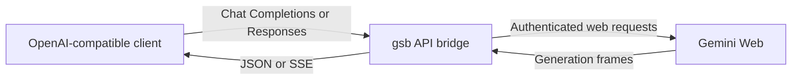

# gemini-stealth-bridge (`gsb`)

OpenAI-compatible proxy for [Gemini Web](https://gemini.google.com/app). Connect coding agents and other API clients to your Gemini account through Chat Completions or Responses endpoints.

`gsb` translates OpenAI-style messages, images, and tool definitions into Gemini Web requests, then converts the results back into JSON or Server-Sent Events (SSE). It authenticates with your Google session cookies, not a Gemini Developer API key. Model access and quotas depend on the connected account.

The daemon runs without headless Chrome or CDP. Browserless transport is an implementation detail; the API bridge is the interface your clients use.

## Contents

- [Capabilities and limits](#capabilities-and-limits)
- [What's new in v0.2.0](#whats-new-in-v020)
- [Quick start](#quick-start)
- [Account setup](#account-setup)
- [Client integration](#client-integration)
- [API usage](#api-usage)
- [Authentication and security](#authentication-and-security)
- [Configuration](#configuration)
- [Operations and troubleshooting](#operations-and-troubleshooting)
- [How it works](#how-it-works)
- [Development](#development)
- [License](#license)

## Capabilities and limits

| Capability | Behavior |
|---|---|
| Chat Completions | `POST /v1/chat/completions`, JSON or SSE output |
| Responses | `POST /v1/responses`, JSON or SSE output |
| Function calling | Translates tool definitions into a prompt contract, validates returned arguments, and emits OpenAI-style calls; the client executes the tools |
| Image input | Base64 image data URLs and remote HTTPS images |
| Thinking effort | Maps `low`, `medium`, and `high` to Gemini Web thinking levels |
| Conversation history | Reuses Gemini continuation tokens when matching history is available; offloads older turns into text attachments when the inline prompt budget is exceeded |
| Multiple accounts | Pool key routes across accounts with rotation; per-account keys pin one account. Includes model discovery, quota checks, and per-account isolation |
| Session maintenance | Background cookie rotation and persistence of updated credentials |

This is an unofficial bridge to the Gemini web app, not Google's supported Gemini Developer API or an OpenAI service. Changes to Google's web protocol, sign-in requirements, account restrictions, and quotas can interrupt operation. The transport does not guarantee protection from detection or account restrictions. Use only accounts you are authorized to access and review Google's applicable terms.

Compatibility covers the endpoints and fields described below, not the entire OpenAI API:

- Sampling and output controls such as `temperature`, `top_p`, `max_tokens`, and `max_output_tokens` are not forwarded as generation controls. Do not rely on them to enforce output limits.
- Responses clients must send conversation history in `input`; `previous_response_id` is not a continuation mechanism here. Response retrieval, deletion, and background jobs are not implemented.
- Function calling is prompt-based, not native Gemini Developer API function calling. Malformed or schema-invalid calls can fail with `tool_call_error`. Native Gemini web tools are disabled for generation; OpenAI built-in tools such as web search are not exposed.
- Token usage is estimated locally, not reported by Google's billing/tokenizer API. The model registry advertises a 1,048,576-token context window and 65,536-token output limit as metadata, not a guarantee for every account or request.
- Audio, video, image generation, embeddings, and the OpenAI Files API are not exposed. Internal text-attachment offloading is not a general file-upload API.

## What's new in v0.2.0

Version `0.2.0` focuses on making daily coding-agent workflows smoother, keeping long sessions stable, and protecting connected Google accounts:

- **Cleaner answers on multilingual & reasoning prompts**: Gemini Web sometimes writes its thought process directly inside the reply body—especially when thinking in Chinese, Japanese, Korean, or mixed languages. `gsb` now recognizes these patterns and routes them to the reasoning channel so your chat or coding agent only receives the final answer.
- **Model metadata that matches reality**: `/v1/models` now reports the thinking levels each model actually advertises upstream, the default the daemon really applies, and the token limits Google publishes for that specific model. Previously every model inherited one global context window, thinking levels came from name heuristics (so `flash-lite` was wrongly listed as non-reasoning), and the advertised default was hardcoded `high` even when the daemon ran `medium`.
- **Faster streaming & lower prompt overhead**: Tool definitions are compacted before being injected into the prompt so agents with many tools waste less context, while keep-alive pings and optional early SSE headers prevent clients and reverse proxies from timing out during long thinking phases.
- **Accurate cached-token & CJK usage reporting**: When `gsb` reuses a conversation continuation or processes CJK text, token usage now reflects both the script density and the tokens saved by session caching (`cached_tokens`), giving coding agents a much more realistic view of your context budget.
- **Smarter recovery when an account is busy or downgraded**: Instead of failing immediately when you send overlapping requests to a single account, `gsb` briefly waits for the active stream to finish. When Gemini Web silently downgrades or exhausts a model, backoff starts small (`1m → 5m → 15m`) for rolling 5-hour limits, escalates to hour scale (`1h → 6h → 24h`) when repeated failures indicate the weekly cap, and clears automatically as soon as the model responds normally again.
- **Safer session lifecycle & account protection**: A single-writer lock prevents two `gsb` instances from corrupting the same credential directory, expired browser cookies are filtered out during import, in-flight requests no longer overwrite freshly rotated cookies, and accounts that hit an upstream restriction are automatically quarantined instead of being retried in a loop.
- **Lower detection surface in prompts and tool contracts**: Prompt text no longer asserts an API identity, lists internal platform tool names, or tells the model to ignore platform notices and claim unlimited turns. Reminders use a neutral `[Tool reminder: ...]` prefix and offloaded history uses `[Context note: ...]`; the parser accepts the older prefixes so existing sessions keep working.
- **Per-account load control enabled by default**: `BRIDGE_MAX_RPM_PER_ACCOUNT` now defaults to `10` and `BRIDGE_MAX_CONCURRENT_PER_ACCOUNT` to `2`, so a single account is no longer hammered by unbounded parallelism. Set either to `0` to disable that limit. Two new knobs control prompt assembly: `BRIDGE_HISTORY_OFFLOAD` (`false` keeps oversized history inline instead of uploading text attachments) and `BRIDGE_PERSONAL_CONTEXT` (`auto`, `on`, or `off`, instead of inferring the flag from protocol mode).
- **Account posture and quieter idle accounts**: `/v1/accounts` now reports provenance (`importedFrom`, `profileId`, `proxyConfigured`), load counters (`activeStreams`, `recentRpm`, `peakRpm`, `totalRequests`, `offloadRequests`), and `lastUsedAt`. Accounts idle for longer than two rotation intervals rotate cookies at half frequency, and `--import-chrome` prints an advisory when the selected browser profile is still open or when the `Default` profile is chosen implicitly.
- **Selectable pool routing**: `BRIDGE_ACCOUNT_STRATEGY=rotate` (default) stays on one account until it is exhausted, banned, rate-limited, or failing, then moves to the next account and wraps around, so a conversation keeps a single Gemini session and idle accounts retain their full quota. `lru` spreads work to the least recently used healthy account, and `fill-first` drains a fixed priority order set by `BRIDGE_ACCOUNT_PRIORITY`. Every strategy still skips quarantined, quota-exhausted, rate-limited, and busy accounts, prefers the account holding the conversation's continuation cache, and lets a failed account reclaim its turn after a 60-second cooldown.
- **Clearer guidance for expired sessions**: `--import-chrome` now warns when the selected browser profile holds expired or soon-to-expire Google session cookies, and auth failures tell you to run `gsb --login <name>` and sign in again rather than re-exporting the same stale cookies. Import output repeats the same advice.
- **Streaming survives long thinking turns**: buffered streaming used to hold the response headers until Gemini produced its first frame, so a slow thinking model could exceed a reverse proxy's response-header timeout (9router gives up at 120s). Headers now flush as soon as the served model id is verified, with `BRIDGE_EARLY_SSE_GRACE_MS` (default 20s) as a fallback while downgrade verification continues on the stream body. Time-to-first-token still measures the first real token rather than the header flush.
- **Honest account status & quota scope**: `/v1/accounts` and `gsb --accounts` (`--accounts-live`) report a single computed `status` (`ok`, `exhausted`, `expired`, `quarantined`, `cooling`, `degraded`, `unknown`) with `statusReason`, `lastError`, `lastFailAt`, and `quotaWindow` metadata stating plainly that upstream RPC quota numbers only cover the rolling ~5-hour window while the weekly cap is not exposed.

## Quick start

### 1. Build

Requires **Go 1.26.0 or newer**, Git, and an account that can use Gemini Web. Shell examples use a POSIX shell; on Windows, run the binary as `gsb.exe` and adapt environment-variable assignments to your shell.

```sh
git clone https://github.com/azrinaldi/gemini-stealth-bridge.git
cd gemini-stealth-bridge
go build -o gsb ./cmd/gsb
```

Alternatively, install into your Go binary directory and use `gsb` instead of `./gsb`:

```sh
go install github.com/azrinaldi/gemini-stealth-bridge/cmd/gsb@latest
```

### 2. Connect a Gemini account

Sign in through `gsb` so the session is created by a real sign-in. This is the recommended path:

```sh
./gsb --login acc1
```

A browser opens on Gemini Web. Complete Google sign-in (including 2FA), send one message in Gemini, then press Enter in the terminal to capture the session.

If you already have a browser profile signed in to Gemini and prefer to reuse it, import its cookies instead:

```sh
./gsb --import-chrome acc1
```

For a non-default profile, add `--chrome-profile "Profile 4"`. If browser-cookie decryption is unavailable, use a [cookie export](#cookie-header-or-json-export) instead.

```sh
./gsb --probe
```

Inspect the account's discovered model IDs and quota information. A successful import does not imply access to every Gemini model.

### 3. Start the server

```sh
./gsb
```

The default address is `http://127.0.0.1:20133`. Keep this default local-only setup on loopback; see [Authentication and security](#authentication-and-security) before sharing access.

### 4. Send a request

There are two kinds of key. Pick one:

| Key | Value | Behavior |
|---|---|---|
| **Pool key** | `BRIDGE_API_KEY` (default `public`) | Routes each request across all loaded accounts using `BRIDGE_ACCOUNT_STRATEGY`. Use this normally |
| **Account key** | `gsb-<name>` or `<name>` | Pins the request to that account and never fails over. Use this to test or isolate one account |

List the models available to the pool:

```sh
curl -sS http://127.0.0.1:20133/v1/models \
  -H 'Authorization: Bearer public'
```

Set `MODEL` to an `id` returned by that endpoint. `gemini-flash` below is an example, not a promise of availability:

```sh
export MODEL=gemini-flash
curl -sS http://127.0.0.1:20133/v1/chat/completions \
  -H 'Authorization: Bearer public' \
  -H 'Content-Type: application/json' \
  -d "{\"model\":\"$MODEL\",\"messages\":[{\"role\":\"user\",\"content\":\"Reply with OK.\"}]}"
```

Read the answer from `choices[0].message.content`. `/health` checks that the daemon is running; only a successful model request verifies upstream generation.

`X-GSB-Account` in the response headers names the account that served the request, which is the quickest way to see the pool working. Replace `public` with `gsb-acc1` to pin the same request to one account.

## Account setup

Each imported account is stored in `~/.gemini-stealth-bridge/accounts/<name>.json`, or under `$BRIDGE_HOME/accounts/` when configured. Names accept 1-64 characters from `A-Z`, `a-z`, `0-9`, `.`, `_`, and `-`.

Cookie imports bootstrap the account against Gemini Web before reporting success. Treat both source cookie exports and saved account files as credentials.

### Sign in with `--login` (recommended)

```sh
./gsb --login acc1
```

The helper opens Gemini Web and waits for terminal input. Sign in, then press Enter to import from the selected local profile, or paste a cookie header / single-line JSON export. It does not automatically detect completion of login. Without a profile hint, the opened default browser and the auto-detected cookie profile may differ.

Prefer `--login` over copying cookies out of a browser that was never signed in to Gemini. A profile that has not completed Google sign-in holds cookies that expire within minutes, so an import can look successful and then fail almost immediately with `401 upstream_auth_error` or `code 1016`. Signing in first, then capturing, is the reliable path:

1. Run `./gsb --login <name>` and complete Google sign-in in the opened browser, including any 2FA or "verify it's you" prompt.
2. Open `https://gemini.google.com/app` and send one message, so the session is fully established.
3. Press Enter in the terminal to capture the session.
4. Run `./gsb --probe` and confirm the account reports models without an auth error.

If an account later starts failing with an expired-session error, repeat the login instead of re-exporting the same stale cookies. `./gsb --rotate` only renews rotating cookies such as `__Secure-1PSIDTS`; it cannot restore a revoked or never-established sign-in.

### Reuse a signed-in browser profile

Despite its name, `--import-chrome` also recognizes other Chromium browsers and Firefox cookie databases. No browser is launched during import. Use this only when that browser profile is already signed in to Gemini.

```sh
# Auto-detect a local cookie database.
./gsb --import-chrome acc1

# Choose a profile by name.
./gsb --import-chrome acc1 --chrome-profile "Profile 4"

# Choose a profile directory or cookie database explicitly.
./gsb --import-chrome acc1 --cookie-db "$HOME/.config/google-chrome/Default"
```

`--chrome-profile` also accepts a directory or cookie database path. `--cookie-db` takes precedence when both are supplied.

Arc is supported too. On macOS its profile lives at `~/Library/Application Support/Arc/User Data`; on Windows it lives under the MSIX package directory `%LOCALAPPDATA%\Packages\TheBrowserCompany.Arc_*\LocalCache\Local\Arc\User Data` (auto-detected via glob):

```sh
# macOS
./gsb --import-chrome acc1 --cookie-db "$HOME/Library/Application Support/Arc/User Data/Default"

# Or just name the browser and let gsb find the profile.
./gsb --import-chrome acc1 --chrome-profile arc
```

When no profile is given, auto-detection scans every known browser and prefers the first database that actually contains a `SAPISID` cookie, so an unsigned-in Chrome install no longer shadows a signed-in Arc, Brave, or Edge profile.

Decryption depends on the browser, OS, and access to the browser's encryption keys. Linux keyring-backed cookies may require `secret-tool` and an unlocked desktop keyring. On macOS `gsb` queries the login Keychain for the matching `<Browser> Safe Storage` item (`Chrome Safe Storage`, `Arc Safe Storage`, `Brave Safe Storage`, …) and macOS asks you to allow access the first time; `CHROME_PASS` overrides the lookup when Keychain access is unavailable. Windows DPAPI decryption requires the same Windows user context; App-Bound (`v20`) encryption requires a manual export. A detected database is not a guarantee that its cookies can be decrypted.

### Cookie header or JSON export

Import either a raw `Cookie` header value or a Cookie-Editor JSON array:

```sh
./gsb --import-cookie acc1 --cookie-file /path/to/cookies.json
```

The same payload can be supplied on stdin:

```sh
./gsb --import-cookie acc1 < /path/to/cookies.json
```

`--cookie-value` accepts an inline payload, but puts credentials in shell history and potentially process listings. Prefer a protected file or stdin. Export the Google cookies used by the authenticated Gemini session; an incomplete or expired export will not bootstrap successfully.

### Additional accounts

Repeat the login with another name:

```sh
./gsb --login acc2
```

Or, if that account is already signed in to a different browser profile:

```sh
./gsb --import-chrome acc2 --chrome-profile "Profile 2"
```

Each account has its own cookie state, model list, quota state, and transport session. Multiple files belonging to the same Google account may be deduplicated; additional files do not create additional upstream quota.

## Client integration

### Direct connection

Configure any client that supports a custom OpenAI-compatible endpoint:

| Setting | Value |
|---|---|
| Base URL | `http://127.0.0.1:20133/v1` |
| API key | Pool key (`BRIDGE_API_KEY`, default `public`) for automatic rotation/failover, or `gsb-acc1` to pin `acc1` |
| API mode | Chat Completions or Responses, matching the client's adapter |
| Model | An ID from `GET /v1/models` using the same key |

Choose Chat Completions for clients that consume `choices` / `tool_calls`, or Responses for clients that consume `output` items and `response.*` events. Client support for reasoning fields varies. OpenAI compatibility does not imply that every coding agent or every client-specific feature has been tested.

### Through `9router`

Add `gsb` as an OpenAI-compatible provider in `9router`:

| Provider setting | Value |
|---|---|
| Name | `Gemini Stealth Bridge` |
| Base URL | `http://127.0.0.1:20133/v1` |
| API type | Chat Completions (`chat`) or Responses (`responses`) |
| Prefix | `gsb` |
| Credential | Pool key (`BRIDGE_API_KEY`) to let `gsb` rotate accounts, or an account key (`gsb-acc1`) to pin one account |

Add a separate provider credential for each account if you want the router to manage account selection. Point the coding agent at the router's URL with the router's own API key; use the model name/prefix exposed by the router, for example `gsb/gemini-flash`. The bridge also accepts the `gsb/` model prefix directly.

**Prefer one connection with the pool key.** Account rotation belongs to `gsb` because it is the only component that knows per-account quota, quarantine state, and conversation continuation affinity. A router that spreads requests across per-account connections cannot see any of that: it only learns about exhaustion from a `429`, and it will move the next turn to a different account, discarding the cached Gemini session. Use per-account connections only when you deliberately want to pin traffic to one account.

The base URL must be reachable **from the router process**. Inside a container, `127.0.0.1` refers to that container, not the host running `gsb`. Any non-loopback deployment needs the security measures below. If your router caches or overrides model metadata, verify what survives:

```sh
# Check the bridge alone (all fields required)
./scripts/check-router-metadata.sh http://127.0.0.1:20133 public

# Compare the bridge against the router; reports exactly which fields the router dropped
./scripts/check-router-metadata.sh --compare \
  http://127.0.0.1:20133 http://127.0.0.1:20130 - sk-router-key
```

The compare form distinguishes a bridge problem from a router problem. A router that drops `capabilities.thinkingLevels` is why a harness cannot render a low/medium/high selector, and the script names that field rather than blaming the bridge.

## API usage

The following examples assume the daemon is running, `acc1` is imported, and `MODEL` is set to an available model as shown in the quick start. They use `gsb-acc1` so the account serving each request is predictable. Replace it with your pool key (`BRIDGE_API_KEY`, `public` by default) to let `gsb` rotate across accounts.

### Streaming chat

Use `curl -N` to avoid buffering SSE output:

```sh
curl -N -sS http://127.0.0.1:20133/v1/chat/completions \
  -H 'Authorization: Bearer gsb-acc1' \
  -H 'Content-Type: application/json' \
  -d "{\"model\":\"$MODEL\",\"stream\":true,\"reasoning_effort\":\"high\",\"messages\":[{\"role\":\"user\",\"content\":\"Explain how this bridge works.\"}]}"
```

Chat streams emit `chat.completion.chunk` objects and finish with `data: [DONE]`. Text uses `choices[].delta.content`; reasoning, when extracted and enabled, uses the extension `choices[].delta.reasoning_content`. Tool calls use `choices[].delta.tool_calls`.

### Responses

```sh
curl -sS http://127.0.0.1:20133/v1/responses \
  -H 'Authorization: Bearer gsb-acc1' \
  -H 'Content-Type: application/json' \
  -d "{\"model\":\"$MODEL\",\"instructions\":\"Keep answers concise.\",\"input\":\"Explain how this bridge works.\"}"
```

Read the result from the returned `output` items. Set `stream: true` for events including `response.created`, `response.output_text.delta`, `response.reasoning_summary_text.delta`, `response.function_call_arguments.delta`, and `response.completed`.

For multi-turn calls, resend the conversation in `input`, including assistant output and any `function_call` / `function_call_output` items. The bridge's internal continuation cache is separate from OpenAI's `previous_response_id` feature.

### Tools, images, and thinking

- For Chat Completions, supply function tools using `tools: [{"type":"function","function":{"name":"get_status","description":"Read service status","parameters":{"type":"object","properties":{},"additionalProperties":false}}}]`. Responses accepts flat function definitions with `type`, `name`, `description`, and `parameters`.
- `tool_choice` supports `auto`, `none`, `required`, or a named function. To force a function, use `{"type":"function","function":{"name":"get_status"}}` for Chat or `{"type":"function","name":"get_status"}` for Responses. The bridge returns calls; it never executes your functions. Append the assistant call and matching tool result to the next request's history.
- Chat image content uses `{"type":"image_url","image_url":{"url":"..."}}`; Responses uses `{"type":"input_image","image_url":"..."}`. URLs can be base64 image data URLs or public HTTPS URLs. Remote-image downloads are limited to 20 MiB and reject private/loopback destinations by default. The total JSON request body is limited to 32 MiB.
- Set Chat `reasoning_effort` or Responses `reasoning.effort` to `low`, `medium`, or `high`. A model suffix such as `gemini-flash@think=high` is also accepted; an explicit body setting takes precedence.
- The configured default thinking effort is `high` for reasoning-capable models. Disabling-style values map to `low`; they do not disable Gemini's thinking entirely.
- `BRIDGE_LIVE_THOUGHTS=false` suppresses separately extracted reasoning output; it does not change the upstream thinking level or guarantee removal of every model-written reasoning passage from ordinary answer text.

### Endpoint reference

All `/v1/*` endpoints below use the same authentication resolver. Account keys scope models, accounts, and quota to their account; session status and refresh are not restricted to an admin-only API.

| Method | Path | Purpose |
|---|---|---|
| `GET` | `/health` | Unauthenticated daemon status and account/model counts; does not prove upstream readiness |
| `GET` | `/readyz` | Readiness probe reporting per-account `models_fresh`, `quota_fresh`, `auth_ok`, and `quarantined` (`?strict=1` returns HTTP `503` when no healthy account is available) |
| `GET` | `/v1/models` | Model IDs, per-model documented token limits, registry-discovered thinking levels, and OpenRouter/OpenAI capability metadata (`ETag` / `If-None-Match` caching; `?fresh=1` forces live discovery) |
| `POST` | `/v1/chat/completions` | Chat messages, tools, images, and JSON/SSE output (includes `X-GSB-*` diagnostic headers) |
| `POST` | `/v1/responses` | Responses input, instructions, tools, and JSON/SSE output (includes `X-GSB-*` diagnostic headers) |
| `GET` | `/v1/accounts` | Account IDs, email addresses, computed `status` and `statusReason`, `lastError`/`lastFailAt`, provenance (`importedFrom`, `profileId`, `proxyConfigured`), timestamps, quarantine state, surfaces, models, cached quotas, `quotaWindow` metadata, and load telemetry (`activeStreams`, `recentRpm`, `peakRpm`, `totalRequests`, `offloadRequests`, `lastUsedAt`) |
| `GET` | `/v1/quota` | Cached or live (`?fresh=1`) upstream quota buckets for scoped accounts |
| `GET` | `/v1/sessions` | Transport session status and continuation cache hit/miss counters |
| `POST` | `/v1/refresh` | Reloads credential files and refreshes the model registry across the daemon |

`/v1/refresh` rejects requests carrying an `Origin` header. Model names and quota information come from Gemini Web and can change independently of this repository.

## Authentication and security

The daemon listens on loopback by default. **`BRIDGE_API_KEY` defaults to `public`, and unauthenticated access is allowed in that mode.**

Two kinds of key exist, and they do different things:

| | **Pool key** | **Account key** |
|---|---|---|
| Value | `BRIDGE_API_KEY` (default `public`) | `gsb-<name>` and `<name>` |
| Scope | All loaded accounts | Exactly one account |
| Account selection | Automatic, per `BRIDGE_ACCOUNT_STRATEGY` | None; the named account is always used |
| Failover on quota, ban, or failure | Yes | No; the error is returned to the caller |
| `/v1/accounts` and `/v1/quota` | All accounts | Only the named account |
| Best for | Normal use, agents, routers | Testing one account, per-project quota isolation |

Use the pool key unless you specifically need to pin an account. Pool routing is described under `BRIDGE_ACCOUNT_STRATEGY` below.

- `BRIDGE_API_KEY=public` means the pool key is `public` and requests without a key are accepted. Set `BRIDGE_API_KEY` to a random value before exposing the daemon beyond loopback; the account keys then keep working alongside it.
- Account keys are registered for every loaded account file. They are predictable from the filename, so treat them as routing aliases, not secrets. Setting a pool key does not remove them.
- `BRIDGE_ACCOUNT_TOKENS` adds `token:account_id` mappings for custom account keys. It does not disable the automatically registered aliases.
- `Authorization: Bearer <key>` is recommended. `x-api-key`, `x-goog-api-key`, and `?key=` are also accepted; query keys can leak into URL logs.
- The daemon serves plain HTTP, not HTTPS. For access outside the local machine, use a private network/tunnel or an authenticated TLS reverse proxy that restricts access independently of the daemon's routing keys. Do not publish the port directly to an untrusted network.
- Startup warns about a non-loopback bind with default authentication; it does **not** refuse to start. `/health` remains unauthenticated even when a pool key is set.

Account files contain Google session credentials and are written with mode `0600` on POSIX systems. The session cache also contains sensitive continuation metadata. Protect the whole data directory with OS permissions, exclude it from version control and shared backups, and do not paste cookies or account responses into issues. On Windows, use appropriate filesystem ACLs rather than relying on POSIX mode bits.

## Configuration

Set environment variables before starting `./gsb`. The binary reads `HOST` and `PORT`, not `BRIDGE_HOST` or `BRIDGE_PORT`.

### Listener, credentials, and transport

| Variable | Default | Meaning |
|---|---|---|
| `HOST` | `127.0.0.1` | Listen address |
| `PORT` | `20133` | Listen port |
| `BRIDGE_HOME` | `~/.gemini-stealth-bridge` | Root for account files and continuation cache |
| `BRIDGE_API_KEY` | `public` | Pool key: routes across all accounts. Default `public` permits unauthenticated access |
| `BRIDGE_ACCOUNT_TOKENS` | Empty | Comma- or semicolon-separated `token:account_id` mappings; account aliases remain available |
| `CHROME_COOKIES` | Empty | Browser cookie database/profile hint for import/login; also enables a live-cookie fallback when no saved accounts load |
| `CHROME_PASS` | Empty | Browser cookie-encryption password override, not your Google sign-in password; treat as a secret |
| `BRIDGE_PROXY_SERVER` | Empty | Outbound HTTP or SOCKS5 proxy URL for Gemini transport |
| `BRIDGE_IMPERSONATE` | `chrome_150_psk` | uTLS profile; alternatives include `chrome_146`, `chrome_133`, `firefox_135`, and `safari_18_0` |
| `BRIDGE_IPV6` | `auto` | IPv6 transport mode: `auto`, `off` (disables IPv6; also set by `BRIDGE_DISABLE_IPV6=1`), or `on` |
| `BRIDGE_ALLOW_PRIVATE_IMAGE_URLS` | Disabled | Exactly `1` permits private/loopback image destinations; weakens SSRF protection, so leave unset for untrusted requests |

### Generation and history

| Variable | Default | Meaning |
|---|---|---|
| `BRIDGE_DEFAULT_THINKING` | `high` | Effort applied when a request sends no `reasoning_effort`: `low`, `medium`, or `high`. Also advertised as `thinking.default` in `/v1/models`, so metadata matches behaviour. Models that do not list the configured level keep their own default |
| `BRIDGE_REJECT_DOWNGRADE` | `true` | Reject detected upstream model substitution instead of silently returning another model |
| `BRIDGE_LIVE_THOUGHTS` | `true` | Include separately extracted reasoning in API output |
| `BRIDGE_TEMPORARY` | `false` | Request temporary Gemini conversations; skips continuation-cache reuse |
| `BRIDGE_SESSION_CACHE` | `true` | Persist and reuse conversation continuation metadata |
| `BRIDGE_TOOL_PREAMBLE` | `false` | Preserve assistant text before tool calls as answer text rather than moving it into reasoning |
| `BRIDGE_MAX_PROMPT_CHARS` | `850000` | Inline history budget before older turns are offloaded; not a token count |
| `BRIDGE_MAX_OLD_TOOL_CHARS` | `32000` | Compaction threshold for older tool-result messages |
| `BRIDGE_HISTORY_OFFLOAD` | `true` | Upload older conversation turns as text attachments when inline budget is exceeded; `false` forces inline compaction only |
| `BRIDGE_PERSONAL_CONTEXT` | `auto` | Personal context flag (`inner[67]`/`inner[68]`): `auto` (disabled in `bridge` mode, enabled in pure `web` mode), `on`, or `off` |
| `BRIDGE_CONTEXT_WINDOW` | `1048576` | Fallback context window for models Google has not published limits for. Models with a documented limit always use the documented value |
| `BRIDGE_MAX_OUTPUT_TOKENS` | `65536` | Fallback output limit, used on the same terms as `BRIDGE_CONTEXT_WINDOW` |
| `BRIDGE_QUOTA_PREFLIGHT` | `strict` | What to do when the rolling quota window looks spent: `strict` skips the account, `advisory` logs and proceeds, `off` disables the check |
| `BRIDGE_MAX_RPM_PER_ACCOUNT` | `10` | Per-account requests-per-minute limit (`0` disables the limit) |
| `BRIDGE_MAX_CONCURRENT_PER_ACCOUNT` | `2` | Per-account concurrent active stream limit (`0` disables the limit) |
| `BRIDGE_ACCOUNT_STRATEGY` | `rotate` | Pool routing for the pool key. `rotate` keeps using one account until it is exhausted, banned, rate-limited, or failing, then advances to the next and wraps around. `lru` spreads load to the least recently used healthy account. `fill-first` drains the highest-priority account first |
| `BRIDGE_ACCOUNT_PRIORITY` | Empty | Comma-separated account IDs used as the `fill-first` order; ignored by `rotate` and `lru` |

All three strategies share the same eligibility rules. An account is skipped when it is quarantined after an upstream restriction, when its cached quota shows the requested model exhausted, when its per-account RPM or concurrency limit is reached, or when it failed within the last 60 seconds. An account that already holds the conversation's continuation cache is preferred, so a multi-turn conversation stays on one Gemini session even when the pool rotates. A failed account is retried after its cooldown instead of being demoted permanently.

`rotate` is the default because it keeps one Gemini session per conversation and leaves the other accounts at full quota as standby. It does not reclaim an earlier account the moment that account recovers; it continues forward from the current position. Use `fill-first` when you want a fixed preferred account to take traffic again as soon as it is healthy.

### Timeouts and background work

Duration values are in milliseconds.

| Variable | Default | Meaning |
|---|---|---|
| `BRIDGE_FIRST_BYTE_TIMEOUT_MS` | `60000` | Initial upstream response timeout |
| `BRIDGE_EARLY_SSE_GRACE_MS` | `20000` | For streaming requests, flush response headers after this long even if the first Gemini frame has not arrived, so proxies with a 120s response-header timeout do not fail long thinking turns. Headers also flush as soon as the served model id is verified, which is usually much earlier. `0` keeps headers buffered until the first frame |
| `BRIDGE_EARLY_SSE` | `false` | Flush streaming headers immediately instead of waiting for the grace period |
| `BRIDGE_STALL_TIMEOUT_MS` | `90000` | Timeout between upstream generation frames |
| `BRIDGE_STREAM_TIMEOUT_MS` | `600000` | Overall request timeout |
| `BRIDGE_ROTATE_COOKIES_MS` | `540000` | Background cookie rotation interval; accounts idle longer than two intervals rotate at half frequency (clamped to 60s–3600s) |
| `BRIDGE_MODEL_REFRESH_MS` | `1800000` | Model/quota refresh interval |
| `BRIDGE_IDLE_SESSION_MS` | `180000` | Idle transport-session expiry |
| `BRIDGE_MAX_SESSIONS` | `16` | Transport session-pool limit |
| `BRIDGE_MAX_QUEUE` | `4` | Per-session wait-queue bound |
| `BRIDGE_SESSION_WAIT_MS` | `10000` | Wait timeout for an available transport session |

For example, use an outbound proxy without changing the local API address:

```sh
BRIDGE_PROXY_SERVER=socks5://127.0.0.1:1080 ./gsb
```

`BRIDGE_PROXY_SERVER` applies to Gemini transport, not the separate remote-image downloader. It does not provide a process-wide proxy or privacy boundary. `WEB_CRED_FILE` is parsed by configuration but is not used by the daemon's credential loader; use `$BRIDGE_HOME/accounts/` for account management.

## Operations and troubleshooting

### Inspect and refresh

```sh
./gsb --help
./gsb --probe
./gsb --rotate
curl -sS http://127.0.0.1:20133/health
curl -sS http://127.0.0.1:20133/v1/quota \
  -H 'Authorization: Bearer gsb-acc1'
curl -sS -X POST http://127.0.0.1:20133/v1/refresh \
  -H 'Authorization: Bearer gsb-acc1'
```

`--accounts` prints one row per loaded account with a computed status, so you can see at a glance which accounts are usable without calling `/v1/accounts` and interpreting raw fields:

```sh
./gsb --accounts              # read the saved account files
./gsb --accounts --accounts-live   # query upstream for fresh models and quota first
```

| Status | Meaning |
|---|---|
| `ok` | Loaded, authenticated, no known limit |
| `exhausted` | A quota window is fully spent, or a model stayed exhausted across retries |
| `expired` | The saved session is no longer valid; run `gsb --login <name>` |
| `quarantined` | Upstream restricted the account |
| `cooling` | A recent failure put the account in a short cooldown |
| `degraded` | Usable, but has recorded failures |
| `unknown` | No quota check has run in this process; use `--accounts-live` or read the running daemon |

`--probe` bootstraps configured accounts and prints model/quota details; inspect per-account errors, not just the command's exit status. `--rotate` attempts cookie renewal, but cannot restore a revoked Google session. Re-import credentials when sign-in is required.

Run `./gsb` directly for predictable environment handling. The optional Bash helper `./start.sh` builds a missing or outdated binary when a Go toolchain is available (or runs the existing binary if not) and starts the daemon.

### Common failures

| Symptom | What to check |
|---|---|
| `503 auth_unavailable` / no accounts configured | Connect an account with `gsb --login <name>`; ensure the daemon and the import use the same `BRIDGE_HOME`; reload with `/v1/refresh` or restart |
| `401 authentication_error` | Confirm the key: pool key is `BRIDGE_API_KEY`, account keys are `gsb-<name>` or `<name>`. Check the account filename and whether that account is loaded |
| Cookie import/decryption failure | Run `gsb --login <name>` instead; cookie import only works when that browser profile is already signed in. If decryption itself fails, unlock the keyring or use a cookie export |
| Bootstrap/sign-in failure | Open Gemini Web with the same account, complete any Google sign-in checks, then re-import |
| `401 upstream_auth_error` / `code 1016` on a previously working account | The saved session expired. Run `gsb --login <name>`, complete sign-in, then `gsb --probe`. Re-exporting the same browser cookies will not help |
| `404 model_not_found` | Query `/v1/models` with the same key; do not assume another account's model is available |
| `429` quota/rate-limit error | Inspect `/v1/quota`; wait for reset or choose an account/model with available quota |
| `429 model_substitution` | Gemini served a different model and downgrade rejection is enabled; retry after checking quota or explicitly select an available model |
| Tool-call validation error | Check the tool schema and `tool_choice`; the generated call must match the requested contract |
| Stream appears stalled or fails | Check daemon logs, upstream connectivity/proxy, client buffering, and client/reverse-proxy timeouts |
| Reasoning appears in normal chat output | Check the client's reasoning-field support; model-authored inline reasoning may not be extracted |

Quota-related errors may include `Retry-After` and `X-Resets-At` when usable reset information is available. When an error is caused by a silent model downgrade rather than an upstream quota timer, `gsb` uses a short retry cooldown and includes `X-GSB-Retry-Reason` so clients can tell the difference. SSE requests can emit an error after HTTP headers have been sent; clients must inspect stream events, not only the HTTP status.

## How it works



The request path has four parts:

1. Resolve the caller's account scope and requested model, then check tool contracts and known quota state.
2. Normalize conversation history, images, thinking effort, and tools. Reuse cached Gemini continuation metadata where possible; upload older history as text attachments when necessary.
3. Send requests using a per-account uTLS/HTTP2 transport. The default `Chrome_150_PSK` profile and ordered headers replace a headless browser process; they do not emulate every property of a real browser.
4. Parse Gemini's generation frames, separate available reasoning and tool calls, validate the result, and return the selected OpenAI-compatible response format.

Background workers refresh model/quota information, rotate cookies, and retire idle sessions. Updated cookies are persisted to account files, and continuation metadata is stored in `$BRIDGE_HOME/session-cache.json`.

## Development

| Path | Responsibility |
|---|---|
| [`cmd/gsb`](./cmd/gsb) | CLI, imports/login, daemon startup and shutdown |
| [`internal/server`](./internal/server) | API routing, authentication, account selection, response formatting, continuation cache |
| [`internal/gemini`](./internal/gemini) | Gemini Web authentication, model/quota discovery, uploads, generation and frame parsing |
| [`internal/prompt`](./internal/prompt) | History normalization, text offloading, image handling and usage estimation |
| [`internal/toolbridge`](./internal/toolbridge) | Prompt-based function-call contract, JSON Schema validation, call parsing and streaming |
| [`internal/cookies`](./internal/cookies) | Cookie import/decryption, persistence, authentication headers and rotation |
| [`internal/transport`](./internal/transport) | uTLS/HTTP2 client, account sessions, queues and timeouts |
| [`internal/config`](./internal/config) | Environment configuration and browser header profiles |

[`AGENTS.md`](./AGENTS.md) records the setup rules for AI coding agents. Its main point: connect an account with `gsb --login`, and treat cookie import as a fallback for browser profiles that are already signed in.

Build and run the existing checks from the repository root:

```sh
go build -o gsb ./cmd/gsb
go vet ./...
go test -race ./...
```

When reporting a bug, include the endpoint, model ID, HTTP/error code, OS, Go version, and redacted daemon logs. Remove cookies, API keys, email addresses, prompts, and tool outputs containing private data.

## License

[MIT](./LICENSE).
