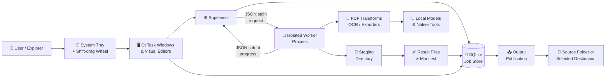
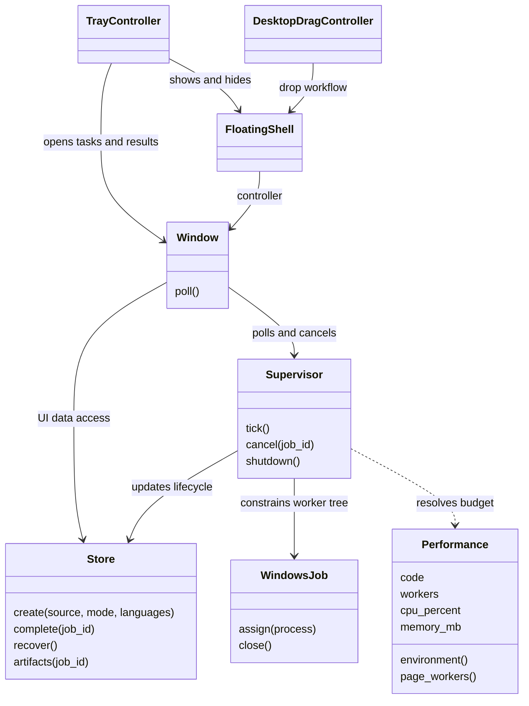
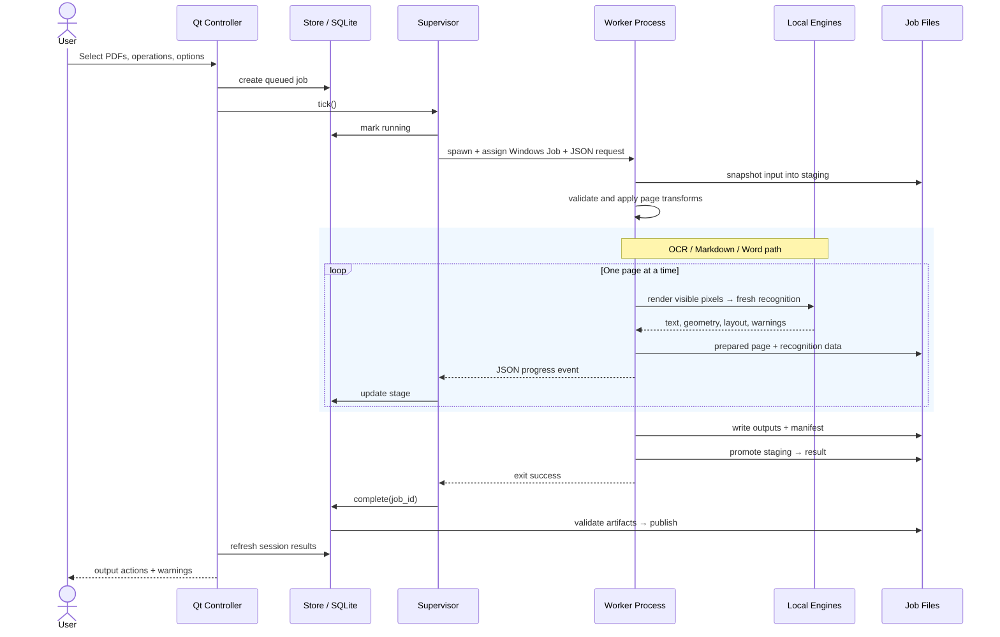
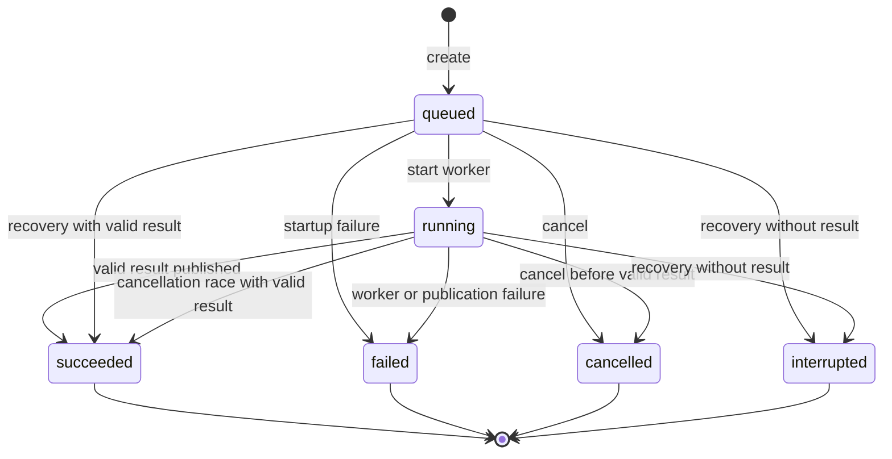
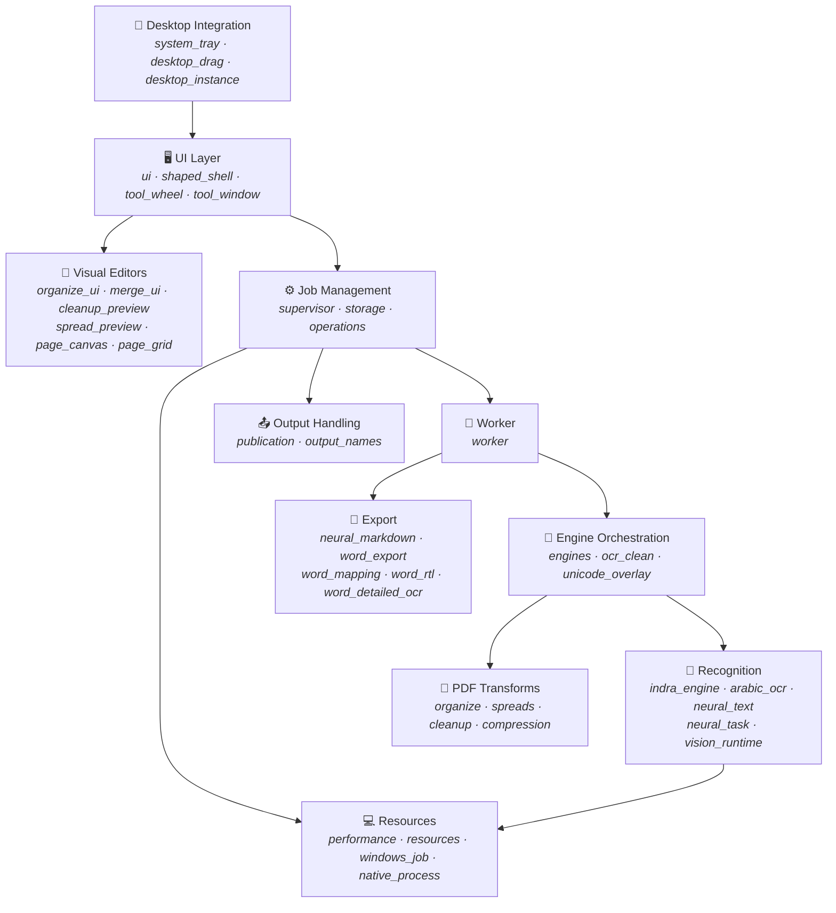

<p align="center">
  
  
  
  
  
  
</p>

# YuzuFile

> **Drop files. Get things done.**

A local-first Windows desktop toolbox for PDF and document recognition, conversion, and visual page editing — powered by on-device neural inference.

YuzuFile lives in the system tray. Right-click to select PDFs, or drag files in Explorer and tap **Shift** to summon a floating tool wheel. Every operation runs locally on your machine — no cloud uploads, no API keys, no internet required after setup.

<p align="center">
  
</p>

> **Status:** Desktop beta `0.27.0`. Windows x64 is the supported target.
> This repository describes the current personal-use build. A project license and
> public binary redistribution are **not yet cleared**; see [Release Readiness](docs/RELEASE_READINESS.md).

---

## Table of Contents

- [Features](#features)
- [How It Works](#how-it-works-for-everyday-users)
- [Architecture](#architecture)
- [Technology Stack](#technology-stack)
- [Project Structure](#project-structure)
- [Getting Started](#getting-started)
- [CLI Usage](#cli-usage)
- [Testing](#testing)
- [Build & Packaging](#build--packaging)
- [Limitations](#limitations)
- [Documentation](#documentation)
- [FAQ](#faq)
- [Licensing & Acknowledgements](#licensing--acknowledgements)

---

## Features

| Tool | Description | Output |
|------|-------------|--------|
| **OCR** | Neural recognition from fresh page renders | Searchable PDF with invisible text overlay |
| **Remove OCR** | Strip selectable text layer | Image-only PDF |
| **Markdown** | Structured document conversion | `.md` file with extracted image assets |
| **Word** | Editable document reconstruction | `.docx` with text, tables, and figures |
| **Compress** | Three-tier PDF compression | Lossless, Balanced, or Maximum |
| **Split Spreads** | Divide pages into 2–12 segments | LTR, RTL, TTB, or BTT splitting |
| **Merge & Arrange** | Visual page management | Combined PDF with reordered/rotated/extracted pages |
| **Clean Up Pages** | Crop, adjust margins, straighten | Cleaned PDF |

### Additional Capabilities

- **Batch processing** — queue multiple files with progress tracking, cancellation, and retry
- **Multi-language OCR** — English, French, and Arabic with specialized Arabic print recognition
- **Resource presets** — Low Usage, Balanced, and High Performance CPU/memory budgets
- **Privacy by design** — fully local processing after initial model download
- **System tray integration** — resident workflow with drag-and-drop support

---

## How It Works (For Everyday Users)

YuzuFile was designed to feel like an invisible part of Windows — **no heavy windows cluttering your taskbar**, and **zero cloud uploads**.

<p align="center">
  
</p>

Screenshots below show the current **0.27.0 resident interface**: a temporary drop wheel, compact task windows, and visual page editors. Captures use a synthetic sample document; [capture details](docs/screenshots/current/README.md).

### The 3 Core Ways to Use YuzuFile:

<table>
<tr>
<td width="33%" align="center">
<h4>1. The Shift-Drag Wheel</h4>

<p>Drag any PDF in Windows Explorer, tap the <b>Shift</b> key, and drop it directly onto the action you want.</p>
</td>
<td width="33%" align="center">
<h4>2. The System Tray</h4>

<p>Right-click the Yuzu icon beside your Windows clock for quick access to processing tasks, current-session results, and the drag + Shift toggle.</p>
</td>
<td width="33%" align="center">
<h4>3. Visual Page Editors</h4>

<p>Rearrange, delete, rotate, or split pages with an interactive live visual grid before saving.</p>
</td>
</tr>
</table>

---

## Visual Feature Walkthrough

<table>
<tr>
<td width="50%" align="center" valign="top">
<h4>📄 Smart OCR &amp; Word Export</h4>
<a href="docs/screenshots/current/word-export.png"></a>
<p>Turn scanned PDFs into searchable PDFs or editable Word files, with table reconstruction and right-to-left Arabic support.</p>
</td>
<td width="50%" align="center" valign="top">
<h4>✂️ Split Book Spreads &amp; Scans</h4>
<a href="docs/screenshots/current/split-editor.png"></a>
<p>Divide scanned spreads into individual pages. Choose left-to-right, right-to-left, or vertical splits.</p>
</td>
</tr>
<tr>
<td width="50%" align="center" valign="top">
<h4>🧹 Page Cleanup &amp; Straightening</h4>
<a href="docs/screenshots/current/cleanup-editor.png"></a>
<p>Crop irregular borders, adjust margins, and straighten tilted scans visually.</p>
</td>
<td width="50%" align="center" valign="top">
<h4>🗜️ PDF Compression</h4>
<a href="docs/screenshots/current/compress-options.png"></a>
<p>Choose Lossless, Balanced, or Maximum compression. Lossy levels trade image detail for smaller files.</p>
</td>
</tr>
</table>

---

## Technical Pipeline Overview

For technical users and developers, here is how YuzuFile coordinates processes under the hood:



1. **Select** — pick PDFs from the tray menu or drag-and-drop with Shift
2. **Configure** — choose operations, language, quality, and page options
3. **Process** — the supervisor spawns an isolated worker with resource constraints
4. **Collect** — results are saved beside the originals (or to a chosen directory)

---

## Architecture

YuzuFile uses a two-process desktop architecture: the Qt desktop process owns user interactions and SQLite state, while an isolated worker process executes transforms and neural inference within a constrained Windows Job Object.

For full technical specifications, see **[Architecture & UML Guide](docs/ARCHITECTURE.md)**.

<details>
<summary><strong>View Subsystem & Architecture Diagrams</strong> (Class, Sequence, Lifecycle, ER, Dependencies)</summary>

### Class Relationships



### Conversion Pipeline (Sequence Diagram)



### Job Lifecycle (State Machine)



### Data Model (ER Diagram)

```mermaid
erDiagram
    JOBS ||--o{ ARTIFACTS : produces
    JOBS {
        TEXT id PK
        TEXT source
        TEXT mode
        TEXT languages "JSON"
        TEXT state
        TEXT stage
        TEXT created
        TEXT updated
        TEXT error
        TEXT metadata "JSON"
        TEXT compression
        TEXT performance
        TEXT output_directory
        TEXT split_settings "JSON"
        TEXT page_plan "JSON"
        TEXT cleanup_settings "JSON"
        INTEGER save_beside_source
    }
    ARTIFACTS {
        TEXT job_id PK_FK
        TEXT path PK
        TEXT kind
        INTEGER deleted
    }
    SCHEMA_MIGRATIONS {
        INTEGER version PK
    }
```

### Module Dependency Graph



</details>

### Resource Budget Policy

| Preset | Worker CPU Cap | Memory Budget | Thread Ceiling |
|--------|---------------|---------------|----------------|
| Low Usage | 25% | 2,048 MB | 1 |
| Balanced | 50% | 3,072 MB | 2 |
| High Performance | 85% | 4,096 MB | 4 |

> These are worker-level budgets enforced via Windows Job Objects, not total system RAM guarantees.
> Thread count is also bounded by available CPU cores. Fresh OCR remains sequential across pages.

---

## Technology Stack

| Layer | Technologies |
|-------|-------------|
| **Desktop UI** | Python · PySide6 / Qt · Lucide icons · Windows tray and drag integration |
| **PDF Engine** | PyMuPDF · PyMuPDF4LLM · custom Markdown post-processing |
| **Recognition** | Indra OCR · specialized Arabic print pipeline · RapidOCR · Tesseract (fallback) |
| **Neural Inference** | ONNX Runtime (CPU) · local vision models · llama.cpp runtime |
| **Word Export** | python-docx · custom layout engine · RTL/BiDi handling |
| **Persistence** | SQLite (WAL mode) · per-job staging directories · JSON manifests |
| **Packaging** | PyInstaller (dual-exe: desktop + worker) · bundled models and native tools |
| **Testing** | pytest · 42 test modules · synthetic PDF fixtures · visual equivalence checks · packaged smoke tests |

---

## Project Structure

```
YuzuFile/
├── src/YuzuFile/                  # Application source (~50 modules)
│   ├── ui.py                   # Desktop entry point (tray, task windows)
│   ├── cli.py                  # CLI entry point
│   ├── supervisor.py           # Job scheduling and worker lifecycle
│   ├── worker.py               # Isolated conversion worker process
│   ├── engines.py              # PDF transform and OCR orchestration
│   ├── indra_engine.py         # Indra neural OCR integration
│   ├── arabic_ocr.py           # Specialized Arabic print recognition
│   ├── word_export.py          # DOCX generation with layout/RTL
│   ├── neural_markdown.py      # Markdown export with image extraction
│   ├── storage.py              # SQLite job store and artifact tracking
│   ├── publication.py          # Output file placement and collision handling
│   ├── system_tray.py          # Windows notification area integration
│   ├── tool_wheel.py           # Shift-drag floating tool selector
│   └── ...                     # Visual editors, transforms, resources
│
├── tests/                      # 42 pytest modules
│   ├── conftest.py             # Shared fixtures and Qt test helpers
│   ├── test_worker_fresh_pipeline.py
│   ├── test_word_export.py
│   └── ...
│
├── scripts/                    # Setup, model prep, build, verification
│   ├── setup.ps1               # Environment bootstrap
│   ├── build_windows.py        # PyInstaller build orchestration
│   ├── prepare_indra.py        # Neural model preparation
│   └── ...
│
├── packaging/                  # PyInstaller spec and entry points
├── vendor/                     # Bundled models, Tesseract data, licenses
├── docs/                       # Architecture, decisions, versioned notes
│
├── pyproject.toml              # Package metadata and dependencies
├── requirements-windows.lock   # Pinned Windows x64 environment
├── run.ps1                     # Development launcher
├── CONTRIBUTING.md             # Contribution guidelines
└── SECURITY.md                 # Trust boundaries and reporting
```

---

## Getting Started

### Prerequisites

| Requirement | Details |
|-------------|---------|
| **OS** | Windows 10 / 11 (x64) |
| **Python** | 3.11 – 3.13 (3.13 tested). Verify: `py -3 --version` |
| **Tesseract** | Windows distribution with English data on PATH |
| **Disk space** | ~2+ GB for neural models and native tools |
| **Git** | For cloning the repository |

### Installation

```powershell
# 1. Clone the repository
git clone https://github.com/<your-username>/YuzuFile.git
cd YuzuFile

# 2. Create virtual environment and install dependencies
.\scripts\setup.ps1

# 3. Download language data and neural models
.venv\Scripts\python.exe scripts\download_languages.py
.venv\Scripts\python.exe scripts\download_neural_models.py
.venv\Scripts\python.exe scripts\prepare_indra.py --personal-use
.venv\Scripts\python.exe scripts\prepare_arabic_print.py

# 4. Verify environment health
.\run.ps1 doctor

# 5. Launch the desktop app (appears in system tray)
.\run.ps1
```

> **Note:** Model preparation requires network access and may take time depending on
> your connection. Review license files in `vendor/` before acquisition.
> The `--personal-use` flag is intentional — see [Release Readiness](docs/RELEASE_READINESS.md).

### For End Users (Portable Build)

Extract the ZIP and open `YuzuFile.exe`. Keep `YuzuFile.exe`, `YuzuFile-worker.exe`, and `_internal/` together. No Python or terminal needed.

1. Find YuzuFile beside the Windows clock (check the hidden-icons overflow)
2. Right-click → **Process PDFs…**, or drag files and tap **Shift** to reveal the tool wheel
3. Choose operations, language, quality, or page options
4. Start processing — **Hide** keeps it running in the background
5. Open completed files or their containing folder from the results

---

## CLI Usage

```powershell
# Check environment and available engines
.\run.ps1 doctor

# Convert a PDF with OCR (English + French + Arabic)
.\run.ps1 convert sample.pdf --format ocr --languages eng fra ara

# Run with an isolated development library
.\run.ps1 --home .\tmp\dev-library gui

# Full command reference
.\run.ps1 convert --help
```

---

## Testing

The project includes **42 test modules** covering storage, UI, OCR engines, visual editors, word export, packaging, and end-to-end worker pipelines.

```powershell
# Set headless mode for Qt tests
$env:QT_QPA_PLATFORM = 'offscreen'

# Run the full test suite
.venv\Scripts\python.exe -m pytest -q

# Run specific test modules
.venv\Scripts\python.exe -m pytest tests\test_storage.py tests\test_word_export.py -q

# Reset for interactive testing
Remove-Item Env:QT_QPA_PLATFORM -ErrorAction SilentlyContinue
```

### Test Coverage Map

| Area | Test Modules |
|------|-------------|
| Desktop integration | `test_system_tray` · `test_desktop_drag` · `test_desktop_instance` · `test_desktop_lifecycle` |
| Job management | `test_storage` · `test_operations` · `test_source_output` · `test_output_names` |
| OCR & recognition | `test_worker_fresh_pipeline` · `test_fresh_ocr_engines` · `test_ocr_clean` · `test_indra_engine` |
| Arabic / Word | `test_arabic_print` · `test_word_arabic` · `test_word_export` · `test_word_fresh_ocr` |
| Visual editors | `test_spreads` · `test_organize` · `test_cleanup` · `test_visual_geometry` |
| UI / Shell | `test_ui` · `test_shaped_shell` · `test_tool_wheel` · `test_resident_navigation` |
| Packaging | `test_bundled_runtime` · frozen module guards · smoke tests |

---

## Build & Packaging

```powershell
# Build portable Windows executables (requires all models prepared)
.venv\Scripts\python.exe scripts\build_windows.py

# Verify frozen module integrity
.venv\Scripts\python.exe scripts\verify_frozen_modules.py
```

**Build outputs:**

```
dist/
├── YuzuFile-0.27.0/
│   ├── YuzuFile.exe              # Desktop process (tray, UI, SQLite)
│   ├── YuzuFile-worker.exe       # Isolated conversion worker
│   └── _internal/             # Bundled runtime, models, assets
└── YuzuFile-Windows-0.27.0.zip   # Distributable portable archive
```

The desktop and worker are separate executables by design — the supervisor spawns the worker in a constrained Windows Job Object for failure isolation and resource control.

---

## Limitations

- **Protected PDFs** — rejects password-protected PDFs, signed documents, files over 1 GB, and documents outside 1–2,000 pages
- **OCR accuracy** — re-recognition from pixels can regress clean native text; always verify important content
- **Remove OCR** — rasterizes all visible content, removing native vector text and interactivity
- **Arabic & complex scripts** — vowelled Arabic, decorative text, small print, and complex tables need review
- **Compression** — savings vary; lossy levels trade image detail for file size
- **Resource usage** — model bundles require substantial disk space; CPU processing takes time and memory
- **Platform** — Windows x64 only; macOS, Linux, cloud sync, and public API are not established

See the [Arabic OCR validation note](docs/notes/ARABIC_OCR_V0260.md) for language-specific accuracy observations.

---

## Documentation

| Document | Purpose |
|----------|---------|
| [Architecture & UML](docs/ARCHITECTURE.md) | Component boundaries, class/sequence/state/ER diagrams, resource policy |
| [Development Guide](docs/DEVELOPMENT.md) | Environment setup, native tools, testing, packaging, troubleshooting |
| [Design Decisions](docs/DECISIONS.md) | ADRs explaining current choices and tradeoffs |
| [Contributing](CONTRIBUTING.md) | Bug reports, change guidelines, PR expectations |
| [Security](SECURITY.md) | Trust boundaries, data handling, vulnerability reporting |
| [Release Readiness](docs/RELEASE_READINESS.md) | Licensing, privacy, quality, and distribution gates |

<details>
<summary><strong>Historical implementation notes</strong> (versioned docs)</summary>

Version-labelled files under `docs/notes/\` are historical implementation notes tracking
the evolution of specific subsystems. They may describe superseded behavior.
This README and the architecture guide describe the current version.

- `FRESH_OCR_V0210.md` — Fresh recognition pipeline
- `RESIDENT_WORKFLOW_V0240.md` — Tray-resident workflow
- `TRAY_AND_DESKTOP_DRAG_V0230.md` — Desktop drag integration
- `WORD_EXPORT_V0130.md` — Word export engine
- `SPREAD_SPLITTING_V080.md` — Spread splitting
- `NEURAL_OCR_V070.md` — Neural OCR integration
- And 20+ more covering UI, Arabic, compression, visual editing, etc.

</details>

---

## Design Decisions (ADR Summary)

The project follows an Architecture Decision Record (ADR) approach. Key decisions:

| ADR | Decision | Rationale |
|-----|----------|-----------|
| **001** | Local Windows desktop execution | Private document handling; direct filesystem workflows |
| **002** | Separate worker process with bounded resources | UI responsiveness; failure isolation via Windows Job Objects |
| **003** | Fresh recognition, one page at a time | Avoid silently exporting garbled legacy OCR text |
| **004** | Specialized recognition with conditional fallbacks | Different scripts and layouts fail differently; no blind majority vote |
| **005** | Session-only results (no History UI) | Simple tray workflow; internal records retained for recovery |
| **006** | Source-adjacent outputs with safe names | Users find results where they work; collision handling protects originals |
| **007** | Staged artifacts with manifest-based recovery | Partial output never appears successful; crash recovery is possible |

Full records with tradeoff analysis: [Design Decisions](docs/DECISIONS.md)

---

## FAQ

<details>
<summary><strong>Does YuzuFile upload my documents to the internet?</strong></summary>

No. All document processing is entirely local after the initial one-time model download.
Network access is only needed during setup for downloading language data and neural models.
</details>

<details>
<summary><strong>Can I use this on macOS or Linux?</strong></summary>

Not currently. Windows x64 is the only supported and tested platform.
Cross-platform packaging is listed as future work.
</details>

<details>
<summary><strong>OCR output has errors — is that expected?</strong></summary>

Yes. OCR is inherently imperfect. YuzuFile re-recognizes from page pixels, which means even
well-formed native text is re-processed and can regress. Always verify important names,
numbers, and tables against the source document. See [Limitations](#limitations).
</details>

<details>
<summary><strong>How much disk space do the models need?</strong></summary>

The full neural model bundle (Indra, Arabic print, RapidOCR, Tesseract data, vision models)
requires approximately 2+ GB. See the model manifests under `vendor/neural/`.
</details>

<details>
<summary><strong>Why are there two executables in the build?</strong></summary>

`YuzuFile.exe` is the desktop process that owns the UI, system tray, and SQLite database.
`YuzuFile-worker.exe` is a separate isolated process spawned for each conversion job, constrained
by Windows Job Objects for resource control and failure isolation. This separation keeps the
UI responsive even during heavy CPU inference.
</details>

---

## Licensing & Acknowledgements

> **A repository-level open-source license has not been selected.** Source visibility does not
> grant redistribution rights to every component. Libraries, native tools, and model weights
> carry separate licenses. Indra preparation specifically targets personal use.
> Review the [licensing gates](docs/RELEASE_READINESS.md#licensing-and-provenance) before publication.

### Built With

YuzuFile builds on the work of these open-source projects:

- **[Qt / PySide6](https://www.qt.io/)** — Desktop UI framework
- **[MuPDF / PyMuPDF](https://mupdf.com/)** — PDF rendering and manipulation
- **[Tesseract](https://github.com/tesseract-ocr/tesseract)** — OCR engine (fallback path)
- **[Indra OCR](https://github.com/JaidedAI/IndraOCR)** — Primary neural recognition
- **[RapidOCR](https://github.com/RapidAI/RapidOCR)** — RTL-capable OCR path
- **[ONNX Runtime](https://onnxruntime.ai/)** — Neural inference runtime
- **[python-docx](https://python-docx.readthedocs.io/)** — Word document generation
- **[Lucide](https://lucide.dev/)** — Icon library

Desktop interaction design was informed by Tangerine and Kinnow.
YuzuFile is an independent project without affiliation to any of these.
