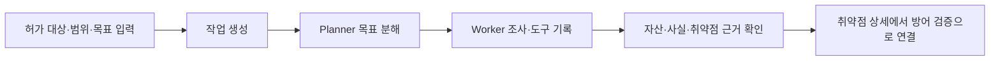
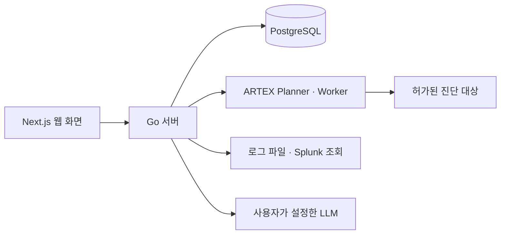

<div align="center">

# AegisLoop : ARTEX Plus

**취약점 발견부터 탐지 설계, 방어 검증, 과거 로그 조사까지**

[](LICENSE)

[화면으로 보기](#실제-화면으로-보는-조사-흐름) · [빠른 시작](#빠른-시작) · [사용 설명서](docs/FINDING_DEFENSE_INVESTIGATION_KO.md)

</div>

AegisLoop는 [ARTEX](https://github.com/Autumn-27/ARTEX)의 [한국어판 artex-ko](https://github.com/jiwoochris/artex-ko)를 기반으로 한 보안 검증 프로젝트입니다. 허가된 자산에서 찾은 취약점을 출발점으로 공격·탐지 시나리오를 설계하고, 실제 실행 로그로 탐지·차단 여부를 검증하며, 과거 로그에서 관련 행동을 조사합니다. 취약점 없이 로그에서 시작하는 Defensive 사건도 지원합니다.

```text
Offensive: 취약점과 재현 근거
    ↓
Defensive: 공격·탐지 시나리오 → 방어 계획 → 실제 로그 기반 방어 검증
    ↓
침해 조사: 로그 근거 준비 → AI 조사 → 관측 결과와 원본 근거 확인
```
## Offensive 진단 실행

**Offensive → 진단 현황**에서 저장된 작업·취약점 현황을 보고, 실제 진단은 **Offensive → 작업 → 새 작업**에서 시작합니다. 필수 입력은 **설명**과 **목표**입니다. 필요하면 작업 단위 자산 허용·차단 규칙, LLM 설정 체인, 작업 타임아웃을 지정합니다.



작업 상세의 **세션·탐색 경로·취약점**에서 진행 과정과 근거를 검토합니다. 작업이 끝났다는 상태만으로 취약점 확인이나 진단 범위 전체의 안전성을 판단하지 않습니다. 아래 취약점 #8 화면은 현재 흐름의 대표 결과 한 건이며, 새 설치에서 자동으로 생성되는 기록은 아닙니다.

## 실제 화면으로 보는 조사 흐름

아래 이미지는 **2026년 10월 22일 로컬 실습**에서 저장한 취약점 #8의 화면입니다. 새 설치에 해당 취약점, Splunk 로그 또는 조사 결과가 함께 설치되지는 않습니다. 전체 조작 순서와 화면별 설명은 [취약점 → 방어 검증 → 침해 조사 사용 설명서](docs/FINDING_DEFENSE_INVESTIGATION_KO.md)에 있습니다.

### 1. 취약점 근거 확인

Offensive의 ARTEX 작업이 기록한 취약점에서 대상 자산, 경로, 설명과 재현 근거를 확인합니다. 이 정보가 방어 시나리오의 입력입니다. 작업 완료나 후보 발견만으로 악용 성공을 확정하지 않습니다.


### 2. 방어 검증

**AI 시나리오 생성**은 취약점 근거로 공격 흐름과 구간별 탐지 설계를 만듭니다. 이 단계에는 Splunk 연결이 필요하지 않습니다. 각 구간에서 장비 후보, 필요한 로그·필드, 탐지 조건과 Splunk SPL **초안**을 검토한 뒤 필요한 내용을 방어 계획에 복사해 저장합니다. 장비가 실제 배치됐는지, 로그가 연동됐는지는 실제 환경에서 확인해야 합니다.


다음으로 허가된 범위에서 ARTEX 재검증을 실행하고, 해당 실행의 감사·경보 로그를 파일 또는 Splunk로 연결합니다. 화면은 **취약점 재현**, **증거 기반 탐지**, **로그로 확인한 차단**을 각각 표시합니다. SPL 초안은 자동으로 실행하거나 SIEM 정책으로 배포하지 않습니다.


### 3. 침해 조사

**로그 근거 준비 → AI 조사 → 결과 확인** 순서로 진행합니다. 먼저 파일을 등록하거나 저장된 Splunk 연결에서 대상·기간·경로와 인덱스 범위를 지정해 과거 로그를 조회합니다. 준비된 근거를 확인한 뒤 AI 조사를 명시적으로 시작합니다. 결과의 관측, 추정, 미확인 항목을 나눠 읽고 인용 표시에서 원본 이벤트를 대조합니다.


위 AI 조사 화면은 **실행 한도에 도달한 부분 결과**입니다. 공개용 이미지에서는 출처 IP 값만 가렸습니다. 로그에 요청이 보인다는 사실은 침해 확정과 다르며, 검색 결과가 없다는 사실도 조사 범위 밖의 활동을 배제하지 않습니다.

## 기능과 판단 기준

| 기능 | 입력과 동작 | 결과를 읽을 때 |
|---|---|---|
| ARTEX 취약점 진단 | 허가된 자산을 작업 범위로 지정하고 Planner·Worker가 조사 | 원본 요청·응답과 재현 근거를 확인 |
| 공격·탐지 시나리오 | 취약점 근거에서 AI가 단계별 공격 흐름, 장비·로그 후보, SPL 초안 생성 | 장비 배치와 로그 연동은 별도 확인 |
| 방어 검증 | ARTEX 재검증과 같은 실행의 감사·경보 파일 또는 Splunk 로그를 연결 | 재현·탐지·차단을 독립적으로 판정 |
| 침해 조사 | 지정한 자산·기간·경로의 로그를 준비하고 AI 조사 실행 | 관측·추정·자료 부족을 구분하고 원문 확인 |
| 독립 Defensive 사건 | 취약점 없이 파일·Splunk 로그로 사건 시작 | 저장한 범위 안에서 조사 이력과 근거 검토 |
| Closed-loop 평가 | 기준 실행과 개선 후 재실행의 로그·규칙 결과 비교 | 후보 규칙의 일치와 실제 SIEM 경보를 구분 |

Splunk 없이 파일 업로드로 방어 검증과 침해 조사를 시작할 수 있습니다. Splunk 연결을 사용하는 경우 인덱스와 `sourcetype`은 연결·조사 범위에 맞게 설정합니다. 로그 준비와 기본 집계에는 LLM이 필요하지 않습니다. 시나리오 생성, ARTEX 진단, AI 조사는 설정한 모델을 호출하므로 비용과 실행 한도가 발생할 수 있습니다.

## 빠른 시작

Docker Desktop 또는 Docker Engine과 Docker Compose v2가 필요합니다. 소스 폴더에서 다음 명령을 실행합니다. 최초 실행에는 컨테이너 이미지와 의존성 다운로드를 위한 인터넷 연결이 필요합니다.

```sh
./scripts/local-start.sh
```

1. [http://localhost:8787/setup/](http://localhost:8787/setup/)에서 관리자 계정을 만듭니다.
2. AI 기능을 사용할 경우 **시스템 → LLM**에 본인의 모델 연결을 설정합니다.
3. 본인이 소유하거나 점검을 허가받은 자산을 등록합니다. 로그를 Splunk에서 읽으려면 **Defensive → 로그 연결**을 별도로 설정합니다.

깨끗한 설치의 기본 구성은 **AegisLoop 앱과 PostgreSQL**입니다. VulnBank, Juice Shop, Splunk와 같은 실습 대상·로그 시스템은 별도로 준비합니다. 앱과 기록 프록시의 기본 포트는 각각 `127.0.0.1:8787`, `127.0.0.1:8788`입니다. 로컬 DB 비밀번호와 로그인 서명 키는 실행 스크립트가 생성하며 배포 소스에 포함되지 않습니다.

```sh
# 변경된 소스를 빌드해 다시 실행
./scripts/local-start.sh

# 앱을 중지하고 저장된 데이터는 유지
docker compose --env-file .env.local -f docker-compose.local.yml stop

# 별도 임시 DB와 모의 모델·Splunk를 이용한 통합 테스트
./scripts/local-test.sh
```

루트의 `docker-compose.yml`과 `install.sh`는 기반 프로젝트의 설치 경로입니다. 이 확장의 로컬 실행 명령은 `./scripts/local-start.sh`입니다.

## 시스템 아키텍처

Next.js 화면은 Go 서버에서 제공하며, 작업·취약점·방어 계획·조사 이력은 PostgreSQL에 저장합니다. ARTEX Planner·Worker는 허가된 작업 범위에서 진단을 수행합니다. Defensive는 저장된 취약점 근거와 실행 로그를 연결하고, 파일 또는 읽기 전용 Splunk 조회로 조사 근거를 준비합니다.



### 모델 선택과 출력 언어

진단과 AI 기능의 응답 품질·언어·사용량은 등록한 모델에 따라 달라집니다. 작업 목표에 원하는 출력 언어를 명시하고, 생성된 시나리오와 조사 결과를 원본 근거와 대조하세요. AI 침해 조사를 시작하면 선택한 취약점 근거와 로그 발췌가 설정한 모델 공급자에게 전송될 수 있습니다.

## 사용 범위와 문서

### ⚠️ 먼저 읽어 주세요 — 사용 범위와 국내법 고지

진단과 재검증은 본인이 소유하거나 명시적으로 허가받은 대상에만 실행하세요. 대상, 기간, 경로와 실행 자원 한도를 점검한 후 시작하고, 로그에 포함된 개인정보와 자격 증명을 신중히 취급하세요. 운영 환경의 탐지 규칙이나 차단 정책은 이 앱이 자동 배포하지 않습니다.

- [취약점 → 방어 검증 → 침해 조사 사용 설명서](docs/FINDING_DEFENSE_INVESTIGATION_KO.md): 화면 순서, Splunk 근거 준비, 결과 판독과 캡처.
- [자율 AI 공격 방어·탐지 가이드](docs/defense-ko.md): 방어자 관점의 관측 지점과 탐지 자료.
- [Defense & Detection Guide](docs/defense-en.md): 영문 방어·탐지 자료.

### 사용 제한

- 이 도구는 **소스 코드를 읽고 학습·연구하는 용도**, 그리고 **로컬 격리 환경에서 기술 원리를 검증**하는 용도로 쓰십시오.
- 자신이 소유하거나 **서면으로 명시적 허가를 받은 대상이 아니라면**, 어떤 웹사이트·온라인 서비스·연결된 시스템에도 스캐닝·탐지·익스플로잇·공격을 수행하지 마십시오.
- 불법 침입, 데이터 탈취, 서비스 거부(DoS), 그 밖에 파괴적·범죄적 활동에 사용하는 것을 엄격히 금지합니다.
- 사용자가 속한 국가·지역의 네트워크 보안·데이터 보호·컴퓨터 범죄 관련 법규(대한민국의 경우 정보통신망법·개인정보보호법 등)를 모두 준수해야 합니다.

### 면책

이 프로젝트는 "있는 그대로(AS IS)" 제공되며 명시적·묵시적 어떤 보증도 하지 않습니다. 원저자와 기여자는 이 도구의 사용(사용 방식의 적절성과 무관하게)으로 발생한 어떤 직접·간접 손해, 데이터 손실, 시스템 손상, 법적 분쟁에도 책임지지 않습니다. **이 프로젝트를 내려받거나 설치하거나 사용하는 것은 위 모든 조건을 읽고 이해하고 동의한 것으로 봅니다.**

**모든 법적 책임과 결과는 사용자 본인이 부담합니다.**

---

## 원본 프로젝트

- 원본 저장소: [Autumn-27/ARTEX](https://github.com/Autumn-27/ARTEX)
- 글로벌판 저장소 : [jiwoochris/artex-global](https://github.com/jiwoochris/artex-global)
