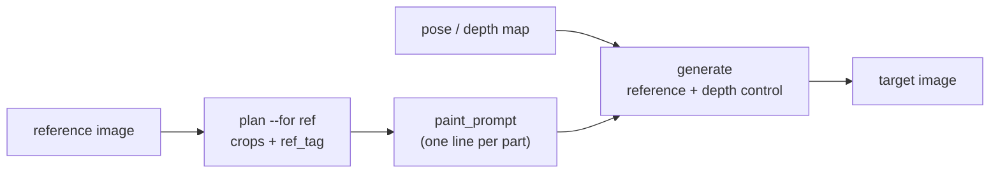
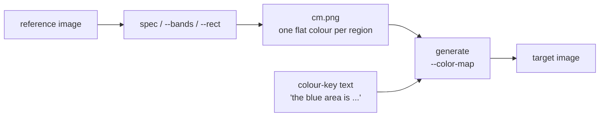
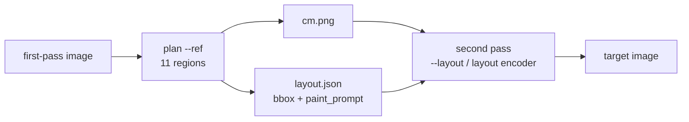

# GrabTag

**English** · [简体中文](README.zh.md)

**Cut a reference into regions, tag each one, and tell the model exactly which region each phrase belongs to.**

GrabTag turns one reference image into region-controlled generation input: cut a character into parts, tag each part, and emit a region-ID colour map plus `layout.json` for MOSS-Image / ComfyUI. Pure Python, CPU-only, no model weights. Ships four CLIs: `plan`/`build`, `colormap`, `depth-colormap`, `chroma` (green-screen matting).

<table>
<tr>
<td width="50%"></td>
<td width="50%"></td>
</tr>
<tr>
<td><sub><b>1 &middot; what you have</b> &mdash; one illustration; every detail is implicit, and a prompt can only point at it vaguely</sub></td>
<td><sub><b>2 &middot; what <code>plan</code> gives you</b> &mdash; the same figure painted as a region-ID map: each flat colour is one region, and each region gets its own instruction with its own box</sub></td>
</tr>
</table>

*The artwork above is a sample supplied by the author for documentation; the colour map on the right is the direct output of `plan` with a 12-region spec (gold hairpin, robe, chest lotus, sash, buckle, skirt, hem, sleeves, legs, boots …).*

**No LoRA injection, no style drift.** GrabTag needs no LoRA and injects none: the look comes from the base weights plus your prompt, not from whatever a fine-tuned training set happened to prefer — so the same reference can be re-skinned without dragging a house style along.

Most reference-image workflows hand the model one picture and hope it keeps the details. GrabTag takes the opposite route: it **cuts the reference into named regions, writes one instruction per region, and gives each instruction a box** — so the model is told *this phrase belongs to that box*, not *somewhere in this picture there is a lotus*.

No model weights, no artwork, no framework lock-in: Python + Pillow, with OpenCV / scipy / SAM optional.

---

## Case V2 — one pass, reference at native size, patterns inherited

[](docs/case-v2/index.md)

*One pass, no second-stage touch-up: **reference** (fed at the output's size, so patterns survive) → **GrabTag regions** (11 parts, each with its own `ref_tag`) → **pose depth** (silhouette only) → **output** (1024×1808, 92.6 s on an 8 GB laptop GPU).*

Full walkthrough: [`docs/case-v2`](docs/case-v2/index.md) · step-by-step SOP: [`docs/sop-v2.md`](docs/sop-v2.md) · channel differences: [`docs/moss-image-edit-integration.md`](docs/moss-image-edit-integration.md) · OOM guards: [`docs/moss-ref-oom-guards.md`](docs/moss-ref-oom-guards.md) · helper scripts: [`tools/`](tools/README.md)

A fully reproducible walkthrough with every asset (reference, region/tag maps, pose depth, prompt, exact command): **[docs/case-v2/index.md](docs/case-v2/index.md)** · mechanism in **[docs/moss-image-edit-integration.md](docs/moss-image-edit-integration.md)** · OOM guards in **[docs/moss-ref-oom-guards.md](docs/moss-ref-oom-guards.md)**.

**A tag can be used in two ways — both are intended:**

1. **Obey the tag literally.** The region is drawn as whatever the `ref_tag` names.
2. **Swap the material or object, keep the shape.** The region keeps the *silhouette, placement and lattice* the tag defines, while the substance is replaced by another material or object of the same shape. In Case V2 the reference is **ice**; prompted as water / gauze, the very same region comes out as **water and sheer silk** with the diamond lattice still in place.

So a `ref_tag` is a **contract about shape and position** — not a lock on material. That is what makes "re-skin a costume" possible without redrawing it.

---

## Three ways to use it

Same tool, three shapes of input. What changes is **which channel carries the geometry**.

### 1. Reference + pose — text and depth carry everything



The depth map fixes the silhouette; the prompts fix what each band is. No colour map involved.

### 2. Colour map — pixels carry the geometry



The map says **where**; the colour-key sentence says **what**. Neither works alone.

### 3. Both — map for placement, one line per region for material



<table>
<tr>
<td width="33%"></td>
<td width="33%"></td>
<td width="34%"></td>
</tr>
<tr>
<td><sub><b>① what you have</b> — a costume card</sub></td>
<td><sub><b>② the same card as regions</b><br/><code>plan --ref</code> paints every part a flat colour</sub></td>
<td><sub><b>③ a pose</b> — rendered to a depth map, used as structural control</sub></td>
</tr>
</table>

<table>
<tr>
<td width="33%"></td>
<td width="33%"></td>
<td width="34%"></td>
</tr>
<tr>
<td><sub><b>④ first pass</b> — ① + ③, no region map yet</sub></td>
<td><sub><b>⑤ the first pass, cut into 11 regions</b><br/><code>examples/ice_11.json</code></sub></td>
<td><sub><b>⑥ second pass</b> — colour map for placement, one prompt per region for material</sub></td>
</tr>
</table>

*Every panel is from one real run.* The same `plan` call does two different jobs here: **②** turns the costume card into named regions (so you can write `ref_tag` per part), **⑤** turns a rendered image into placement regions (so the second pass knows where each `paint_prompt` belongs). Between them, **④** is what the model produces from a reference plus a depth pose with no region map at all — that gap is exactly what **⑤** closes.

*Panels ① ② ③ are cropped and downsized; ④ and ⑤ are the run's own output, only resized.*

*Every panel above is from one real run.* The costume card and the pose are the actual inputs: the pose was rendered as a depth map and used as the structural control, the card supplied the look — that produced ③. Then `plan --ref` cut 11 regions out of ③, wrote `cm.png` (④) plus one `paint_prompt` per region (`examples/ice_11.json`), and the second pass refined it into ⑤. Panels are cropped and the chest area is mosaicked for this document.

## Why it exists

Two channels reach a region-aware image model, and mixing them up is the most common failure:

| Channel | Carried by | Answers | Cannot express |
|---|---|---|---|
| **text** | `ref_tag` (reference side), `paint_prompt` (generation side), `summary.text` | *what* this region is / what to draw there | where it goes — text alone has no geometry |
| **pixels** | `cm.png` — a region-ID colour map | *where* each region is | what the region is made of |
| **both** | `layout.json` | which phrase belongs to which box | — it only assembles the two above |

GrabTag's job is to produce those files correctly; how your own pipeline consumes them is up to you. One page on the whole mechanism, plus six symptoms of getting it backwards: [`docs/MECHANISM.md`](docs/MECHANISM.md).

---

## Install

```bash
git clone <this repo> && cd grabtag

pip install -e .            # core: numpy + Pillow, the four CLIs all work
pip install -e ".[mask]"    # + opencv-python, scipy  -> --masker grabcut, --fit, --min-area
pip install -e ".[sam]"     # + torch, segment-anything -> --masker sam-auto
```

Python 3.9+. No GPU needed unless you use SAM on CUDA.

## Quick start

```bash
python examples/make_demo.py examples/demo.png     # a synthetic reference, no assets needed

python grabtag.py plan --ref examples/demo.png \
       --spec examples/demo_spec.json --out build/demo   # 1) cut + paint + write JSON

# 2) open build/demo/montage.png, look at each numbered crop,
#    fill ref_tag / paint_prompt in build/demo/regions.json

python grabtag.py build --dir build/demo           # 3) export the layout
```

```
build/demo/
├─ regions.json        what you fill in (ref_tag + paint_prompt per region)
├─ tags.json           the reference-side labels  (for whoever writes the prompt)
├─ cm.png              region-ID colour map       (pixels channel)
├─ montage.png         numbered crops             (for your eyes / a VLM)
├─ layout.json         {summary.text, items[{label, paint_prompt, bbox}]}
└─ layout.audit.json   same items + per-region coverage audit
```

## The four outputs, precisely

| File | Keys | Consumed by |
|---|---|---|
| `regions.json` | `id, color, rect, span, crop, ref_tag, paint_prompt, priority, kept, loss_hi, masker, own_px` | you, then `build` |
| `tags.json` | `ref, size, summary, tags[{name, ref_tag, crop, color, area}]` | the text side: feed these phrases into your prompt |
| `layout.json` | `summary{text}` + `items[{label, paint_prompt, bbox}]` | the pixel+text side: layout-aware samplers |
| `layout.audit.json` | the same items plus `_region / _kept / _warn` | debugging only |

`bbox` is **`yxyx` in pixels, shifted so the canvas centre is `(0, 0)`** — `[y0, x0, y1, x1]`. Convert once at the edge if your model wants `xyxy`, normalised floats or top-left pixels; the maths lives in `grabtag/core/layout.py::pixel_bbox`.

> **Field names (2026-11-06)**: reference-side label is `ref_tag` (was `tag`), generation-side instruction is `paint_prompt` (was `caption`), global line is `summary.text` (was `summary.caption`). The code **reads the old names and writes only the new ones**, so old working directories keep loading.

---

## CLI reference

### `plan` — define regions and paint them

| Flag | Meaning |
|---|---|
| `--ref IMG` | the reference image (any size; it is rescaled to `--size`) |
| `--bands N` | slice the figure into N horizontal bands (fastest baseline) |
| `--band a:b --band c:d …` | explicit fractional bands, e.g. `--band 0.0:0.30` |
| `--rect name=x0,y0,x1,y1 …` | free boxes |
| `--spec FILE` | JSON list of `{name, rect, color?, ref_tag?, paint_prompt?, seed?, priority?, object?, aliases?, requires?, no_clamp?, sam?}` |
| `--for both\|ref\|layout` | `ref` = crops + tags only; `layout` = colour map only; default both |
| `--masker grabcut\|sam-auto` | refine each region to the real silhouette (needs `[mask]` / `[sam]`) |
| `--fit bg\|depth` | restrict painting to the figure silhouette, keeping hair gaps and the space between legs |
| `--x-inset 0.10` | shrink band width; **full-width bands get read as several people** |
| `--max-items 20` | cap the number of *objects* (a pair of sleeves counts once via `object`) |
| `--lint-strict` | exit 2 when a `paint_prompt` fails the template check |

`plan` prints a **coverage audit** — `kept` (how much of a region survived painting) and `loss_hi` (how much of the loss came from regions of equal or higher priority) — and rejects duplicate colours, because the layout exporter merges regions by colour.

### `build` — export the layout

```bash
python grabtag.py build --dir build/demo [--sort small|area|y] [--quiet]
```

Fails fast if any region still lacks `paint_prompt`; also (re)writes `tags.json` from `ref_tag`, so the "auto-cut → fill by hand → build" workflow still gets a reference-side export. `--sort small` pushes small props first, which they deserve.

### `colormap` / `depth-colormap` / `chroma`

```bash
# horizontal bands driven by a depth map
python grabtag.py colormap --depth pose_depth.png --bands 4 --out cm.png
# keep the paint on the subject only (needs a clean depth background)
python grabtag.py colormap --depth pose_depth.png --bands 4 --subject --out cm.png

# depth-sliced regions: seed | band | front | plateau
python grabtag.py depth-colormap --depth pose_depth.png --mode front --out cm.png
# several regions in one pass: --region x,y,mode,tol,color (repeatable)

# green-screen keying -> RGBA + checker-board preview
python grabtag.py chroma shot.jpeg --rotate 90 --metric green --out rgba.png --preview prev.png
```

A colour map is **not a picture**: every flat colour is a region ID, and the prompt has to say what that colour means (`the #7fb3ff area is a faceted ice shell`). Paint order is `(priority, −area)`, so ten small props survive one big garment.

---

## Environment variables

| Var | Read by | Meaning |
|---|---|---|
| `GRABTAG_SAM_CKPT` | `--masker sam-*` | path to `sam_vit_b_*.pth` (default `sam_vit_b_01ec64.pth` in cwd) |
| `GRABTAG_INPUT_DIR` | `plan` | where a downstream loader expects images; defaults to `./ComfyUI/input`, and the copy is skipped when the directory does not exist |

## Using it with ComfyUI / MOSS-Image

* Put `cm.png` where the loader can see it — the image loader usually accepts only names inside its own `input/` directory, so copy it there and pass the bare filename.
* Keep the map small: a 16×16-patch VAE means `(w/16)·(h/16) ≤ 4096`, i.e. ≤ 1024×1024.
* `layout.json` is for layout-aware samplers (MOSS-Image's layout encoder, or your own node). It is **not** an image — passing it to a prompt field only feeds the model JSON as text.

## Practical notes (learned the hard way)

1. **One region = one object.** A garment without its own region gets invented by the model.
2. **Colours must be unique.** Two regions with the same RGB are merged into one item.
3. **A `paint_prompt` needs a landmark.** `a lotus ornament` may land in the hair; `a lotus ornament printed flat on the chest, between the collarbones` does not.
4. **~12 regions is the sweet spot** for a full-body figure; past ~16 small props start disappearing.
5. **Narrow boxes do not split a person; full-width boxes do.** Keep `--x-inset` at `0.08–0.12` in band mode.
6. **The colour map carries geometry, the instruction carries material.** Editing text never changes a silhouette — repaint the map for that.

## Development

```bash
pip install -e ".[mask]"
python examples/make_demo.py /tmp/demo.png
python grabtag.py plan --ref /tmp/demo.png --spec examples/demo_spec.json --out /tmp/gt
python grabtag.py build --dir /tmp/gt
```

CI runs exactly these steps on Python 3.9 / 3.11 / 3.12 — see `.github/workflows/ci.yml`. Ground rules for patches: [`CONTRIBUTING.md`](CONTRIBUTING.md). Changes: [`CHANGELOG.md`](CHANGELOG.md).

## Licence

MIT — see [`LICENSE`](LICENSE). Third-party notices in [`NOTICE.md`](NOTICE.md).

---

*Screenshots are generated by `examples/make_demo.py`; no third-party artwork ships with this repository. A Chinese README is available at [`README.zh.md`](README.zh.md).*
