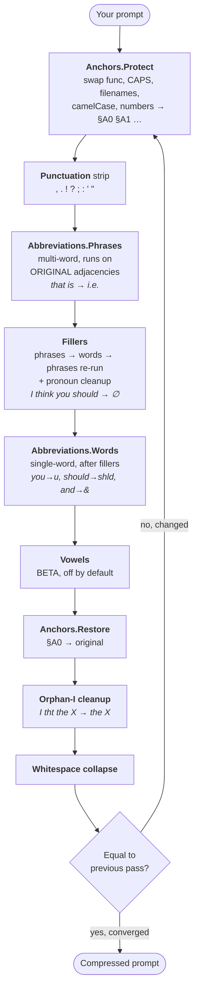

<div align="center">


# eXprompt

**Reverse T9 for LLMs.**
Free, open-source CLI proxy prompt compressor for your AI prompts and agents.


**English** · [Español](README.es.md) · [Français](README.fr.md) · [Deutsch](README.de.md) · [日本語](README.ja.md) · [Українська](README.uk.md)

</div>

---

## See it in one second

```text
$ exprompt 'Actually I think you should really check if the API returns correct JSON'

  → chk if the API rtrns crct JSON

  ███████████░░░░░░░░░  56% saved · 31 chars · 2 passes · <1ms

  ✓ copied to clipboard
```

The result is on your clipboard, ready to paste into ChatGPT, Claude, or anywhere else.

---

## What is eXprompt

A tiny CLI that **shrinks AI prompts by 25–50%** before they reach the model. It removes filler words, replaces common words with short forms, and protects technical terms (`API`, `JSON`, `camelCase`, `func()`, numbers, filenames) so they're never mangled.

| | |
|---|---|
| **Local-only** | No model runs, no network calls, no data leaves your machine. Just text in, text out. |
| **Deterministic** | Dictionary-driven. The same input always produces the same output. |
| **Composable** | Toggle filters per-run, or save preferences once with `exprompt config set`. |
| **Tiny** | A single static Go binary. Runs in <1 ms on any prompt you'd realistically write. |
| **Open** | MIT-licensed, every transformation is in plain JSON files you can read, fork, or extend. |

**Not a goal:** semantic rewriting (no LLM rewrites your text), translation, or acting as a proxy.

---

## Why you might want it

- **Cheaper API bills.** Every token you send costs money. eXprompt cuts the input side of that bill by a third without changing the model's answer.
- **More room in the context window.** Same budget, more signal. Great for long chats, code reviews, and RAG.
- **Faster prompts.** Smaller prompts ship faster across the wire and pre-fill quicker on the model side.
- **One command, zero lock-in.** Works with any LLM (ChatGPT, Claude, Gemini, Llama, …) because the output is just plain text.
- **Stays out of your way.** Hook it into Claude Code once and forget it exists.

---

## How it works

A fixed, deterministic chain runs over your text. It **re-runs the whole chain** until the output stops changing (capped at 3 passes), so single-word filler removal can stitch multi-word phrases back together and a second pass catches them.



**Why the loop matters:** a prompt like `"I honestly think that the createUserTable() function should be documented"` doesn't have `"I think that"` as a contiguous phrase on pass 1 (the word `"honestly"` is in the way). Pass 1 removes `"honestly"`. Pass 2 now sees `"I think that"` as a continuous filler and removes it. Pass 3 confirms no more changes — done.

### Two safeguards built in

**CAPS exclusion.** `ALL_CAPS` words are protected by default, but if the lowercase form is in the abbreviations or fillers dictionary, the dictionary wins:

| Word | Outcome | Why |
|---|---|---|
| `API`, `JSON`, `DATABASE_URL` | kept verbatim | not in any dictionary |
| `PLEASE` | → `pls` | in abbreviations |
| `AND` | → `&` | in abbreviations |
| `THE`, `BUT`, `FOR` | stripped or left as-is | ≤ 3 chars, not in anchors |

**Manual anchors.** Wrap any phrase in `[[ … ]]` to force it through verbatim:

```text
$ exprompt 'Actually you should test [[my custom auth flow]] really thoroughly'
  → chk [[my custom auth flow]] thoroughly                          46% saved
```

---

## Install

End state: `exprompt` works from any folder.

### macOS / Linux — Homebrew (recommended)

```bash
brew install bladysh/tap/exprompt
exprompt -v
```

To upgrade: `brew upgrade exprompt`. To remove: `brew uninstall exprompt`.

### Windows — Scoop (recommended)

```powershell
scoop bucket add bladysh https://github.com/bladysh/scoop-bucket
scoop install exprompt
exprompt -v
```

To upgrade: `scoop update exprompt`. To remove: `scoop uninstall exprompt`.

### Pre-built binaries (any OS)

Grab the matching archive from the [latest release page](https://github.com/bladysh/exprompt/releases/latest) (`exprompt_<ver>_<os>_<arch>.tar.gz` or `.zip` on Windows), extract, and put `exprompt` somewhere on your `PATH`.

### From source

```bash
# Needs Go 1.22+
git clone https://github.com/bladysh/exprompt.git
cd exprompt
make install          # copies to /usr/local/bin/ (asks for sudo on macOS/Linux)
exprompt -v
```

To remove: `make uninstall`.

### Go install (Go users)

```bash
go install github.com/bladysh/exprompt/cmd/exprompt@latest
```

Drops the binary into `$(go env GOBIN)` (defaults to `~/go/bin`). Make sure that's on your `PATH`.

### Clipboard helper (Linux only)

The `--copy` flag needs one of `xclip`, `xsel`, or `wl-clipboard` on Linux. macOS (`pbcopy`) and Windows (`clip.exe`) work out of the box. Headless / SSH: skip; the result still prints to stdout.

---

## Examples — what it does to real prompts

```text
$ exprompt 'Actually you should really check if my code works properly'
  → chk if my code works properly                                  47% saved
```

```text
$ exprompt 'Please explain how getUserData() handles errors when the database connection times out'
  → pls explain how getUserData() handles errors when the db conn times out
                                                                   18% saved
```

```text
$ exprompt 'Could you please review this implementation and check if the API endpoints return the correct JSON responses'
  → review ths impl & chk if the API endpoints rtrn the crct JSON resps
                                                                   38% saved
```

The longer and more polite your prompts, the bigger the saving — formal "please" / "could you" / "would you mind" / "actually" phrasing wins the most.

---

## Usage

> ⚠️ **Always quote your prompt.** Single quotes are safest — without them, the shell will interpret `( ) $ ! "` and similar characters before `exprompt` ever sees them.

```bash
# Default action: compress
exprompt 'your prompt here'

# Pipe from stdin
echo 'your prompt' | exprompt
cat prompt.txt | exprompt

# For hooks / pipes with multi-line input (normalises \n, \t before pipeline)
exprompt --stdin -q --no-copy < prompt.txt

# Skip the clipboard copy for this run
exprompt '...' --no-copy

# Print only the compressed text (for scripts)
result=$(exprompt '...' -q)

# Disable a filter for this run only
exprompt '...' --disable fillers
exprompt '...' --disable abbreviations --disable punctuation

# Other languages (when bundled — see exprompt langs)
exprompt '...' --lang en
```

---

## Editor / IDE integration

### Claude Code

```bash
cd your-project
exprompt hook claude        # writes a UserPromptSubmit hook to .claude/settings.json
```

Every prompt you submit to Claude Code in that folder is now compressed first. The hook stores an **absolute path** to the `exprompt` binary, so it works regardless of `$PATH`. To remove: `exprompt hook remove`. To see status: `exprompt hook status`.

### Cursor

Coming soon.

---

## Config — saved settings

Edit once, applies to every future run. CLI flags still override per-invocation.

```bash
exprompt config                       # show current settings
exprompt config set fillers off       # turn fillers off permanently
exprompt config set autocopy off      # stop auto-copying to clipboard
exprompt config set stats off         # hide the savings bar/numbers line
exprompt config set debug on          # show the per-pass pipeline trace
exprompt config set vowels on         # enable the BETA vowel-stripper
exprompt config set lang en
exprompt config reset                 # back to factory defaults
exprompt config path                  # print where the file lives
```

Available keys: `lang`, `punctuation`, `fillers`, `abbreviations`, `vowels`, `stats`, `autocopy`, `debug`. Boolean keys accept `on/off`, `true/false`, `yes/no`, `1/0`. The retention window `history_days` (default 90) is JSON-only — edit the config file directly.

Factory defaults: language `en`, every filter `on` *except `vowels` (BETA, off)*, stats `on`, autocopy `on`, debug `off`.

### Vowels (BETA)

The `vowels` filter removes most vowels from words 4+ letters long. It runs after the other filters and can add another **5–15%** compression on top. It is **OFF by default** because the result is harder to read and some LLMs handle de-voweled text inconsistently. Enable it once you've checked the model still answers your prompts correctly:

```bash
exprompt config set vowels on
```

Config file location:

| OS | Path |
|---|---|
| macOS | `~/Library/Application Support/exprompt/config.json` |
| Linux | `~/.config/exprompt/config.json` |
| Windows | `%AppData%\exprompt\config.json` |

---

## Savings tracker

Every compression you run is recorded locally in a small history file. Inspect cumulative savings any time:

```bash
exprompt savings                      # all-time stats
exprompt savings --reset              # wipe history
```

Output:

```text
  eXprompt compression savings · All time
  ───────────────────────────────────────

  ██████████░░░░░░░░░░  50% efficiency

  Compressions:       29
  Without eXprompt:   17,909 chars (17.5 KB)
  With eXprompt:      8,939 chars (8.7 KB)
  Saved:              8,970 chars (8.8 KB)
```

History retention defaults to 90 days; edit `history_days` in `config.json` to change.

---

## Security

eXprompt runs locally and only reads its own embedded dictionaries:

- **No network calls, no shell-out, no writes** outside the user's config directory.
- **`--lang`** flows into a read-only `embed.FS` rooted under `dictionaries/`. Values like `../etc/passwd` simply return "not found".
- **Regex compilation** uses Go's RE2 engine — linear-time, ReDoS-immune. Patterns loaded from `anchors.json` inherit the same guarantee.
- **Stdin input is capped at 10 MiB** so a runaway pipe can't exhaust memory.
- **JSON parsing** uses `encoding/json` from the standard library. Bad JSON surfaces as a startup error, never a panic.
- **User text is only ever printed with `%q`** (Go-escaped), so no format-string risks.

---

## Library mode

`pkg/exprompt` is a public Go package — you can use the compression pipeline from your own code without going through the CLI.

```bash
go get github.com/bladysh/exprompt
```

```go
import "github.com/bladysh/exprompt/pkg/exprompt"

p := exprompt.NewPipeline("en")
r, err := p.Compress("Actually you should test the API")
if err != nil { /* unknown language, malformed dicts */ }

fmt.Println(r.Text)     // "test the API"
fmt.Println(r.Savings)  // 0.42 (ratio 0.0–1.0)
fmt.Println(r.Passes)   // 2 (effective passes ran)
fmt.Println(r.Anchors)  // ["API"]
```

Public API surface:

| Symbol | Purpose |
|---|---|
| `exprompt.NewPipeline(lang) *Pipeline` | Build a pipeline for the given language (e.g. `"en"`) |
| `exprompt.NewPipelineFromBytes(a, f, ab []byte) (*Pipeline, error)` | Build from custom dictionaries instead of the bundled ones |
| `(*Pipeline).Compress(text) (Result, error)` | Run the multi-pass pipeline |
| `(*Pipeline).EnableFilter(name)` / `DisableFilter(name)` | Toggle a filter on/off |
| `exprompt.KnownFilters() []string` | List filter names accepted by Enable/DisableFilter |
| `filters.AvailableLangs() []string` | List bundled language codes |
| `exprompt.Result` | `Text`, `Original`, `Savings`, `Anchors`, `CharsSaved`, `WordsSaved`, `Elapsed`, `Passes`, `Filters`, `Trace` |

> **Reuse the pipeline.** Building it parses dictionaries and compiles regexes (~1 ms). Build once at startup, call `Compress` as often as you need — it's safe to share across goroutines.

Three runnable examples in [`examples/`](examples/): `basic`, `configured`, `llm-wrapper`.

---

## Project layout

```
exprompt/
├── cmd/exprompt/              CLI entry + subcommands
├── pkg/
│   ├── exprompt/              Pipeline orchestrator (public API)
│   │   ├── pipeline.go        NewPipeline, Compress, Result, TraceStep
│   │   └── pipeline_test.go
│   └── filters/               Text-transform primitives (public)
│       ├── filter.go          Filter interface
│       ├── schema.go          AnchorsFile / FillersFile / AbbreviationsFile
│       ├── anchors.go         Protect / Restore mechanism
│       ├── abbreviations.go, fillers.go, punctuation.go, vowels.go
│       ├── orphan_i.go        post-chain pronoun cleanup
│       ├── embed.go           //go:embed + Load + AvailableLangs
│       └── dictionaries/en/   anchors.json, fillers.json, abbreviations.json
├── internal/
│   ├── config/                persisted CLI settings (private)
│   └── history/               compression-history tracking (private)
├── integrations/
│   └── hooks/                 editor/AI-tool integrations (claude-code today)
├── examples/                  runnable Go programs showing library use
├── e2e/                       end-to-end CLI tests
└── .goreleaser.yaml           cross-platform release pipeline
```

[`pkg/filters/dictionaries/README.md`](pkg/filters/dictionaries/README.md) documents the strict file/naming protocol for adding new language packs — no Go changes needed.

---

## Tests

```bash
make test          # everything — unit + e2e
make test-unit     # fast inner loop
make test-e2e      # binary-level tests (rebuilds in tempdir)
```

---

## Contributing

```bash
make fmt vet test     # before opening a PR
```

Good first issues:

- Add a new dictionary language under `pkg/filters/dictionaries/<lang>/` ([protocol](pkg/filters/dictionaries/README.md))
- Curate `pkg/filters/dictionaries/en/abbreviations.json` with a 1-line justification per entry
- Add an e2e test case for a real-world prompt you hit a regression on

---

## License

[MIT](LICENSE) — fully open source, no strings.

### Built on the shoulders of

Our English filler and hedge dictionaries started from Titus Wormer's MIT-licensed word lists. We've since extended, curated, and reorganised them heavily for prompt-compression — but the original repos were the seed that made this possible. Big shout-out:

- [words/fillers](https://github.com/words/fillers) — common filler words
- [words/hedges](https://github.com/words/hedges) — hedge phrases

The original MIT license texts (preserved for the entries we kept) live in [`pkg/filters/dictionaries/README.md`](pkg/filters/dictionaries/README.md) alongside the data they describe.

---

<div align="center">

<sub>Built with Go · Made for people who type too politely to LLMs.</sub>

</div>
