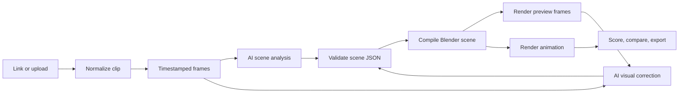

<div align="center">

# BlendClone

**Turn a reference video into an editable Blender project.**

Import a clip, let an AI planner describe the scene, compile it into native Blender objects,
compare the render side by side, refine it in plain English, and export the `.blend`.


<sub>Four scenes compiled from scene JSON into native Blender objects and rendered in Cycles. Every frame is editable in the exported <code>.blend</code>.</sub>


[](https://github.com/blixvip/BlendClone/actions/workflows/tests.yml)


</div>

---

## Contents

- [What it does](#what-it-does)
- [Gallery](#gallery)
- [Screenshots](#screenshots)
- [How it works](#how-it-works)
- [Quick start](#quick-start)
- [Verify](#verify)
- [Repository layout](#repository-layout)
- [Safety model](#safety-model)
- [Honest limits](#honest-limits)
- [Roadmap](#roadmap)
- [Contributing](#contributing)

## What it does

| | |
|---|---|
| **Import** | YouTube / Vimeo / X links via `yt-dlp`, or local MP4 / MOV / WebM. Pick any 0.25–60 s section. |
| **Analyse** | Samples timestamped frames (extra samples around big visual changes) and asks the planner model for geometry, materials, cameras, lights, shot cuts and animation. |
| **Compile** | Validated scene JSON → native Blender objects, keyframes, shape keys, cameras and lights. Model-written Python **never** runs. |
| **Compare** | Synchronized reference / remake players with shared seeking, speed and audio, plus a per-frame fidelity score (layout SSIM, colour ΔE, motion, timing). |
| **Refine** | Type a correction ("at 0:02.5 move the camera closer"). One review pass compares source and render frames automatically. |
| **Export** | Editable `.blend`, remake MP4, side-by-side comparison MP4, and a project ZIP with the scene JSON and a standalone compiler. |

Also included: procedural asset recipes (hands, skin cutaways, follicles, vessels, splinters, tweezers), shape-key swelling, procedural skin/wood textures, subsurface materials, depth of field, native frame-rate preservation (29.97 fps included), and Eevee/Cycles pinned per project so previews and finals match.

## Gallery

Each clip below is one JSON file in [`examples/`](examples). The same validated contract the AI planner writes goes through the same compiler, so this is exactly what the engine can build. Rebuild any of them with `python scripts/showcase.py --only <name>`.

<table>
<tr>
<td width="50%"></td>
<td width="50%"></td>
</tr>
<tr>
<td><b>Studio turntable</b> · coated, chrome and glass materials, noise-textured marble, depth of field, orbiting camera<br><sub><a href="examples/turntable.json">scene</a> · <a href="docs/media/showcase/turntable.mp4">MP4</a></sub></td>
<td><b>Domino cascade</b> · staggered keyframes pivoting on the floor edge, two shots with a hard camera cut<br><sub><a href="examples/cascade.json">scene</a> · <a href="docs/media/showcase/cascade.mp4">MP4</a></sub></td>
</tr>
<tr>
<td width="50%"></td>
<td width="50%"></td>
</tr>
<tr>
<td><b>Neon title</b> · 3D text, emissive bezier tubes, glossy reflections, dolly push-in<br><sub><a href="examples/neon.json">scene</a> · <a href="docs/media/showcase/neon.mp4">MP4</a></sub></td>
<td><b>Low-poly island</b> · one generated mesh with per-face materials by height, flat shading, sun light, flyover<br><sub><a href="examples/island.json">scene</a> · <a href="docs/media/showcase/island.mp4">MP4</a></sub></td>
</tr>
</table>

### Reference vs remake

The compare view plays the source and the rebuild in sync and scores every frame.


<sub>Pipeline test: synthetic reference (left) vs the BlendClone remake (right).</sub>

## Screenshots

<table>
<tr>
<td width="50%"></td>
<td width="50%"></td>
</tr>
<tr>
<td align="center"><sub>Start a remake: link or upload, section, quality</sub></td>
<td align="center"><sub>Compare, refine, export</sub></td>
</tr>
</table>

## How it works




- **Planner**: the official Codex CLI with your ChatGPT login (`BLENDREMAKE_MODEL`, default `gpt-6-astra`). No API key is stored by the app.
- **Contract**: `app/models.py` is a Pydantic schema with bounded objects, meshes, keyframes and durations. It rejects parent cycles, missing materials, uncovered time and out-of-range keys before Blender starts.
- **Compiler**: `app/blender_scene.py` is repository-owned Blender Python that turns the contract into editable collections per shot.
- **Fidelity**: `app/fidelity.py` scores every rendered frame against the reference (worst-tile SSIM, ΔE, optical flow, timing lag), with gates in `app/fidelity_gates.json` calibrated by `scripts/calibrate_fidelity.py`.
- **Jobs**: one worker at a time, atomic `job.json` per project, cancel/retry/revise, and restarts mark unfinished jobs as interrupted.

More detail: [all docs](docs/README.md) · [Architecture](docs/ARCHITECTURE.md) · [Implementation](docs/IMPLEMENTATION.md) · [Final plan](docs/FINAL-PLAN.md)

## Quick start

**Requirements:** Windows (macOS/Linux untested), Python 3.12, Blender 5.1+, FFmpeg/ffprobe, and the Codex CLI (`codex login` with your ChatGPT account).

```powershell
.\start.ps1
```

This creates `.venv` if needed, starts the app at **http://127.0.0.1:4331** and opens your browser.

Manual setup:

```powershell
py -3.12 -m venv .venv
.venv\Scripts\python.exe -m pip install -r requirements.lock.txt
.venv\Scripts\python.exe -m uvicorn app.server:app --host 127.0.0.1 --port 4331
```

| Variable | Default | Purpose |
|---|---|---|
| `BLENDER_PATH` | auto-detect | Full path to `blender.exe` |
| `BLENDREMAKE_MODEL` | `gpt-6-astra` | Planner model available to your Codex account |
| `BLENDREMAKE_DATA` | `./data/projects` | Where projects are stored |

## Verify

```powershell
.venv\Scripts\python.exe -m pytest -q                 # 165 contract / API / pipeline tests
.venv\Scripts\python.exe scripts\renderer_check.py     # renders the synthetic ball drop in Blender
.venv\Scripts\python.exe scripts\browser_check.py      # UI at 5 widths (app must be running)
.venv\Scripts\python.exe scripts\fidelity_selftest.py  # fidelity scorer sanity check
.venv\Scripts\python.exe scripts\ai_check.py           # optional live planner run (uses account allowance)
```

`scripts\showcase.py` re-renders the gallery scenes and rebuilds the README media (needs Blender + FFmpeg).

`scripts\export_check.py PROJECT_ID` rebuilds a finished project's ZIP in a fresh folder, reopens the `.blend`, and recaptures the comparison.

## Repository layout

| Path | Purpose |
|---|---|
| `app/models.py` | Validated scene contract and timing rules |
| `app/ai.py` | Planner prompts, correction loop, Codex bridge |
| `app/blender_scene.py` | Deterministic JSON → Blender compiler |
| `app/blender_worker.py`, `app/worker.py` | Persistent Blender worker for fitting passes |
| `app/anatomy.py`, `app/geometry.py`, `app/reference_anatomy.py` | Trusted procedural asset recipes and mesh builders |
| `app/fidelity.py`, `app/measurements.py`, `app/fitting.py` | Frame scoring, measured tracks, parameter fitting |
| `app/media.py`, `app/reference.py` | Imports, normalization, frame sampling, source manifests |
| `app/render.py`, `app/pipeline.py`, `app/process.py` | Blender runs, encoding, job orchestration, owned-process control |
| `app/server.py`, `app/store.py` | Local FastAPI app and project storage |
| `web/` | Single-page workspace: import, library, compare, revise |
| `examples/` | Gallery scenes (turntable, cascade, neon, island) and the ball-drop fixture |
| `scripts/` | Renderer / browser / export / fidelity / pilot tooling |
| `tests/` | 165 pytest tests |
| `docs/` | Architecture, plans, benchmarks, audits |

## Safety model

- Only repository-owned Blender Python executes. The model emits data, not code: no file paths, shell commands, imports or downloads.
- The server binds to loopback, checks Host/Origin and mutation headers, limits upload size, and serves only named artifacts.
- Cancellation signals only the exact child process a job started. Nothing else is touched.
- Project ZIPs exclude the source video and reference frames. Downloads never contain credentials or prompt logs.
- Selected frames and review renders **are** sent to the planner model, and link imports contact the source site. It is a local app, not an offline one.

## Honest limits

This is an experimental **reconstruction** tool, not a way to recover an original project file. The planner infers unseen geometry, lighting and motion from sampled images, so **a successful render does not mean a close match**. The fidelity score exists to make that gap visible.

Supported today: primitives, custom meshes, tube curves, text, procedural anatomy assets, textured and per-face materials, bevel/subdivision, parenting, transform / shape-key / material keyframes, camera targets, depth of field, lights, shot cuts, and packed captions.

**Not supported yet:** skinned rigs, facial animation, imported character assets, physics, image textures, asset search. Characters and complex anatomy remain approximate.

The complex benchmark (a 30 s, seven-shot anatomy short, [notes](docs/SPLINTER-BENCHMARK.md), [frame audit](docs/FRAME-AUDIT.md), [fidelity log](docs/FIDELITY-LOG.md)) builds a full editable scene. It does **not** reach frame-accurate fidelity yet. Third-party reference footage is not included in this repository.

## Roadmap

See [docs/ROADMAP.md](docs/ROADMAP.md). The next major direction is stylized character shorts: rigged characters, facial expressions and story-driven scenes generated from a prompt, not only rebuilt from a reference.

## Contributing

See [CONTRIBUTING.md](CONTRIBUTING.md). Licensed under [MIT](LICENSE).

## Contributors

Thank you to everyone who has contributed to BlendClone! New here? Read [CONTRIBUTING.md](CONTRIBUTING.md) and pick a [good first issue](https://github.com/blixvip/BlendClone/issues?q=is%3Aissue+is%3Aopen+label%3A%22good+first+issue%22).

<a href="https://github.com/blixvip/BlendClone/graphs/contributors"></a>

---

<sub>Display name BlendClone; folder, environment variables and protocol identifiers keep the original `blendremake` name for compatibility.</sub>
