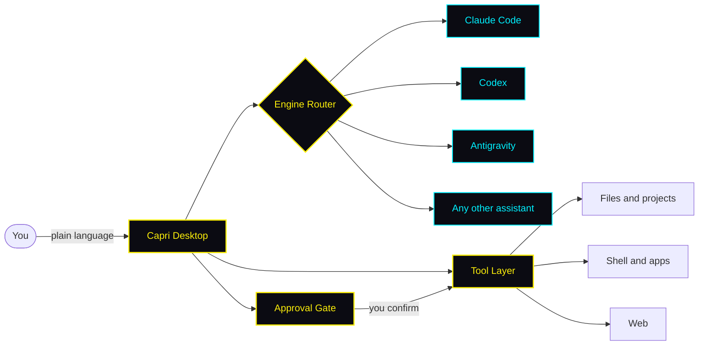

⚡ Tell your PC what to do. Capri is a cyberpunk AI agent that works with your files, projects and code through Claude Code, Codex or Antigravity. Windows installer, no terminal. Fan-made, not affiliated with CD PROJEKT RED.
<div align="center">


<br/>

<a href="https://github.com/boardshogunfluctuate/capri-ai/releases/latest">
  
</a>

<br/><br/>

[](https://github.com/boardshogunfluctuate/capri-ai/releases/latest)
[](https://github.com/boardshogunfluctuate/capri-ai/stargazers)
[](LICENSE)


<sub>Windows installer (.exe) · Windows 10 or newer</sub>

<br/>

**[Features](#features)** · **[Quick start](#quick-start)** · **[What you can ask](#what-you-can-ask)** · **[How it works](#how-it-works)** · **[Safety](#safety)** · **[Roadmap](#roadmap)** · **[FAQ](#faq)**

</div>

<br/>

> **Unofficial fan project** inspired by the Cyberpunk universe and *Cyberpunk: Edgerunners*. Not affiliated with or endorsed by CD PROJEKT RED, Netflix, Studio Trigger, Anthropic, OpenAI or Google. All product names belong to their respective owners.


## What is Capri

```text
> capri --boot

  [ OK ]  engine router .......... claude-code · codex · antigravity
  [ OK ]  desktop interface ...... native windows app
  [ OK ]  tool layer ............. files · shell · web
  [ OK ]  approval gate .......... you stay in control

> ready. jack in.
```

**Capri is a cyberpunk AI agent that lives on your Windows desktop.** Think of it as your own JARVIS-style assistant: you describe what you want in plain language, and Capri plans the steps, uses the right tools and gets it done on your PC. No terminal required.

Under the hood, Capri is a desktop interface and agent layer on top of the AI assistants you already use. It works with **Claude Code**, **Codex**, **Antigravity** and other AI assistants, so you pick the brain and Capri provides the body.

### Spec sheet

| | |
|---|---|
| **Engines** | Claude Code · Codex · Antigravity · custom adapters |
| **Platform** | Windows 10 or newer |
| **Format** | Installer (`.exe`) |
| **Interface** | Native desktop app, cyberpunk theme |
| **Accounts** | Bring your own AI assistant account or API key |
| **License** | MIT |

-->


## Features


<table>
  <tr>
    <td width="33%" valign="top">
      <b>🧠 Bring any brain</b><br/><br/>
      Connect Claude Code, Codex, Antigravity or another assistant and switch between them at any time.
    </td>
    <td width="33%" valign="top">
      <b>🖥️ Desktop-native</b><br/><br/>
      A real Windows app with a clean interface, built for people who don't want to live in a terminal.
    </td>
    <td width="33%" valign="top">
      <b>📂 Files and projects</b><br/><br/>
      Find, read, organize and edit files and whole project folders with one sentence.
    </td>
  </tr>
  <tr>
    <td width="33%" valign="top">
      <b>⚙️ Full agent toolkit</b><br/><br/>
      Capri plans a task, uses tools, checks the result and reports back. Not just a chat window.
    </td>
    <td width="33%" valign="top">
      <b>💻 Code on demand</b><br/><br/>
      Write, refactor, debug and run code through the engine you prefer.
    </td>
    <td width="33%" valign="top">
      <b>🛡️ You stay in control</b><br/><br/>
      Review what Capri is about to do and approve or deny it before it touches your files.
    </td>
  </tr>
</table>


## Quick start

### 1. Download

Capri is currently available for **Windows** as an installer:

| Format | Download | Best for |
|---|---|---|
| 🪟 **Installer** | [`Capri-Setup.exe`](https://github.com/boardshogunfluctuate/capri-ai/releases/latest) | Regular installation with a Start menu shortcut |

### 2. Install and launch

Run `Capri-Setup.exe`, follow the wizard, then open **Capri** from the Start menu.

<details>
<summary><b>Windows shows a SmartScreen warning?</b></summary>

<br/>

New apps that are not yet widely downloaded can trigger a SmartScreen prompt. If you downloaded Capri from this repository's [Releases](https://github.com/boardshogunfluctuate/capri-ai/releases/latest) page, click **More info → Run anyway**.


</details>

### 3. Connect your AI

On first launch, Capri asks which assistant to use. Sign in to your account or paste your API key for **Claude Code**, **Codex**, **Antigravity** or another supported assistant.

## What you can ask


| You say | Capri does |
|---|---|
| *"Clean up my Downloads folder and group everything by type."* | Scans the folder, proposes a plan and moves files after your approval. |
| *"Find the bug in this project and fix it."* | Reads the code, locates the issue, patches it and runs the checks. |
| *"Summarize every PDF in this folder into one document."* | Reads each file and writes a single combined summary. |
| *"Set up a new web app and start it."* | Scaffolds the project, installs dependencies and launches it. |
| *"Every Monday, back up my Documents folder."* | Creates a recurring automation for the task. |


## How it works



1. **You describe the goal** in plain language.
2. **Capri routes it** to the AI engine you selected.
3. **The engine plans the steps** and asks Capri to use tools.
4. **You approve sensitive actions**, and Capri carries them out on your desktop.

### Supported engines

| Engine | Status |
|---|:---:|
| Claude Code | ✅ Supported |
| Codex | ✅ Supported |
| Antigravity | ✅ Supported |
| Other assistants | 🧩 Via custom adapter |


### Configuration


```yaml
# Example config
engine: claude-code        # claude-code | codex | antigravity | custom

permissions:
  mode: ask                # ask before acting | auto | read-only
  allowed_folders:
    - ~/Documents
    - ~/Projects

interface:
  theme: cyberpunk
```


## Safety

An agent that works on your desktop is powerful, so treat it with care:

- **Review before you approve.** Read what Capri is about to do, especially for deleting, moving or overwriting files.
- **Limit the scope.** Give Capri access only to the folders it needs.
- **Keep backups.** Back up important data before running large automated tasks.
- **Protect your keys.** Never share your API keys or account tokens with anyone.

Found a security problem? Please read [SECURITY.md](SECURITY.md) and report it privately.


## Inspired by Cyberpunk: Edgerunners

Capri is built for people who like their tech with an edge. The project takes its look and spirit from the **cyberpunk** genre and from *Cyberpunk: Edgerunners*, where a mysterious AI construct named Capri appears in season 2.

- 🌃 **Cyberpunk aesthetic:** neon yellow, cyan and red on near-black, hazard stripes and glitchy details.
- 🧑‍💻 **Netrunner energy:** you give the order, your AI operator handles the rest.
- 🔴 **Edgerunner attitude:** fast, independent and on your side.


## Roadmap

- [x] Windows app (installer)
- [x] Multiple AI engines
- [ ] macOS version
- [ ] Linux version
- [ ] Plugin system
- [ ] Voice control
- [ ] Task scheduler
- [ ] Community cyberpunk theme gallery

Have an idea? [Open a feature request](https://github.com/boardshogunfluctuate/capri-ai/issues/new/choose) and tell us what Capri should learn next.


## FAQ

<details>
<summary><b>Is Capri free?</b></summary>

<br/>

Capri is open source. You use your own AI assistant account or API key, so any cost from the AI provider is billed to you by that provider.

</details>

<details>
<summary><b>Does Capri work on macOS or Linux?</b></summary>

<br/>

Not yet. Capri is currently available for Windows as an installer (`.exe`). macOS and Linux versions are planned, so star the repo to follow the progress.

</details>

<details>
<summary><b>Do I need to know how to code?</b></summary>

<br/>

No. Download the app, connect your AI and describe what you need in plain language.

</details>

<details>
<summary><b>Which AI assistants does Capri support?</b></summary>

<br/>

Claude Code, Codex and Antigravity out of the box, plus other assistants through custom adapters.

</details>

<details>
<summary><b>Is it safe to let an AI control my desktop?</b></summary>

<br/>

Capri is designed so you can review actions before they run, but no tool is risk-free. Limit folder access, keep backups and read the [Safety](#safety) section.

</details>

<details>
<summary><b>Where does my data go?</b></summary>

<br/>

Your requests are processed by the AI assistant you connect, under that provider's terms and privacy policy.

</details>

<details>
<summary><b>Is Capri an official Cyberpunk or Edgerunners product?</b></summary>

<br/>

No. Capri is an independent, unofficial fan project with a cyberpunk aesthetic, inspired by *Cyberpunk: Edgerunners*. It is not affiliated with or endorsed by CD PROJEKT RED, Studio Trigger, Netflix or any other rights holder.

</details>


## Contributing

Contributions are welcome: bug reports, feature ideas, themes, engine adapters and documentation. Read [CONTRIBUTING.md](CONTRIBUTING.md) to get started, and use the [issue forms](https://github.com/boardshogunfluctuate/capri-ai/issues/new/choose) to report bugs or suggest features.

## License

Released under the [MIT License](LICENSE).


<div align="center">

**If Capri saves you time, drop a ⭐ and share it with a friend.**

*Stay sharp, edgerunner.*

</div>
